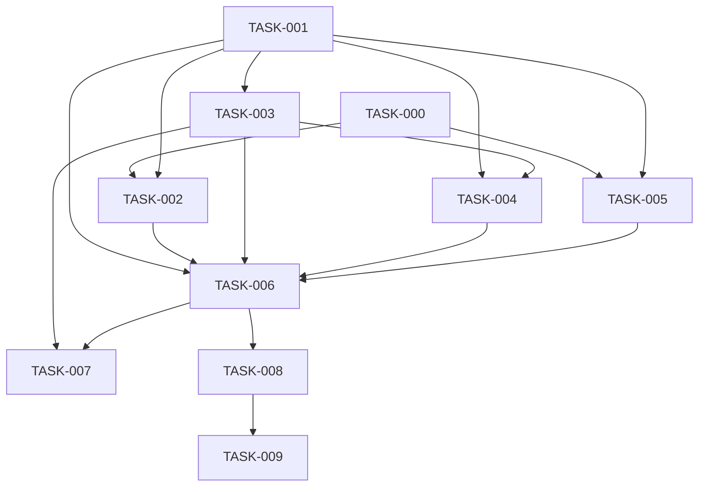

# EPIC-001: chat context management

← [[chat_context_management|Master design]]

## Goal / Outcomes

Manage the long-term contents of a `Conversation`: compress long conversations,
extract durable knowledge into user profiles, externalise summaries into a vector
store, and restore context on demand via an agent skill — so Yoda stays coherent
and affordable on long-running chats.

Outcomes:
- Long conversations are compressed inline once they grow past a threshold.
- Durable facts are extracted from compressed history into user profiles.
- Summaries are stored in Chroma and recallable via `recall_conversation`.
- Triggers (size + timeout) drive compression without manual intervention.

## Shared branch

All member tasks are implemented on a single branch: `feat/EPIC-001-chat-context-management`.
Member-task `plan.md` `branch:` stays empty — `implement-task` resolves the branch
from this epic (create on the first task, reuse afterwards).

## Decomposition

**Principle:** cut by dependency layers, not by "features":
schema → ingest behaviour → pure Core algorithms → Maintenance shell → summariser → full apply pipeline → timeout wiring → vector store → recall skill.

| ID | Title | Size | Deliverable |
|----|-------|------|-------------|
| [[TASK-000-compression-prerequisites/task\|TASK-000]] | compression prerequisites | S | skill names in `task_result`; `skill_preferences` + delta keys |
| [[TASK-001-message-kinds-and-conversation-state-v3/task\|TASK-001]] | message kinds and conversation state v3 | M | `Message.kind`, 5 `Conversation` fields, migration v2→v3, ingest counters, settings |
| [[TASK-002-user-introduction-on-ingest/task\|TASK-002]] | user introduction on ingest | S | lazy `user_introduction` + `introduced_users` + reusable Core helper |
| [[TASK-003-compression-window-algorithms-core/task\|TASK-003]] | compression window algorithms core | M | `CompressionCore`: window selection + trigger firing predicates |
| [[TASK-004-maintenance-integration-shell/task\|TASK-004]] | maintenance integration shell | S | `Maintenance` integration, periodic loop, dry-run stubs |
| [[TASK-005-summarizer-provider-and-profile-extraction/task\|TASK-005]] | summarizer provider and profile extraction | M | `SummarizerProvider`, mechanical participants/skills, profile delta application |
| [[TASK-006-compression-apply-and-size-trigger/task\|TASK-006]] | compression apply and size trigger | L | full apply pipeline + size-trigger |
| [[TASK-007-timeout-trigger-wiring/task\|TASK-007]] | timeout trigger wiring | S | timeout-trigger wired to the existing apply |
| [[TASK-008-summary-store-and-outbox-flush/task\|TASK-008]] | summary store and outbox flush | M | Chroma, embeddings, `flush_summary_outbox` |
| [[TASK-009-recall-conversation-skill/task\|TASK-009]] | recall conversation skill | S | agent skill `recall_conversation` |

**Dependency graph:**



**Milestone:** after TASK-006 long chats are compressed inline (without Chroma) — user value without cold-path recall.

**Parallelisation:** TASK-000 and TASK-001 are independent. After TASK-001, TASK-003 (pure Core) can start immediately; after both TASK-000 and TASK-001, TASK-002 and TASK-005 can run in parallel; TASK-004 follows TASK-001 + TASK-003.

## Member tasks (live rollup)

```dataviewjs
const EPIC = "EPIC-001";
const statusLabel = {
  "in-progress": "🔵 in-progress",
  "in-review":   "🟣 in-review",
  "blocked":     "🔴 blocked",
  "todo":        "⬜ todo",
  "done":        "✅ done"
};
const tasks = dv.pages('"backlog"')
  .where(p => p.file.name === "task" && p.epic === EPIC)
  .sort(p => p.id);
dv.table(
  ["ID", "Title", "Status", "Priority", "Size"],
  tasks.map(p => [
    p.file.link,
    p.title,
    statusLabel[p.status] ?? p.status,
    p.priority,
    p.size
  ])
);
```

## Notes

<!-- Cross-task decisions made on the fly, sequencing changes, etc. -->
