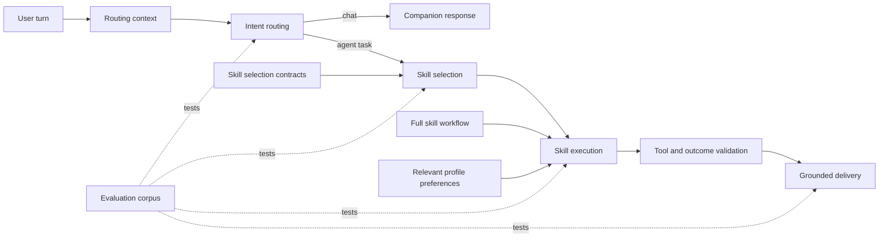

# EPIC-002: agent routing reliability — Master design

← [[backlog/EPIC-002-agent-routing-reliability/epic|Back to epic]] |
[[backlog/EPIC-002-agent-routing-reliability/suggested_prompts|Suggested prompts]]

Source of truth for the cross-cutting architecture of this epic. Member-task
`design.md` files reference sections here instead of restating decisions.
This document evolves in stages: a section appears only after its design is
settled; anything still open is parked in «Open questions».

## Solution overview

Treat delegation as a sequence of explicit contracts rather than one broad
LLM decision: context preparation → intent routing → skill selection → skill
execution → outcome delivery. Each stage receives only the context and schema it
needs, validates its own output, and emits structured diagnostics. Skill
selection is driven by discriminative capability metadata, especially the
difference between static messages and fresh-data tasks. Execution then loads
the full workflow, profile preferences, and typed tools. Invalid model output is
repaired within a bounded retry policy, while the final chat response is
grounded in the actual tool or scheduled-job outcome.

## Architecture

IODA ownership:
- `CognitionCore` and `ReactLoop` remain pure synchronous builders and
  validators over Data.
- `CognitionProvider`, language/session Providers, and tool infrastructure adapt
  external services without orchestrating other Operations.
- `Mind` remains the top-level Integration. A bare-noun `Agent` Integration owns
  phase and tool orchestration by calling Cores and Providers; the current
  orchestration-heavy `AgentProvider` does not remain the architectural boundary.
- Integrations pass Data between independent Operations; routing, validation,
  scheduling, and source-selection business rules do not leak into `Mind`.

## Foundational concepts

### Stage-local correctness

The pipeline has five independently testable decisions:
1. **Intent routing:** chat, agent task, deterministic command, or resume.
2. **Skill selection:** which capability owns the requested outcome.
3. **Tool planning:** which tools and arguments implement the selected workflow.
4. **Execution:** what tools/jobs actually succeeded.
5. **Delivery:** what can truthfully be claimed to the user.

A correct earlier stage does not imply a correct later stage. Logs and
evaluation results must identify the failed stage explicitly.

### Static message versus dynamic task

- A **static message** delivers stored text at a later time. It must not claim
  to fetch weather, prices, news, or any other changing information.
- A **dynamic task** runs a selected skill at trigger time and produces fresh
  output from that execution.
- Recurrence is not the discriminator: both job kinds can recur. Whether the
  payload must be recomputed at execution time is the discriminator.

### Selection contract versus execution workflow

The selection phase receives a compact contract sufficient to distinguish
skills: purpose, positive triggers, negative boundaries, and a small set of
contrastive examples. It does not receive tool schemas and does not clarify
workflow parameters.

Only after selection does the execution phase receive the full skill workflow,
relevant tool schemas, required/optional inputs, and profile preferences.

### Control-plane authority

Executor rules, skill contracts, workflow instructions, and validation feedback
are control-plane content and use the `system` role. User tasks, answers, and
quoted recent conversation use the `user` role and remain untrusted data.
Synthetic assistant acknowledgements are not used as a substitute for
authoritative state.

### Truthful completion

User-visible delivery is derived from a structured outcome containing at least
the operation performed, success/failure, and resulting job/tool kind. Free-form
chat rendering may change tone but not strengthen the factual claim. Internal
validation errors are logged and repaired or translated into a safe failure;
they are never presented as successful task results.

### Context hygiene

Routing context contains only kinds relevant to user-visible conversational
continuity. The existing first member task
[[TASK-010-only-visible-kinds-for-intent-context/task|TASK-010]] owns filtering
`RoutingContext.recent_messages` to visible `user`/`assistant` kinds before the
tail limit is applied.

## Key decisions

### Decision 1: Choose the skill before clarification

**Context:** The current Phase 1 prompt permits `ask_user` but also asks the
model to select a skill, encouraging responses that contain both modes and fail
validation.

**Choice:** Phase 1 selects one skill or returns a no-skill outcome. Clarification
belongs to Phase 2, where the selected workflow defines which inputs are
actually required. This removes the ambiguous combined `selected_skill` plus
`tool_calls` state. (ADR candidate: no)

### Decision 2: Use phase-specific response models

**Context:** One all-nullable `Decision` model allows invalid combinations that
must be reconstructed after parsing.

**Choice:** Define separate typed selection and execution outputs. Keep
cross-field validation in `ReactLoop`; reject unknown/extra fields. A validation
failure receives one corrective retry with concise machine-generated feedback,
then terminates with a safe structured failure. (ADR candidate: no)

### Decision 3: Make selection metadata discriminative

**Context:** Phase 1 currently sees only skill name and a broad description;
the useful `When to use` guidance is hidden in the body until after selection.

**Choice:** Extend the catalog contract with concise `when_to_use`,
`do_not_use_when`, and contrastive examples (exact names to be settled in the
member design). For scheduling, the decisive invariant is static stored payload
versus content recomputed at trigger time. Catalog order must not carry semantic
priority. (ADR candidate: no)

### Decision 4: Keep profile preferences and request constraints distinct

**Context:** Stored `skill_preferences` are not present in executor profile
context, while a source named in the current request can be lost during
distillation.

**Choice:** Pass only preferences relevant to the active skill into execution;
preferences for unrelated skills do not enter its prompt. Resolve behavior in
this order: explicit strict request constraint → explicit soft request
preference → stored skill preference → skill default. A one-off source request
is preserved in the current task but is not promoted to a durable profile
preference unless the user expresses it as a lasting choice.

Distilled tasks for scheduled dynamic work are self-contained and retain the
explicit constraints agreed when the job was created. A later profile change
may fill unspecified defaults but does not rewrite that contract. For web
search, strict source enforcement is implemented only through
`include_domains`; prompt wording or a `site:` query alone is not considered
enforcement. If an allowed domain produces no usable result, the agent reports
the limitation instead of silently widening the search. Preference keys are
standardized on the skill name (`search_web`), not the tool name
(`web_search`). (ADR candidate: no)

### Decision 5: Use IANA timezone identity

**Context:** Asking for the user's current clock is an indirect and DST-unsafe
way to determine scheduling semantics.

**Choice:** Persist and schedule with an IANA timezone. Reuse a valid profile
timezone. Initially, add explicit execution guidance to infer the IANA timezone
when the named location is unambiguous, persist it, and ask a direct
clarification only when ambiguity remains. Do not introduce a location resolver
until prompt evaluation demonstrates the need, and never derive a timezone
solely from a current UTC offset. Existing `ZoneInfo`/`CronTrigger` behavior is
retained and covered with transition tests. (ADR candidate: no)

### Decision 6: Handle interface commands deterministically

**Context:** Commands such as `/reset` have exact interface semantics and should
not depend on probabilistic chat/agent classification.

**Choice:** Recognized commands are intercepted by the Portal before LLM intent
routing. Unknown slash commands follow an explicit Portal fallback policy.
(ADR candidate: no)

### Decision 7: Evaluate stages, not only end-to-end replies

**Context:** Unit tests currently validate prompt assembly and mocked decision
sequences but do not measure real routing or skill-choice accuracy.

**Choice:** Maintain a versioned multilingual corpus with expected intent,
skill, tool/job kind, key arguments, and allowed user-visible claims. Report
stage-specific failures and include contrastive static/dynamic scheduling,
refinements, suspend/resume, malformed model output, preferences, and commands.

Use a hybrid execution model:
- deterministic tests with recorded/mock decisions run in normal CI and verify
  context, schemas, recovery, argument propagation, job kinds, and delivery
  constraints;
- live-model evals exercise actual prompt/model semantics on demand for changes
  to prompts, skills, or model configuration, recording model identity, prompt
  hash, corpus version, and stage metrics;
- live evals are not initially PR-blocking because they incur network cost,
  rate limits, model drift, and residual nondeterminism. They may later run
  periodically or as a release gate once the corpus and thresholds stabilize.

Recorded model responses are regression fixtures, not evidence of current-model
accuracy. Exact free-form reasoning or Yoda wording is not scored; structural
decisions and prohibited claims are. (ADR candidate: no)

### Decision 8: Use system role for control-plane messages

**Context:** Skill activation, catalog instructions, and workflow rules are
currently mixed with task data under the `user` role, weakening authority and
blurring trust boundaries.

**Choice:** Classifier instructions, selection contracts, skill activation,
workflow instructions, validation feedback, and agent-initiated control messages
use `system`. Original user text, clarification answers, and quoted conversation
remain `user`; user-authored data is never promoted to `system`. (ADR candidate:
no)

### Decision 9: Keep safe failures capability-agnostic

**Context:** Internal phase/schema errors can reach the companion model and
expose implementation details or invite it to improvise unsupported recovery.

**Choice:** Return a structured failure category without skill, tool, model,
schema, phase, storage, or provider details. Delivery chooses the useful next
step: ask to clarify/rephrase for ambiguous input, suggest retrying later for a
transient failure, or state the capability boundary for unsupported work. Yoda
voice may rephrase the approved meaning but may not disclose implementation or
claim success. (ADR candidate: no)

### Decision 10: Put agent orchestration in an Integration

**Context:** The current `AgentProvider` coordinates phase transitions,
sessions, tools, and completion, which is Integration responsibility under IODA.

**Choice:** Establish a bare-noun `Agent` Integration as the orchestration
boundary. Keep pure transition/validation policy in `ReactLoop` Core and
infrastructure adaptation in narrowly scoped Providers. The exact
rename/extraction sequence and compatibility shim, if any, are deferred to the
member task design so this master decision does not prescribe a premature
file-by-file refactor. (ADR candidate: no)

## Proposed delivery sequence

This is the recommended dependency order for later decomposition; it does not
yet assign member-task IDs:

1. **Context hygiene:** complete member TASK-010 so evaluation and selection are
   not fed profile snapshots or prior task-result noise.
2. **Selection contracts:** add discriminative catalog metadata, static/dynamic
   boundaries, authoritative roles, and contrastive selection tests.
3. **Phase protocol and IODA boundary:** introduce the `Agent` Integration,
   phase-specific output models, selection-before-clarification, and bounded
   correction/retry.
4. **Execution context and constraints:** propagate relevant preferences,
   preserve source/timezone constraints, standardize preference keys, add
   prompt-first timezone inference, and enforce strict web sources through
   `include_domains`.
5. **Grounded outcomes:** distinguish message/task results structurally and
   constrain user-visible delivery and safe failure guidance to the actual
   completed operation/failure category.
6. **Deterministic commands:** move recognized interface commands out of LLM
   routing.
7. **Evaluation and observability:** consolidate the regression corpus,
   stage-labelled telemetry, and the July 20 scenario as an end-to-end fixture.

Steps 2 and 3 establish the first meaningful reliability checkpoint. Steps 4
and 5 complete correct scheduled dynamic-content behavior. Steps 6 and 7 can be
developed after the stage contracts stabilize.

## Open questions

No unresolved master-level decisions remain from the initial outline. Exact
class/file extraction for the `Agent` Integration, corpus thresholds, and safe
failure wording are member-task design details constrained by Decisions 7, 9,
and 10.