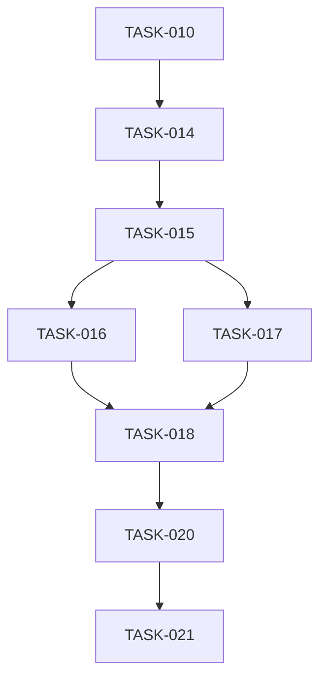

# EPIC-002: agent routing reliability

← [[backlog/EPIC-002-agent-routing-reliability/design|Master design]] |
[[backlog/EPIC-002-agent-routing-reliability/suggested_prompts|Suggested prompts]]

## Goal / Outcomes

Make delegation predictable from the first routing decision through user-visible
delivery: classify the request with relevant context, select the skill by its
semantic contract, execute a phase-safe tool workflow, and report only outcomes
the created job or completed tool call can actually provide. The result should
be reliable for multilingual requests, refinements, scheduled dynamic content,
and recoverable model-format mistakes without exposing internal protocol errors.

Outcomes:
- Intent routing, skill selection, tool planning, execution, and delivery are
  evaluated as separate stages with stage-specific diagnostics.
- Skill selection distinguishes static scheduled messages from tasks that must
  obtain fresh data on every run.
- Selection and execution use separate typed response contracts; invalid model
  output receives bounded corrective recovery rather than becoming a user answer.
- Skill routing sees concise positive and negative selection guidance, while
  authoritative workflow instructions are carried with an authoritative role.
- Agent execution receives the relevant profile preferences and applies explicit
  per-request constraints, including source and timezone, predictably.
- User-visible completion messages are grounded in typed tool/job outcomes and
  cannot claim that a static reminder will perform a recurring live search.
- A repeatable multilingual evaluation suite protects routing, skill choice,
  tool plans, suspend/resume, and truthful completion against regressions.

## Delivery profile

- **integration_strategy:** epic-branch
- **integration_boundary:** epic
- **decomposition_principle:** functional
- **internal_compat:** none
- **external_contract:** additive
- **branch:** `feat/EPIC-002-agent-routing-reliability` — single shared branch (see [Shared branch](#shared-branch)); member-task `plan.md` `branch:` stays empty.

> `internal_compat` governs states *between* member tasks. `external_contract` is a
> separate horizon for already-deployed/persisted state at epic merge and is always
> in force regardless of `internal_compat`. Existing persisted
> `skill_preferences` remain readable while writes converge on canonical
> skill-name keys.

## Shared branch

All member tasks are implemented on a single branch: `feat/EPIC-002-agent-routing-reliability`.
Member-task `plan.md` `branch:` stays empty — `implement-task` resolves the
branch from this epic (create on the first task, reuse afterwards).

<!-- Omit for trunk-based or sequential-branches — branch mapping lives in Delivery profile. -->

## Decomposition

**Principle:** functional slices follow the routing pipeline and IODA ownership
boundaries. Each member establishes one independently testable contract before
the next dependent stage consumes it.

| ID | Title | Size | Deliverable |
|----|-------|------|-------------|
| [[TASK-010-only-visible-kinds-for-intent-context/task\|TASK-010]] | only visible kinds for intent context | XS | Routing tails contain only visible `user`/`assistant` messages before the limit is applied. |
| [[TASK-014-discriminative-skill-selection-contracts/task\|TASK-014]] | discriminative skill selection contracts | M | Skill catalogs expose compact positive, negative, and contrastive selection guidance with authoritative control-plane roles. |
| [[TASK-015-phase-protocol-and-agent-integration/task\|TASK-015]] | phase protocol and Agent Integration | L | Selection and execution use separate validated phase contracts with bounded recovery under an IODA `Agent` Integration. |
| [[TASK-016-execution-preferences-and-domain-constraints/task\|TASK-016]] | execution preferences and domain constraints | M | Skill-scoped preferences and explicit request constraints reach execution, with canonical keys and strict domain enforcement. |
| [[TASK-017-iana-timezone-execution-guidance/task\|TASK-017]] | IANA timezone execution guidance | S | Scheduling infers and persists unambiguous IANA timezones, clarifying only genuine ambiguity and preserving DST semantics. |
| [[TASK-018-grounded-outcomes-and-safe-failures/task\|TASK-018]] | grounded outcomes and safe failures | M | Structured outcomes constrain completion claims and capability-agnostic failures hide implementation details. |
| [[TASK-020-deterministic-routing-evaluation-corpus/task\|TASK-020]] | deterministic routing evaluation corpus | M | A versioned multilingual corpus and stage-scored CI harness cover routing contracts, including the July 20 scenario. |
| [[TASK-021-stage-telemetry-and-live-eval-runner/task\|TASK-021]] | stage telemetry and live eval runner | M | Stage diagnostics and prompt/model metadata feed a non-blocking live-model evaluation runner. |

**Dependency graph:**



**Milestone:** after TASK-015, routing has clean context, discriminative skill
selection, and a phase-safe IODA orchestration boundary—the first standalone
reliability checkpoint. After TASK-018, the full motivating scheduled
dynamic-content scenario is correct through truthful delivery.

**Parallelisation:** TASK-010 is an independent root. After TASK-015,
TASK-016 and TASK-017 can proceed in parallel; all members still use the shared
epic branch and are integrated sequentially.

## Member tasks (live rollup)

```dataviewjs
const EPIC = "EPIC-002";
const statusLabel = {
  "in-progress": "🔵 in-progress",
  "in-review":   "🟣 in-review",
  "blocked":     "🔴 blocked",
  "todo":        "⬜ todo",
  "done":        "✅ done"
};
const tasks = dv.pages('"backlog"')
  .where(p => p.file.name === "task" && p.epic === EPIC)
  .sort(p => p.id);
dv.table(
  ["ID", "Title", "Link", "Status", "Priority", "Size"],
  tasks.map(p => [
    p.id,
    p.title,
    p.file.link,
    statusLabel[p.status] ?? p.status,
    p.priority,
    p.size
  ])
);
```

## Notes

- [[TASK-010-only-visible-kinds-for-intent-context/task|TASK-010 — only visible kinds for intent context]]
  is an existing task adopted as the first EPIC-002 member; its existing
  requirements, design, plan, and review artifacts are retained.
- The motivating July 20 session was a test session; no operational job
  cancellation or migration is part of this epic.
- Closed 2026-07-22: all eight member tasks done (TASK-010, 014–018, 020–021).
  Shared branch `feat/EPIC-002-agent-routing-reliability` ready to merge to
  `main` when approved.
- Post-close follow-ups (tech debt + live-eval UX/settings): 
  [[backlog/EPIC-002-agent-routing-reliability/follow-up|follow-up.md]]
