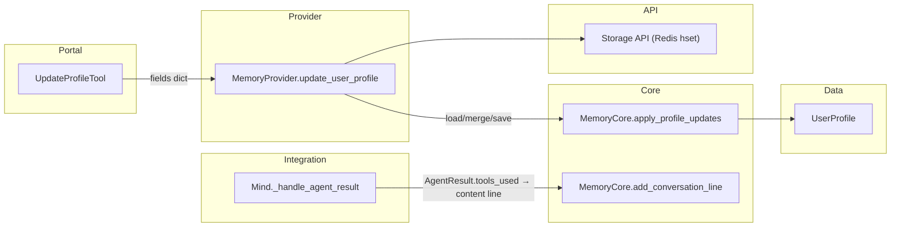

# TASK-000: compression prerequisites — Design

← [[backlog/TASK-000-compression-prerequisites/task|Back to task]] | [[requirements|Requirements]]

## Solution overview

Two additive widenings land in parallel: (1) agent-completion system messages written by `Mind._handle_agent_result` gain a `Tools used: …` clause sourced from the already-populated `AgentResult.tools_used`, giving TASK-005 a machine-parseable substring without touching `Message.kind`; (2) `UserProfile` grows a `skill_preferences` dict-of-lists and `MemoryProvider.update_user_profile` learns compression-time delta keys (`interests_to_add`, `facts_to_add`, `skill_preferences_to_add`) with case-insensitive append dedup, implemented as pure logic in `MemoryCore` and invoked by the Provider. The agent `update_profile` tool's replace path gains `skill_preferences`. No migration bump, no new Redis keys, no behavioural change for reminder/failure/clarification paths.

## Architecture



| Component | IODA | Role in this task |
|-----------|------|-------------------|
| `Mind` | Integration | Formats agent-result system line including `Tools used:` ([[requirements\|FR-1]]) |
| `MemoryCore` | Core | Pure profile merge + case-insensitive list append ([[requirements\|FR-3]]) |
| `MemoryProvider` | Provider | Loads/saves profile; delegates merge to Core ([[requirements\|FR-2]], [[requirements\|FR-3]]) |
| `UserProfile` | Data | New `skill_preferences` field ([[requirements\|FR-2]]) |
| `UpdateProfileTool` | Portal | Allow-list extended for replace writes ([[requirements\|FR-4]]) |

## Key decisions

### Decision 1: `Tools used:` line template lives in `Mind`

**Context:** FR-1 requires a parseable substring in agent-completion content; wording beyond that substring is flexible.
**Options:** (A) inline template in `Mind._handle_agent_result` as today / (B) new `CognitionCore.format_agent_result_line(result)` helper.
**Choice:** A — matches [[chat_context_management#Prerequisite: skill name in task_result content]] and the existing pattern where `Mind` already assembles clarification and answer lines. No new Operation; one caller only.

### Decision 2: Profile delta merge logic in `MemoryCore`, not inline in Provider

**Context:** FR-3 requires case-insensitive dedup across three delta key shapes; logic must be unit-testable without Redis.
**Options:** (A) implement dedup inline in `MemoryProvider.update_user_profile` / (B) `MemoryCore.apply_profile_updates(current, fields) -> UserProfile` static method.
**Choice:** B — satisfies IODA (pure logic in Core; Provider keeps async I/O only). TASK-005 will call the same merge path when applying summariser deltas.

### Decision 3: No `schema_version` bump for `skill_preferences`

**Context:** FR-2 requires legacy Redis profiles to deserialise with `skill_preferences == {}`.
**Options:** (A) add migration `user_profiles` v2→v3 / (B) rely on dataclass `default_factory=dict` plus existing field filter in `get_user_profile`.
**Choice:** B — `get_user_profile` already constructs `UserProfile(**{k: v for k, v in data.items() if k in UserProfile.__dataclass_fields__})`; missing keys get the default. Additive and backward compatible per requirements constraint.

### Decision 4: Delta keys processed before replace keys in one update

**Context:** FR-3 allows mixing delta and replace keys in a single `fields` dict (unlikely for agent tool; possible in tests).
**Options:** (A) deltas first, then replace setattr / (B) replace first, then deltas.
**Choice:** A — if both `interests_to_add` and `interests` appear, replace wins on the full list after append, which matches "each key handled by its respective rule" and keeps agent replace semantics predictable. Document in Core docstring.

### Decision 5: Case-insensitive dedup retains first-seen casing

**Context:** Requirements assume lowercased comparison with first-seen casing kept.
**Options:** (A) normalise stored values to lowercase / (B) compare via `.lower()` but store the incoming item only when no case-insensitive match exists.
**Choice:** B — preserves user-facing preference strings as written; matches master design intent.

## Interfaces

### Agent-result content contract (FR-1)

Produced only in the `result.answer` branch of `_handle_agent_result`:

```python
tools = ", ".join(result.tools_used) if result.tools_used else "none"
line = (
    f"Agent completed a task. Tools used: {tools}. "
    f"Result: {result.answer}. Communicate this to the user naturally"
)
# then existing: line = f"{line}. Current time: {… UTC}"
```

Downstream parser (TASK-005) matches the substring `Tools used: ` followed by comma-separated names or the literal `none`. Clarification, reminder, and failure lines are unchanged.

### `UserProfile` (FR-2)

```python
@dataclass
class UserProfile:
    # … existing scalar and list fields …
    skill_preferences: dict[str, list[str]] = field(default_factory=dict)
    schema_version: int = 2  # unchanged
```

Shape example: `{"web_search": ["weather: accuweather.com"], "text_to_image": ["anime style"]}`.

### `MemoryCore.apply_profile_updates` (FR-3)

```python
PROFILE_DELTA_KEYS = frozenset({
    "interests_to_add",
    "facts_to_add",
    "skill_preferences_to_add",
})

@staticmethod
def apply_profile_updates(current: UserProfile, fields: dict) -> UserProfile:
    """Return a new UserProfile with delta merges and replace setattr applied.

    Processing order:
    1. Delta keys (append-with-case-insensitive-dedup); keys not stored on profile.
    2. Keys in UserProfile.__dataclass_fields__ → setattr (replace semantics).
    3. Unknown keys → ignored (existing behaviour).
    """
```

Dedup helper (private, same module):

```python
def _append_case_insensitive(target: list[str], items: list[str]) -> None:
    existing_lower = {s.lower() for s in target}
    for item in items:
        if item.lower() not in existing_lower:
            target.append(item)
            existing_lower.add(item.lower())
```

`skill_preferences_to_add` iterates `(skill_name, items)` and calls `_append_case_insensitive` on `current.skill_preferences.setdefault(skill_name, [])`.

### `MemoryProvider.update_user_profile` (FR-3)

After load:

```python
current = MemoryCore.apply_profile_updates(current, user_profile)
current.updated_on = dtm.datetime.now(dtm.UTC).isoformat()
await self._storage_api.hset(..., json.dumps(current.to_dict()))
```

Replace the current inline `for k, v: setattr` loop.

### `update_profile` tool (FR-4)

```python
ALLOWED_FIELDS = {
    "preferred_name", "gender",
    "location", "timezone", "occupation",
    "interests", "facts",
    "skill_preferences",  # new
}
```

Delta keys remain **disallowed** at the tool layer (validation rejects unknown fields); only TASK-005 / direct Provider calls use delta keys.

## System impact

| Path / class | IODA | Change | FR |
|--------------|------|--------|-----|
| `yoda/mind/mind.py` — `Mind._handle_agent_result` | Integration | edit — insert `Tools used:` clause on answer branch | FR-1 |
| `yoda/mind/memory/data/user_profile.py` — `UserProfile` | Data | edit — add `skill_preferences` field | FR-2 |
| `yoda/mind/memory/memory.py` — `MemoryCore` | Core | edit — add `apply_profile_updates`, `_append_case_insensitive`, `PROFILE_DELTA_KEYS` | FR-3 |
| `yoda/mind/memory/memory.py` — `MemoryProvider.update_user_profile` | Provider | edit — delegate merge to `MemoryCore.apply_profile_updates` | FR-2, FR-3 |
| `yoda/mind/agent/tools/update_profile_tool.py` — `ALLOWED_FIELDS` | Portal | edit — add `"skill_preferences"` | FR-4 |
| `tests/test_mind_agent_pipeline.py` | — | edit — assert `Tools used:` in stored conversation for agent answer path; assert absent for clarification and scheduled reminder | FR-1 |
| `tests/test_memory_operation.py` | — | edit — profile round-trip, legacy load without field, delta append/dedup, mixed delta+replace | FR-2, FR-3 |
| `tests/test_agent_tools.py` | — | edit — `update_profile` accepts and persists `skill_preferences`; delta keys still rejected | FR-4 |

**Rollout:** deploy is backward compatible. Existing Redis `user_profiles` entries gain `skill_preferences: {}` on next read/write. Existing conversation lines without `Tools used:` are untouched; new agent completions get the clause immediately. No rollback migration needed — revert code only.

## Decisions made (from requirements review)

| Item | Resolution |
|------|------------|
| Requirements review (all dimensions 1–8) | **Pass** — FRs map to task scope; ACs testable; aligns with [[chat_context_management#Prerequisites]]; IODA placement clear |
| Dedup implementation location | `MemoryCore` (Decision 2) |
| Migration strategy for new field | Dataclass default, no version bump (Decision 3) |
| Mixed delta + replace in one update | Deltas first, then replace (Decision 4) |

## Open questions

None.
