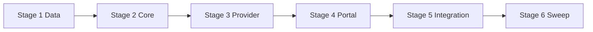

# TASK-000: compression prerequisites — Implementation plan

← [[backlog/TASK-000-compression-prerequisites/task|Back to task]] | [[requirements|Requirements]] | [[design|Design]]

## Overview

Land two additive prerequisites from the Chat Context Management program: agent-completion system messages include a `Tools used: …` clause for downstream mechanical parsing, and `UserProfile` gains `skill_preferences` plus append-only delta merge keys in `MemoryProvider.update_user_profile` (pure logic in `MemoryCore`). The agent `update_profile` tool's replace path accepts `skill_preferences`. No migration bump, no new Redis keys, no compression wiring.

## Goal / Non-goals

- **Goal:** After execution, agent answers persist `Tools used:` in conversation content; profiles store and merge `skill_preferences` and delta keys (`interests_to_add`, `facts_to_add`, `skill_preferences_to_add`); `update_profile` can replace `skill_preferences`; full test suite green.
- **Non-goals:** `Message.kind` / conversation state v3; mechanical `Tools used:` parsing or summariser delta application (TASK-005); `user_introduction` (TASK-002); compression, Maintenance, vector store, recall skill (TASK-003–TASK-009); prompt/summariser schema changes.

## Context to load

Files to read before starting:

- [[requirements]] — FR-1…FR-4 and acceptance criteria
- [[design]] — Architecture, Interfaces, System impact, Decisions 1–5
- `AGENTS.md` (root) — IODA categories and hard dependency rules
- `coding_behavior.md` — project coding conventions
- `yoda/mind/mind.py` — `_handle_agent_result`, `deliver_scheduled_reminder`
- `yoda/mind/memory/memory.py` — `MemoryCore`, `MemoryProvider.update_user_profile`
- `yoda/mind/memory/data/user_profile.py` — current `UserProfile` shape
- `yoda/mind/agent/tools/update_profile_tool.py` — `ALLOWED_FIELDS`
- `tests/test_memory_operation.py`, `tests/test_agent_tools.py`, `tests/test_mind_agent_pipeline.py` — existing test patterns

## Pre-flight

Mandatory conditions before implementation starts.
If any item below fails and cannot be satisfied immediately, do not proceed to implementation.

- [ ] `git checkout main && git pull` — main is up to date
- [ ] `git status` — working tree is clean
- [ ] `git checkout -b feat/EPIC-001-chat-context-management` — feature branch created
- [ ] `.venv` active and dependencies installed
- [ ] No external services required (Redis/Chroma/LLM mocked via `FakeStorageApi` in tests)
- [ ] Baseline tests green: `.venv/bin/python -m pytest`

## Files & artifacts

| Path                                                                | IODA        | Op   | FR         |
| ------------------------------------------------------------------- | ----------- | ---- | ---------- |
| `yoda/mind/memory/data/user_profile.py` — `UserProfile`             | Data        | edit | FR-2       |
| `yoda/mind/memory/memory.py` — `MemoryCore`                         | Core        | edit | FR-3       |
| `yoda/mind/memory/memory.py` — `MemoryProvider.update_user_profile` | Provider    | edit | FR-2, FR-3 |
| `yoda/mind/agent/tools/update_profile_tool.py` — `ALLOWED_FIELDS`   | Portal      | edit | FR-4       |
| `yoda/mind/mind.py` — `Mind._handle_agent_result`                   | Integration | edit | FR-1       |
| `tests/test_memory_operation.py`                                    | —           | edit | FR-2, FR-3 |
| `tests/test_agent_tools.py`                                         | —           | edit | FR-4       |
| `tests/test_mind_agent_pipeline.py`                                 | —           | edit | FR-1       |

## Stages

### Stage 1: Profile data model

**Goal:** `UserProfile` exposes `skill_preferences` with a safe default.

- [ ] **1.1** Add `skill_preferences` field to `UserProfile`
  - Files: `yoda/mind/memory/data/user_profile.py`
  - Action: (Data) add `skill_preferences: dict[str, list[str]] = field(default_factory=dict)` after `facts`; leave `schema_version: int = 2` unchanged.
  - Verify: `.venv/bin/python -c "from yoda.mind.memory.data.user_profile import UserProfile; p = UserProfile(); assert p.skill_preferences == {}; assert 'skill_preferences' in p.to_dict()"`
  - Commit: `feat(TASK-000): 1.1 add skill_preferences to UserProfile`

**Checkpoint Stage 1:** import smoke passes; no test regressions — `.venv/bin/python -m pytest tests/test_memory_operation.py -q`

---

### Stage 2: Core profile delta merge

**Goal:** Pure merge logic for delta keys and replace keys lives in `MemoryCore`, unit-tested without Redis.

- [ ] **2.1** Add failing tests for `MemoryCore.apply_profile_updates`
  - Files: `tests/test_memory_operation.py`
  - Action: add tests calling `MemoryCore.apply_profile_updates` directly — `interests_to_add` / `facts_to_add` append with case-insensitive dedup; `skill_preferences_to_add` per-skill buckets; unknown skill creates bucket; delta keys absent from resulting `to_dict()`; mixed delta + replace (delta first, replace wins); empty delta lists are no-ops.
  - Verify: `.venv/bin/python -m pytest tests/test_memory_operation.py -k "profile_update" -q` → **FAIL** (method not implemented)
  - Commit: `test(TASK-000): 2.1 MemoryCore profile delta merge tests`

- [ ] **2.2** Implement `MemoryCore.apply_profile_updates`
  - Files: `yoda/mind/memory/memory.py`
  - Action: (Core) add `PROFILE_DELTA_KEYS`, module-level `_append_case_insensitive`, and `@staticmethod apply_profile_updates` per [[design#MemoryCore.apply_profile_updates]] — copy `current` before mutating; process delta keys first, then `setattr` for keys in `UserProfile.__dataclass_fields_`_; ignore unknown keys.
  - Verify: `.venv/bin/python -m pytest tests/test_memory_operation.py -k "profile_update" -q` → **PASS**
  - Commit: `feat(TASK-000): 2.2 MemoryCore apply_profile_updates`

**Checkpoint Stage 2:** `.venv/bin/python -m pytest tests/test_memory_operation.py -k "profile_update" -q`

---

### Stage 3: Provider persistence

**Goal:** `MemoryProvider.update_user_profile` delegates merge to Core and persists round-trips including legacy profiles.

- [ ] **3.1** Add failing tests for Provider profile updates
  - Files: `tests/test_memory_operation.py`
  - Action: async tests with `FakeStorageApi` — legacy JSON in `user_profiles` hash without `skill_preferences` loads as `{}`; replace `skill_preferences` round-trips; delta-only update sets `updated_on`; delta keys not stored in Redis payload; existing scalar replace behaviour unchanged.
  - Verify: `.venv/bin/python -m pytest tests/test_memory_operation.py -k "user_profile" -q` → **FAIL**
  - Commit: `test(TASK-000): 3.1 MemoryProvider profile update tests`

- [ ] **3.2** Wire `MemoryProvider.update_user_profile` to Core
  - Files: `yoda/mind/memory/memory.py`
  - Action: (Provider) replace inline `for k, v: setattr` loop with `current = MemoryCore.apply_profile_updates(current, user_profile)` then refresh `updated_on` and `hset`.
  - Verify: `.venv/bin/python -m pytest tests/test_memory_operation.py -k "user_profile or profile_update" -q` → **PASS**
  - Commit: `feat(TASK-000): 3.2 delegate profile merge to MemoryCore`

**Checkpoint Stage 3:** `.venv/bin/python -m pytest tests/test_memory_operation.py -q`

---

### Stage 4: `update_profile` tool

**Goal:** Agent replace path accepts `skill_preferences`; delta keys remain rejected at tool boundary.

- [ ] **4.1** Extend `update_profile` tests and allow-list
  - Files: `tests/test_agent_tools.py`, `yoda/mind/agent/tools/update_profile_tool.py`
  - Action: (TDD) add test — `fields: {"skill_preferences": {"web_search": ["accuweather.com"]}}` succeeds and persists via real `MemoryProvider` + `FakeStorageApi`; add test — `fields: {"interests_to_add": ["x"]}` rejected as unknown field. Then (Portal) add `"skill_preferences"` to `ALLOWED_FIELDS`.
  - Verify: `.venv/bin/python -m pytest tests/test_agent_tools.py -k "update_profile" -q` → **PASS**
  - Commit: `feat(TASK-000): 4.1 allow skill_preferences in update_profile tool`

**Checkpoint Stage 4:** `.venv/bin/python -m pytest tests/test_agent_tools.py -k "update_profile" -q`

---

### Stage 5: Agent result `Tools used:` content

**Goal:** Agent-completion system lines include parseable tool names; other paths unchanged.

- [ ] **5.1** Add failing tests for `Tools used:` in stored conversation
  - Files: `tests/test_mind_agent_pipeline.py`
  - Action: extend agent-task tests — stored system message contains `Tools used: search_web` when `AgentResult(answer=..., tools_used=["search_web"])`; empty `tools_used` → `Tools used: none`; multiple tools preserve order; clarification path has no `Tools used:`; `deliver_scheduled_reminder` has no `Tools used:`.
  - Verify: `.venv/bin/python -m pytest tests/test_mind_agent_pipeline.py -k "tools_used or agent_task or clarification or deliver_scheduled" -q` → **FAIL**
  - Commit: `test(TASK-000): 5.1 Tools used content tests`

- [ ] **5.2** Implement `Tools used:` clause in `_handle_agent_result`
  - Files: `yoda/mind/mind.py`
  - Action: (Integration) in the `result.answer` branch only, build `tools = ", ".join(result.tools_used) if result.tools_used else "none"` and insert `Tools used: {tools}.` before `Result:` per [[design#Agent-result content contract]]; leave clarification branch and scheduled paths untouched.
  - Verify: `.venv/bin/python -m pytest tests/test_mind_agent_pipeline.py -k "tools_used or agent_task or clarification or deliver_scheduled" -q` → **PASS**
  - Commit: `feat(TASK-000): 5.2 Tools used in agent result line`

**Checkpoint Stage 5:** `.venv/bin/python -m pytest tests/test_mind_agent_pipeline.py -q`

---

### Stage 6: Test sweep & coverage

- [ ] **6.1** Full suite and regression check
  - Files: (all above)
  - Action: run full pytest; fix any regressions in existing `test_update_profile_saves_fields` or similar tests that assumed setattr-only merge.
  - Verify: `.venv/bin/python -m pytest`
  - Commit: `test(TASK-000): 6.1 full suite green` (only if fixes were needed; otherwise skip commit)

- [ ] **6.2** Manual acceptance criteria walk-through
  - FR-1: inspect stored conversation text after agent task — `Tools used:`, `Result:`, timestamp present; reminder line unchanged.
  - FR-2: load legacy profile JSON without `skill_preferences` → `{}`.
  - FR-3: call `update_user_profile` with `facts_to_add` twice with different casing → single entry retained.
  - FR-4: delta key via `update_profile` tool → rejected; `skill_preferences` replace → accepted.
  - Verify: checklist above satisfied (no live Telegram/Redis required if unit tests cover each AC)
  - Commit: `chore(TASK-000): 6.2 mark task complete` — update `task.md` `status: done`, `updated: 2026-06-09`

**Checkpoint Stage 6:** `.venv/bin/python -m pytest`

## Stage dependencies

## FR coverage (traceability)

| FR   | Steps                        | Verification                                                                                  |
| ---- | ---------------------------- | --------------------------------------------------------------------------------------------- |
| FR-1 | 5.1, 5.2, 6.2                | `tests/test_mind_agent_pipeline.py` — Tools used / none / clarification / reminder            |
| FR-2 | 1.1, 3.1, 3.2, 6.1           | `tests/test_memory_operation.py` — legacy load, round-trip `skill_preferences`                |
| FR-3 | 2.1, 2.2, 3.1, 3.2, 6.1, 6.2 | `tests/test_memory_operation.py` — delta append/dedup, delta keys not persisted, `updated_on` |
| FR-4 | 4.1, 6.1, 6.2                | `tests/test_agent_tools.py` — `skill_preferences` replace; delta keys rejected                |

## Risks

| Risk                                                                            | Probability | Impact | Mitigation                                                                    |
| ------------------------------------------------------------------------------- | ----------- | ------ | ----------------------------------------------------------------------------- |
| Existing `update_user_profile` callers rely on setattr-only loop semantics      | Low         | Medium | Stage 3.1 preserves replace tests; full suite in 6.1 catches regressions      |
| `apply_profile_updates` mutates shared list/dict references from loaded profile | Low         | Medium | Copy `UserProfile` (and nested lists/dicts) before merge in Core (Step 2.2)   |
| Agent pipeline tests don't inspect stored system message text today             | Medium      | Low    | Step 5.1 adds explicit conversation assertions on `memory.get_conversation()` |

## Rollback

- **Code:** `git revert` the feature branch merge commit(s).
- **State:** No destructive migration. Redis profiles without `skill_preferences` remain valid; redeploying old code ignores the extra JSON field on read (filtered by `UserProfile.__dataclass_fields__`). New conversation lines with `Tools used:` are harmless to old code.

## Definition of Done

- [ ] All plan steps checked (`last_step` = `6.2`)
- [ ] All acceptance criteria from [[requirements]] pass (FR-1…FR-4)
- [ ] Full suite green: `.venv/bin/python -m pytest`
- [ ] IODA respected: merge logic in `MemoryCore` (Core), I/O in `MemoryProvider` (Provider), line formatting in `Mind` (Integration), allow-list in `UpdateProfileTool` (Portal), field in `UserProfile` (Data)
- [ ] `coding_behavior.md` conventions followed (type hints, `@staticmethod`, fail-fast)
- [ ] `task.md`: `status: done`, `updated: 2026-06-09`
- [ ] `design.md` unchanged unless execution diverged (then update design, not requirements)