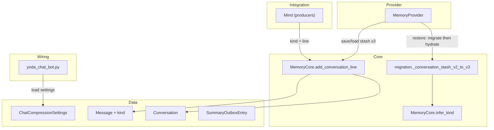

# TASK-001: message kinds and conversation state v3 — Design

← [[task|Back to task]] | [[requirements|Requirements]]

## Solution overview

Extend the memory data model with an explicit `Message.kind` discriminator and five `Conversation` bookkeeping fields, bump the conversation-stash wire format to schema version 3, and register a fail-fast v2→v3 migration that infers `kind` once from legacy `role`/`text`/`user_id` (per [[chat_context_management#Persistence and migration]]). All live message creation flows through `MemoryCore.add_conversation_line`, which requires `kind` from the Integration caller, appends via `Conversation`, and updates visible-message counters in the same Core call. `ChatCompressionSettings` is loaded from `settings.json` at startup and held in wiring for downstream tasks; no compression or trigger logic runs in this task. User-visible behaviour and LLM message shape stay unchanged.

## Architecture



| Component | IODA | Responsibility in this task |
|-----------|------|----------------------------|
| `Message`, `Conversation`, `MessageKind`, `SummaryOutboxEntry`, `ChatCompressionSettings` | Data | New/changed fields and wire shapes |
| `MemoryCore` | Core | Chokepoint append, counter updates, stash serialisation, `infer_kind`, timestamp parsing, settings factory |
| `migration.py` | Core | v2→v3 stash step orchestration (calls `MemoryCore.infer_kind`) |
| `MemoryProvider` | Provider | Unchanged restore/save flow; benefits from migrated dict + extended serialisation |
| `Mind` | Integration | Passes correct `kind` at each producer call site |
| `yoda_chat_bot.py` | Wiring | Constructs `ChatCompressionSettings`; does not pass it to runtime logic yet |

## Key decisions

### Decision 1: Single append chokepoint with counter updates in `MemoryCore`

**Context:** FR-5 and FR-7 require every message to carry `kind` at creation and visible counters to update atomically with append.
**Options:** (A) Update counters inside `Conversation.add_message`; (B) update in `MemoryCore.add_conversation_line` after `add_message`.
**Choice:** B — `MemoryCore.add_conversation_line` is already the sole append path; keeping `Conversation` as a thin Data container and centralising ingest bookkeeping in Core matches IODA (pure logic on Data, no cross-Operation calls).
**FR:** FR-5, FR-7

### Decision 2: Migration operates on wire dicts before object hydration

**Context:** FR-4 requires one-time inference and backfill of conversation fields on stash restore.
**Options:** (A) Migrate in `stash_dict_to_conversations` on `Message` objects; (B) add `_conversation_stash_v2_to_v3` in `migration.py` that mutates the JSON dict, then hydrate normally.
**Choice:** B — consistent with existing `MIGRATIONS` pattern (`_conversation_stash_v1_to_v2`); `infer_kind` receives dict slices `{role, text, user_id}` so migration does not depend on a `kind` field that does not exist yet.
**FR:** FR-3, FR-4

### Decision 3: `SummaryOutboxEntry` defined now, populated later

**Context:** FR-2 requires `pending_vectorization` to exist and round-trip; element shape is left to design; TASK-006/008 will append evicted summaries.
**Options:** (A) `list[dict]` untyped placeholder; (B) typed `SummaryOutboxEntry` dataclass aligned with [[chat_context_management#Record schema]] and outbox flush needs.
**Choice:** B — stable wire contract for TASK-006+; this task only ever serialises `[]`, but deserialisation must accept the full shape. Fields mirror the Chroma record + inline `added_at` from the master design eviction audit entry.
**FR:** FR-2, FR-3

*ADR candidate:* if TASK-006 or TASK-008 adjust field names, reconcile here first rather than changing wire format post-merge.

### Decision 4: Shared timestamp parser for migration backfill and live ingest

**Context:** FR-4 and FR-7 both derive `last_visible_at` from message `timestamp` strings; producers use Telegram `str(message.date)` and `str(datetime.now(UTC))` formats.
**Options:** (A) `datetime.fromisoformat` only; (B) `MemoryCore.parse_message_timestamp` normalising `+00:00` / space-separated UTC strings, returning `0.0` for empty timestamps.
**Choice:** B — single function used by migration backfill and live ingest so `last_visible_at` semantics match; empty timestamp contributes `0.0` to the max (does not block counter increment).
**FR:** FR-4, FR-7

### Decision 5: `MigrationError` in `migration.py`

**Context:** FR-4 requires fail-fast abort with locating context on unknown system-message prefixes.
**Options:** (A) generic `ValueError`; (B) dedicated `MigrationError` in `migration.py` with `chat_id`, `message_index`, `text_prefix`.
**Choice:** B — distinguish migration failures from other validation errors; `MemoryProvider.restore_conversation_stash` already catches broad `Exception`, logs, and leaves the Redis key in place.
**FR:** FR-4

### Decision 6: `ChatCompressionSettings.from_dict` on Data, loaded in wiring

**Context:** FR-8 requires fail-fast loading from `mind.memory.chat_compression` without consumption by logic yet.
**Options:** (A) inline dict access in `yoda_chat_bot.py`; (B) `ChatCompressionSettings.from_dict` classmethod on a Data dataclass (nested `QuietRunsSettings` for `private`/`group`).
**Choice:** B — typed settings object ready for TASK-003+ injection; wiring assigns to a local variable (e.g. `chat_compression_settings`) not passed into `Mind` or `MemoryProvider` in this task. The `chat_compression` block is already present in the repo `settings.json` with master-design defaults; implementation verifies keys and values, no silent fallbacks.
**FR:** FR-8

## Interfaces

### Types (`yoda/mind/memory/data/`)

```python
MessageKind = Literal[
    "prompt", "user", "assistant", "task_result",
    "user_introduction", "summary",
]

@dataclass
class Message:
    role: str
    kind: MessageKind
    text: str = ""
    # ... existing fields unchanged ...

@dataclass
class SummaryOutboxEntry:
    summary_id: str
    document: str
    created_at: float
    chunk_start_message_id: int
    chunk_end_message_id: int
    chunk_visible_count: int
    participants: list[int]
    skills: list[str]
    topics: list[str]
    added_at: str  # ISO-8601 UTC — when the summary was first inserted inline

@dataclass
class Conversation:
    chat_id: int
    messages: list[Message] = field(default_factory=list)
    last_visible_at: float = 0.0
    last_compressed_at: float = 0.0
    visible_messages: int = 0
    introduced_users: set[int] = field(default_factory=set)
    pending_vectorization: list[SummaryOutboxEntry] = field(default_factory=list)

@dataclass
class QuietRunsSettings:
    private: int
    group: int

@dataclass
class ChatCompressionSettings:
    size_trigger_threshold: int
    min_chunk_length: int
    max_summary_count: int
    gap_to_trigger_ratio: float
    quiet_runs_before_compression: QuietRunsSettings
    outbox_health_threshold: int

    @classmethod
    def from_dict(cls, block: dict) -> ChatCompressionSettings: ...
```

`Message.to_llm_dict()` remains `{"role": self.role, "content": self.text}` — `kind` is excluded.

### `Conversation` methods

```python
def ensure_system_prompt(self, system_prompt: str) -> None:
    # if messages empty: append Message(role="system", kind="prompt", text=system_prompt)

def add_message(
    self,
    *,
    kind: MessageKind,
    role: str,
    text: str,
    media_type: str = "text",
    timestamp: str = "",
    message_id: int | None = None,
    user_id: int | None = None,
) -> None: ...
```

### `MemoryCore`

```python
VISIBLE_KINDS: frozenset[MessageKind] = frozenset({"user", "assistant"})

@staticmethod
def parse_message_timestamp(timestamp: str) -> float: ...

@staticmethod
def infer_kind(
    msg: dict,
    *,
    is_first: bool,
    chat_id: int,
    message_index: int,
) -> MessageKind:
    """Fail-fast via MigrationError when role=system, not first, user_id is None,
    and text does not startswith any known_prefixes tuple from master design."""

@staticmethod
def add_conversation_line(
    conversation: Conversation | None,
    chat_id: int,
    *,
    kind: MessageKind,
    role: str,
    line: str,
    system_prompt: str = DEFAULT_SYSTEM_PROMPT,
    timestamp: str = "",
    message_id: int | None = None,
    user_id: int | None = None,
) -> tuple[Conversation, list[dict]]:
    # ensure_system_prompt → kind="prompt"
    # add_message(..., kind=kind)
    # if kind in VISIBLE_KINDS: visible_messages += 1;
    #   last_visible_at = max(last_visible_at, parse_message_timestamp(timestamp))

@staticmethod
def conversations_to_stash_dict(conversations: dict[str, Conversation]) -> dict: ...

@staticmethod
def stash_dict_to_conversations(data: dict) -> dict[str, Conversation]: ...
```

`known_prefixes` for `infer_kind` (exact match to task.md / master design):

```python
KNOWN_TASK_RESULT_PREFIXES = (
    "SCHEDULED REMINDER:",
    "SCHEDULED TASK FAILED:",
    "Agent completed a task",
    "Ask the user (rephrase naturally",
)
```

### Migration (`yoda/mind/memory/migration.py`)

```python
class MigrationError(Exception):
    chat_id: int
    message_index: int
    text_prefix: str

def _conversation_stash_v2_to_v3(data: dict) -> dict:
    """For each conversation payload:
    1. Walk messages in order; set msg['kind'] via MemoryCore.infer_kind.
    2. Backfill introduced_users, visible_messages, last_visible_at.
    3. Set last_compressed_at=0.0, pending_vectorization=[].
    Set schema_version=3."""

MIGRATIONS["conversation_stash"][2] = _conversation_stash_v2_to_v3
```

### Stash wire format (v3)

```json
{
  "schema_version": 3,
  "conversations": {
    "<chat_id_str>": {
      "chat_id": 42,
      "messages": [
        {
          "role": "system",
          "kind": "prompt",
          "text": "...",
          "media_type": "text",
          "timestamp": "",
          "message_id": null,
          "user_id": null
        }
      ],
      "last_visible_at": 1718123456.789,
      "last_compressed_at": 0.0,
      "visible_messages": 2,
      "introduced_users": [7, 9],
      "pending_vectorization": []
    }
  }
}
```

- `introduced_users`: JSON array of integers → `set[int]` on load; serialise as `sorted(introduced_users)` for stable diffs.
- `pending_vectorization`: JSON array of `SummaryOutboxEntry` dicts; empty in this task.

### Producer `kind` mapping (`Mind`)

| Call site | `kind` | Notes |
|-----------|--------|-------|
| `process_message_batch` (perceived lines) | `"user"` | Perception returns `role="system"`; caller overrides kind |
| `_reply_and_send` | `"assistant"` | Each reply part |
| `_handle_agent_result` | `"task_result"` | Clarification and agent-result lines |
| `deliver_scheduled_reminder` | `"task_result"` | |
| `notify_scheduled_failure` | `"task_result"` | |

`ensure_system_prompt` path uses `kind="prompt"` inside `MemoryCore`, not from Mind.

### Settings loading (`yoda_chat_bot.py`)

```python
compression_block = memory_settings["chat_compression"]
chat_compression_settings = ChatCompressionSettings.from_dict(compression_block)
# Not passed to Mind / MemoryProvider / compression in this task
```

`from_dict` raises `ValueError` naming the first missing required key.

## System impact

| Path / class | IODA | Change | FR |
|--------------|------|--------|-----|
| `yoda/mind/memory/data/message.py` — `Message`, `MessageKind` | Data | Add `kind: MessageKind` field | FR-1 |
| `yoda/mind/memory/data/summary_outbox_entry.py` — `SummaryOutboxEntry` | Data | **Create** outbox record dataclass | FR-2 |
| `yoda/mind/memory/data/chat_compression_settings.py` — `ChatCompressionSettings`, `QuietRunsSettings` | Data | **Create** settings dataclasses + `from_dict` | FR-8 |
| `yoda/mind/memory/data/conversation.py` — `Conversation` | Data | Add five fields; `ensure_system_prompt` sets `kind="prompt"`; `add_message` requires `kind` | FR-1, FR-2, FR-5 |
| `yoda/mind/memory/memory.py` — `MemoryCore` | Core | `CONVERSATION_STASH_SCHEMA_VERSION = 3`; extend `add_conversation_line`, stash serialisation/deserialisation, `parse_message_timestamp`, `infer_kind`, `VISIBLE_KINDS` | FR-1–FR-5, FR-7 |
| `yoda/mind/memory/migration.py` — `MigrationError`, `_conversation_stash_v2_to_v3` | Core | **Create** exception; register `[2]` migration step | FR-3, FR-4 |
| `yoda/mind/memory/memory.py` — `MemoryProvider` | Provider | No signature change; restore/save uses v3 stash via Core | FR-3 |
| `yoda/mind/mind.py` — `Mind` | Integration | Pass `kind` at five `add_conversation_line` call sites | FR-6 |
| `yoda/yoda_chat_bot.py` | Wiring | Load `ChatCompressionSettings`; hold unused reference | FR-8 |
| `settings.json` | Config | Verify `mind.memory.chat_compression` block (already present with master-design values) | FR-8 |
| `tests/test_memory_operation.py` | Test | Extend round-trip, migration, counter, and settings tests; update existing `add_conversation_line` tests for required `kind` | FR-1–FR-8 |
| `tests/test_mind_*.py` (if any touch `add_conversation_line`) | Test | Update call signatures | FR-6 |

## Decisions made (from requirements review)

| Item | Resolution |
|------|------------|
| Ingest counter ownership | `MemoryCore.add_conversation_line` (Decision 1) |
| `pending_vectorization` element type | `SummaryOutboxEntry` dataclass (Decision 3) |
| Timestamp parser shared across migration + ingest | `MemoryCore.parse_message_timestamp` (Decision 4) |
| `settings.json` block | Already in repo with correct defaults; task adds loader + tests, not new JSON values |

## Open questions

None.
