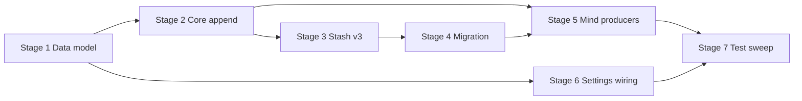

# TASK-001: message kinds and conversation state v3 — Implementation plan

← [[task|Back to task]] | [[requirements|Requirements]] | [[design|Design]]

## Overview

Establish the Chat Context Management data-model foundation: add `Message.kind` (six-value `Literal`), five bookkeeping fields on `Conversation`, bump the Redis conversation stash to schema v3 with a fail-fast v2→v3 migration (`infer_kind`), thread explicit `kind` through the `MemoryCore.add_conversation_line` chokepoint from every `Mind` producer, update visible-message counters on ingest, and load `ChatCompressionSettings` from `settings.json` at startup (held but unused). User-visible behaviour and LLM message shape stay unchanged; downstream compression, user introduction, and maintenance tasks depend on this landing first.

## Goal / Non-goals

- **Goal:** Every stored message carries an explicit `kind`; conversations persist five trigger-bookkeeping fields in stash v3; legacy v2 stashes migrate once with fail-fast prefix matching; live ingest updates `visible_messages` / `last_visible_at` for user and assistant kinds only; `ChatCompressionSettings` loads at startup; full test suite green.
- **Non-goals:** Lazy `user_introduction`, compression algorithms, Maintenance shell, summariser, Chroma/outbox flush, decrementing counters on apply, populating `pending_vectorization` with real records, using loaded compression settings in runtime logic.

## Context to load

Files to read before starting:

- [[requirements]] — FR-1…FR-8 and acceptance criteria
- [[design]] — Architecture, Interfaces, System impact, Decisions 1–6
- [[EPIC-001-chat-context-management/chat_context_management|chat_context_management]] — Foundational concepts, Persistence and migration, Constants and entry threshold
- [[EPIC-001-chat-context-management/epic|EPIC-001]] — shared branch `feat/EPIC-001-chat-context-management`
- Root `AGENTS.md` (IODA + test command)
- `coding_behavior.md`
- Current implementations: `yoda/mind/memory/data/message.py`, `conversation.py`, `memory.py`, `migration.py`, `yoda/mind/mind.py`, `yoda/yoda_chat_bot.py`, `settings.json`, `tests/test_memory_operation.py`

## Pre-flight

Mandatory conditions before implementation starts.
If any item below fails and cannot be satisfied immediately, do not proceed to implementation.

- [x] On epic shared branch: `git checkout feat/EPIC-001-chat-context-management` (create from `main` if it does not exist yet — see [[EPIC-001-chat-context-management/epic#Shared branch]])
- [x] `git pull` — branch is current with remote (if tracking)
- [x] `git status` — working tree is clean (or only unrelated WIP stashed)
- [x] `.venv` active and dependencies installed
- [x] Redis not required for unit tests; no LLM/Telegram keys needed for this task's pytest scope
- [x] Confirm `settings.json` already contains `mind.memory.chat_compression` with master-design defaults (300, 30, 30, 0.5, private/group 8, 10)
- [x] Baseline tests green: `.venv/bin/python -m pytest`

## Files & artifacts

| Path | IODA | Op | FR |
|------|------|----|----|
| `yoda/mind/memory/data/message.py` — `Message`, `MessageKind` | Data | edit | FR-1 |
| `yoda/mind/memory/data/summary_outbox_entry.py` — `SummaryOutboxEntry` | Data | create | FR-2 |
| `yoda/mind/memory/data/chat_compression_settings.py` — `ChatCompressionSettings`, `QuietRunsSettings` | Data | create | FR-8 |
| `yoda/mind/memory/data/conversation.py` — `Conversation` | Data | edit | FR-1, FR-2, FR-5 |
| `yoda/mind/memory/memory.py` — `MemoryCore` | Core | edit | FR-1–FR-5, FR-7 |
| `yoda/mind/memory/migration.py` — `MigrationError`, `_conversation_stash_v2_to_v3` | Core | edit | FR-3, FR-4 |
| `yoda/mind/memory/memory.py` — `MemoryProvider` | Provider | edit (behaviour via Core only; no signature change) | FR-3 |
| `yoda/mind/mind.py` — `Mind` | Integration | edit | FR-6 |
| `yoda/yoda_chat_bot.py` | Wiring | edit | FR-8 |
| `settings.json` | Config | edit (verify only — block already present) | FR-8 |
| `tests/test_memory_operation.py` | Test | edit | FR-1–FR-8 |
| `tests/test_cognition_intent.py` | Test | edit | FR-1 |
| `tests/test_mind_pipelines.py` | Test | edit | FR-6, FR-7 |

## Stages

### Stage 1: Data model

**Goal:** Typed data layer for `kind`, conversation bookkeeping fields, outbox record shape, and compression settings — with isolated unit tests green.

- [x] **1.1** Add `MessageKind` and `kind` field on `Message`
  - Files: `yoda/mind/memory/data/message.py`
  - Action: (Data) Declare `MessageKind = Literal[...]` per [[design#Interfaces]]; add required `kind: MessageKind` on `Message`; confirm `to_llm_dict()` still returns only `role` + `content`.
  - Verify: `.venv/bin/python -m pytest tests/test_memory_operation.py::test_message_to_llm_dict_excludes_kind -x` (write failing test first)
  - Commit: `feat(TASK-001): 1.1 add MessageKind and kind field`

- [x] **1.2** Create `SummaryOutboxEntry`
  - Files: `yoda/mind/memory/data/summary_outbox_entry.py`
  - Action: (Data) Add dataclass with fields from [[design#Interfaces]] (`summary_id`, `document`, `created_at`, `chunk_start_message_id`, `chunk_end_message_id`, `chunk_visible_count`, `participants`, `skills`, `topics`, `added_at`).
  - Verify: `.venv/bin/python -m pytest tests/test_memory_operation.py::test_summary_outbox_entry_roundtrip -x`
  - Commit: `feat(TASK-001): 1.2 add SummaryOutboxEntry dataclass`

- [x] **1.3** Create `ChatCompressionSettings` with fail-fast `from_dict`
  - Files: `yoda/mind/memory/data/chat_compression_settings.py`
  - Action: (Data) Add `QuietRunsSettings` and `ChatCompressionSettings` dataclasses; implement `from_dict` raising `ValueError` naming the first missing required key; no silent fallbacks for required keys.
  - Verify: `.venv/bin/python -m pytest tests/test_memory_operation.py::test_chat_compression_settings_from_dict -x` and `::test_chat_compression_settings_from_dict_missing_key_raises -x`
  - Commit: `feat(TASK-001): 1.3 add ChatCompressionSettings loader`

- [x] **1.4** Extend `Conversation` with five fields and kind-aware append methods
  - Files: `yoda/mind/memory/data/conversation.py`
  - Action: (Data) Add `last_visible_at`, `last_compressed_at`, `visible_messages`, `introduced_users`, `pending_vectorization` with defaults per [[design#Interfaces]]; change `ensure_system_prompt` to append `Message(role="system", kind="prompt", ...)`; change `add_message` to require keyword-only `kind: MessageKind`.
  - Verify: `.venv/bin/python -m pytest tests/test_memory_operation.py::test_conversation_defaults_and_add_message_kind -x`
  - Commit: `feat(TASK-001): 1.4 extend Conversation state fields and kind on append`

**Checkpoint Stage 1:** new data tests green — `.venv/bin/python -m pytest tests/test_memory_operation.py -k "message_to_llm or summary_outbox or chat_compression or conversation_defaults"`

---

### Stage 2: Core append chokepoint and timestamp parsing

**Goal:** `MemoryCore.add_conversation_line` requires `kind`, updates visible counters atomically, and shares timestamp parsing with migration.

- [x] **2.1** Add `parse_message_timestamp` and `VISIBLE_KINDS`
  - Files: `yoda/mind/memory/memory.py`
  - Action: (Core) Add `VISIBLE_KINDS = frozenset({"user", "assistant"})` and `parse_message_timestamp(timestamp: str) -> float` per Decision 4 — normalise `+00:00` / space-separated UTC strings; return `0.0` for empty input.
  - Verify: `.venv/bin/python -m pytest tests/test_memory_operation.py::test_parse_message_timestamp -x`
  - Commit: `feat(TASK-001): 2.1 add parse_message_timestamp`

- [x] **2.2** Thread `kind` through `add_conversation_line` with ingest counters
  - Files: `yoda/mind/memory/memory.py`
  - Action: (Core) Add required keyword-only `kind: MessageKind` to `add_conversation_line`; pass `kind="prompt"` via `ensure_system_prompt`; pass caller `kind` to `add_message`; after append, if `kind in VISIBLE_KINDS`: increment `visible_messages` by 1 and set `last_visible_at = max(current, parse_message_timestamp(timestamp))`; do not touch `last_compressed_at` or `introduced_users`.
  - Verify: `.venv/bin/python -m pytest tests/test_memory_operation.py::test_add_conversation_line_visible_counters -x` and `::test_add_conversation_line_non_visible_kind_no_counter_bump -x`
  - Commit: `feat(TASK-001): 2.2 kind chokepoint and visible ingest counters`

- [x] **2.3** Fix existing Core call-site tests for required `kind`
  - Files: `tests/test_memory_operation.py`, `tests/test_cognition_intent.py`
  - Action: (Test) Update `test_add_conversation_line_initializes_system_prompt` to pass `kind="user"`; add `kind=` to every direct `Message(...)` construction matching semantic role (bootstrap → `prompt`, user lines → `user`, assistant → `assistant`, agent system lines → `task_result`). No production Integration changes yet — tests only so Core compiles and existing unit tests pass.
  - Verify: `.venv/bin/python -m pytest tests/test_memory_operation.py tests/test_cognition_intent.py -x`
  - Commit: `test(TASK-001): 2.3 update tests for required Message.kind`

**Checkpoint Stage 2:** `.venv/bin/python -m pytest tests/test_memory_operation.py tests/test_cognition_intent.py`

---

### Stage 3: Stash wire format v3

**Goal:** Persist and restore conversation stash schema version 3 including all new fields.

- [x] **3.1** Bump schema version and extend stash serialisation
  - Files: `yoda/mind/memory/memory.py`
  - Action: (Core) Set `CONVERSATION_STASH_SCHEMA_VERSION = 3`; extend `conversations_to_stash_dict` to emit per-conversation `last_visible_at`, `last_compressed_at`, `visible_messages`, `introduced_users` (sorted int list), `pending_vectorization` (list of `asdict(SummaryOutboxEntry)`); extend `stash_dict_to_conversations` to hydrate all fields with defaults for missing keys on v3 payloads.
  - Verify: `.venv/bin/python -m pytest tests/test_memory_operation.py::test_conversations_to_stash_dict_v3_roundtrip -x`
  - Commit: `feat(TASK-001): 3.1 conversation stash schema v3 serialisation`

- [x] **3.2** Update existing stash round-trip and provider tests
  - Files: `tests/test_memory_operation.py`
  - Action: (Test) Update `test_conversations_to_stash_dict_roundtrip_core`, `test_conversation_stash_save_restore_deletes_redis_key`, and related tests to pass `kind` on messages and assert v3 wire shape (`schema_version == 3`, five conversation fields present).
  - Verify: `.venv/bin/python -m pytest tests/test_memory_operation.py -k "stash or roundtrip" -x`
  - Commit: `test(TASK-001): 3.2 update stash round-trip tests for v3`

**Checkpoint Stage 3:** `.venv/bin/python -m pytest tests/test_memory_operation.py -k "stash or roundtrip or v3"`

---

### Stage 4: Migration v2→v3 with fail-fast `infer_kind`

**Goal:** Legacy stashes upgrade once on restore; unknown system prefixes abort migration.

- [x] **4.1** Add `MigrationError`
  - Files: `yoda/mind/memory/migration.py`
  - Action: (Core) Define `MigrationError(Exception)` with attributes `chat_id`, `message_index`, `text_prefix` per Decision 5.
  - Verify: `.venv/bin/python -m pytest tests/test_memory_operation.py::test_migration_error_attributes -x`
  - Commit: `feat(TASK-001): 4.1 add MigrationError`

- [x] **4.2** Implement `MemoryCore.infer_kind`
  - Files: `yoda/mind/memory/memory.py`
  - Action: (Core) Add `KNOWN_TASK_RESULT_PREFIXES` tuple and `infer_kind(msg, *, is_first, chat_id, message_index)` per [[design#Interfaces]] — rules: assistant → `assistant`; first message → `prompt`; `user_id is not None` → `user`; else system non-first must match a known prefix → `task_result` or raise `MigrationError`.
  - Verify: `.venv/bin/python -m pytest tests/test_memory_operation.py::test_infer_kind_cases -x` and `::test_infer_kind_unknown_prefix_raises -x`
  - Commit: `feat(TASK-001): 4.2 add infer_kind for migration`

- [x] **4.3** Register `_conversation_stash_v2_to_v3` migration step
  - Files: `yoda/mind/memory/migration.py`
  - Action: (Core) Implement `_conversation_stash_v2_to_v3`: for each conversation walk messages in order setting `msg["kind"]` via `MemoryCore.infer_kind`; backfill `introduced_users` (distinct `user_id` on user-kind messages), `visible_messages` (count user+assistant), `last_visible_at` (max parsed timestamp among visible, else `0.0`); set `last_compressed_at=0.0`, `pending_vectorization=[]`; set root `schema_version=3`. Register `MIGRATIONS["conversation_stash"][2]`.
  - Verify: `.venv/bin/python -m pytest tests/test_memory_operation.py::test_migrate_conversation_stash_v2_to_v3 -x`
  - Commit: `feat(TASK-001): 4.3 add v2 to v3 conversation stash migration`

- [x] **4.4** End-to-end migration via `MemoryProvider.restore_conversation_stash`
  - Files: `tests/test_memory_operation.py`
  - Action: (Test) Add fixture representing typical production v2 stash (prompt/user/assistant/task_result prefixes including `"Agent completed a task"`, `"SCHEDULED REMINDER:"`, `"Ask the user (rephrase naturally"`); assert restore succeeds, counters backfilled, kinds set; add test that unknown system prefix leaves Redis key in place (restore failure path); extend `test_conversation_stash_migrates_v1_content_field` to assert v1→v2→v3 chain lands at schema 3.
  - Verify: `.venv/bin/python -m pytest tests/test_memory_operation.py -k "migrate_conversation or conversation_stash_migrates" -x`
  - Commit: `test(TASK-001): 4.4 migration integration tests`

**Checkpoint Stage 4:** `.venv/bin/python -m pytest tests/test_memory_operation.py -k "migrate or infer_kind or MigrationError"`

---

### Stage 5: Integration — Mind producer kinds

**Goal:** Every live message append passes the correct `kind` from `Mind`.

- [x] **5.1** Pass explicit `kind` at all `Mind` producer call sites
  - Files: `yoda/mind/mind.py`
  - Action: (Integration) Add `kind=` to each `MemoryCore.add_conversation_line` call per [[design#Producer kind mapping]]: `process_message_batch` → `"user"`; `_reply_and_send` → `"assistant"`; `_handle_agent_result`, `deliver_scheduled_reminder`, `notify_scheduled_failure` → `"task_result"`. Confirm no other append bypasses the chokepoint.
  - Verify: `.venv/bin/python -m pytest tests/test_mind_pipelines.py -x` (extend or add assertion that stored messages carry expected kinds — e.g. user line `kind=="user"`, assistant reply `kind=="assistant"`, agent result `kind=="task_result"`)
  - Commit: `feat(TASK-001): 5.1 thread kind through Mind producers`

**Checkpoint Stage 5:** `.venv/bin/python -m pytest tests/test_mind_pipelines.py tests/test_mind_agent_pipeline.py`

---

### Stage 6: Wiring — load compression settings

**Goal:** Startup loads typed settings; no runtime consumption yet.

- [x] **6.1** Load `ChatCompressionSettings` in `yoda_chat_bot.py`
  - Files: `yoda/yoda_chat_bot.py`, `settings.json`
  - Action: (Wiring) After `memory_settings` is resolved, call `ChatCompressionSettings.from_dict(memory_settings["chat_compression"])`; assign to local `chat_compression_settings` (underscore-prefixed or explicit unused binding per linter); do **not** pass into `Mind`, `MemoryProvider`, or other components. Verify `settings.json` values match master design (no JSON edits unless keys missing).
  - Verify: `.venv/bin/python -m pytest tests/test_memory_operation.py::test_chat_compression_settings_matches_settings_json -x` (load repo `settings.json` in test)
  - Commit: `feat(TASK-001): 6.1 load ChatCompressionSettings at startup`

- [x] **6.2** Smoke-test wiring import path
  - Files: `tests/test_memory_operation.py` (or lightweight `tests/test_wiring_settings.py` if cleaner)
  - Action: (Test) Assert `from_dict` on the committed `settings.json` block yields expected numeric values (300, 30, 30, 0.5, 8/8, 10).
  - Verify: `.venv/bin/python -m pytest tests/test_memory_operation.py::test_chat_compression_settings_matches_settings_json -x`
  - Commit: `test(TASK-001): 6.2 settings.json compression block smoke test`

**Checkpoint Stage 6:** `.venv/bin/python -m pytest`

---

### Stage 7: Test sweep & coverage

- [x] **7.1** Cover every FR acceptance criterion with tests
  - Files: `tests/test_memory_operation.py`, `tests/test_mind_pipelines.py`, `tests/test_cognition_intent.py`
  - Action: Audit FR-1…FR-8 against the coverage matrix below; add any missing tests (e.g. `Message.to_llm_dict` unchanged with `kind` set; new `Conversation()` defaults; non-visible ingest leaves `introduced_users` / `last_compressed_at` untouched; only five active kinds in new traffic).
  - Verify: `.venv/bin/python -m pytest`
  - Commit: `test(TASK-001): 7.1 FR acceptance test sweep`

- [x] **7.2** Manual AC check
  - FR-1: Inspect stash JSON — each message object includes `kind`; LLM dicts unchanged in pipeline tests.
  - FR-4: Deliberately inject unknown system prefix into a v2 fixture — confirm `MigrationError` logged and Redis key retained (unit test covers this; no production Redis needed).
  - FR-8: Grep `yoda_chat_bot.py` — `chat_compression_settings` constructed, not passed to Mind/MemoryProvider.
  - FR-6: Grep `yoda/mind/mind.py` — five call sites each pass the mapped kind.
  - Verify: manual checklist above + `.venv/bin/python -m pytest`
  - Commit: `chore(TASK-001): 7.2 manual AC verification`

**Checkpoint Stage 7:** `.venv/bin/python -m pytest`

## Stage dependencies

## FR coverage (traceability)

| FR | Steps | Verification |
|----|-------|--------------|
| FR-1 | 1.1, 1.4, 3.1, 7.1 | `test_message_to_llm_dict_excludes_kind`, `test_conversations_to_stash_dict_v3_roundtrip` |
| FR-2 | 1.2, 1.4, 3.1, 7.1 | `test_conversation_defaults_and_add_message_kind`, `test_conversations_to_stash_dict_v3_roundtrip` |
| FR-3 | 3.1, 3.2, 4.3, 7.1 | `test_conversations_to_stash_dict_v3_roundtrip`, `test_conversation_stash_save_restore_deletes_redis_key` |
| FR-4 | 4.1, 4.2, 4.3, 4.4, 7.1 | `test_infer_kind_cases`, `test_infer_kind_unknown_prefix_raises`, `test_migrate_conversation_stash_v2_to_v3`, restore failure test |
| FR-5 | 1.4, 2.2, 5.1, 7.1 | `test_add_conversation_line_visible_counters`, Mind pipeline kind assertions |
| FR-6 | 5.1, 7.1, 7.2 | `tests/test_mind_pipelines.py` kind assertions; manual grep of `mind.py` |
| FR-7 | 2.2, 5.1, 7.1 | `test_add_conversation_line_visible_counters`, `test_add_conversation_line_non_visible_kind_no_counter_bump` |
| FR-8 | 1.3, 6.1, 6.2, 7.1, 7.2 | `test_chat_compression_settings_from_dict`, `test_chat_compression_settings_matches_settings_json`; manual grep wiring |

## Risks

| Risk | Probability | Impact | Mitigation |
|------|-------------|--------|------------|
| Production v2 stash contains system messages with prefixes outside the four known bot-initiated patterns | Low | High — startup restore fails, bot cannot load conversations | Fail-fast `MigrationError` with `chat_id` + index + text prefix (step 4.2–4.4); operator inspects Redis key before retry; document prefix list in migration error message |
| `parse_message_timestamp` mishandles Telegram `str(message.date)` vs `str(datetime.now(UTC))` formats | Medium | Medium — `last_visible_at` skew after migration or live ingest | Single shared parser (step 2.1); explicit tests for both formats; migration backfill uses same function as live ingest |
| Required `kind` on `Message` breaks tests constructing `Message(...)` without kind | High | Low — CI red until fixed | Step 2.3 updates all direct constructions; stage checkpoints run targeted/full pytest |
| `pending_vectorization` wire shape drift before TASK-006 | Low | Medium — later apply/flush rework | Typed `SummaryOutboxEntry` now (step 1.2); ADR candidate noted in design if TASK-006 adjusts fields |

## Rollback

- **Code:** `git revert` the merge commit on `feat/EPIC-001-chat-context-management`, or reset the branch to pre-TASK-001 commit.
- **Redis conversation stash:** If a v3 stash was written and must be reverted, restore from backup or delete `conversation_stash` key and accept cold start (existing graceful-shutdown behaviour). Do not manually edit `schema_version` without running inverse migration — no downgrade path is implemented.
- **Settings:** No persistent-state change; removing the loader commit is sufficient.

## Definition of Done

- [x] All plan steps (1.1–7.2) checked complete; `last_step` reflects final step
- [x] All FR-1…FR-8 acceptance criteria pass
- [x] Full suite green: `.venv/bin/python -m pytest`
- [x] IODA respected: Data types pure; Core owns migration/append/counters/serialisation; Integration (`Mind`) only passes parameters; wiring loads settings without consumption
- [x] `task.md`: `status: done`, `updated: 2026-06-12` (or execution date)
- [x] `design.md` updated only if execution diverges (e.g. `SummaryOutboxEntry` field rename → reconcile before TASK-006)
- [x] No `user_introduction` or `summary` kinds emitted in live traffic; compression settings not referenced by Mind/MemoryProvider/Maintenance
