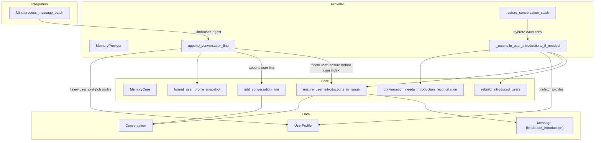

# TASK-002: user introduction on ingest — Design

← [[task|Back to task]] | [[requirements|Requirements]]

## Solution overview

Introduce lazy `user_introduction` insertion by extending `MemoryCore` with a deterministic profile-snapshot formatter and a synchronous, range-parameterised helper that inserts non-visible system messages immediately before each participant's first `user`-kind message in a slice. Live ingest stays O(1): `MemoryProvider.append_conversation_line` checks `introduced_users`, prefetches the profile asynchronously when needed, appends the user message via `MemoryCore.add_conversation_line`, then invokes the helper on that single-message slice so the introduction sits immediately before it. Post-migration repair runs once inside `MemoryProvider.restore_conversation_stash` when the FR-6 mismatch predicate holds, prefetching all distinct historical authors and invoking the same helper over the full live tail before any caller can read LLM history. One code path serves private and group chats; TASK-006 reuses the helper unchanged for compression refresh and graft/merge reconciliation.

## Architecture



| Component | IODA | Responsibility |
|-----------|------|----------------|
| `MemoryCore.format_user_profile_snapshot` | Core | Deterministic `UserProfile` → introduction `text` ([[requirements\|FR-2]]) |
| `MemoryCore.ensure_user_introductions_in_range` | Core | Range scan, mid-list insert, `introduced_users` add-on-insert ([[requirements\|FR-4]], [[requirements\|FR-5]]) |
| `MemoryCore.conversation_needs_introduction_reconciliation` | Core | FR-6 mismatch predicate ([[requirements\|FR-6]]) |
| `MemoryCore.rebuild_introduced_users` | Core | Sync set from `user_introduction` markers after full-tail repair ([[requirements\|FR-6]], [[requirements\|FR-5]]) |
| `MemoryProvider.append_conversation_line` | Provider | Async profile fetch + ingest orchestration for `kind=="user"` ([[requirements\|FR-3]], [[requirements\|FR-7]]) |
| `MemoryProvider._reconcile_user_introductions_if_needed` | Provider | One-shot post-migration repair per restored conversation ([[requirements\|FR-6]]) |
| `Mind.process_message_batch` | Integration | Calls Provider instead of Core for user-message ingest ([[requirements\|FR-3]]) |
| `Message`, `Conversation` | Data | Unchanged wire shape; `user_introduction` already in `MessageKind` ([[requirements\|FR-1]]) |

Cross-cutting rules ([[chat_context_management#user_introduction lifecycle]], [[chat_context_management#Insertion on message ingest]], [[chat_context_management#Private vs. group chats]]) are referenced, not restated.

## Key decisions

### Decision 1: Range helper as the shared Core contract for TASK-006

**Context:** [[requirements\|FR-4]] requires one synchronous helper parameterised by `[start, end)` that TASK-006 reuses for transformation step 8 and graft/merge on `new_arrivals`.
**Options:** (A) Separate fast-path ingest insert plus a different batch helper; (B) one `ensure_user_introductions_in_range` used everywhere, with an O(1) `introduced_users` guard on the live ingest path only.
**Choice:** B — ingest still avoids tail scans via the guard and single-user prefetch, but reconciliation and TASK-006 share identical insertion semantics. Inserts run in descending index order so multiple insertions in one pass do not corrupt indices.
**FR:** FR-4, FR-6

### Decision 2: Profile snapshot formatting in `MemoryCore`

**Context:** [[requirements\|FR-2]] needs deterministic, stable text including `skill_preferences`; TASK-006 refresh must reuse the same builder.
**Options:** (A) Format in Provider at fetch time; (B) `MemoryCore.format_user_profile_snapshot(profile: UserProfile) -> str` as pure Core logic.
**Choice:** B — keeps formatting testable without I/O and gives TASK-006 a single import. Provider prefetches `UserProfile`, Core formats.
**FR:** FR-2

*ADR candidate:* if the snapshot layout becomes a cross-subsystem contract (summariser prompts, agent tools), promote to a shared design note or ADR before TASK-006 changes field labels.

### Decision 3: Ingest orchestration in `MemoryProvider.append_conversation_line`

**Context:** [[requirements\|FR-3]] and constraints require Core to stay sync while `get_user_profile` is async; ingest must complete before `to_llm_messages()` on the reply path.
**Options:** (A) Mind prefetches profiles and calls Core directly; (B) Provider wrapper around `add_conversation_line` for all ingest call sites; (C) Provider wrapper used only from `Mind.process_message_batch`.
**Choice:** C — satisfies "at minimum `Mind.process_message_batch`" with minimal churn; assistant/task_result paths keep calling `MemoryCore.add_conversation_line` directly. The wrapper signature mirrors Core's so Mind changes are a one-line swap per user-ingest call site.
**FR:** FR-3, FR-7

### Decision 4: Mid-list insertion bypasses the tail append chokepoint

**Context:** [[TASK-001-message-kinds-and-conversation-state-v3/design|TASK-001]] centralised tail appends in `MemoryCore.add_conversation_line`; introductions are inserted *before* an existing or about-to-be-appended user message ([[chat_context_management#Insertion on message ingest]]).
**Options:** (A) Force all introductions through `add_conversation_line` (append-only); (B) `ensure_user_introductions_in_range` mutates `conversation.messages` via `list.insert` for mid-tail placement.
**Choice:** B — append-only cannot satisfy "immediately before first user message" for reconciliation over historical tails. Live ingest appends the user line via `add_conversation_line`, then the helper inserts the introduction at that index; reconciliation inserts at historical indices inside the helper.
**FR:** FR-1, FR-3, FR-6

Non-visible counter rule: only `MemoryCore.add_conversation_line` bumps `visible_messages` / `last_visible_at` for `VISIBLE_KINDS`; helper-created `user_introduction` messages never pass through that path ([[requirements\|FR-1]], [[chat_context_management#Visibility]]).

### Decision 5: Post-migration reconciliation at restore, not on hot paths

**Context:** [[requirements\|FR-6]] — TASK-001 migration backfills `introduced_users` without creating markers; ingest would no-op forever without a one-shot repair.
**Options:** (A) Re-check predicate on every `to_llm_messages()`; (B) dedicated repair in `MemoryProvider.restore_conversation_stash` before returning hydrated conversations.
**Choice:** B — matches `external_contract: migrate-on-merge`, keeps steady-state ingest O(1), and runs before `yoda_chat_bot.py` startup wiring hands conversations to `Mind`.
**FR:** FR-6

After a successful full-tail helper pass, `MemoryCore.rebuild_introduced_users` replaces `introduced_users` with `{msg.user_id for msg in messages if msg.kind == "user_introduction"}` so FR-5 holds even when the pre-repair set was over-populated.

### Decision 6: Snapshot text layout

**Context:** [[requirements\|FR-2]] — stable formatting, all substantive fields, explicit empty-profile marker, omit internal bookkeeping fields.
**Options:** (A) JSON serialisation of profile; (B) fixed-order labelled plain-text sections.
**Choice:** B — readable in LLM context and stable for golden-file tests. Layout:

```
User profile snapshot:
Preferred name: <value or "(not set)">
Gender: ...
Location: ...
Timezone: ...
Occupation: ...
Interests:
- item
Facts:
- item
Skill preferences:
  <skill_name>:
  - item
```

Scalar fields always emit a line (use `(not set)` when empty). List sections emit a header plus `-` lines, or `  (none)` when empty. `skill_preferences` emits per-skill subsections sorted by skill name; skills with empty buckets are omitted. When every substantive field is empty/unset, the header line remains and a trailing `(no profile information stored yet)` line is appended.

**FR:** FR-2

## Interfaces

### `MemoryCore.format_user_profile_snapshot`

```python
@staticmethod
def format_user_profile_snapshot(profile: UserProfile) -> str:
    """Return deterministic introduction text; excludes schema_version and updated_on."""
```

### `MemoryCore.ensure_user_introductions_in_range`

```python
@staticmethod
def ensure_user_introductions_in_range(
    conversation: Conversation,
    start: int,
    end: int,
    intro_text_for_user_id: Callable[[int], str],
) -> None:
    """Mutate conversation in place.

    For each distinct user_id with kind=='user' in messages[start:end),
    ensure a user_introduction for that user immediately precedes that user's
    first such message in the range. Idempotent when an matching introduction
    already sits directly before that first user message.

    On insert: insert Message(role='system', kind='user_introduction',
    user_id=uid, text=intro_text_for_user_id(uid)) and add uid to
    conversation.introduced_users. Does not remove from introduced_users.
    """
```

Index contract: `start` and `end` are half-open; `0 <= start <= end <= len(messages)` at call time. After inserts, `len(messages)` increases; callers pass a fixed `end` captured before inserts (reconciliation uses `end = len(messages)` at entry).

### `MemoryCore.conversation_needs_introduction_reconciliation`

```python
@staticmethod
def conversation_needs_introduction_reconciliation(conversation: Conversation) -> bool:
    """True when FR-6 post-migration mismatch predicate holds."""
```

Predicate (all required):

- ∃ message with `kind == "user"`
- `conversation.introduced_users` is non-empty
- ∄ message with `kind == "user_introduction"`

### `MemoryCore.rebuild_introduced_users`

```python
@staticmethod
def rebuild_introduced_users(conversation: Conversation) -> None:
    """Set introduced_users from user_introduction markers in messages."""
```

### `MemoryProvider.append_conversation_line`

Same parameters and return type as `MemoryCore.add_conversation_line`. Live ingest sequence:

1. If `kind == "user"` and `user_id is not None` and `user_id ∉ conversation.introduced_users` (treat missing conversation as empty set): prefetch `profile = await get_user_profile(user_id, chat_id)` and `profile_text = format_user_profile_snapshot(profile)`.
2. `conversation, _ = MemoryCore.add_conversation_line(...)` — append the incoming message (including the user line).
3. If step 1 ran: let `i = len(conversation.messages) - 1`; call `ensure_user_introductions_in_range(conversation, i, i + 1, lambda uid: profile_text)` so the helper inserts the introduction immediately before the just-appended user message and adds `user_id` to `introduced_users`.
4. Return `(conversation, conversation.to_llm_messages())`.

The O(1) guard in step 1 skips profile fetch and step 3 for already-introduced users. Step 2 always runs so visible counters and system-prompt initialisation stay on the existing chokepoint.

### `MemoryProvider._reconcile_user_introductions_if_needed`

```python
async def _reconcile_user_introductions_if_needed(
    self, conversation: Conversation,
) -> None:
    """No-op unless conversation_needs_introduction_reconciliation."""
```

Steps when predicate true:

1. Collect distinct `user_id` from messages where `kind == "user"` and `user_id is not None`.
2. Prefetch profiles: `{uid: await get_user_profile(uid, conversation.chat_id)}`.
3. Build `snapshots = {uid: format_user_profile_snapshot(p) for ...}`.
4. `end = len(conversation.messages)` (capture before inserts).
5. `ensure_user_introductions_in_range(conversation, 0, end, lambda uid: snapshots.get(uid, format(empty)))`.
6. `rebuild_introduced_users(conversation)`.

Invoked from `restore_conversation_stash` for each hydrated conversation before assigning `self._conversations`.

### `user_introduction` message shape (Data)

```python
Message(
    role="system",
    kind="user_introduction",
    text=<format_user_profile_snapshot output>,
    user_id=<participant id>,
    timestamp="",  # non-visible bookkeeping; empty default
)
```

`Message.to_llm_dict()` unchanged: `{"role": "system", "content": text}` ([[requirements\|FR-1]]).

## System impact

| Path / class | IODA | Change | FR |
|--------------|------|--------|-----|
| `yoda/mind/memory/memory.py` — `MemoryCore.format_user_profile_snapshot` | Core | create | FR-2 |
| `yoda/mind/memory/memory.py` — `MemoryCore.ensure_user_introductions_in_range` | Core | create | FR-4, FR-5 |
| `yoda/mind/memory/memory.py` — `MemoryCore.conversation_needs_introduction_reconciliation` | Core | create | FR-6 |
| `yoda/mind/memory/memory.py` — `MemoryCore.rebuild_introduced_users` | Core | create | FR-5, FR-6 |
| `yoda/mind/memory/memory.py` — `MemoryProvider.append_conversation_line` | Provider | create | FR-3, FR-7 |
| `yoda/mind/memory/memory.py` — `MemoryProvider._reconcile_user_introductions_if_needed` | Provider | create | FR-6 |
| `yoda/mind/memory/memory.py` — `MemoryProvider.restore_conversation_stash` | Provider | edit — call reconciliation per conversation | FR-6 |
| `yoda/mind/mind.py` — `Mind.process_message_batch` | Integration | edit — user ingest via `memory_provider.append_conversation_line` | FR-3 |
| `tests/test_memory_operation.py` | test | edit — unit tests for Core helpers, snapshot format, non-visible counters | FR-1, FR-2, FR-4, FR-5 |
| `tests/test_user_introduction_ingest.py` (or equivalent module) | test | create — integration: private, group, repeat, migrated stash | FR-7, FR-8 |

No changes to `migration.py` ([[requirements\|Out of scope]]). No changes to `Message` / `Conversation` dataclass fields.

## Decisions made (from requirements review)

| Item | Resolution |
|------|------------|
| Async/sync bridge for profile fetch | Provider prefetches before calling sync Core helpers ([[requirements\|Assumption]] on `get_user_profile`) |
| Ingest orchestration placement | `MemoryProvider.append_conversation_line`; Mind swaps call site for user ingest only |
| Snapshot format | Decision 6 — labelled plain text, fixed field order |
| `introduced_users` repair after migration | Full-tail helper + `rebuild_introduced_users` at restore |
| Mid-list vs append chokepoint | Helper uses `list.insert`; live user append still via `add_conversation_line` |

## Open questions

None.
