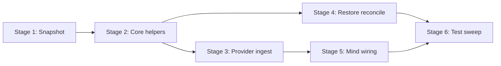

# TASK-002: user introduction on ingest — Implementation plan

← [[task|Back to task]] | [[requirements|Requirements]] | [[design|Design]]

## Overview

Add lazy `user_introduction` insertion on first `user`-kind ingest: a non-visible `system` message carrying a deterministic `UserProfile` snapshot immediately before each participant's first user message. Implement the shared Core helpers (`format_user_profile_snapshot`, `ensure_user_introductions_in_range`, reconciliation predicate/rebuild) so TASK-006 can reuse them unchanged; wire live ingest through `MemoryProvider.append_conversation_line` and one-shot post-migration repair in `restore_conversation_stash`. Private and group chats share one path; steady-state ingest stays O(1) via `introduced_users`.

## Goal / Non-goals

- **Goal:** On first `user` ingest per participant, a `user_introduction` precedes that message, `introduced_users` is consistent, LLM-bound history includes snapshot text, migrated stashes are repaired once at restore, and Core helpers are ready for TASK-006.
- **Non-goals:** Compression refresh (step 8), graft/merge on `new_arrivals`, compression triggers, summariser/profile delta, re-intro on profile change, `summary` messages, v2→v3 migration edits, hot-path reconciliation guards, partial epic rollout behaviour.

## Context to load

Files to read before starting:

- [[requirements]] — FR-1…FR-8 and acceptance criteria
- [[design]] — Architecture, Key decisions, Interfaces, System impact
- [[EPIC-001-chat-context-management/epic|EPIC-001 epic.md]] — delivery profile (`internal_compat: none`, `external_contract: migrate-on-merge`)
- [[chat_context_management]] — master design sections linked from `task.md` `## Master design`
- `AGENTS.md` (IODA), `coding_behavior.md`
- `yoda/mind/memory/memory.py` — current `MemoryCore` / `MemoryProvider`
- `yoda/mind/mind.py` — `process_message_batch` user-ingest call site
- `yoda/mind/memory/data/user_profile.py`, `message.py`, `conversation.py`
- `tests/test_memory_operation.py` — existing stash/migration test patterns
- [[TASK-001-message-kinds-and-conversation-state-v3/design|TASK-001 design]] — `add_conversation_line` chokepoint, visibility rules

## Pre-flight

Mandatory conditions before implementation starts.

- [ ] On epic shared branch: `git checkout feat/EPIC-001-chat-context-management` (create from `main` if missing)
- [ ] `git status` — working tree clean or only unrelated WIP stashed
- [ ] Dependencies merged on branch: [[TASK-000-compression-prerequisites/task|TASK-000]] and [[TASK-001-message-kinds-and-conversation-state-v3/task|TASK-001]] are `done` (`UserProfile.skill_preferences`, `Message.kind`, `introduced_users`, stash v3)
- [ ] `.venv` active; dependencies installed
- [ ] Baseline suite green: `.venv/bin/python -m pytest`
- [ ] No `user_introduction` insertion logic present yet in `memory.py` (avoid duplicate work if resuming)

## Files & artifacts

| Path | IODA | Op | FR |
|------|------|----|----|
| `yoda/mind/memory/memory.py` — `MemoryCore.format_user_profile_snapshot` | Core | create | FR-2 |
| `yoda/mind/memory/memory.py` — `MemoryCore.ensure_user_introductions_in_range` | Core | create | FR-4, FR-5 |
| `yoda/mind/memory/memory.py` — `MemoryCore.conversation_needs_introduction_reconciliation` | Core | create | FR-6 |
| `yoda/mind/memory/memory.py` — `MemoryCore.rebuild_introduced_users` | Core | create | FR-5, FR-6 |
| `yoda/mind/memory/memory.py` — `MemoryProvider.append_conversation_line` | Provider | create | FR-3, FR-7 |
| `yoda/mind/memory/memory.py` — `MemoryProvider._reconcile_user_introductions_if_needed` | Provider | create | FR-6 |
| `yoda/mind/memory/memory.py` — `MemoryProvider.restore_conversation_stash` | Provider | edit | FR-6 |
| `yoda/mind/mind.py` — `Mind.process_message_batch` | Integration | edit | FR-3 |
| `tests/test_memory_operation.py` | test | edit | FR-1, FR-2, FR-4, FR-5, FR-6 |
| `tests/test_user_introduction_ingest.py` | test | create | FR-7, FR-8 |

## Stages

### Stage 1: Profile snapshot formatter (Core)

**Goal:** Deterministic `UserProfile` → introduction text per [[design#Decision 6]].

- [ ] **1.1** Implement `MemoryCore.format_user_profile_snapshot`
  - Files: `yoda/mind/memory/memory.py`, `tests/test_memory_operation.py`
  - Action: Add Core staticmethod per [[design#Interfaces]] — labelled plain-text layout, `(not set)` / `(none)` markers, sorted `skill_preferences` subsections, trailing `(no profile information stored yet)` when all substantive fields empty; exclude `schema_version` and `updated_on`. Write failing tests first: empty profile, populated profile with `skill_preferences`, identical-input determinism (golden string).
  - Verify: `.venv/bin/python -m pytest tests/test_memory_operation.py -k "format_user_profile_snapshot"`
  - Commit: `feat(TASK-002): 1.1 profile snapshot formatter`

**Checkpoint Stage 1:** `.venv/bin/python -m pytest tests/test_memory_operation.py -k "format_user_profile_snapshot"`

---

### Stage 2: Core range helpers and reconciliation primitives

**Goal:** Synchronous, range-parameterised introduction logic reusable by ingest, restore, and TASK-006.

- [ ] **2.1** Implement `conversation_needs_introduction_reconciliation` and `rebuild_introduced_users`
  - Files: `yoda/mind/memory/memory.py`, `tests/test_memory_operation.py`
  - Action: Add Core predicates/set-sync per [[design#Interfaces]] — FR-6 mismatch (has `user`, non-empty `introduced_users`, no `user_introduction`); `rebuild_introduced_users` sets `introduced_users` from `user_introduction` markers. TDD: predicate true/false cases; rebuild from mixed message list.
  - Verify: `.venv/bin/python -m pytest tests/test_memory_operation.py -k "introduction_reconciliation or rebuild_introduced_users"`
  - Commit: `feat(TASK-002): 2.1 reconciliation predicate and rebuild`

- [ ] **2.2** Implement `ensure_user_introductions_in_range`
  - Files: `yoda/mind/memory/memory.py`, `tests/test_memory_operation.py`
  - Action: Add Core helper per [[design#Interfaces]] and Decision 1 — scan `[start, end)` for first `kind=="user"` per `user_id`, insert `Message(role="system", kind="user_introduction", user_id=uid, text=...)` immediately before when missing; add `uid` to `introduced_users`; never bump `visible_messages`; process insertions in **descending index order**; idempotent when introduction already precedes first user message. TDD: single user, two users in range, user absent from range, idempotent second pass, empty-profile text via callable, non-visible counter unchanged.
  - Verify: `.venv/bin/python -m pytest tests/test_memory_operation.py -k "ensure_user_introductions_in_range"`
  - Commit: `feat(TASK-002): 2.2 ensure introductions in range`

**Checkpoint Stage 2:** `.venv/bin/python -m pytest tests/test_memory_operation.py -k "introduction or ensure_user or rebuild_introduced or format_user_profile"`

---

### Stage 3: Provider live ingest path

**Goal:** O(1) lazy insert on first `user` message via Provider orchestration (FR-3, FR-7).

- [ ] **3.1** Implement `MemoryProvider.append_conversation_line`
  - Files: `yoda/mind/memory/memory.py`, `tests/test_memory_operation.py`
  - Action: Add Provider method mirroring `MemoryCore.add_conversation_line` signature per [[design#MemoryProvider.append_conversation_line]] — for `kind=="user"` with new `user_id`: prefetch profile, format snapshot, append user line via `MemoryCore.add_conversation_line`, then `ensure_user_introductions_in_range(conversation, i, i+1, ...)` on the single-message slice; skip fetch/helper when `user_id ∈ introduced_users`; non-user kinds delegate to Core only. TDD with `FakeStorageApi`: first user message gets introduction before user line; second message does not; `visible_messages` counts only user/assistant; `to_llm_messages()` includes introduction text; stash round-trip preserves `kind` and `user_id`.
  - Verify: `.venv/bin/python -m pytest tests/test_memory_operation.py -k "append_conversation_line"`
  - Commit: `feat(TASK-002): 3.1 append conversation line with introductions`

**Checkpoint Stage 3:** `.venv/bin/python -m pytest tests/test_memory_operation.py`

---

### Stage 4: Post-migration reconciliation at restore

**Goal:** One-shot FR-6 repair before any caller uses restored conversations (`external_contract`).

- [ ] **4.1** Implement `_reconcile_user_introductions_if_needed`
  - Files: `yoda/mind/memory/memory.py`, `tests/test_memory_operation.py`
  - Action: Add private Provider method per [[design#MemoryProvider._reconcile_user_introductions_if_needed]] — no-op when predicate false; when true: collect distinct historical `user` authors, prefetch profiles, full-tail `ensure_user_introductions_in_range(0, end)`, then `rebuild_introduced_users`. TDD: v3 stash payload with users + `introduced_users` but no markers → after method, introductions precede each author's first user message and predicate is false; already-reconciled conversation is no-op; new empty conversation is no-op.
  - Verify: `.venv/bin/python -m pytest tests/test_memory_operation.py -k "reconcile_user_introductions"`
  - Commit: `feat(TASK-002): 4.1 reconcile introductions on restore`

- [ ] **4.2** Wire reconciliation into `restore_conversation_stash`
  - Files: `yoda/mind/memory/memory.py`, `tests/test_memory_operation.py`
  - Action: After `stash_dict_to_conversations` and before assigning `self._conversations`, `await` reconciliation for each hydrated conversation. Extend `test_migrate_conversation_stash_v2_to_v3` / `test_conversation_stash_migrates_v1_content_field` restore paths: after `restore_conversation_stash`, assert `user_introduction` markers present and `to_llm_messages()` includes snapshots — without any subsequent ingest.
  - Verify: `.venv/bin/python -m pytest tests/test_memory_operation.py -k "conversation_stash_migrates or migrate_conversation_stash_v2"`
  - Commit: `feat(TASK-002): 4.2 restore stash runs reconciliation`

**Checkpoint Stage 4:** `.venv/bin/python -m pytest tests/test_memory_operation.py`

---

### Stage 5: Mind integration wiring

**Goal:** User-ingest path uses Provider wrapper; assistant/task_result paths unchanged.

- [ ] **5.1** Swap user ingest in `Mind.process_message_batch`
  - Files: `yoda/mind/mind.py`, `tests/test_mind_pipelines.py` (adjust if FakeMemoryProvider needs `append_conversation_line` stub)
  - Action: Replace `MemoryCore.add_conversation_line` with `await self.memory_provider.append_conversation_line` in the perceived-message loop only; leave `_reply_and_send`, task_result, and reminder paths on `MemoryCore.add_conversation_line`. If `FakeMemoryProvider` lacks the new method, add a thin delegate matching Provider behaviour for existing mind pipeline tests.
  - Verify: `.venv/bin/python -m pytest tests/test_mind_pipelines.py tests/test_mind_agent_pipeline.py`
  - Commit: `feat(TASK-002): 5.1 mind user ingest via memory provider`

**Checkpoint Stage 5:** `.venv/bin/python -m pytest tests/test_mind_pipelines.py tests/test_mind_agent_pipeline.py`

---

### Stage 6: Test sweep & coverage

- [ ] **6.1** End-to-end ingest and parity integration tests
  - Files: `tests/test_user_introduction_ingest.py`
  - Action: New module using real `MemoryProvider` + `FakeStorageApi` (and Mind where useful): private chat first/second user message; group chat two users in speak order; repeated messages unchanged; migrated v2/v3 stash restore → LLM list has per-author introductions; `visible_messages` equals user+assistant count only; `introduced_users` matches authors introduced.
  - Verify: `.venv/bin/python -m pytest tests/test_user_introduction_ingest.py`
  - Commit: `test(TASK-002): 6.1 user introduction ingest integration`

- [ ] **6.2** FR acceptance audit and full suite
  - Files: `tests/test_memory_operation.py`, `tests/test_user_introduction_ingest.py`
  - Action: Walk FR-1…FR-8 acceptance bullets; add any missing test; confirm `to_llm_messages()` and stash serialisation not invoked from hot-path reconciliation; run full suite.
  - Verify: `.venv/bin/python -m pytest`
  - Commit: `test(TASK-002): 6.2 FR coverage sweep`

**Checkpoint Stage 6:** `.venv/bin/python -m pytest`

## Stage dependencies

## FR coverage (traceability)

| FR | Steps | Verification |
|----|-------|--------------|
| FR-1 | 2.2, 3.1, 6.1 | `test_memory_operation.py` (kind/role/user_id, non-visible counters); `test_user_introduction_ingest.py` (LLM list includes text) |
| FR-2 | 1.1, 3.1, 6.1 | `test_memory_operation.py -k format_user_profile_snapshot`; integration snapshot in LLM list |
| FR-3 | 3.1, 5.1, 6.1 | `test_memory_operation.py -k append_conversation_line`; `test_user_introduction_ingest.py` (first/second message) |
| FR-4 | 2.2, 6.1 | `test_memory_operation.py -k ensure_user_introductions_in_range` (multi-user, idempotency, range-bound) |
| FR-5 | 2.1, 2.2, 3.1, 4.1, 6.1 | predicate/rebuild/ingest tests; stash `introduced_users` round-trip |
| FR-6 | 2.1, 4.1, 4.2, 6.1 | restore + migrated stash tests; no reconciliation on `to_llm_messages` / `add_conversation_line` |
| FR-7 | 3.1, 5.1, 6.1 | `test_user_introduction_ingest.py` (private + group parity) |
| FR-8 | 6.1, 6.2 | `test_user_introduction_ingest.py` full scenarios; manual: inspect `messages` ordering in group fixture |

## Risks

| Risk | Probability | Impact | Mitigation |
|------|-------------|--------|------------|
| Multi-insert index corruption when reconciling full tail | Medium | High | Stage 2.2 — descending insertion order; unit test with 3+ historical users |
| `FakeMemoryProvider` breaks Mind tests after Provider API change | Medium | Medium | Stage 5.1 — add delegate on fake before swapping Mind call site |
| Snapshot format drift breaks TASK-006 golden tests | Low | Medium | Stage 1.1 golden-file test; design notes ADR candidate if layout changes later |
| Reconciliation runs on every restore despite one-shot intent | Low | Medium | Stage 4.1 — predicate must be false once markers exist; test no-op on second restore of same payload |

## Rollback

- **Code:** `git revert` commits on `feat/EPIC-001-chat-context-management`.
- **State:** Reconciliation mutates in-memory conversations at restore only; after a successful boot the stash saved on shutdown includes `user_introduction` markers (forward-compatible extra system messages). No Redis key schema change beyond existing v3 fields. To undo in-memory repair before save: restart from pre-merge stash backup if one exists.

## Definition of Done

- [ ] All plan steps checked (`last_step` at 6.2)
- [ ] All FR-1…FR-8 acceptance criteria pass
- [ ] Full suite green: `.venv/bin/python -m pytest`
- [ ] IODA respected: Core helpers sync and pure; Provider owns async prefetch; Mind only swaps call site
- [ ] `ensure_user_introductions_in_range` contract stable for TASK-006 import
- [ ] No reconciliation on `to_llm_messages()`, `MemoryCore.add_conversation_line`, or ingest hot paths
- [ ] `task.md`: `status: done`, `updated: 2026-06-14`
- [ ] `design.md` updated only if execution diverges (e.g. snapshot layout tweak)
