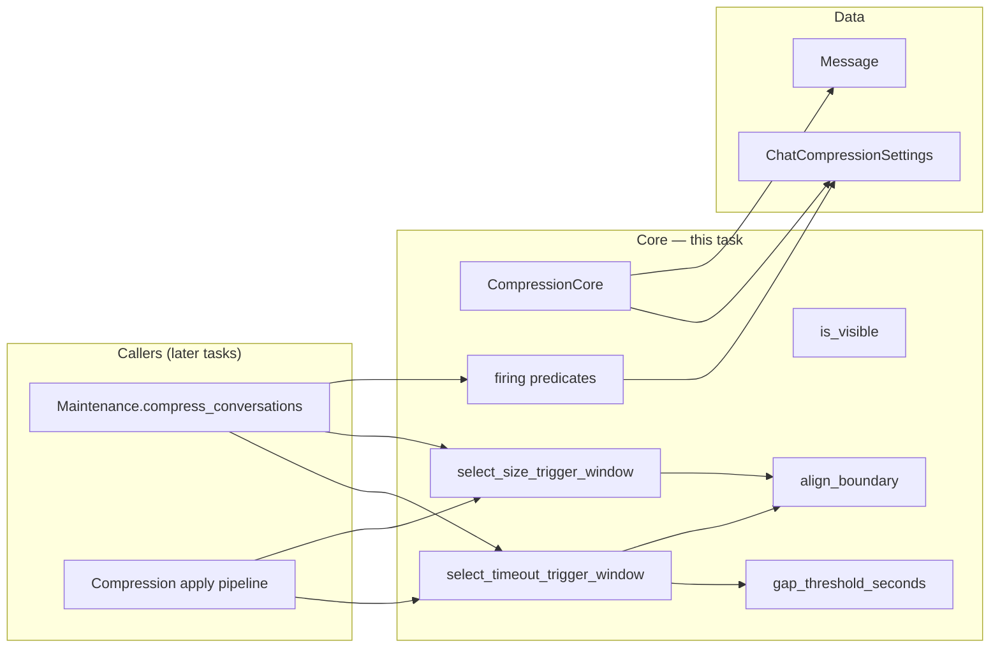

# TASK-003: compression window algorithms core — Design

← [[task|Back to task]] | [[requirements|Requirements]]

## Solution overview

Add `CompressionCore` — a pure, synchronous Core module with static methods for compression window selection and trigger firing predicates. Callers ([[TASK-004-maintenance-integration-shell/task|TASK-004]], [[TASK-006-compression-apply-and-size-trigger/task|TASK-006]], [[TASK-007-timeout-trigger-wiring/task|TASK-007]]) pass `Message` lists, scalar conversation bookkeeping fields, `ChatCompressionSettings`, `chat_type`, and `tick_seconds`; Core returns split indices or booleans with no I/O. Boundary alignment uses a **single** rule for all chat types: forward-shift the split so the live tail starts on a `user` message ([[chat_context_management#Boundary alignment by kind (universal rule)]] — corrected 2026-06-15 to drop the erroneous private/group asymmetry on `user_introduction`).

## Architecture



| Component | IODA | Responsibility |
|-----------|------|----------------|
| `CompressionCore` | Core | All window selection + trigger predicates ([[requirements\|FR-1]]–[[requirements\|FR-8]]) |
| `Message`, `ChatCompressionSettings` | Data | Inputs only; no changes in this task |
| `Maintenance`, apply Integration | Integration | Call Core; no business logic duplicated (later tasks) |

Cross-cutting trigger rules ([[chat_context_management#Compression triggers]], [[chat_context_management#Window selection algorithm]]) are referenced, not restated.

## Key decisions

### Decision 1: Unified boundary alignment on `user` (no chat-type split)

**Context:** Master design originally required `user_introduction` alignment in group chats. That asymmetry is removed — intro restoration belongs on apply (step 8), not window selection.
**Options:** (A) private → `user`, group → `user_introduction`; (B) both → `user`.
**Choice:** B — (1) post-apply invariant is enforced by step 8 refresh, not alignment; (2) intro markers are sparse in long group tails (one per participant's first message), so forward-scan for `user_introduction` can miss and force split `= len(messages)` → compression no-op; (3) `user` messages are abundant in active tails, so forward alignment reliably succeeds; (4) matches [[TASK-002-user-introduction-on-ingest/design|TASK-002]] "one code path for private and group".
**FR:** FR-4, FR-5, FR-6

### Decision 2: Module location `yoda/mind/memory/compression_core.py`

**Context:** Logic operates on `Message` and compression settings already owned by the memory layer; no Integration imports.
**Options:** (A) `yoda/mind/compression_core.py`; (B) colocate with memory data under `yoda/mind/memory/compression_core.py`.
**Choice:** B — keeps compression algorithms next to `Message` / `ChatCompressionSettings` without coupling Core to `MemoryCore` or `MemoryProvider`.
**FR:** FR-1

### Decision 3: Timestamp parsing via duplicated helper

**Context:** Gap detection compares epoch seconds between visible messages ([[requirements\|FR-6]]).
**Options:** (A) import `MemoryCore.parse_message_timestamp`; (B) duplicate a small `parse_message_timestamp` in `compression_core.py`; (C) extract shared helper to Data.
**Choice:** B — IODA forbids Core→Core dependency; duplication is ~10 lines and tested against the same golden strings as TASK-001. Promote to shared Data helper only if a third consumer appears.
**FR:** FR-6

### Decision 4: Window selection return contract

**Context:** Callers need a single, unambiguous split point ([[requirements\|FR-5]], [[requirements\|FR-6]]).
**Options:** (A) return `(chunk_start, chunk_end)` indices; (B) return split index `split` where `[0:split)` is the pre-boundary partition and `[split:]` is the live tail.
**Choice:** B — matches master design "everything before the boundary" wording. `[0:split)` is **compression chunk boundary input** (the partition Core selects), not the summariser payload: [[TASK-006-compression-apply-and-size-trigger/task|TASK-006]] strips leading `prompt` / existing `summary` blocks from that prefix before the LLM call. `None` means no-op (timeout no gap, or alignment exhaustion / zero-width chunk).
**FR:** FR-5, FR-6

### Decision 5: Size-trigger halving index

**Context:** Halve by visible-message count with non-visible messages interleaved ([[chat_context_management#Size-trigger — emergency cutoff]]).
**Choice:** Count visible indices in order; let `k = total_visible // 2` (integer division); candidate split = index of the `(k+1)`-th visible message (first visible message of the **newer** half). Then `align_boundary`. If `split <= 0` or `split >= len(messages)` after alignment, return `None`.
**FR:** FR-5

### Decision 6: Timeout gap placement

**Context:** [[chat_context_management#Window selection algorithm]] steps 1–6.
**Choice:** Walk backward from the newest message, counting only visible messages. Once `visible_in_tail >= min_chunk_length`, continue backward toward index `0`, checking gaps between each consecutive visible pair (newer, older) encountered. The **first** qualifying gap while walking backward is the one nearest the tail — i.e. the most recent pause long enough to split on. When a gap between visible at indices `a` (older) and `b` (newer) qualifies (`timestamp[b] - timestamp[a] > gap_threshold_seconds`), set candidate split to `a + 1` (first index after the older visible message). Non-visible messages with indices in `[a + 1, b)` fall inside the gap and belong to the live tail per master-design step 6. If no qualifying gap exists before the walk reaches the list head, return `None`. Apply `align_boundary`.
**FR:** FR-6

### Decision 7: `is_visible` mirrors `VISIBLE_KINDS` without Core→Core import

**Context:** FR-2 requires a single visibility predicate aligned with TASK-001's `VISIBLE_KINDS` frozenset in `memory.py`; IODA forbids `CompressionCore` importing `MemoryCore`.
**Options:** (A) `from yoda.mind.memory.memory import VISIBLE_KINDS`; (B) module-local `_VISIBLE_KINDS = frozenset({"user", "assistant"})` with a test asserting parity with `memory.VISIBLE_KINDS`.
**Choice:** B — same rationale as Decision 3 (no Core→Core coupling); two-line duplication; parity locked by test.
**FR:** FR-2

### Decision 8: Firing predicates as small static methods + optional composite

**Context:** [[requirements\|FR-7]], [[requirements\|FR-8]]; TASK-004 dry-run logs candidates.
**Choice:** Expose atomic predicates (`should_fire_size_trigger`, `passes_timeout_entry_guard`, `is_quiet_for_n_runs`, `has_visible_activity_since_compression`) plus `should_evaluate_timeout_trigger(...)` as logical AND of the three timeout checks. `chat_type` resolution for quiet runs / gap threshold uses the same `_resolve_chat_type(chat_type) -> "private" | "group"` helper with fail-fast on unknown values.
**FR:** FR-3, FR-7, FR-8

## Interfaces

### `CompressionCore` public contract

```python
class CompressionCore:
    @staticmethod
    def is_visible(message: Message) -> bool: ...

    @staticmethod
    def parse_message_timestamp(timestamp: str) -> float: ...

    @staticmethod
    def gap_threshold_seconds(
        settings: ChatCompressionSettings,
        chat_type: str,
        tick_seconds: float,
    ) -> float: ...

    @staticmethod
    def align_boundary(messages: list[Message], split_index: int) -> int: ...

    @staticmethod
    def select_size_trigger_window(messages: list[Message]) -> int | None: ...

    @staticmethod
    def select_timeout_trigger_window(
        messages: list[Message],
        settings: ChatCompressionSettings,
        chat_type: str,
        tick_seconds: float,
    ) -> int | None: ...

    @staticmethod
    def should_fire_size_trigger(visible_messages: int, settings: ChatCompressionSettings) -> bool: ...

    @staticmethod
    def passes_timeout_entry_guard(visible_messages: int, settings: ChatCompressionSettings) -> bool: ...

    @staticmethod
    def is_quiet_for_n_runs(
        last_visible_at: float,
        now: float,
        settings: ChatCompressionSettings,
        chat_type: str,
        tick_seconds: float,
    ) -> bool: ...

    @staticmethod
    def has_visible_activity_since_compression(
        last_visible_at: float,
        last_compressed_at: float,
    ) -> bool: ...

    @staticmethod
    def should_evaluate_timeout_trigger(
        visible_messages: int,
        last_visible_at: float,
        last_compressed_at: float,
        now: float,
        settings: ChatCompressionSettings,
        chat_type: str,
        tick_seconds: float,
    ) -> bool: ...
```

**`align_boundary` semantics:** `split_index` must satisfy `0 <= split_index <= len(messages)`. Scan forward from `split_index`; return index of first `kind == "user"`, or `len(messages)` if none. Never return an index `< split_index`.

**Private helpers (not part of the public contract):** `_resolve_chat_type(chat_type: str) -> Literal["private", "group"]` — shared by `gap_threshold_seconds` and `is_quiet_for_n_runs`; raises `ValueError` on unknown values ([[requirements|FR-3]], [[requirements|FR-8]]).

## System impact

| Path / class | IODA | Change | FR |
|--------------|------|--------|-----|
| `yoda/mind/memory/compression_core.py` — `CompressionCore` | Core | create | FR-1–FR-8 |
| `tests/test_compression_core.py` | test | create | FR-9 |

No changes to `MemoryCore`, `Mind`, wiring, or Data types in this task.

## Decisions made (from requirements review)

| Item | Resolution |
|------|------------|
| Boundary alignment chat-type asymmetry | Unified `user` alignment (Decision 1); master design already corrected — no private/group split on `user_introduction` |
| `MemoryCore.parse_message_timestamp` reuse | Duplicate in `CompressionCore` (Decision 3); golden-string parity test vs TASK-001 parser |
| `VISIBLE_KINDS` reuse | Module-local frozenset + parity test (Decision 7); no import from `memory.py` |
| Size-trigger halving on odd visible counts | Integer half: older `k = n // 2`, newer `n - k` visible messages (Decision 5) |
| Timeout gap search upper bound | Walk back to index `0`; no fallback to size-trigger halving (Decision 6, [[requirements|Constraints]]) |
| `tick_seconds` source | Caller-supplied parameter; not loaded in this task ([[requirements|Constraints]]) |

## Open questions

None.
