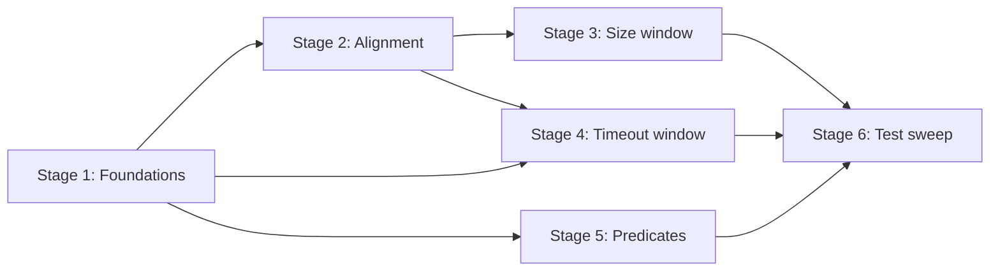

# TASK-003: compression window algorithms core — Implementation plan

← [[task|Back to task]] | [[requirements|Requirements]] | [[design|Design]]

## Overview

Implement `CompressionCore` in `yoda/mind/memory/compression_core.py` — pure, synchronous static methods for compression window selection (size-trigger halve + align, timeout-trigger gap walk + align) and trigger firing predicates (size threshold, timeout entry guard, quiet-for-N-runs, changed-since-compression). Callers in later tasks pass `Message` lists, scalar bookkeeping fields, and `ChatCompressionSettings`; Core returns split indices or booleans with no I/O. This task isolates the hardest algorithmic work from async maintenance and LLM apply pipelines.

## Goal / Non-goals

- **Goal:** `CompressionCore` exposes the full public contract in [[design#Interfaces]]; unit tests lock FR-2–FR-8 behaviour on synthetic fixtures; full suite green; no wiring changes.
- **Non-goals:** LLM summarisation; snapshot, lock, apply, graft+merge; `user_introduction` strip/refresh; `Maintenance` integration, Redis, Chroma; loading settings from `settings.json`; changes to `Message`, `Conversation`, or ingest counters.

## Context to load

Files to read before starting:

- [[requirements]] — FR-1…FR-9 and acceptance criteria
- [[design]] — Architecture, Key decisions, Interfaces, System impact
- [[EPIC-001-chat-context-management/epic|EPIC-001 epic.md]] — delivery profile (`internal_compat: none`, `external_contract: migrate-on-merge`; no intermediate deploy steps)
- [[chat_context_management]] — master design sections linked from `task.md` `## Master design`
- `AGENTS.md` (IODA), `coding_behavior.md`
- `yoda/mind/memory/data/message.py`, `yoda/mind/memory/data/chat_compression_settings.py`
- `yoda/mind/memory/memory.py` — `VISIBLE_KINDS`, `MemoryCore.parse_message_timestamp` (parity reference only; do not import from Core)
- [[TASK-001-message-kinds-and-conversation-state-v3/design|TASK-001 design]] — `Message.kind`, conversation counters, settings shape
- `settings.json` — default `chat_compression` values for fixture constants

## Pre-flight

Mandatory conditions before implementation starts.

- [ ] On epic shared branch: `git checkout feat/EPIC-001-chat-context-management` (create from `main` if missing)
- [ ] `git status` — working tree clean or unrelated WIP stashed
- [ ] Dependency merged on branch: [[TASK-001-message-kinds-and-conversation-state-v3/task|TASK-001]] is `done` (`Message.kind`, `Conversation.visible_messages` / `last_visible_at` / `last_compressed_at`, `ChatCompressionSettings`)
- [ ] `.venv` active; dependencies installed
- [ ] Baseline suite green: `.venv/bin/python -m pytest`
- [ ] No `CompressionCore` or `compression_core.py` present yet (avoid duplicate work if resuming)

## Files & artifacts

| Path | IODA | Op | FR |
|------|------|----|----|
| `yoda/mind/memory/compression_core.py` — `CompressionCore` | Core | create | FR-1–FR-8 |
| `tests/test_compression_core.py` | test | create | FR-9 |

No changes to `MemoryCore`, `Mind`, wiring, or Data types in this task.

## Stages

### Stage 1: Module scaffold, visibility, timestamp, gap threshold

**Goal:** Core module exists with foundational helpers and FR-2/FR-3 behaviour locked.

- [ ] **1.1** Create module + `is_visible` + `VISIBLE_KINDS` parity
  - Files: `yoda/mind/memory/compression_core.py`, `tests/test_compression_core.py`
  - Action: Add Core class skeleton with module-local `_VISIBLE_KINDS = frozenset({"user", "assistant"})` per [[design#Decision 7]]; implement `is_visible(message) -> bool`. TDD: true for `user`/`assistant`, false for `prompt`, `summary`, `task_result`, `user_introduction`; assert `_VISIBLE_KINDS == memory.VISIBLE_KINDS` (import `VISIBLE_KINDS` from `memory` in test only).
  - Verify: `.venv/bin/python -m pytest tests/test_compression_core.py -k "is_visible or visible_kinds_parity"`
  - Commit: `feat(TASK-003): 1.1 visibility predicate and kinds parity`

- [ ] **1.2** Implement `parse_message_timestamp`
  - Files: `yoda/mind/memory/compression_core.py`, `tests/test_compression_core.py`
  - Action: Duplicate ~10-line parser per [[design#Decision 3]] — empty → `0.0`, ISO and space-separated formats, invalid → `0.0`. TDD golden strings matching `test_memory_operation.py::test_parse_message_timestamp` (`""`, `"2026-03-09T21:36:51+00:00"`, `"2026-03-09 21:36:51+00:00"`).
  - Verify: `.venv/bin/python -m pytest tests/test_compression_core.py -k "parse_message_timestamp"`
  - Commit: `feat(TASK-003): 1.2 message timestamp parser`

- [ ] **1.3** Implement `_resolve_chat_type` + `gap_threshold_seconds`
  - Files: `yoda/mind/memory/compression_core.py`, `tests/test_compression_core.py`
  - Action: Private `_resolve_chat_type(chat_type) -> Literal["private", "group"]` raises `ValueError` on unknown values; `gap_threshold_seconds(settings, chat_type, tick_seconds)` computes `quiet_runs[chat_type] * gap_to_trigger_ratio * tick_seconds`. Add test fixture `default_compression_settings()` mirroring `settings.json` defaults. TDD: defaults with `tick_seconds=3600` → `14400.0`; group quiet-runs change affects group only; invalid `chat_type` raises.
  - Verify: `.venv/bin/python -m pytest tests/test_compression_core.py -k "gap_threshold"`
  - Commit: `feat(TASK-003): 1.3 gap threshold derivation`

**Checkpoint Stage 1:** `.venv/bin/python -m pytest tests/test_compression_core.py -k "is_visible or visible_kinds or parse_message or gap_threshold"`

---

### Stage 2: Universal boundary alignment

**Goal:** `align_boundary` implements unified `user`-start rule (FR-4).

- [ ] **2.1** Implement `align_boundary`
  - Files: `yoda/mind/memory/compression_core.py`, `tests/test_compression_core.py`
  - Action: Per [[design#Interfaces]] — scan forward from `split_index`; return first `kind == "user"` index, or `len(messages)` if none; never return index `< split_index`. TDD: candidate already `user` → no-op; candidate on `assistant` → next `user`; tail with no forward `user` → `len(messages)`; group fixture with `user_introduction` markers but no forward `user` still lands on next `user` (compression not blocked by intro alignment).
  - Verify: `.venv/bin/python -m pytest tests/test_compression_core.py -k "align_boundary"`
  - Commit: `feat(TASK-003): 2.1 boundary alignment on user`

**Checkpoint Stage 2:** `.venv/bin/python -m pytest tests/test_compression_core.py -k "align_boundary"`

---

### Stage 3: Size-trigger window selection

**Goal:** Emergency halve + align returns split index or `None` (FR-5).

- [ ] **3.1** Implement `select_size_trigger_window`
  - Files: `yoda/mind/memory/compression_core.py`, `tests/test_compression_core.py`
  - Action: Per [[design#Decision 5]] — collect visible indices in order; `k = total_visible // 2`; candidate split = index of `(k+1)`-th visible message (first visible of newer half); apply `align_boundary`; return `None` if `split <= 0` or `split >= len(messages)`. TDD: even visible count with interleaved `prompt`/`summary`; odd visible count (`n=5` → older 2, newer 3); halve landing on `assistant` shifts forward; zero-width / alignment exhaustion → `None`.
  - Verify: `.venv/bin/python -m pytest tests/test_compression_core.py -k "select_size_trigger_window"`
  - Commit: `feat(TASK-003): 3.1 size-trigger window selection`

**Checkpoint Stage 3:** `.venv/bin/python -m pytest tests/test_compression_core.py -k "select_size_trigger_window or align_boundary"`

---

### Stage 4: Timeout-trigger window selection

**Goal:** Backward gap walk + align; no fallback to size halving (FR-6).

- [ ] **4.1** Implement core timeout walk and gap placement
  - Files: `yoda/mind/memory/compression_core.py`, `tests/test_compression_core.py`
  - Action: Per [[design#Decision 6]] — walk backward from newest message counting visible only; once `visible_in_tail >= min_chunk_length`, continue toward index `0` checking gaps between consecutive visible pairs (newer − older timestamps via `parse_message_timestamp`); first qualifying gap (`delta > gap_threshold_seconds`) sets candidate split to `older_visible_index + 1`; apply `align_boundary`. TDD: synthetic list with one clear 5 h gap → non-`None` split; live tail retains ≥ `min_chunk_length` visible messages.
  - Verify: `.venv/bin/python -m pytest tests/test_compression_core.py -k "timeout_trigger_window and gap"`
  - Commit: `feat(TASK-003): 4.1 timeout gap walk and placement`

- [ ] **4.2** Timeout edge cases and no-op paths
  - Files: `tests/test_compression_core.py` (extend fixtures)
  - Action: TDD remaining FR-6 cases: continuously active traffic (all gaps ≤ threshold) → `None`; `task_result` sandwiched between visible messages stays in live tail (gap measured visible-to-visible only); non-visible messages inside a qualifying gap attach to live tail (`split = a + 1` with non-visible in `[a+1, b)`); confirm no size-trigger fallback is invoked (timeout method returns `None`, not halve result).
  - Verify: `.venv/bin/python -m pytest tests/test_compression_core.py -k "timeout_trigger_window"`
  - Commit: `test(TASK-003): 4.2 timeout window edge cases`

**Checkpoint Stage 4:** `.venv/bin/python -m pytest tests/test_compression_core.py -k "timeout_trigger_window or gap_threshold"`

---

### Stage 5: Trigger firing predicates

**Goal:** Pure boolean gates for size and timeout triggers (FR-7, FR-8).

- [ ] **5.1** Size-trigger and timeout entry predicates
  - Files: `yoda/mind/memory/compression_core.py`, `tests/test_compression_core.py`
  - Action: Implement `should_fire_size_trigger(visible_messages, settings)` — strict `>` on `size_trigger_threshold` (300 → false, 301 → true). Implement `passes_timeout_entry_guard(visible_messages, settings)` — strict `>` on `2 * min_chunk_length` (60 → false, 61 → true). TDD boundary values.
  - Verify: `.venv/bin/python -m pytest tests/test_compression_core.py -k "should_fire_size or passes_timeout_entry"`
  - Commit: `feat(TASK-003): 5.1 size and entry guard predicates`

- [ ] **5.2** Quiet, changed-since, and composite timeout predicate
  - Files: `yoda/mind/memory/compression_core.py`, `tests/test_compression_core.py`
  - Action: Implement `is_quiet_for_n_runs(last_visible_at, now, settings, chat_type, tick_seconds)` using `_resolve_chat_type`; `has_visible_activity_since_compression(last_visible_at, last_compressed_at)` — strict `>`; `should_evaluate_timeout_trigger(...)` as logical AND of entry guard + quiet + changed. TDD: `last_compressed_at=0.0` with positive `last_visible_at` → changed true; quiet boundary at `8 * 3600` seconds; unknown `chat_type` raises; composite false when any atomic predicate false.
  - Verify: `.venv/bin/python -m pytest tests/test_compression_core.py -k "quiet or changed_since or should_evaluate_timeout"`
  - Commit: `feat(TASK-003): 5.2 timeout firing predicates`

**Checkpoint Stage 5:** `.venv/bin/python -m pytest tests/test_compression_core.py -k "should_fire or passes_timeout or quiet or changed_since or should_evaluate"`

---

### Stage 6: Test sweep & coverage

- [ ] **6.1** FR acceptance audit
  - Files: `tests/test_compression_core.py`
  - Action: Walk FR-1…FR-8 acceptance bullets; add any missing test (especially interleaved non-visible halving arithmetic, multiple gaps choosing nearest-to-tail, `select_*` return `None` vs valid split). Confirm `CompressionCore` has only `@staticmethod` methods and imports only Data types (no Integration/Provider/API imports in module under test).
  - Verify: `.venv/bin/python -m pytest tests/test_compression_core.py`
  - Commit: `test(TASK-003): 6.1 FR coverage audit`

- [ ] **6.2** Full suite and import hygiene check
  - Files: `yoda/mind/memory/compression_core.py`, `tests/test_compression_core.py`
  - Action: Run full suite; optionally grep module for forbidden imports (`Mind`, `MemoryProvider`, `Maintenance`, API modules). No wiring added to `yoda_chat_bot.py` or `mind.py`.
  - Verify: `.venv/bin/python -m pytest`
  - Commit: `test(TASK-003): 6.2 full suite green`

**Checkpoint Stage 6:** `.venv/bin/python -m pytest`

## Stage dependencies

## FR coverage (traceability)

| FR | Steps | Verification |
|----|-------|--------------|
| FR-1 | 1.1, 6.1, 6.2 | `test_compression_core.py` (staticmethod-only, Data-only imports); manual: no wiring files changed |
| FR-2 | 1.1, 3.1, 4.1 | `test_compression_core.py -k "is_visible or visible_kinds"`; window tests use visibility-only counting |
| FR-3 | 1.3, 4.1 | `test_compression_core.py -k "gap_threshold"` (defaults 14400, chat-type split, fail-fast) |
| FR-4 | 2.1, 3.1, 4.1 | `test_compression_core.py -k "align_boundary"`; size/timeout tests assert post-alignment `user` start |
| FR-5 | 3.1, 6.1 | `test_compression_core.py -k "select_size_trigger_window"` (halve, interleaved, None edges) |
| FR-6 | 4.1, 4.2, 6.1 | `test_compression_core.py -k "timeout_trigger_window"` (gap, no-gap, task_result sandwich, no fallback) |
| FR-7 | 5.1, 6.1 | `test_compression_core.py -k "should_fire_size"` (300 false, 301 true) |
| FR-8 | 5.1, 5.2, 6.1 | `test_compression_core.py -k "passes_timeout_entry or quiet or changed_since or should_evaluate_timeout"` |
| FR-9 | 1.1–5.2, 6.1, 6.2 | `tests/test_compression_core.py`; full `.venv/bin/python -m pytest` |

## Risks

| Risk | Probability | Impact | Mitigation |
|------|-------------|--------|------------|
| Size-trigger halving off-by-one with interleaved non-visible messages | Medium | High | Stage 3.1 — explicit fixtures with known visible indices; assert split index on `(k+1)`-th visible per Decision 5 |
| Timeout gap walk picks wrong gap when multiple qualify | Medium | Medium | Stage 4.1 — fixture with two gaps; assert split uses nearest-to-tail (first found walking backward) |
| `parse_message_timestamp` drift from `MemoryCore` | Low | Medium | Stage 1.2 — golden-string parity test against TASK-001 cases |
| `align_boundary` returns `len(messages)` producing caller confusion | Low | Low | Stage 3.1/4.2 — document via tests that `select_*` returns `None` when split invalid after alignment |

## Rollback

- **Code:** `git revert` commits on `feat/EPIC-001-chat-context-management`.
- **State:** Pure code + tests only; no Redis, ChromaDB, or stash writes. No persistent-state rollback required.

## Definition of Done

- [ ] All plan steps checked
- [ ] All FR-1…FR-9 acceptance criteria pass
- [ ] Full suite green: `.venv/bin/python -m pytest`
- [ ] IODA respected: all logic in `CompressionCore` (Core); no Integration/Provider wiring; no Core→Core imports
- [ ] Public contract matches [[design#Interfaces]] — stable for TASK-004 dry-run and TASK-006/007 apply wiring
- [ ] `task.md`: `status: done`, `updated: 2026-06-14`
- [ ] `design.md` updated only if execution diverges (e.g. halving edge-case tweak)
