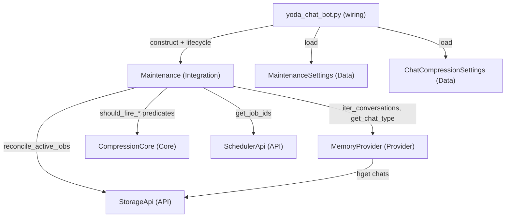

# TASK-004: maintenance integration shell — Design

← [[task|Back to task]] | [[requirements|Requirements]]

## Solution overview

Introduce `Maintenance` as a new Integration in `yoda/mind/maintenance.py` that owns all periodic background orchestration: a single asyncio tick loop (base period from `mind.maintenance.tick_minutes`), lifecycle hooks (`run_initial_pass`, `start`, `stop`), relocated `reconcile_active_jobs`, and stubs for `compress_conversations` (dry-run predicate evaluation via `CompressionCore`) and `flush_summary_outbox` (no-op). The wiring file constructs `Maintenance` with injected APIs/Providers/settings, calls `run_initial_pass` + `start` on app start and `stop` on shutdown, and drops the ad-hoc `periodic_job_cleanup` closure. Trigger decisions stay in `CompressionCore`; `Maintenance` only iterates live conversations, resolves `chat_type`, evaluates predicates, and logs candidates — preparing a stable seam for TASK-006 apply and TASK-008 outbox flush without changing tick structure.

## Architecture

Per [[chat_context_management#Maintenance integration]] and [[chat_context_management#Single ticking loop]].



| Component | IODA | Role in this task |
|-----------|------|-------------------|
| `Maintenance` | Integration | Tick loop, lifecycle, sub-routine dispatch |
| `reconcile_active_jobs` | Integration (module fn) | Redis `active_jobs:*` vs scheduler job ids |
| `MaintenanceSettings` | Data | `tick_minutes` from settings |
| `CompressionCore` | Core | Predicate evaluation only (unchanged) |
| `MemoryProvider` | Provider | Conversation iteration + `chat_type` lookup |
| `StorageApi`, `SchedulerApi` | API | Reconciliation I/O |
| `yoda_chat_bot.py` | Wiring | Construction, settings load, hooks |

## Key decisions

### Decision 1: `Maintenance` module path

**Context:** FR-1 requires a `Maintenance` Integration under `yoda/mind/`; path must be discoverable and consistent with other top-level integrations.
**Options:** (A) `yoda/mind/maintenance.py` flat module; (B) `yoda/mind/maintenance/maintenance.py` package.
**Choice:** A — mirrors `yoda/mind/mind.py`; the class is the only Integration in the module and keeps imports short (`from yoda.mind.maintenance import Maintenance, reconcile_active_jobs`).

### Decision 2: `MaintenanceSettings` placement

**Context:** FR-2 needs a Data type for `mind.maintenance.tick_minutes` with fail-fast loading.
**Options:** (A) `yoda/mind/data/maintenance_settings.py`; (B) colocate in `maintenance.py`; (C) under `memory/data/`.
**Choice:** A — maintenance tick config is not memory-domain; `yoda/mind/data/` already holds cross-mind Data (`routing_context.py`). Pattern matches `ChatCompressionSettings.from_dict` fail-fast style.

### Decision 3: Conversation iteration accessor

**Context:** FR-6 requires iterating all in-memory conversations held by `MemoryProvider`; no accessor exists today.
**Options:** (A) `MemoryProvider.iter_conversations() -> Iterator[Conversation]`; (B) expose `_conversations` dict; (C) `Maintenance` reads stash from Redis each tick.
**Choice:** A — sync iterator over the in-memory dict values; dry-run is read-only; avoids Redis round-trip and respects Provider ownership of conversation cache (FR-6).

### Decision 4: `chat_type` resolution for timeout predicates

**Context:** FR-6 requires `"private"` or `"group"` from persisted metadata; unknown/missing must fail fast; `CognitionCore.determine_chat_type` needs `user_id` and is unsuitable for background iteration.
**Options:** (A) `MemoryProvider.get_chat_type(chat_id) -> str` reading Redis `chats` hash; (B) `Maintenance` calls `StorageApi.hget` directly; (C) store `chat_type` on `Conversation`.
**Choice:** A — `MemoryProvider` already owns chat metadata writes (`update_chat_info`); a symmetric read helper keeps Redis key/migration logic in one Provider. Raises `ValueError` when the chat record is missing or `chat_type` is empty; `CompressionCore` predicates validate `"private"` / `"group"` via `_resolve_chat_type` (FR-6).

### Decision 5: `reconcile_active_jobs` as a module-level function

**Context:** FR-5 relocates the function and existing tests import it by name from a stable module.
**Options:** (A) module-level `async def reconcile_active_jobs(...)` in `maintenance.py`; (B) private `Maintenance._reconcile_active_jobs` only.
**Choice:** A — move implementation verbatim; `Maintenance` calls it from `run_initial_pass` and the tick loop; tests update import to `yoda.mind.maintenance` (FR-5, FR-8).

### Decision 6: `start()` is synchronous

**Context:** FR-4 exposes `start()` to install the background loop after `run_initial_pass`.
**Options:** (A) `def start() -> None` using `asyncio.create_task`; (B) `async def start()`.
**Choice:** A — matches scheduler `start()` pattern; wiring calls `maintenance.start()` without awaiting; loop task is stored on `Maintenance` for `stop()` cancellation (FR-3, FR-4).

### Decision 7: Reconciliation cadence via tick counter

**Context:** FR-3 requires `reconcile_active_jobs` every 24 ticks while compression/outbox run every tick; today's behaviour is ≈ daily (24 h sleep).
**Options:** (A) increment `_tick_count` each loop iteration, reconcile when `_tick_count % 24 == 0`; (B) separate sleep accumulator.
**Choice:** A — matches master design integer-multiple rule; with `tick_minutes=60`, period is 24 h (FR-3). `RECONCILE_EVERY_N_TICKS = 24` module constant.

## Interfaces

### `MaintenanceSettings` (Data)

```python
@dataclass
class MaintenanceSettings:
    tick_minutes: int

    @classmethod
    def from_dict(cls, block: dict) -> MaintenanceSettings: ...
    # Raises ValueError("Missing required key: ...") if block or tick_minutes absent.
```

Wiring: `MaintenanceSettings.from_dict(mind_settings["maintenance"])`.

### `Maintenance` (Integration)

```python
RECONCILE_EVERY_N_TICKS = 24

class Maintenance:
    def __init__(
        self,
        *,
        storage_api: StorageApi,
        scheduler_api: SchedulerApi,
        memory_provider: MemoryProvider,
        compression_settings: ChatCompressionSettings,
        maintenance_settings: MaintenanceSettings,
    ) -> None:
        self._tick_seconds = float(maintenance_settings.tick_minutes * 60)
        ...

    async def run_initial_pass(self) -> None:
        """One-shot startup: initial reconcile_active_jobs."""

    def start(self) -> None:
        """Install single background asyncio tick loop."""

    async def stop(self) -> None:
        """Cancel loop task, await, swallow CancelledError."""

    async def _tick_loop(self) -> None: ...

    async def compress_conversations(self) -> None:
        """Dry-run: evaluate CompressionCore predicates, debug-log candidates."""

    async def flush_summary_outbox(self) -> None:
        """No-op stub for TASK-008."""

    async def _run_subroutine(
        self,
        name: str,
        coro: Coroutine[None, None, None] | Awaitable[int],
    ) -> None:
        """try/except wrapper: log warning, continue loop. Accepts int-returning reconcile coroutines."""
```

**Tick loop semantics (FR-3):**

1. Loop body runs immediately on first iteration (no initial sleep before first tick).
2. Each iteration: `_tick_count += 1`; `await compress_conversations()`; `await flush_summary_outbox()`; if `_tick_count % RECONCILE_EVERY_N_TICKS == 0`: `await reconcile_active_jobs(...)`.
3. `await asyncio.sleep(self._tick_seconds)`.
4. Sub-routine exceptions caught per call; `logger.warning("%s failed", name, exc_info=True)`.

**Dry-run log contract (FR-6):**

When either predicate is true for a conversation:

```python
logger.debug(
    "compression trigger candidate: chat_id=%s triggers=%s",
    conversation.chat_id,
    triggers,  # e.g. ["size"], ["timeout"], or ["size", "timeout"]
)
```

No message text, profile content, or summary payloads. Conversations with both predicates false log nothing.

### `reconcile_active_jobs` (module function)

```python
async def reconcile_active_jobs(
    storage_api: StorageApi,
    scheduler_api: SchedulerApi,
) -> int:
    """Unchanged behaviour: scan active_jobs:*, remove stale entries, info log if removed > 0."""
```

### `MemoryProvider` additions (Provider)

```python
def iter_conversations(self) -> Iterator[Conversation]:
    """Yield in-memory conversations (values of _conversations)."""

async def get_chat_type(self, chat_id: int) -> str:
    """Read chats hash; raise ValueError if record missing or chat_type empty."""
```

`get_chat_type` implementation sketch: `hget("chats", str(chat_id))` → migrate/parse `Chat` → if not `chat.chat_type`: `raise ValueError(f"Missing chat_type for chat_id={chat_id}")` → return `chat.chat_type`.

### Wiring changes (`yoda_chat_bot.py`)

```python
maintenance_settings = MaintenanceSettings.from_dict(mind_settings["maintenance"])
chat_compression_settings = ChatCompressionSettings.from_dict(memory_settings["chat_compression"])

maintenance = Maintenance(
    storage_api=storage_api,
    scheduler_api=scheduler_api,
    memory_provider=memory_provider,
    compression_settings=chat_compression_settings,
    maintenance_settings=maintenance_settings,
)

async def on_app_start(application):
    await memory_provider.restore_conversation_stash()
    scheduler_api.start()
    await asyncio.sleep(2)
    await maintenance.run_initial_pass()
    maintenance.start()

async def on_post_stop(_application) -> None:
    await maintenance.stop()
    # ... existing flush_pending_batches, etc. (cleanup_job_metadata unchanged)
```

Remove: module-level `reconcile_active_jobs`, `periodic_job_cleanup`, `periodic_cleanup_holder`.

## System impact

| Path / class | IODA | Change | FR |
|--------------|------|--------|-----|
| `yoda/mind/maintenance.py` — `Maintenance`, `reconcile_active_jobs`, `RECONCILE_EVERY_N_TICKS` | Integration | **Create** Integration + relocated reconcile fn | FR-1, FR-3, FR-4, FR-5, FR-6, FR-7 |
| `yoda/mind/data/maintenance_settings.py` — `MaintenanceSettings` | Data | **Create** settings dataclass + `from_dict` | FR-2 |
| `yoda/mind/memory/memory.py` — `MemoryProvider.iter_conversations`, `MemoryProvider.get_chat_type` | Provider | **Edit** add iteration + chat_type read | FR-6 |
| `yoda/yoda_chat_bot.py` | Wiring | **Edit** load settings, construct `Maintenance`, wire lifecycle; remove periodic cleanup | FR-2, FR-4, FR-8 |
| `settings.json` — `mind.maintenance.tick_minutes` | Config | **Exists** (verify default 60) | FR-2 |
| `tests/test_agent_tools.py` | Test | **Edit** import `reconcile_active_jobs` from `yoda.mind.maintenance` | FR-5 |
| `tests/test_maintenance.py` (new) | Test | **Create** tick loop, dry-run logging, lifecycle, settings load (optional but recommended) | FR-1–FR-7 |

No changes to `CompressionCore`, `Conversation`, stash migration, or `cleanup_job_metadata`.

## Decisions made (from requirements review)

| Item | Resolution |
|------|------------|
| `chat_type` source for dry-run | `MemoryProvider.get_chat_type` from Redis `chats` hash; fail fast on missing/empty (Decision 4) |
| Conversation enumeration | `MemoryProvider.iter_conversations()` sync iterator (Decision 3) |
| `reconcile_active_jobs` export | Module-level function in `maintenance.py` for test continuity (Decision 5) |
| First tick timing | Sub-routines run once before first sleep (preserves immediate startup reconcile via `run_initial_pass`; first scheduled compression tick at loop start) |

## Open questions

None.
