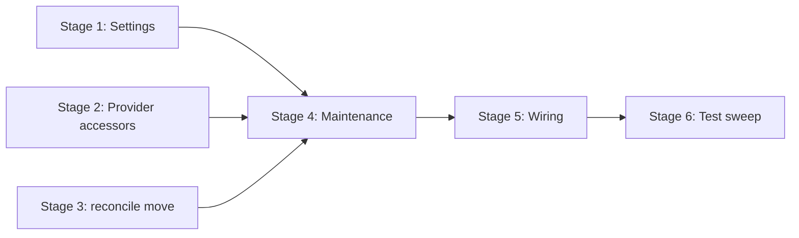

# TASK-004: maintenance integration shell — Implementation plan

← [[task|Back to task]] | [[requirements|Requirements]] | [[design|Design]]

## Overview

Introduce `Maintenance` as a new Integration in `yoda/mind/maintenance.py` with a single asyncio tick loop (period from `mind.maintenance.tick_minutes`), lifecycle hooks (`run_initial_pass`, `start`, `stop`), relocated `reconcile_active_jobs`, and stubs for `compress_conversations` (dry-run predicate evaluation via `CompressionCore`) and `flush_summary_outbox` (no-op). Wire construction and hooks in `yoda_chat_bot.py`, add `MaintenanceSettings` and `MemoryProvider` accessors for iteration and `chat_type` lookup, and remove the ad-hoc `periodic_job_cleanup` closure — preparing a stable seam for TASK-006 apply and TASK-008 outbox flush without changing tick structure.

## Goal / Non-goals

- **Goal:** `Maintenance` runs one background tick loop; startup/shutdown hooks replace inline reconciliation and periodic cleanup; dry-run logs compression trigger candidates at debug; `reconcile_active_jobs` lives in `maintenance.py` with unchanged behaviour; full suite green.
- **Non-goals:** compression apply pipeline; timeout-trigger apply beyond dry-run logging; `SummarizerProvider` / profile extraction; real `flush_summary_outbox` (embeddings, Chroma); `recall_conversation` skill; `CompressionCore` algorithm changes; `Message` / `Conversation` schema or stash migration; moving `cleanup_job_metadata`; per-conversation compression locks.

## Context to load

Files to read before starting:

- [[requirements]] — FR-1…FR-8 and acceptance criteria
- [[design]] — Architecture, Key decisions, Interfaces, System impact
- [[EPIC-001-chat-context-management/epic|EPIC-001 epic.md]] — delivery profile (`internal_compat: none`, `external_contract: migrate-on-merge`; shared branch `feat/EPIC-001-chat-context-management`)
- [[chat_context_management]] — master design sections linked from `task.md` `## Master design` (Maintenance integration, Single ticking loop)
- `AGENTS.md` (IODA), `coding_behavior.md`
- `yoda/yoda_chat_bot.py` — current `reconcile_active_jobs`, `periodic_job_cleanup`, `on_app_start` / `on_post_stop`
- `yoda/mind/memory/compression_core.py` — `should_fire_size_trigger`, `should_evaluate_timeout_trigger`
- `yoda/mind/memory/data/chat_compression_settings.py` — `from_dict` fail-fast pattern
- `yoda/mind/memory/memory.py` — `MemoryProvider`, `update_chat_info` (symmetry for `get_chat_type`)
- `settings.json` — `mind.maintenance.tick_minutes` (default 60)
- [[TASK-003-compression-window-algorithms-core/design|TASK-003 design]] — predicate contracts

## Pre-flight

Mandatory conditions before implementation starts.

- [x] On epic shared branch: `git checkout feat/EPIC-001-chat-context-management` (create from `main` if missing)
- [x] `git status` — working tree clean or unrelated WIP stashed
- [x] Dependencies merged on branch: [[TASK-001-message-kinds-and-conversation-state-v3/task|TASK-001]] (`Conversation` counters, `ChatCompressionSettings`) and [[TASK-003-compression-window-algorithms-core/task|TASK-003]] (`CompressionCore` predicates) are `done`
- [x] `settings.json` contains `mind.maintenance.tick_minutes` (repo default `60`)
- [x] `.venv` active; dependencies installed
- [x] Baseline suite green: `.venv/bin/python -m pytest`
- [x] No `yoda/mind/maintenance.py` present yet (avoid duplicate work if resuming)

## Files & artifacts

| Path | IODA | Op | FR |
|------|------|----|----|
| `yoda/mind/data/maintenance_settings.py` — `MaintenanceSettings` | Data | create | FR-2 |
| `yoda/mind/memory/memory.py` — `MemoryProvider.iter_conversations`, `get_chat_type` | Provider | edit | FR-6 |
| `yoda/mind/maintenance.py` — `Maintenance`, `reconcile_active_jobs`, `RECONCILE_EVERY_N_TICKS` | Integration | create | FR-1, FR-3, FR-4, FR-5, FR-6, FR-7 |
| `yoda/yoda_chat_bot.py` | Wiring | edit | FR-2, FR-4, FR-8 |
| `settings.json` — `mind.maintenance.tick_minutes` | Config | verify | FR-2 |
| `tests/test_agent_tools.py` | Test | edit | FR-5 |
| `tests/test_maintenance.py` | Test | create | FR-1–FR-8 |

No changes to `CompressionCore`, `Conversation`, stash migration, or `cleanup_job_metadata`.

## Stages

### Stage 1: Maintenance settings (Data)

**Goal:** `MaintenanceSettings` loads `tick_minutes` from config with fail-fast validation (FR-2).

- [x] **1.1** Create `MaintenanceSettings` dataclass + `from_dict`
  - Files: `yoda/mind/data/maintenance_settings.py`, `tests/test_maintenance.py`
  - Action: Data type with `tick_minutes: int` and `from_dict` raising `ValueError("Missing required key: ...")` when block or key absent — mirror `ChatCompressionSettings.from_dict` style per [[design#Decision 2]]. TDD: valid block → instance; missing `tick_minutes` → `ValueError`; empty block → `ValueError`.
  - Verify: `.venv/bin/python -m pytest tests/test_maintenance.py -k "maintenance_settings"`
  - Commit: `feat(TASK-004): 1.1 MaintenanceSettings data type`

**Checkpoint Stage 1:** `.venv/bin/python -m pytest tests/test_maintenance.py -k maintenance_settings`

---

### Stage 2: MemoryProvider accessors (Provider)

**Goal:** Read-only conversation iteration and `chat_type` resolution for dry-run (FR-6).

- [x] **2.1** Add `iter_conversations`
  - Files: `yoda/mind/memory/memory.py`, `tests/test_maintenance.py`
  - Action: Provider method `iter_conversations(self) -> Iterator[Conversation]` yielding `self._conversations.values()` per [[design#Decision 3]]. TDD: save two conversations → iterator yields both; empty cache → empty iterator.
  - Verify: `.venv/bin/python -m pytest tests/test_maintenance.py -k "iter_conversations"`
  - Commit: `feat(TASK-004): 2.1 MemoryProvider iter_conversations`

- [x] **2.2** Add `get_chat_type`
  - Files: `yoda/mind/memory/memory.py`, `tests/test_maintenance.py`
  - Action: Provider method `async def get_chat_type(self, chat_id: int) -> str` — `hget("chats", str(chat_id))`, `migrate` + parse `Chat`; raise `ValueError` if record missing or `chat.chat_type` empty per [[design#Decision 4]]. TDD: seeded `"private"` / `"group"` → returned; missing hash entry → `ValueError`; empty `chat_type` → `ValueError`.
  - Verify: `.venv/bin/python -m pytest tests/test_maintenance.py -k "get_chat_type"`
  - Commit: `feat(TASK-004): 2.2 MemoryProvider get_chat_type`

**Checkpoint Stage 2:** `.venv/bin/python -m pytest tests/test_maintenance.py -k "iter_conversations or get_chat_type"`

---

### Stage 3: Relocate `reconcile_active_jobs` (Integration)

**Goal:** Reconciliation function moves out of wiring file; existing tests pass from new import (FR-5).

- [x] **3.1** Move `reconcile_active_jobs` to `maintenance.py`
  - Files: `yoda/mind/maintenance.py` (new module), `yoda/yoda_chat_bot.py`, `tests/test_agent_tools.py`
  - Action: Copy `reconcile_active_jobs` verbatim from `yoda_chat_bot.py` into `yoda/mind/maintenance.py` as module-level async function per [[design#Decision 5]]. Remove definition from wiring file (temporary duplicate import OK until Stage 5). Update `tests/test_agent_tools.py` imports to `from yoda.mind.maintenance import reconcile_active_jobs`.
  - Verify: `.venv/bin/python -m pytest tests/test_agent_tools.py -k reconcile`
  - Commit: `refactor(TASK-004): 3.1 relocate reconcile_active_jobs`

**Checkpoint Stage 3:** `.venv/bin/python -m pytest tests/test_agent_tools.py -k reconcile`

---

### Stage 4: Maintenance Integration — lifecycle and dry-run (Integration)

**Goal:** `Maintenance` class with startup reconcile, dry-run compression stub, outbox no-op, and tick loop (FR-1, FR-3, FR-6, FR-7).

- [x] **4.1** `Maintenance` constructor and `run_initial_pass`
  - Files: `yoda/mind/maintenance.py`, `tests/test_maintenance.py`
  - Action: Integration class with injected `storage_api`, `scheduler_api`, `memory_provider`, `compression_settings`, `maintenance_settings`; compute `_tick_seconds = float(tick_minutes * 60)`. `run_initial_pass` awaits `reconcile_active_jobs`. TDD: fake APIs → reconcile called once on `run_initial_pass`.
  - Verify: `.venv/bin/python -m pytest tests/test_maintenance.py -k "run_initial_pass"`
  - Commit: `feat(TASK-004): 4.1 Maintenance constructor and run_initial_pass`

- [x] **4.2** `compress_conversations` dry-run stub
  - Files: `yoda/mind/maintenance.py`, `tests/test_maintenance.py`
  - Action: For each conversation from `iter_conversations`, resolve `chat_type` via `get_chat_type`, evaluate `CompressionCore.should_fire_size_trigger` and `should_evaluate_timeout_trigger` (pass `visible_messages`, `last_visible_at`, `last_compressed_at`, `time.time()`, settings, `chat_type`, `_tick_seconds`). When either true, `logger.debug("compression trigger candidate: chat_id=%s triggers=%s", ...)` with trigger list `["size"]`, `["timeout"]`, or both; no apply/mutation. TDD: fixture conversation above size threshold → debug log with `size`; quiet timeout candidate → `timeout`; both false → no log (`caplog` at DEBUG).
  - Verify: `.venv/bin/python -m pytest tests/test_maintenance.py -k "compress_conversations or dry_run"`
  - Commit: `feat(TASK-004): 4.2 compress_conversations dry-run stub`

- [x] **4.3** `flush_summary_outbox` no-op and `_run_subroutine`
  - Files: `yoda/mind/maintenance.py`, `tests/test_maintenance.py`
  - Action: `flush_summary_outbox` is `async` empty body (awaitable seam for TASK-008). `_run_subroutine(name, coro)` wraps `await coro` in try/except, logs `logger.warning("%s failed", name, exc_info=True)` on exception per [[design#Interfaces]]. TDD: subroutine raising → warning logged, no propagate; flush returns without side effects.
  - Verify: `.venv/bin/python -m pytest tests/test_maintenance.py -k "flush_summary_outbox or run_subroutine"`
  - Commit: `feat(TASK-004): 4.3 flush_summary_outbox stub and subroutine wrapper`

- [x] **4.4** `_tick_loop` with cadence and exception resilience
  - Files: `yoda/mind/maintenance.py`, `tests/test_maintenance.py`
  - Action: Loop body runs immediately (no initial sleep): `_tick_count += 1`; `await _run_subroutine("compress_conversations", compress_conversations())`; same for `flush_summary_outbox`; if `_tick_count % RECONCILE_EVERY_N_TICKS == 0` (module constant `24`), `await reconcile_active_jobs`. Then `await asyncio.sleep(_tick_seconds)`. TDD: patch `asyncio.sleep` to no-op; `tick_minutes=1` fixture; assert compression+outbox each tick; reconcile on tick 24 not tick 1; subroutine exception does not terminate loop.
  - Verify: `.venv/bin/python -m pytest tests/test_maintenance.py -k "tick_loop"`
  - Commit: `feat(TASK-004): 4.4 Maintenance tick loop`

- [x] **4.5** `start` and `stop` lifecycle
  - Files: `yoda/mind/maintenance.py`, `tests/test_maintenance.py`
  - Action: `def start()` stores `asyncio.create_task(self._tick_loop())` per [[design#Decision 6]]; `async def stop()` cancels task, awaits it, swallows `CancelledError`. TDD: start installs one task; stop completes cleanly; idempotent stop safe.
  - Verify: `.venv/bin/python -m pytest tests/test_maintenance.py -k "start_stop or lifecycle"`
  - Commit: `feat(TASK-004): 4.5 Maintenance start and stop`

**Checkpoint Stage 4:** `.venv/bin/python -m pytest tests/test_maintenance.py`

---

### Stage 5: Wiring in `yoda_chat_bot.py` (Integration wiring)

**Goal:** Construction, settings load, lifecycle hooks; remove ad-hoc periodic cleanup (FR-2, FR-4, FR-8).

- [x] **5.1** Construct `Maintenance` and wire lifecycle hooks
  - Files: `yoda/yoda_chat_bot.py`
  - Action: Load `MaintenanceSettings.from_dict(mind_settings["maintenance"])` (fail-fast if block missing — no silent fallback). Rename `_chat_compression_settings` to `chat_compression_settings` and pass with other deps into `Maintenance(...)`. `on_app_start`: after stash restore + scheduler start + 2s sleep, `await maintenance.run_initial_pass()` then `maintenance.start()`. `on_post_stop`: `await maintenance.stop()` before existing `flush_pending_batches` (replace `periodic_cleanup_holder` cancel block).
  - Verify: `.venv/bin/python -m pytest` (suite must stay green; no new test file required if Stage 3–4 coverage suffices)
  - Commit: `feat(TASK-004): 5.1 wire Maintenance lifecycle in yoda_chat_bot`

- [x] **5.2** Remove legacy periodic cleanup from wiring file
  - Files: `yoda/yoda_chat_bot.py`
  - Action: Delete module-level `reconcile_active_jobs` (if still present), `periodic_job_cleanup` closure, `periodic_cleanup_holder`, and `asyncio.create_task(periodic_job_cleanup())`. Confirm `cleanup_job_metadata` callback remains. Grep wiring file: no `periodic_job_cleanup`, no `periodic_cleanup_holder`, no inline `reconcile_active_jobs` definition.
  - Verify: `.venv/bin/python -m pytest`; `rg "periodic_job_cleanup|periodic_cleanup_holder|^async def reconcile_active_jobs" yoda/yoda_chat_bot.py` returns no matches
  - Commit: `refactor(TASK-004): 5.2 remove legacy periodic cleanup from wiring`

**Checkpoint Stage 5:** `.venv/bin/python -m pytest`

---

### Stage 6: Test sweep & coverage

- [x] **6.1** FR acceptance audit
  - Files: `tests/test_maintenance.py`, `tests/test_agent_tools.py`
  - Action: Walk FR-1…FR-8 acceptance bullets; add missing tests (e.g. `MaintenanceSettings` missing `mind.maintenance` block at wiring level if unit-tested via `from_dict`; both triggers fire → log contains `size` and `timeout`; `Maintenance` does not import LLM/embedding APIs). Confirm `Maintenance` delegates predicates to `CompressionCore` static methods only.
  - Verify: `.venv/bin/python -m pytest tests/test_maintenance.py tests/test_agent_tools.py -k "maintenance or reconcile or dry_run or tick_loop"`
  - Commit: `test(TASK-004): 6.1 FR coverage audit`

- [x] **6.2** Full suite and manual AC check
  - Files: (read-only verification)
  - Action: Run full suite. Manual AC spot-check:
    - FR-4: `on_app_start` calls `run_initial_pass` then `start`; `cleanup_job_metadata` still in wiring file
    - FR-2: `settings.json` `mind.maintenance.tick_minutes` is `60`
    - FR-6: dry-run logs at DEBUG only (no message text in logs)
  - Verify: `.venv/bin/python -m pytest`
  - Commit: `test(TASK-004): 6.2 full suite green`

**Checkpoint Stage 6:** `.venv/bin/python -m pytest`

## Stage dependencies

## FR coverage (traceability)

| FR | Steps | Verification |
|----|-------|--------------|
| FR-1 | 4.1–4.5, 5.1, 6.1 | `tests/test_maintenance.py` (class exists, injected deps, CompressionCore delegation, no apply) |
| FR-2 | 1.1, 5.1, 6.2 | `tests/test_maintenance.py -k maintenance_settings`; manual: `settings.json` tick_minutes=60 |
| FR-3 | 4.3, 4.4, 4.5, 6.1 | `tests/test_maintenance.py -k "tick_loop or run_subroutine or start_stop"` |
| FR-4 | 4.1, 4.5, 5.1, 6.2 | `tests/test_maintenance.py -k lifecycle`; manual: `yoda_chat_bot.py` hooks |
| FR-5 | 3.1, 4.1, 4.4, 6.1 | `tests/test_agent_tools.py -k reconcile` |
| FR-6 | 2.1, 2.2, 4.2, 6.1 | `tests/test_maintenance.py -k "dry_run or compress_conversations or get_chat_type"` |
| FR-7 | 4.3, 4.4, 6.1 | `tests/test_maintenance.py -k "flush_summary_outbox or tick_loop"` |
| FR-8 | 5.1, 5.2, 6.2 | full `.venv/bin/python -m pytest`; grep wiring file for removed symbols |

## Risks

| Risk | Probability | Impact | Mitigation |
|------|-------------|--------|------------|
| Tick-loop tests flake on real `asyncio.sleep` | Medium | Medium | Stage 4.4 — patch `asyncio.sleep`; use `tick_minutes=1` only in tests |
| `get_chat_type` raises for chats never registered via `update_chat_info` | Medium | Low | FR-3 subroutine wrapper logs and continues; document in implementation-notes if production chats lack metadata |
| Duplicate `reconcile_active_jobs` during Stage 3 partial state | Low | Low | Stage 3 removes wiring definition before Stage 5; run targeted reconcile tests after 3.1 |

## Rollback

- Code: `git revert` commits on epic branch (no intermediate deploy per `internal_compat: none`).
- State: no Redis/Chroma schema or key changes in this task — no data rollback required.

## Definition of Done

- [x] All plan steps checked
- [x] All acceptance criteria from `requirements.md` (FR-1…FR-8) pass
- [x] Full suite green: `.venv/bin/python -m pytest`
- [x] IODA + coding guidelines (`AGENTS.md`) respected — `Maintenance` is Integration-only orchestration; predicates stay in `CompressionCore`
- [x] `task.md`: `status: done`, `updated: 2026-06-15`
- [x] `design.md` updated if execution diverged from plan
- [x] `cleanup_job_metadata` remains in `yoda_chat_bot.py` (not moved)
