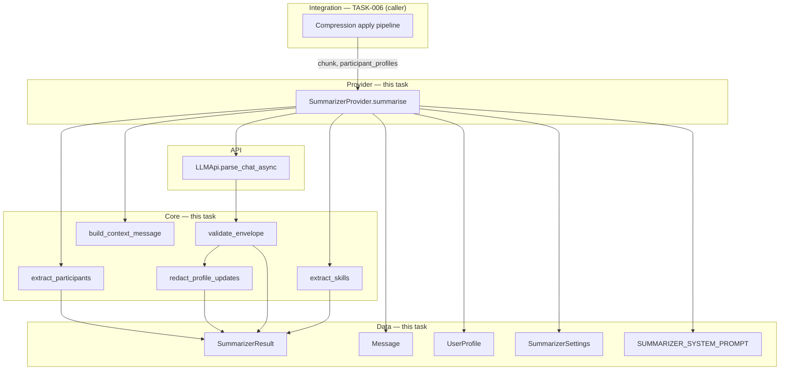

# TASK-005: summarizer provider and profile extraction — Design

← [[task|Back to task]] | [[requirements|Requirements]]

## Solution overview

Introduce a self-contained summarisation Operation under `yoda/mind/memory/`: `SummarizerCore` holds all sync logic (mechanical `participants`/`skills` extraction, dynamic context assembly, strict envelope validation, PII redaction on structured deltas); `SummarizerProvider` performs exactly one `LLMApi.parse_chat_async` call per `summarise` invocation and merges LLM output with mechanical fields into a `SummarizerResult` Data object. The static system prompt is packaged as a Python constant (source of truth remains [[design/prompts/summarizer|summarizer.md]]); model name comes from an optional `mind.memory.chat_compression.summarizer` settings block with fallback to `mind.perception.language.model_name`. The Provider never touches Redis or `MemoryProvider` — [[TASK-006-compression-apply-and-size-trigger/task|TASK-006]] fetches profiles, calls `summarise`, then applies returned deltas via `MemoryProvider.update_user_profile` in transformation step 5.

## Architecture



| Component | IODA | Role |
|-----------|------|------|
| `SummarizerProvider` | Provider | One LLM call; orchestrates Core steps; returns `SummarizerResult` ([[requirements\|FR-1]]–[[requirements\|FR-3]], [[requirements\|FR-9]]) |
| `SummarizerCore` | Core | Mechanical extraction, context serialisation, envelope validation, redaction ([[requirements\|FR-4]]–[[requirements\|FR-8]]) |
| `SummarizerResult`, `SummarizerSettings`, `LlmSummarizerEnvelope` | Data | Result DTO, settings DTO, Pydantic wire-shape for `json.loads` ([[requirements\|FR-2]]) |
| `SUMMARIZER_SYSTEM_PROMPT` | Data | Packaged static prompt text ([[requirements\|FR-3]]) |
| `SummarizerValidationError` | Data | Dedicated validation failure type ([[requirements\|FR-4]]) |
| `LLMApi` | API | Existing async Mistral JSON-object completion ([[requirements\|FR-3]]) |

## Key decisions

### Decision 1: Module layout — `summarizer.py` + `data/` siblings

**Context:** FR-1 requires a Provider under `yoda/mind/` without coupling to `MemoryProvider`.
**Options:** (A) `yoda/mind/summarizer.py` at mind root / (B) `yoda/mind/memory/summarizer.py` alongside `compression_core.py` and `memory.py`.
**Choice:** B — summarisation is part of the chat-compression memory pipeline; colocates with `Message`, `UserProfile`, and `CompressionCore` imports. Matches the `memory.py` pattern of Core + Provider in one module file.

### Decision 2: `SummarizerProvider` depends on `LLMApi` directly, not `LanguageProvider`

**Context:** FR-1 forbids Provider-to-Provider dependencies; summariser may use a different model than chat replies.
**Options:** (A) inject `LanguageProvider` / (B) inject `LLMApi` + `SummarizerSettings`.
**Choice:** B — satisfies IODA; mirrors how `yoda_chat_bot.py` already constructs a shared `LLMApi` instance. TASK-006 wiring passes the same `LLMApi` used for perception plus resolved model name.

### Decision 3: Static prompt as packaged constant, not runtime doc read

**Context:** FR-3 requires the static system prompt from [[design/prompts/summarizer#Static system prompt]].
**Options:** (A) read `doc/design/prompts/summarizer.md` at runtime / (B) `yoda/mind/memory/data/summarizer_prompt.py` constant / (C) settings string.
**Choice:** B — matches `DEFAULT_SYSTEM_PROMPT` and `INTENT_CLASSIFICATION_PROMPT` patterns; no deployment path dependency on the Obsidian vault. When prompt prose changes, update both the design doc and the constant (optional parity test can compare lengths or a checksum — not required for MVP).

### Decision 4: Two-stage validation — Pydantic wire parse, then Core normalisation

**Context:** FR-4 requires strict rules (topics ≤ 5, stringified user ids, drop empty scalars, unknown keys fail) beyond a naive Pydantic model.
**Options:** (A) single Pydantic model with all validators / (B) `LlmSummarizerEnvelope` (loose wire shape) + `SummarizerCore.validate_envelope(envelope) -> EnvelopeFields`.
**Choice:** B — keeps `LLMApi.parse_chat_async` integration simple (`LlmSummarizerEnvelope` has the three top-level keys only); business rules and normalisation live in testable Core staticmethods. `SummarizerValidationError` raised for all post-parse rule violations; `json.JSONDecodeError` and Pydantic `ValidationError` propagate from `LLMApi` unchanged.

### Decision 5: Mechanical `participants` computed inside Provider before the LLM call

**Context:** FR-3 `== PROFILES ==` section needs the mechanical participant set; FR-2 also passes `participant_profiles` from the caller.
**Options:** (A) caller passes precomputed `participants` / (B) Provider computes participants, filters `participant_profiles` to that set.
**Choice:** B — single source of truth for the mechanical rule ([[chat_context_management#Summarizer envelope]]); caller only supplies profile snapshots. Provider **fails fast** with `ValueError` if any mechanical participant id is missing from `participant_profiles` (caller contract for TASK-006).

### Decision 6: `skills` returned as sorted `list[str]`

**Context:** FR-2 allows set or sorted list; FR-6 requires deterministic test ordering.
**Options:** (A) `set[str]` / (B) `sorted` list after union.
**Choice:** B — `SummarizerResult.skills: list[str]` sorted ascending; Chroma metadata flattening in TASK-008 is simpler with a stable list.

### Decision 7: Redaction as compiled regex set in `SummarizerCore`

**Context:** FR-7 requires post-parse PII drop on structured fields; city/country in `location` must survive.
**Options:** (A) LLM-only redaction / (B) Core regex helpers with per-class patterns / (C) external library (e.g. `presidio`).
**Choice:** B — no new dependency; testable in isolation. `SummarizerCore.is_redactable(text: str) -> bool` OR-matches pattern classes from [[chat_context_management#Profile extraction details / Redaction]]: email, phone (E.164-ish and common national formats; match requires ≥7 digits in the candidate string to avoid false positives on short numeric tokens), street-level address (number + street-type token heuristic — **not** bare city/country), IBAN / card / account number, password/token/key literals (`password`, `api_key`, `secret`, `sk-`, `Bearer ` prefixes). Scalar: drop field when entire value matches; list/dict items: drop matching items only.

*ADR candidate:* if redaction patterns need sharing with other subsystems (agent tools, export), promote to `doc/design/` or ADR before a second copy appears.

### Decision 8: Summariser model settings — optional nested block with fallback

**Context:** Requirements assumption leaves settings key as a design choice.
**Options:** (A) always reuse `mind.perception.language.model_name` / (B) optional `mind.memory.chat_compression.summarizer.model_name` with fallback.
**Choice:** B — allows a cheaper model for compression without changing chat model. `SummarizerSettings.from_settings(mind_settings: dict)` reads nested block; missing block → fallback. API key always comes from the injected `LLMApi` instance (constructed from `mind.perception.language.api_key` in wiring). Fail fast if no model name resolves.

### Decision 9: Defer `SummarizerProvider` wiring to TASK-006

**Context:** FR-1 allows test-only construction until apply lands.
**Options:** (A) wire in `yoda_chat_bot.py` now / (B) defer to TASK-006.
**Choice:** B — no caller exists until apply; keeps this task diff focused. `SummarizerSettings.from_settings` is implemented here so TASK-006 adds two lines to `main()`.

## Interfaces

### Public Provider contract (FR-1, FR-2)

```python
# yoda/mind/memory/summarizer.py

class SummarizerProvider:
    def __init__(self, llm_api: LLMApi, settings: SummarizerSettings) -> None: ...

    async def summarise(
        self,
        chunk: list[Message],
        participant_profiles: dict[int, UserProfile],
    ) -> SummarizerResult: ...
```

`summarise` flow:

1. `participants = SummarizerCore.extract_participants(chunk)`
2. Validate `participant_profiles` keys ⊇ `set(participants)`; else `ValueError`
3. `user_content = SummarizerCore.build_context_message(chunk, participants, participant_profiles)`
4. `messages = [{"role": "system", "content": SUMMARIZER_SYSTEM_PROMPT}, {"role": "user", "content": user_content}]`
5. `wire = await self._llm_api.parse_chat_async(self._settings.model_name, messages, LlmSummarizerEnvelope)`
6. `envelope = SummarizerCore.validate_envelope(wire)` — may raise `SummarizerValidationError`
7. `profile_updates = SummarizerCore.redact_profile_updates(envelope.profile_updates)`
8. `skills = SummarizerCore.extract_skills(chunk)`
9. Log debug counts; return `SummarizerResult(...)`

No retry loop inside the Provider (FR-3).

### Result DTO (FR-2)

```python
# yoda/mind/memory/data/summarizer_result.py

@dataclass(frozen=True)
class SummarizerResult:
    summary: str
    topics: list[str]
    participants: list[int]          # sorted ascending
    skills: list[str]                  # sorted ascending
    profile_updates: dict[int, dict]   # ready for MemoryProvider.update_user_profile
```

Record-schema fields (`id`, `chunk_start_message_id`, `chunk_end_message_id`, `chunk_visible_count`, `created_at`) are **not** on this type — TASK-006 adds them when building inline `summary` messages and outbox entries.

### Settings DTO (Decision 8)

```python
# yoda/mind/memory/data/summarizer_settings.py

@dataclass(frozen=True)
class SummarizerSettings:
    model_name: str

    @classmethod
    def from_settings(cls, settings: dict) -> "SummarizerSettings": ...
```

Resolution order: `settings["mind"]["memory"]["chat_compression"].get("summarizer", {}).get("model_name")` → `settings["mind"]["perception"]["language"]["model_name"]`; raise `ValueError` if still missing.

### Wire envelope (Pydantic — FR-3, FR-4)

```python
# yoda/mind/memory/data/summarizer_envelope.py

class LlmSummarizerEnvelope(BaseModel):
    summary: str
    topics: list[str]
    profile_updates: dict[str, dict[str, object]]  # keys are stringified user ids
```

### Core helpers (FR-4–FR-8)

```python
# yoda/mind/memory/summarizer.py — module-level constants + Core

SUMMARIZER_SCALAR_KEYS = frozenset({
    "preferred_name", "gender", "location", "timezone", "occupation",
})
SUMMARIZER_ALLOWED_USER_KEYS = SUMMARIZER_SCALAR_KEYS | frozenset({
    "interests_to_add", "facts_to_add", "skill_preferences_to_add",
})

@dataclass(frozen=True)
class ValidatedEnvelope:
    summary: str
    topics: list[str]
    profile_updates: dict[int, dict]

class SummarizerCore:
    @staticmethod
    def extract_participants(chunk: list[Message]) -> list[int]: ...

    @staticmethod
    def extract_skills(chunk: list[Message]) -> list[str]: ...

    @staticmethod
    def build_context_message(
        chunk: list[Message],
        participants: list[int],
        participant_profiles: dict[int, UserProfile],
    ) -> str: ...

    @staticmethod
    def validate_envelope(wire: LlmSummarizerEnvelope) -> "ValidatedEnvelope": ...

    @staticmethod
    def redact_profile_updates(
        updates: dict[int, dict],
    ) -> dict[int, dict]: ...

    @staticmethod
    def is_redactable(text: str) -> bool: ...
```

#### `extract_participants` (FR-5)

```python
sorted({m.user_id for m in chunk if m.kind == "user" and m.user_id is not None})
```

#### `extract_skills` (FR-6)

For each `m` where `m.kind == "task_result"`:

- If `"Tools used: "` not in `m.text` → skip (no error).
- Let `clause` = text after `"Tools used: "` up to (but not including) the first `.` after that index.
- If `clause == "none"` → skip.
- Else split `clause` on `", "`, strip each token, drop empties; union into a set.
- Return `sorted(set)`.

#### `build_context_message` (FR-3)

Returns a single string:

```
== PROFILES ==
{"user_id": <id>, "profile": <UserProfile.to_dict()>}
...one line per participant id in ascending order...

== CHUNK ==
{"kind": "...", "ts": "<ISO-8601 UTC from Message.timestamp>", "content": "<Message.text>", ...}
```

Chunk lines: include `user_id` only when `kind == "user"`. Serialise messages in chunk order; do not filter kinds — caller passes an already-stripped chunk (TASK-006).

#### `validate_envelope` (FR-4)

Returns a module-level `ValidatedEnvelope` frozen dataclass with `summary: str`, `topics: list[str]`, `profile_updates: dict[int, dict]`. Per-user normalisation is delegated to private `_normalise_user_delta`; redaction uses private `_redact_user_delta`.

Rules:

| Rule | On violation |
|------|----------------|
| `summary.strip()` non-empty | `SummarizerValidationError` |
| `len(topics) <= 5` | `SummarizerValidationError` |
| each topic is `str` | `SummarizerValidationError` |
| each `profile_updates` key parses to `int` | `SummarizerValidationError` |
| per-user dict non-empty after normalisation | drop user |
| only keys in `SUMMARIZER_ALLOWED_USER_KEYS` | `SummarizerValidationError` on unknown |
| scalar values: reject `null`, `""`, whitespace-only — drop field | — |
| `interests_to_add` / `facts_to_add`: list of non-empty strings | `SummarizerValidationError` on wrong type/empty item |
| `skill_preferences_to_add`: `dict[str, list[str]]` with non-empty keys and items | `SummarizerValidationError` on wrong shape |
| empty top-level `profile_updates` | valid → `{}` |

#### `redact_profile_updates` (FR-7)

Walk each user's delta dict:

- Scalars: drop key if `is_redactable(value)`.
- `interests_to_add` / `facts_to_add`: filter list items.
- `skill_preferences_to_add`: filter each skill's preference strings; drop skill entry if list becomes empty.
- Drop user entry if no keys remain.

Returned dicts use only keys that survived validation and redaction — ready for `MemoryCore.apply_profile_updates` via `MemoryProvider.update_user_profile` in TASK-006 (FR-8).

### Logging (FR-9)

- Validation failure: `logger.error("Summarizer validation failed: %s", exc)` before re-raise; no full chunk/profile at info.
- Success: `logger.debug` with `len(summary)`, `len(participants)`, `len(skills)`, `len(profile_updates)` only.
- Raw JSON truncation stays in existing `LLMApi` debug log.

### Test fake (FR-10)

```python
# tests/fakes.py (extend) or inline in test module

class FakeLLMApi:
  def __init__(self, responses: list[str] | dict[tuple, str]) -> None: ...
  async def parse_chat_async(self, model_name, messages, response_format):
      # json.loads predetermined string → response_format(**data)
      # optionally assert messages shape (profiles section, chunk section)
```

Tests live in `tests/test_summarizer.py` — no Redis, no bot startup.

## System impact

| Path / class | IODA | Change | FR |
|--------------|------|--------|-----|
| `yoda/mind/memory/summarizer.py` — `SummarizerCore` | Core | create — participants, skills, context build, validate, redact | FR-4–FR-8 |
| `yoda/mind/memory/summarizer.py` — `SummarizerProvider` | Provider | create — `summarise`, LLM call, logging | FR-1–FR-3, FR-9 |
| `yoda/mind/memory/data/summarizer_result.py` — `SummarizerResult` | Data | create | FR-2 |
| `yoda/mind/memory/data/summarizer_settings.py` — `SummarizerSettings` | Data | create | FR-1, Decision 8 |
| `yoda/mind/memory/data/summarizer_envelope.py` — `LlmSummarizerEnvelope`, `SummarizerValidationError` | Data | create | FR-4 |
| `yoda/mind/memory/data/summarizer_prompt.py` — `SUMMARIZER_SYSTEM_PROMPT` | Data | create — copy of static prompt body | FR-3 |
| `tests/test_summarizer.py` | — | create — unit tests per FR-10 | FR-10 |
| `tests/fakes.py` — `FakeLLMApi` | — | create (or local test double) | FR-10 |

**Not changed in this task:** `yoda/yoda_chat_bot.py` wiring (TASK-006), `MemoryProvider`, `settings.json` (optional `summarizer` block documented but not required for tests), `doc/design/prompts/summarizer.md` prose.

## Decisions made (from requirements review)

| Item | Resolution |
|------|------------|
| Provider does not call `MemoryProvider` | Confirmed — deltas returned only; apply in TASK-006 step 5 |
| Chunk stripping before `summarise` | Caller (TASK-006) responsibility; tests pass pre-stripped chunks |
| `participant_profiles` sourcing | Integration loads from Redis; Provider validates coverage |
| Summary prose `[REDACTED]` | LLM + prompt only; FR-7 structured redaction in Core |
| Epic `internal_compat: none` | No defensive machinery for partial deploy between member tasks |
| Epic `external_contract: migrate-on-merge` | No stash migration in this task; consumes existing `Message.kind` and profile fields |

## Open questions

None.
