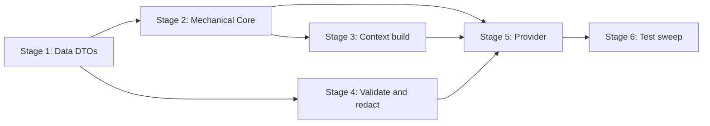

# TASK-005: summarizer provider and profile extraction — Implementation plan

← [[task|Back to task]] | [[requirements|Requirements]] | [[design|Design]]

## Overview

Implement `SummarizerCore` and `SummarizerProvider` under `yoda/mind/memory/` — a self-contained summarisation Operation that performs one `LLMApi.parse_chat_async` call per compression chunk, strictly validates the JSON envelope (`summary`, `topics`, `profile_updates`), derives `participants` and `skills` mechanically from the chunk, redacts PII from structured profile deltas, and returns a `SummarizerResult` ready for TASK-006 apply. No Redis, no `MemoryProvider`, no bot wiring — the riskiest model interaction gets its own test surface before the full apply pipeline lands.

## Goal / Non-goals

- **Goal:** `SummarizerProvider.summarise(chunk, participant_profiles) -> SummarizerResult` matches [[design#Interfaces]]; Core helpers are pure and unit-tested; `FakeLLMApi` drives provider tests without network; full suite green.
- **Non-goals:** Calling `MemoryProvider.update_user_profile`; snapshot / transform / apply / graft+merge; `user_introduction` strip/refresh; compression triggers and Maintenance wiring beyond optional `SummarizerSettings`; Chroma / embeddings; `yoda_chat_bot.py` construction of `SummarizerProvider` (TASK-006); changes to summariser prompt prose in `doc/design/prompts/summarizer.md` unless required for implementability.

## Context to load

Files to read before starting:

- [[requirements]] — FR-1…FR-10 and acceptance criteria
- [[design]] — Architecture, Key decisions, Interfaces, System impact
- [[EPIC-001-chat-context-management/epic|EPIC-001 epic.md]] — delivery profile (`internal_compat: none`, `external_contract: migrate-on-merge`; no intermediate deploy steps)
- [[chat_context_management]] — master design sections linked from `task.md` `## Master design` (Summarizer envelope, Profile extraction / Redaction, Record schema mechanical fields)
- `doc/design/prompts/summarizer.md` — static prompt body to copy into `SUMMARIZER_SYSTEM_PROMPT`
- `AGENTS.md` (IODA), `coding_behavior.md`
- `yoda/api/llm_api.py` — `parse_chat_async` contract
- `yoda/mind/memory/data/message.py`, `yoda/mind/memory/data/user_profile.py`
- `yoda/mind/memory/data/system_prompt.py` — packaged-prompt pattern reference
- `yoda/mind/memory/data/chat_compression_settings.py` — `from_dict` / fail-fast settings pattern
- [[TASK-000-compression-prerequisites/design|TASK-000 design]] — `Tools used: …` contract, delta keys
- [[TASK-001-message-kinds-and-conversation-state-v3/design|TASK-001 design]] — `Message.kind`
- `tests/fakes.py`, `tests/test_mind_agent_pipeline.py` — existing `Tools used:` assertions
- `settings.json` — `mind.memory.chat_compression` block (no `summarizer` sub-block yet; fallback model path)

## Pre-flight

Mandatory conditions before implementation starts.

- [x] On epic shared branch: `git checkout feat/EPIC-001-chat-context-management` (create from `main` if missing)
- [x] `git status` — working tree clean or unrelated WIP stashed
- [x] Dependencies merged on branch: [[TASK-000-compression-prerequisites/task|TASK-000]] and [[TASK-001-message-kinds-and-conversation-state-v3/task|TASK-001]] are `done` (`Message.kind`, `UserProfile.skill_preferences`, `Tools used:` agent lines)
- [x] `.venv` active; dependencies installed (`pydantic`, `mistralai` already present)
- [x] Baseline suite green: `.venv/bin/python -m pytest`
- [x] No `yoda/mind/memory/summarizer.py` yet (avoid duplicate work if resuming)

## Files & artifacts

| Path | IODA | Op | FR |
|------|------|----|----|
| `yoda/mind/memory/data/summarizer_result.py` — `SummarizerResult` | Data | create | FR-2 |
| `yoda/mind/memory/data/summarizer_settings.py` — `SummarizerSettings` | Data | create | FR-1 |
| `yoda/mind/memory/data/summarizer_envelope.py` — `LlmSummarizerEnvelope`, `SummarizerValidationError` | Data | create | FR-4 |
| `yoda/mind/memory/data/summarizer_prompt.py` — `SUMMARIZER_SYSTEM_PROMPT` | Data | create | FR-3 |
| `yoda/mind/memory/summarizer.py` — `SummarizerCore` | Core | create | FR-4–FR-8 |
| `yoda/mind/memory/summarizer.py` — `SummarizerProvider` | Provider | create | FR-1–FR-3, FR-9 |
| `tests/fakes.py` — `FakeLLMApi` | test | edit | FR-10 |
| `tests/test_summarizer.py` | test | create | FR-10 |

**Not changed:** `yoda/yoda_chat_bot.py`, `MemoryProvider`, `settings.json` (optional `summarizer` block documented in design only).

## Stages

### Stage 1: Data DTOs and packaged prompt

**Goal:** All Data types and the static system prompt constant exist; settings resolution is testable without LLM.

- [x] **1.1** Create `SummarizerResult`
  - Files: `yoda/mind/memory/data/summarizer_result.py`, `tests/test_summarizer.py`
  - Action: Frozen dataclass per [[design#Result DTO]] — `summary: str`, `topics: list[str]`, `participants: list[int]`, `skills: list[str]`, `profile_updates: dict[int, dict]`. TDD: construct instance with sample values; assert field types.
  - Verify: `.venv/bin/python -m pytest tests/test_summarizer.py -k "summarizer_result"`
  - Commit: `feat(TASK-005): 1.1 SummarizerResult dataclass`

- [x] **1.2** Create `SummarizerSettings.from_settings`
  - Files: `yoda/mind/memory/data/summarizer_settings.py`, `tests/test_summarizer.py`
  - Action: Frozen dataclass with `model_name: str`. `from_settings(settings: dict)` resolves `mind.memory.chat_compression.summarizer.model_name` → fallback `mind.perception.language.model_name`; raise `ValueError` if still missing (Decision 8). TDD: nested block wins; fallback works; missing both raises.
  - Verify: `.venv/bin/python -m pytest tests/test_summarizer.py -k "summarizer_settings"`
  - Commit: `feat(TASK-005): 1.2 SummarizerSettings resolution`

- [x] **1.3** Create wire envelope and validation error type
  - Files: `yoda/mind/memory/data/summarizer_envelope.py`, `tests/test_summarizer.py`
  - Action: Pydantic `LlmSummarizerEnvelope` with `summary: str`, `topics: list[str]`, `profile_updates: dict[str, dict[str, object]]`. `SummarizerValidationError(ValueError)` for post-parse rule violations. TDD: valid wire parses; missing top-level key raises Pydantic `ValidationError`.
  - Verify: `.venv/bin/python -m pytest tests/test_summarizer.py -k "summarizer_envelope"`
  - Commit: `feat(TASK-005): 1.3 LLM wire envelope model`

- [x] **1.4** Package static summariser prompt
  - Files: `yoda/mind/memory/data/summarizer_prompt.py`, `tests/test_summarizer.py`
  - Action: Copy static prompt body from `doc/design/prompts/summarizer.md` § Static system prompt into `SUMMARIZER_SYSTEM_PROMPT` constant (Decision 3). TDD: constant non-empty; contains distinctive anchor strings (`ROLE`, `OUTPUT FORMAT`, `profile_updates`).
  - Verify: `.venv/bin/python -m pytest tests/test_summarizer.py -k "summarizer_prompt"`
  - Commit: `feat(TASK-005): 1.4 packaged summariser system prompt`

**Checkpoint Stage 1:** `.venv/bin/python -m pytest tests/test_summarizer.py -k "summarizer_result or summarizer_settings or summarizer_envelope or summarizer_prompt"`

---

### Stage 2: Core mechanical extraction

**Goal:** `participants` and `skills` derived from chunk without LLM (FR-5, FR-6).

- [x] **2.1** Implement `SummarizerCore.extract_participants`
  - Files: `yoda/mind/memory/summarizer.py`, `tests/test_summarizer.py`
  - Action: Add `SummarizerCore` skeleton with `SUMMARIZER_SCALAR_KEYS`, `SUMMARIZER_ALLOWED_USER_KEYS` frozensets per [[design#Core helpers]]. Implement `extract_participants(chunk) -> list[int]` — sorted unique `user_id` where `kind == "user"` and `user_id is not None`. TDD: mixed `user`/`assistant`/`task_result`; duplicate user ids deduped; `user_id is None` excluded; ascending order.
  - Verify: `.venv/bin/python -m pytest tests/test_summarizer.py -k "extract_participants"`
  - Commit: `feat(TASK-005): 2.1 mechanical participants extraction`

- [x] **2.2** Implement `SummarizerCore.extract_skills`
  - Files: `yoda/mind/memory/summarizer.py`, `tests/test_summarizer.py`
  - Action: Per [[design#extract_skills]] — scan `kind == "task_result"`; parse `Tools used: ` clause up to first `.`; `none` (case-sensitive) → skip; else split on `", "`, strip, drop empties; return sorted union. TDD: `Tools used: a, b`; `Tools used: none`; absent `Tools used:` on reminder-style `task_result`; multiple messages union; deterministic sort.
  - Verify: `.venv/bin/python -m pytest tests/test_summarizer.py -k "extract_skills"`
  - Commit: `feat(TASK-005): 2.2 mechanical skills extraction`

**Checkpoint Stage 2:** `.venv/bin/python -m pytest tests/test_summarizer.py -k "extract_participants or extract_skills"`

---

### Stage 3: Core context assembly

**Goal:** Dynamic user message block matches summariser prompt contract (FR-3).

- [x] **3.1** Implement `SummarizerCore.build_context_message`
  - Files: `yoda/mind/memory/summarizer.py`, `tests/test_summarizer.py`
  - Action: Build single string with `== PROFILES ==` then `== CHUNK ==` sections per [[design#build_context_message]]. Profiles: one JSON line per participant id (ascending) with `UserProfile.to_dict()`. Chunk: one JSON line per message in order with `kind`, `ts` (ISO-8601 UTC from `timestamp`), `content` (`text`); include `user_id` only when `kind == "user"`. TDD: profile lines only for mechanical participants; chunk preserves order; `user_id` omitted on non-user kinds.
  - Verify: `.venv/bin/python -m pytest tests/test_summarizer.py -k "build_context_message"`
  - Commit: `feat(TASK-005): 3.1 dynamic context block assembly`

**Checkpoint Stage 3:** `.venv/bin/python -m pytest tests/test_summarizer.py -k "build_context_message"`

---

### Stage 4: Core envelope validation and redaction

**Goal:** Strict post-parse rules and PII sanitisation on structured deltas (FR-4, FR-7, FR-8).

- [x] **4.1** Implement `SummarizerCore.is_redactable`
  - Files: `yoda/mind/memory/summarizer.py`, `tests/test_summarizer.py`
  - Action: Compiled regex set per Decision 7 — email, phone, street-level address (number + street token; **not** bare city/country), IBAN/card/account, password/token/key literals (`password`, `api_key`, `secret`, `sk-`, `Bearer `). `is_redactable(text) -> bool` OR-matches. TDD: email/phone/token redactable; `location` values like `Berlin, Germany` not redactable; safe occupation strings pass.
  - Verify: `.venv/bin/python -m pytest tests/test_summarizer.py -k "is_redactable"`
  - Commit: `feat(TASK-005): 4.1 PII redaction pattern helper`

- [x] **4.2** Implement `SummarizerCore.validate_envelope`
  - Files: `yoda/mind/memory/summarizer.py`, `tests/test_summarizer.py`
  - Action: `validate_envelope(wire: LlmSummarizerEnvelope) -> ValidatedEnvelope` (internal dataclass/namedtuple) per [[design#validate_envelope]] rules table. Raise `SummarizerValidationError` on violations; drop empty scalars; drop users with empty dicts after normalisation; parse string user ids to `int`. TDD: happy path; empty `profile_updates` valid; `topics` length > 5 fails; unknown delta key fails; non-numeric user id key fails; whitespace-only scalar dropped; `interests_to_add` / `skill_preferences_to_add` shape validation.
  - Verify: `.venv/bin/python -m pytest tests/test_summarizer.py -k "validate_envelope"`
  - Commit: `feat(TASK-005): 4.2 envelope validation and normalisation`

- [x] **4.3** Implement `SummarizerCore.redact_profile_updates`
  - Files: `yoda/mind/memory/summarizer.py`, `tests/test_summarizer.py`
  - Action: Walk `dict[int, dict]` — drop redactable scalars; filter list items in `interests_to_add`/`facts_to_add`; filter preference strings per skill in `skill_preferences_to_add`; drop empty skill lists; omit users with no keys left. TDD: PII email in scalar dropped; mixed safe/PII list keeps safe items; user omitted when all fields redacted; city-only `location` survives.
  - Verify: `.venv/bin/python -m pytest tests/test_summarizer.py -k "redact_profile_updates"`
  - Commit: `feat(TASK-005): 4.3 structured profile delta redaction`

**Checkpoint Stage 4:** `.venv/bin/python -m pytest tests/test_summarizer.py -k "is_redactable or validate_envelope or redact_profile_updates"`

---

### Stage 5: Provider and fake LLM

**Goal:** End-to-end `summarise` orchestration with `FakeLLMApi`; logging and caller contracts (FR-1–FR-3, FR-9).

- [x] **5.1** Add `FakeLLMApi` test double
  - Files: `tests/fakes.py`, `tests/test_summarizer.py`
  - Action: `FakeLLMApi` with predetermined JSON string responses; `parse_chat_async` does `json.loads` → `response_format(**data)`; optional capture of `messages` for assertion. TDD: fake returns parsed `LlmSummarizerEnvelope`; invalid JSON propagates `JSONDecodeError`.
  - Verify: `.venv/bin/python -m pytest tests/test_summarizer.py -k "fake_llm"`
  - Commit: `test(TASK-005): 5.1 FakeLLMApi test double`

- [x] **5.2** Implement `SummarizerProvider.summarise`
  - Files: `yoda/mind/memory/summarizer.py`, `tests/test_summarizer.py`
  - Action: Provider `__init__(llm_api: LLMApi, settings: SummarizerSettings)`. `summarise` flow per [[design#summarise flow]] — extract participants; `ValueError` if `participant_profiles` missing any participant id; build context; one `parse_chat_async` with system+user messages; validate; redact; extract skills; return `SummarizerResult`. No retry loop; no persistence. TDD happy path: fake returns full envelope → result merges LLM fields + mechanical participants/skills; assert fake received `SUMMARIZER_SYSTEM_PROMPT` and context sections; scalar/list/`skill_preferences_to_add` delta shapes in return value.
  - Verify: `.venv/bin/python -m pytest tests/test_summarizer.py -k "summarise_happy or summarise_provider"`
  - Commit: `feat(TASK-005): 5.2 SummarizerProvider summarise`

- [x] **5.3** Provider failure paths and logging contract
  - Files: `yoda/mind/memory/summarizer.py`, `tests/test_summarizer.py`
  - Action: TDD: invalid JSON and `SummarizerValidationError` propagate (no partial result); missing participant profile raises `ValueError`; validation failure logs at `error` (use `caplog`); success logs at `debug` only with counts (summary length, participant/skill/profile_update counts) — no full chunk or profile payloads. Confirm Provider imports only `LLMApi` (API) + Data + Core — no `MemoryProvider` / `StorageApi`.
  - Verify: `.venv/bin/python -m pytest tests/test_summarizer.py -k "summarise_error or summarise_logging or summarise_missing_profile"`
  - Commit: `feat(TASK-005): 5.3 provider error handling and logging`

**Checkpoint Stage 5:** `.venv/bin/python -m pytest tests/test_summarizer.py`

---

### Stage 6: Test sweep & coverage

- [x] **6.1** FR acceptance audit
  - Files: `tests/test_summarizer.py`
  - Action: Walk FR-1…FR-10 acceptance bullets; add any missing cases (empty `profile_updates`; dynamic context profile lines only for participants; all FR-10 listed scenarios). Confirm `SummarizerCore` methods are `@staticmethod`; module has no Integration/Provider cross-deps beyond `SummarizerProvider` → `LLMApi`.
  - Verify: `.venv/bin/python -m pytest tests/test_summarizer.py`
  - Commit: `test(TASK-005): 6.1 FR coverage audit`

- [x] **6.2** Full suite and import hygiene
  - Files: `yoda/mind/memory/summarizer.py`, `tests/test_summarizer.py`
  - Action: Run full suite; grep `summarizer.py` for forbidden imports (`MemoryProvider`, `Mind`, `Maintenance`, `StorageApi`). Confirm no `yoda_chat_bot.py` or `mind.py` wiring added.
  - Verify: `.venv/bin/python -m pytest`
  - Commit: `test(TASK-005): 6.2 full suite green`

**Checkpoint Stage 6:** `.venv/bin/python -m pytest`

## Stage dependencies

## FR coverage (traceability)

| FR | Steps | Verification |
|----|-------|--------------|
| FR-1 | 1.2, 5.2, 5.3, 6.2 | `test_summarizer.py` (Provider constructible with `LLMApi` + settings; no Memory/Storage imports); manual: no bot wiring |
| FR-2 | 1.1, 5.2, 6.1 | `test_summarizer.py -k "summarizer_result or summarise_happy"` (`SummarizerResult` fields; no record-schema ids) |
| FR-3 | 1.4, 3.1, 5.2, 6.1 | `test_summarizer.py -k "build_context_message or summarise_happy"` (system prompt, profiles+chunk sections, single LLM call) |
| FR-4 | 1.3, 4.2, 5.2, 5.3, 6.1 | `test_summarizer.py -k "validate_envelope or summarise_error"` (strict parse, topics ≤ 5, unknown keys, JSON errors) |
| FR-5 | 2.1, 5.2, 6.1 | `test_summarizer.py -k "extract_participants"` |
| FR-6 | 2.2, 5.2, 6.1 | `test_summarizer.py -k "extract_skills"` |
| FR-7 | 4.1, 4.3, 6.1 | `test_summarizer.py -k "is_redactable or redact_profile_updates"` |
| FR-8 | 4.2, 4.3, 5.2, 6.1 | `test_summarizer.py -k "validate_envelope or redact_profile_updates or summarise_happy"` (delta shapes returned; Provider never calls Memory) |
| FR-9 | 5.3, 6.1 | `test_summarizer.py -k "summarise_logging"` (`caplog` error vs debug) |
| FR-10 | 5.1–6.2 | `tests/test_summarizer.py`; full `.venv/bin/python -m pytest` |

## Risks

| Risk | Probability | Impact | Mitigation |
|------|-------------|--------|------------|
| Redaction regex false positives on legitimate `location` / `facts` text | Medium | Medium | Stage 4.1 — explicit tests for city/country-only locations; street-level patterns require number + street token per Decision 7 |
| `build_context_message` timestamp format mismatch with prompt examples | Low | Medium | Stage 3.1 — assert ISO-8601 UTC output; reuse `Message.timestamp` as stored by ingest (TASK-001) |
| `validate_envelope` normalisation diverges from TASK-000 `MemoryCore.apply_profile_updates` expectations | Medium | High | Stage 4.2/6.1 — return dict keys exactly as emitted post-redaction; cross-check allowed key set against TASK-000 delta keys |
| `FakeLLMApi` diverges from real `LLMApi.parse_chat_async` behaviour | Low | Medium | Stage 5.1 — mirror `json.loads` + Pydantic construct path from `llm_api.py` |

## Rollback

- **Code:** `git revert` commits on `feat/EPIC-001-chat-context-management`.
- **State:** Pure code + tests only; no Redis, ChromaDB, or stash writes. No persistent-state rollback required.

## Definition of Done

- [x] All plan steps checked
- [x] All FR-1…FR-10 acceptance criteria pass
- [x] Full suite green: `.venv/bin/python -m pytest`
- [x] IODA respected: Core logic in `SummarizerCore`; Provider depends only on `LLMApi` + Data; no Provider→Provider or Integration logic
- [x] Public contract matches [[design#Interfaces]] — stable for TASK-006 apply step 5
- [x] `SummarizerSettings.from_settings` ready for TASK-006 wiring (two-line `main()` addition)
- [x] `task.md`: `status: done`, `updated: 2026-06-15`
- [x] `design.md` / ADR updated only if execution diverges (e.g. redaction pattern tweak)
