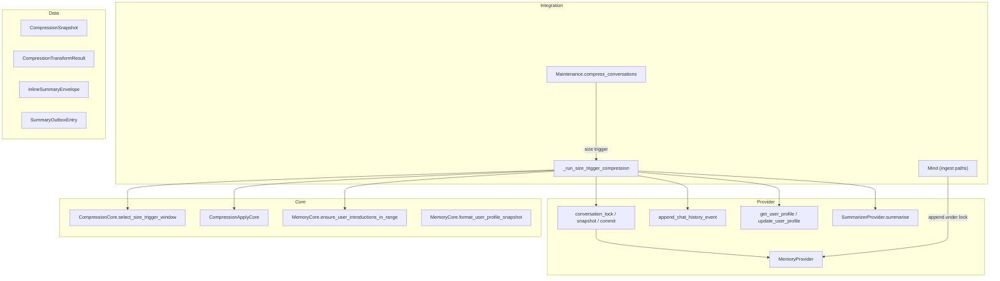

# TASK-006: compression apply and size trigger — Design

← [[task|Back to task]] | [[requirements|Requirements]]

## Solution overview

Deliver the full [[chat_context_management#Compression apply|compression apply]] pipeline as an Integration orchestration in `Maintenance`, with sync transformation helpers in a new `CompressionApplyCore`, per-conversation `asyncio.Lock` boundaries owned by `MemoryProvider`, and size-trigger-only wiring replacing the TASK-004 dry-run stub. Each run: snapshot under lock (`N_old`, deep copy, `snapshot_ts`) → ten transformation steps on the copy (size window via `CompressionCore`, strip/refresh via `MemoryCore.ensure_user_introductions_in_range`, `SummarizerProvider.summarise`, profile deltas via `MemoryProvider.update_user_profile`, inline summary + FIFO eviction, audit entry) without holding the lock during the LLM call → graft+merge under lock with `new_arrivals` reconciliation. `Mind` ingest paths route all message-append mutations through lock-aware `MemoryProvider` methods so concurrent ingest during summarisation is safe. Apply is in-memory only per [[ADR-000-sensitive-data-persistence]]; `Chat.history` audit lines persist to the `chats` Redis hash; `pending_vectorization` accumulates until TASK-008.

## Architecture

Per [[chat_context_management#Compression apply]], [[chat_context_management#Lock model]], [[chat_context_management#Apply: graft + merge]], [[chat_context_management#Refresh during compression]].



| Component | IODA | Role |
|-----------|------|------|
| `Maintenance._run_size_trigger_compression` | Integration | Full run orchestration; size trigger only ([[requirements\|FR-14]]) |
| `MemoryProvider.conversation_lock` | Provider | Per-`chat_id` `asyncio.Lock`; shared by ingest and compression ([[requirements\|FR-1]]) |
| `MemoryProvider.take_compression_snapshot` / `commit_compression` | Provider | Lock-scoped snapshot and graft+merge primitives ([[requirements\|FR-2]], [[requirements\|FR-12]]) |
| `MemoryProvider.append_chat_history_event` | Provider | Load `Chat`, append audit line, `hset` `chats` ([[requirements\|FR-11]]) |
| `CompressionApplyCore` | Core | Sync steps 1–2, 6–10 helpers on the copy; graft merge field math; arrivals reconciliation ([[requirements\|FR-3]]–[[requirements\|FR-10]], [[requirements\|FR-12]]) |
| `CompressionCore` | Core | `select_size_trigger_window` only in this task ([[requirements\|FR-3]]) |
| `SummarizerProvider` | Provider | Single LLM call; caller loads profiles ([[requirements\|FR-5]]) |
| `MemoryCore.ensure_user_introductions_in_range` | Core | Step 8 refresh + `new_arrivals` intro insertion ([[requirements\|FR-9]], [[requirements\|FR-12]]) |
| `InlineSummaryEnvelope` | Data | JSON `Message.text` round-trip for `summary_id` + `added_at` + body ([[requirements\|FR-7]], [[requirements\|FR-8]]) |
| `CompressionSnapshot`, `CompressionTransformResult` | Data | Snapshot and post-transform bundles passed snapshot → commit |

## Key decisions

### Decision 1: `CompressionApplyCore` for sync transformation; `Maintenance` for orchestration

**Context:** [[requirements\|FR-1]]–[[requirements\|FR-13]] span locking, async profile I/O, LLM call, and graft. IODA places orchestration in Integration and pure transforms in Core.
**Options:** (A) All logic in `Maintenance`; (B) new Integration class `Compression`; (C) `CompressionApplyCore` + `Maintenance._run_size_trigger_compression`.
**Choice:** C — mirrors `SummarizerCore`/`SummarizerProvider` and `CompressionCore` split; keeps `Maintenance` as the single periodic Integration entry (TASK-004 seam) without a second top-level Integration. `Maintenance` receives `SummarizerProvider` via constructor injection.
**FR:** FR-1–FR-15

### Decision 2: Lock and snapshot/commit primitives on `MemoryProvider`

**Context:** [[requirements\|FR-1]] requires one lock per conversation shared by ingest and compression; Provider owns in-memory `Conversation` state.
**Options:** (A) Lock dict on `Maintenance`; (B) lock on `MemoryProvider` with snapshot/commit helpers; (C) lock on `Conversation` dataclass.
**Choice:** B — `MemoryProvider._compression_locks: dict[int, asyncio.Lock]` (lazy per `chat_id`); `async with conversation_lock(chat_id)` context manager; `take_compression_snapshot` and `commit_compression` acquire it internally. Ingest mutations (`append_conversation_line`, new `append_message`) acquire the same lock before mutating `messages` or trigger bookkeeping fields.
**FR:** FR-1, FR-2, FR-12

### Decision 3: Inline summary `Message.text` as versioned JSON envelope

**Context:** [[requirements\|FR-7]]–[[requirements\|FR-8]] need `summary_id`, narrative text, and `added_at` for eviction outbox entries and stash v3 round-trip; `Message` has no extra metadata fields.
**Options:** (A) Plain text only, derive ids from position; (B) JSON envelope in `text`; (C) new `Message` fields / stash v4.
**Choice:** B — `InlineSummaryEnvelope` (`v`, `summary_id`, `added_at`, `text`) serialised to `Message.text`; `CompressionApplyCore.build_summary_message` / `parse_summary_message`. `role="system"`, `kind="summary"`. New summaries set `added_at` to `snapshot_ts` as ISO-8601 UTC.
**FR:** FR-7, FR-8, FR-11

### Decision 4: Deterministic `summary_id` and `message_id` fallback

**Context:** [[chat_context_management#Deterministic record id]] and [[requirements\|FR-3]] require stable ids; test fixtures may lack Telegram `message_id`.
**Options:** (A) Require `message_id` on all chunk messages (fail otherwise); (B) synthetic int fallback `-index` when `message_id` is `None`.
**Choice:** B — `CompressionApplyCore.chunk_boundary_message_id(messages, index)` returns `message.message_id` if set, else `-index` (negative index is unambiguous and stable for a given snapshot). `summary_id = sha256(f"{chat_id}:{snapshot_ts}:{start_id}:{end_id}").hexdigest()`.
**FR:** FR-3, FR-7, FR-8

### Decision 5: Compressible chunk = post-split region minus head `prompt` + contiguous `summary` blocks

**Context:** [[requirements\|FR-3]] variant C — never re-summarise existing inline summaries; leading `prompt` is not summarised.
**Options:** (A) Pass full `[0:split)` to summariser; (B) skip head `prompt` then skip contiguous `summary` messages at the front of that region before strip/chunk shaping.
**Choice:** B — `CompressionApplyCore.slice_compressible_chunk(messages, split) -> (chunk_start_index, chunk_end_index, chunk_messages)` returns the half-open slice into `copy.messages` that becomes the summariser input after step-2 strip. Tail `[split:]` stays raw on the copy.
**FR:** FR-3

### Decision 6: Step 8 and graft reconciliation share `MemoryCore.ensure_user_introductions_in_range` with explicit `removed_users` scoping

**Context:** [[requirements\|FR-9]], [[requirements\|FR-12]]; case (b) on `new_arrivals` must not insert intros for users already introduced before snapshot.
**Options:** (A) Call `ensure_user_introductions_in_range` on full `new_arrivals` range; (B) dedicated `CompressionApplyCore.refresh_removed_users_on_copy` for step 8 plus `reconcile_arrivals_introductions` for the four graft cases.
**Choice:** B — step 8: for each `user_id ∈ removed_users`, find first `user` message after the new summary in `copy`; if found, `ensure_user_introductions_in_range(copy, idx, idx+1, intro_text)`; else `copy.introduced_users.discard(user_id)`. Graft: `reconcile_arrivals_introductions(live, n_copy_end, removed_users, intro_text_for_user_id)` implements cases (a)–(d) from [[chat_context_management#Apply: graft + merge]] — case (c) adds `user_id` from existing `user_introduction` markers in arrivals; case (d) calls `ensure_user_introductions_in_range` only for `removed_users` still missing intros. Reuses TASK-002 helper; no parallel placement implementation.
**FR:** FR-9, FR-12, FR-13

### Decision 7: Profile deltas in step 5 before step 8; Integration loads profiles for `summarise` and refresh

**Context:** [[requirements\|FR-5]], [[requirements\|FR-6]], [[requirements\|FR-8]]; IODA forbids `SummarizerProvider` → `MemoryProvider`.
**Options:** (A) `SummarizerProvider` loads profiles; (B) `Maintenance` loads, calls `summarise`, calls `update_user_profile` per delta, reloads for step 8.
**Choice:** B — participants from `SummarizerCore.extract_participants(chunk)` (or `SummarizerResult.participants` after call); `participant_profiles = {uid: await get_user_profile(uid, chat_id) for uid in participants}` before `summarise`; after success, `for uid, delta in result.profile_updates.items(): await update_user_profile(uid, chat_id, delta)`; step 8 `intro_text_for_user_id` calls `get_user_profile` again (post-delta). Summariser failure (`SummarizerValidationError`, `JSONDecodeError`, any exception) → no-op abort before any profile write or graft.
**FR:** FR-5, FR-6, FR-14

### Decision 8: `Mind` non-user append paths use lock-aware `MemoryProvider.append_message`

**Context:** [[requirements\|FR-1]] — all ingest that mutates `Conversation.messages` must hold the lock; `Mind` currently calls `MemoryCore.add_conversation_line` directly for `task_result` and `assistant` kinds.
**Options:** (A) Acquire lock in `Mind` before each append; (B) new `MemoryProvider.append_message(...)` wrapping lock + `MemoryCore.add_conversation_line` + optional intro logic for `kind=="user"` only.
**Choice:** B — `append_conversation_line` already handles `user`; add `append_message` for other kinds used by `Mind` (`assistant`, `task_result`). Refactor `Mind.notify_scheduled_failure`, `deliver_scheduled_reminder`, `_handle_agent_result`, `_reply_and_send` to call Provider. `process_message_batch` unchanged entry point (`append_conversation_line`).
**FR:** FR-1

### Decision 9: Size trigger only; timeout predicate may still log

**Context:** [[requirements\|FR-14]]; TASK-007 wires timeout apply later.
**Options:** (A) Remove timeout dry-run logging; (B) keep timeout candidate debug log, invoke apply only when `should_fire_size_trigger`.
**Choice:** B — preserve TASK-004 observability for timeout candidates; `_run_size_trigger_compression` runs only when size predicate is true. Window selection uses `CompressionCore.select_size_trigger_window` with no timeout fallback ([[requirements\|FR-3]]).
**FR:** FR-14

## Interfaces

### `InlineSummaryEnvelope` (Data)

```python
@dataclass
class InlineSummaryEnvelope:
    summary_id: str
    added_at: str   # ISO-8601 UTC
    text: str       # SummarizerResult.summary narrative

    def to_message_text(self) -> str: ...   # JSON {"v": 1, ...}
    @classmethod
    def from_message_text(cls, raw: str) -> InlineSummaryEnvelope: ...
```

### `CompressionSnapshot` / `CompressionTransformResult` (Data)

```python
@dataclass
class CompressionSnapshot:
    n_old: int
    copy: Conversation
    snapshot_ts: float

@dataclass
class CompressionTransformResult:
    copy: Conversation
    removed_users: set[int]
    audit_entry: dict
    chunk_visible_count: int
```

### `CompressionApplyCore` (Core)

```python
class CompressionApplyCore:
    @staticmethod
    def slice_compressible_chunk(
        messages: list[Message], split: int,
    ) -> tuple[int, int, list[Message]]: ...

    @staticmethod
    def strip_user_introductions(chunk: list[Message]) -> tuple[list[Message], set[int]]: ...

    @staticmethod
    def chunk_boundary_message_id(messages: list[Message], index: int) -> int: ...

    @staticmethod
    def compute_summary_id(
        chat_id: int, snapshot_ts: float,
        chunk_start_message_id: int, chunk_end_message_id: int,
    ) -> str: ...

    @staticmethod
    def visible_count(messages: list[Message]) -> int: ...

    @staticmethod
    def first_last_visible_timestamps(chunk: list[Message]) -> tuple[str, str]: ...

    @staticmethod
    def replace_chunk_with_summary(
        copy: Conversation,
        chunk_start: int, chunk_end: int,
        envelope: InlineSummaryEnvelope,
    ) -> None: ...

    @staticmethod
    def evict_summaries_fifo(
        copy: Conversation,
        max_summary_count: int,
        snapshot_ts: float,
        summaries_added: int,
    ) -> tuple[list[SummaryOutboxEntry], list[dict[str, str]]]: ...

    @staticmethod
    def build_compression_audit_entry(
        snapshot_ts: float,
        summary_id: str,
        chunk_visible_count: int,
        from_ts: str, to_ts: str,
        evicted: list[dict[str, str]],
    ) -> dict: ...

    @staticmethod
    def apply_derived_fields(
        copy: Conversation,
        snapshot_ts: float,
        chunk_visible_count: int,
    ) -> None: ...

    @staticmethod
    def refresh_removed_users_on_copy(
        copy: Conversation,
        summary_insert_index: int,
        removed_users: set[int],
        intro_text_for_user_id: Callable[[int], str],
    ) -> None: ...

    @staticmethod
    def reconcile_arrivals_introductions(
        live: Conversation,
        copy_end_index: int,
        removed_users: set[int],
        intro_text_for_user_id: Callable[[int], str],
    ) -> None: ...

    @staticmethod
    def assert_removed_users_invariant(chunk: list[Message], removed_users: set[int]) -> None:
        """Debug assert: user-kind authors in chunk == removed_users."""
```

### `MemoryProvider` additions (Provider)

```python
@asynccontextmanager
async def conversation_lock(self, chat_id: int) -> AsyncIterator[None]: ...

async def take_compression_snapshot(self, chat_id: int) -> CompressionSnapshot | None:
    """Under lock: N_old, deepcopy, snapshot_ts. Returns None if no conversation."""

async def commit_compression(
    self,
    chat_id: int,
    snapshot: CompressionSnapshot,
    result: CompressionTransformResult,
    removed_users: set[int],
    intro_text_for_user_id: Callable[[int], str],
) -> None:
    """Under lock: assert len(live.messages) >= n_old; graft; merge counters;
    reconcile_arrivals_introductions; replace pending_vectorization; append_chat_history_event."""

async def append_chat_history_event(self, chat_id: int, event: dict) -> None: ...

async def append_message(
    self,
    conversation: Conversation | None,
    chat_id: int,
    *,
    kind: MessageKind,
    role: str,
    line: str,
    system_prompt: str = DEFAULT_SYSTEM_PROMPT,
    timestamp: str = "",
    message_id: int | None = None,
    user_id: int | None = None,
) -> tuple[Conversation, list[dict]]:
    """Lock + MemoryCore.add_conversation_line (no user_introduction side effects)."""
```

`append_conversation_line` — add `async with self.conversation_lock(chat_id)` around existing body.

### `Maintenance` (Integration)

```python
class Maintenance:
    def __init__(
        self,
        *,
        ...
        summarizer_provider: SummarizerProvider,
    ) -> None: ...

    async def _run_size_trigger_compression(self, conversation: Conversation) -> None:
        """Full FR-1–FR-13 pipeline for one conversation; no-op on any abort path."""

    async def compress_conversations(self) -> None:
        """Per conversation: evaluate predicates; on size trigger call _run_size_trigger_compression;
        retain timeout dry-run debug log only."""
```

**Orchestration sequence (`_run_size_trigger_compression`):**

1. `snapshot = await take_compression_snapshot(chat_id)` — abort if `None`.
2. `split = CompressionCore.select_size_trigger_window(snapshot.copy.messages)` — abort no-op if `None`.
3. `chunk_start, chunk_end, chunk = slice_compressible_chunk(...)`; compute `chunk_visible_count`, boundary ids.
4. `stripped_chunk, removed_users = strip_user_introductions(chunk)`; `assert_removed_users_invariant`.
5. Load `participant_profiles`; `result = await summarizer_provider.summarise(stripped_chunk, profiles)` — abort on failure.
6. Apply `profile_updates` via `update_user_profile`.
7. Build `InlineSummaryEnvelope`; `replace_chunk_with_summary`; `evict_summaries_fifo` → extend `working_copy.pending_vectorization` with returned outbox entries; pass returned audit list to `build_compression_audit_entry`.
8. Prefetch post-delta profiles for `removed_users`; `refresh_removed_users_on_copy` (summary at `chunk_start`); `apply_derived_fields`; `build_compression_audit_entry`.
9. `await commit_compression(...)` + `append_chat_history_event` (history write may be inside `commit_compression`).
10. `logger.debug("compression applied: chat_id=%s trigger=size", chat_id)`.

### Wiring (`yoda_chat_bot.py`)

```python
summarizer_settings = SummarizerSettings.from_settings(memory_settings)
summarizer_provider = SummarizerProvider(llm_api=llm_api, settings=summarizer_settings)

maintenance = Maintenance(
    ...
    summarizer_provider=summarizer_provider,
)
```

### `Chat.history` compression event shape

Matches [[chat_context_management#Chathistory schema]]:

```python
{
    "ts": datetime.fromtimestamp(snapshot_ts, UTC).isoformat(),
    "event": "compression",
    "added": {
        "summary_id": "<sha256 hex>",
        "visible_count": chunk_visible_count,
        "from_ts": "<iso8601>",
        "to_ts": "<iso8601>",
    },
    "evicted": [{"summary_id": "...", "added_at": "..."}, ...],  # possibly []
}
```

## System impact

| Path / class | IODA | Change | FR |
|--------------|------|--------|-----|
| `yoda/mind/memory/compression_apply_core.py` — `CompressionApplyCore` | Core | **Create** sync transformation helpers (chunk slice, strip, summary insert, eviction, audit builder, step 8/12 reconciliation) | FR-3, FR-4, FR-7–FR-10, FR-12 |
| `yoda/mind/memory/data/inline_summary_envelope.py` — `InlineSummaryEnvelope` | Data | **Create** summary `Message.text` JSON envelope | FR-7, FR-8 |
| `yoda/mind/memory/data/compression_snapshot.py` — `CompressionSnapshot`, `CompressionTransformResult` | Data | **Create** snapshot/commit DTOs | FR-2, FR-12 |
| `yoda/mind/memory/memory.py` — `MemoryProvider` | Provider | **Edit** per-chat lock, `take_compression_snapshot`, `commit_compression`, `append_chat_history_event`, `append_message`; lock in `append_conversation_line` | FR-1, FR-2, FR-11, FR-12 |
| `yoda/mind/maintenance.py` — `Maintenance` | Integration | **Edit** inject `SummarizerProvider`; `_run_size_trigger_compression`; live size-trigger apply in `compress_conversations` | FR-5, FR-6, FR-14 |
| `yoda/mind/mind.py` — `Mind` | Integration | **Edit** route `assistant`/`task_result` appends through `MemoryProvider.append_message` | FR-1 |
| `yoda/yoda_chat_bot.py` | Wiring | **Edit** construct `SummarizerProvider`, pass to `Maintenance` | FR-14 |
| `tests/test_compression_apply.py` | Test | **Create** happy path, eviction, profile-delta→intro refresh, summariser failure no-op, concurrent ingest / graft (d), FR-13 invariant | FR-13, FR-15 |
| `tests/test_maintenance.py` | Test | **Edit** size-trigger invokes apply (fake summariser); timeout still no apply | FR-14, FR-15 |
| `tests/test_memory_operation.py` | Test | **Edit** lock / snapshot / commit unit tests (optional focused cases) | FR-1, FR-2, FR-12 |

No changes to `CompressionCore` window algorithms, `SummarizerProvider` internals, stash schema version, or `flush_summary_outbox` implementation.

## Decisions made (from requirements review)

| Item | Resolution |
|------|------------|
| Apply orchestration owner | `Maintenance._run_size_trigger_compression` (Integration); sync helpers in `CompressionApplyCore` (Decision 1) |
| Lock ownership | `MemoryProvider` per-`chat_id` `asyncio.Lock` (Decision 2) |
| `Chat.history` not on `Conversation` | Audit entry built during transform; persisted via `append_chat_history_event` at commit (FR-11) |
| Inline summary metadata | JSON envelope in `Message.text` (Decision 3) |
| Missing `message_id` in chunk | Synthetic id `-index` (Decision 4) |
| Mind direct `MemoryCore` appends | Refactor to `MemoryProvider.append_message` under same lock (Decision 8) |
| `internal_compat: none` | No defensive machinery for partial deploy between epic tasks |
| `external_contract: migrate-on-merge` | Use TASK-001 v3 counters; no new stash version |

## As-built notes (close-out reconciliation)

Execution matched the planned architecture with these refinements:

| Area | Planned | As-built |
|------|---------|----------|
| `evict_summaries_fifo` | Mutates `copy.pending_vectorization` in-place | Returns `(outbox_entries, evicted_audit)`; `Maintenance` calls `working_copy.pending_vectorization.extend(outbox_entries)` |
| Eviction cap per run | Implicit (one new summary) | `summaries_added=1` limits evictions to at most one per run even when excess > 1 |
| Empty compressible chunk | Not explicit | Abort no-op when `chunk_start >= chunk_end` or `stripped_chunk` is empty |
| Evicted `SummaryOutboxEntry` metadata | Full chunk fields from original compression | Placeholder zeros/empty lists for `chunk_*`, `participants`, `skills`, `topics` — only `summary_id`, `document`, `created_at`, `added_at` populated from the inline envelope (TASK-008 may enrich on flush) |
| `commit_compression` | Graft + history persist | Also calls `save_conversation(live)` for in-memory dict consistency; still no `save_conversation_stash` |

## Open questions

None.
