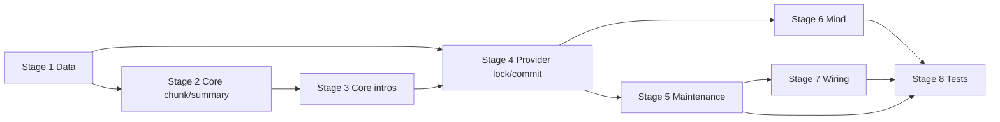

# TASK-006: compression apply and size trigger — Implementation plan

← [[task|Back to task]] | [[requirements|Requirements]] | [[design|Design]]

## Overview

Implement the full compression apply pipeline: per-conversation `asyncio.Lock` on `MemoryProvider`; snapshot under lock → ten transformation steps on a deep copy (size window via `CompressionCore`, strip/refresh via `CompressionApplyCore` + `MemoryCore.ensure_user_introductions_in_range`, `SummarizerProvider.summarise`, profile deltas via `update_user_profile`, inline summary + FIFO eviction, audit entry) without holding the lock during the LLM call → graft+merge under lock with `new_arrivals` reconciliation. Wire size-trigger-only apply in `Maintenance.compress_conversations` and route all `Mind` message appends through lock-aware Provider methods. This is EPIC-001's first user-visible milestone: long chats compress inline without Chroma.

## Goal / Non-goals

- **Goal:** When `CompressionCore.should_fire_size_trigger` is true, `Maintenance` runs the full apply pipeline; live conversation gains an inline `summary` block, decremented `visible_messages`, updated `last_compressed_at`, bounded summary count with evictions in `pending_vectorization`, persisted `Chat.history` audit line, and post-apply `user_introduction` invariants — all in-memory except audit metadata in Redis `chats` hash.
- **Non-goals:** Timeout-trigger apply wiring (TASK-007); `SummarizerProvider` internals (TASK-005); Chroma / real `flush_summary_outbox` (TASK-008); `recall_conversation` skill (TASK-009); `CompressionCore` algorithm changes; stash schema v4; re-summarising existing summaries; `save_conversation_stash` on apply or Maintenance tick.

## Context to load

Files to read before starting:

- [[requirements]] — FR-1…FR-15 and acceptance criteria
- [[design]] — «Architecture», «Interfaces», «System impact», «Key decisions»
- [[EPIC-001-chat-context-management/epic|EPIC-001 epic.md]] — shared branch, `internal_compat: none`, `external_contract: migrate-on-merge`
- [[EPIC-001-chat-context-management/chat_context_management|chat_context_management.md]] — Compression apply, Lock model, Apply: graft + merge, Chat.history schema
- [[ADR-000-sensitive-data-persistence]] — apply is in-memory; stash on graceful shutdown only
- Root `AGENTS.md` (IODA), `coding_behavior.md`
- Upstream code: `yoda/mind/memory/compression_core.py`, `yoda/mind/memory/summarizer.py`, `yoda/mind/memory/memory.py` (`MemoryCore.ensure_user_introductions_in_range`), `yoda/mind/maintenance.py`, `yoda/mind/mind.py`
- Dependency designs: [[TASK-002-user-introduction-on-ingest/design]], [[TASK-005-summarizer-provider-and-profile-extraction/design]]

## Pre-flight

Mandatory conditions before implementation starts.
If any item below fails and cannot be satisfied immediately, do not proceed to implementation.

- [ ] On shared epic branch: `git checkout feat/EPIC-001-chat-context-management` (create from `main` if first epic task on this machine)
- [ ] `git pull` — branch is current; working tree clean
- [ ] `.venv` active; dependencies installed
- [ ] Upstream tasks merged on branch: TASK-001…TASK-005 (`SummarizerProvider`, `CompressionCore`, `Maintenance` dry-run shell, `Message.kind`, `SummaryOutboxEntry`, `ensure_user_introductions_in_range`)
- [ ] Baseline tests green: `.venv/bin/python -m pytest`
- [ ] No live Redis required for unit/integration tests (use `FakeStorageApi` from existing test modules)

## Files & artifacts

| Path | IODA | Op | FR |
|------|------|----|----|
| `yoda/mind/memory/data/inline_summary_envelope.py` — `InlineSummaryEnvelope` | Data | create | FR-7, FR-8 |
| `yoda/mind/memory/data/compression_snapshot.py` — `CompressionSnapshot`, `CompressionTransformResult` | Data | create | FR-2, FR-12 |
| `yoda/mind/memory/compression_apply_core.py` — `CompressionApplyCore` | Core | create | FR-3, FR-4, FR-7–FR-10, FR-12 |
| `yoda/mind/memory/memory.py` — `MemoryProvider` | Provider | edit | FR-1, FR-2, FR-11, FR-12 |
| `yoda/mind/maintenance.py` — `Maintenance` | Integration | edit | FR-5, FR-6, FR-14 |
| `yoda/mind/mind.py` — `Mind` | Integration | edit | FR-1 |
| `yoda/yoda_chat_bot.py` | Wiring | edit | FR-14 |
| `tests/test_compression_apply.py` | Test | create | FR-13, FR-15 |
| `tests/test_maintenance.py` | Test | edit | FR-14, FR-15 |
| `tests/test_memory_operation.py` | Test | edit | FR-1, FR-2, FR-12 |

## Stages

### Stage 1: Data DTOs

**Goal:** Snapshot/transform DTOs and inline summary JSON envelope exist and round-trip.

- [x] **1.1** Create `InlineSummaryEnvelope`
  - Files: `yoda/mind/memory/data/inline_summary_envelope.py`, `tests/test_compression_apply.py`
  - Action: Data dataclass per [[design#InlineSummaryEnvelope]] — `summary_id`, `added_at` (ISO-8601 UTC), `text`; `to_message_text()` → JSON `{"v": 1, ...}`; `from_message_text()` parse/validate. TDD: round-trip preserves fields; invalid JSON raises.
  - Verify: `.venv/bin/python -m pytest tests/test_compression_apply.py -k "inline_summary_envelope"`
  - Commit: `feat(TASK-006): 1.1 InlineSummaryEnvelope`

- [x] **1.2** Create `CompressionSnapshot` and `CompressionTransformResult`
  - Files: `yoda/mind/memory/data/compression_snapshot.py`, `tests/test_compression_apply.py`
  - Action: Dataclasses per [[design#CompressionSnapshot / CompressionTransformResult]] — snapshot holds `n_old`, `copy: Conversation`, `snapshot_ts`; transform result holds `copy`, `removed_users`, `audit_entry`, `chunk_visible_count`. TDD: construct with sample `Conversation`; assert field types.
  - Verify: `.venv/bin/python -m pytest tests/test_compression_apply.py -k "compression_snapshot"`
  - Commit: `feat(TASK-006): 1.2 compression snapshot DTOs`

**Checkpoint Stage 1:** `.venv/bin/python -m pytest tests/test_compression_apply.py -k "inline_summary or compression_snapshot"`

---

### Stage 2: CompressionApplyCore — chunk, strip, summary, eviction

**Goal:** Sync transformation helpers for steps 1–2 and 6–10 field math (no intro reconciliation yet).

- [x] **2.1** Chunk slicing and boundary helpers
  - Files: `yoda/mind/memory/compression_apply_core.py`, `tests/test_compression_apply.py`
  - Action: Core class skeleton. Implement `slice_compressible_chunk(messages, split)` (skip head `prompt`, skip contiguous leading `summary` blocks in `[0:split)`, return `(chunk_start, chunk_end, chunk_messages)`); `chunk_boundary_message_id` (real `message_id` or synthetic `-index`); `compute_summary_id` (sha256 hex); `visible_count`; `first_last_visible_timestamps` (ISO-8601 from visible messages in chunk). TDD: variant C head skip; missing `message_id` fallback; deterministic `summary_id`.
  - Verify: `.venv/bin/python -m pytest tests/test_compression_apply.py -k "slice_compressible or chunk_boundary or compute_summary_id or visible_count"`
  - Commit: `feat(TASK-006): 2.1 chunk slice and boundary helpers`

- [x] **2.2** Strip user introductions before summarisation
  - Files: `yoda/mind/memory/compression_apply_core.py`, `tests/test_compression_apply.py`
  - Action: Implement `strip_user_introductions(chunk) -> (stripped, removed_users)` and `assert_removed_users_invariant` (debug assert: `user`-kind authors in chunk == `removed_users`). TDD: introductions removed from stripped chunk; `removed_users` set correct; invariant holds on fixture with matching user authors.
  - Verify: `.venv/bin/python -m pytest tests/test_compression_apply.py -k "strip_user_introductions"`
  - Commit: `feat(TASK-006): 2.2 strip user introductions`

- [x] **2.3** Summary insert, FIFO eviction, audit builder, derived fields
  - Files: `yoda/mind/memory/compression_apply_core.py`, `tests/test_compression_apply.py`
  - Action: Implement `replace_chunk_with_summary` (`kind="summary"`, `role="system"`, envelope in `text`); `evict_summaries_fifo` (oldest summaries at head when count > `max_summary_count`, build `SummaryOutboxEntry` list with metadata from envelope); `build_compression_audit_entry` (shape per [[design#Chat.history compression event shape]]); `apply_derived_fields` (`visible_messages -= chunk_visible_count`, `last_compressed_at = snapshot_ts`). TDD: happy insert order `[prompt, …summaries…, new_summary, …tail…]`; eviction pushes outbox entries; audit `evicted` list populated; no eviction leaves outbox unchanged.
  - Verify: `.venv/bin/python -m pytest tests/test_compression_apply.py -k "replace_chunk or evict_summaries or audit_entry or apply_derived"`
  - Commit: `feat(TASK-006): 2.3 summary insert eviction and audit`

**Checkpoint Stage 2:** `.venv/bin/python -m pytest tests/test_compression_apply.py -k "slice or strip or replace_chunk or evict or audit or derived"`

---

### Stage 3: CompressionApplyCore — introduction refresh and graft reconciliation

**Goal:** Step 8 refresh on copy and FR-12 `new_arrivals` reconciliation (cases a–d) reuse `MemoryCore.ensure_user_introductions_in_range`.

- [x] **3.1** Refresh removed users on copy (step 8)
  - Files: `yoda/mind/memory/compression_apply_core.py`, `tests/test_compression_apply.py`
  - Action: Implement `refresh_removed_users_on_copy(copy, summary_insert_index, removed_users, intro_text_for_user_id)` per Decision 6 — for each `user_id ∈ removed_users`, find first `user` message after summary; if found call `ensure_user_introductions_in_range(copy, idx, idx+1, …)`; else `copy.introduced_users.discard(user_id)`. TDD: user with tail message gets intro; user without tail message removed from `introduced_users`.
  - Verify: `.venv/bin/python -m pytest tests/test_compression_apply.py -k "refresh_removed_users"`
  - Commit: `feat(TASK-006): 3.1 refresh removed users on copy`

- [x] **3.2** Reconcile arrivals introductions (graft case a–d)
  - Files: `yoda/mind/memory/compression_apply_core.py`, `tests/test_compression_apply.py`
  - Action: Implement `reconcile_arrivals_introductions(live, copy_end_index, removed_users, intro_text_for_user_id)` — cases (a)–(d) from [[chat_context_management#Apply: graft + merge]]; case (d) inserts intro before first `user` message in arrivals for `removed_users` still missing marker. TDD: four cases isolated; case (b) does not duplicate intro for already-introduced user.
  - Verify: `.venv/bin/python -m pytest tests/test_compression_apply.py -k "reconcile_arrivals"`
  - Commit: `feat(TASK-006): 3.2 reconcile arrivals introductions`

**Checkpoint Stage 3:** `.venv/bin/python -m pytest tests/test_compression_apply.py -k "refresh_removed or reconcile_arrivals"`

---

### Stage 4: MemoryProvider lock, snapshot, commit, ingest

**Goal:** Per-chat lock shared by compression and ingest; snapshot/commit primitives; `Chat.history` persistence.

- [x] **4.1** Per-conversation lock
  - Files: `yoda/mind/memory/memory.py`, `tests/test_memory_operation.py`
  - Action: Add `_compression_locks: dict[int, asyncio.Lock]` (lazy per `chat_id`); `@asynccontextmanager conversation_lock(chat_id)`. TDD: concurrent acquires for same `chat_id` serialize; different `chat_id`s do not block each other.
  - Verify: `.venv/bin/python -m pytest tests/test_memory_operation.py -k "conversation_lock"`
  - Commit: `feat(TASK-006): 4.1 per-conversation compression lock`

- [x] **4.2** `take_compression_snapshot`
  - Files: `yoda/mind/memory/memory.py`, `tests/test_memory_operation.py`
  - Action: Under lock: `n_old = len(live.messages)`, `copy = deepcopy(live)`, `snapshot_ts = time.time()`; return `CompressionSnapshot | None` if no conversation. TDD: snapshot captures all conversation fields; returns `None` for missing chat.
  - Verify: `.venv/bin/python -m pytest tests/test_memory_operation.py -k "take_compression_snapshot"`
  - Commit: `feat(TASK-006): 4.2 take compression snapshot`

- [x] **4.3** `append_chat_history_event`
  - Files: `yoda/mind/memory/memory.py`, `tests/test_memory_operation.py`
  - Action: Load `Chat` from `chats` hash (via `migrate`), append event dict to `chat.history`, `hset` back. TDD: event appended; round-trip through `FakeStorageApi`.
  - Verify: `.venv/bin/python -m pytest tests/test_memory_operation.py -k "append_chat_history"`
  - Commit: `feat(TASK-006): 4.3 append chat history event`

- [x] **4.4** `commit_compression`
  - Files: `yoda/mind/memory/memory.py`, `tests/test_memory_operation.py`
  - Action: Under lock: assert `len(live.messages) >= snapshot.n_old`; `new_arrivals = live.messages[n_old:]`; graft `live.messages = result.copy.messages + new_arrivals`; merge `last_compressed_at`, `visible_messages += CompressionApplyCore.visible_count(new_arrivals)`; `live.introduced_users = result.copy.introduced_users`; `reconcile_arrivals_introductions`; replace `pending_vectorization`; call `append_chat_history_event`. **Do not** call `save_conversation_stash`. TDD: graft preserves arrivals; counters merged; outbox replaced; assertion fails if `len(live.messages) < n_old`.
  - Verify: `.venv/bin/python -m pytest tests/test_memory_operation.py -k "commit_compression"`
  - Commit: `feat(TASK-006): 4.4 commit compression graft merge`

- [x] **4.5** Lock-aware ingest: `append_message` and wrap `append_conversation_line`
  - Files: `yoda/mind/memory/memory.py`, `tests/test_memory_operation.py`
  - Action: Add `append_message(...)` — lock + `MemoryCore.add_conversation_line` (no user-intro side effects). Wrap existing `append_conversation_line` body in `async with conversation_lock(chat_id)`. TDD: concurrent append during held lock waits; user intro logic still runs for `kind=="user"`.
  - Verify: `.venv/bin/python -m pytest tests/test_memory_operation.py -k "append_message or append_conversation_line_lock"`
  - Commit: `feat(TASK-006): 4.5 lock-aware message append`

**Checkpoint Stage 4:** `.venv/bin/python -m pytest tests/test_memory_operation.py -k "conversation_lock or compression_snapshot or chat_history or commit_compression or append_message"`

---

### Stage 5: Maintenance orchestration and size-trigger wiring

**Goal:** Full `_run_size_trigger_compression` pipeline and live size trigger in `compress_conversations`.

- [x] **5.1** Implement `_run_size_trigger_compression`
  - Files: `yoda/mind/maintenance.py`, `tests/test_compression_apply.py`
  - Action: Integration orchestration per [[design#Orchestration sequence]] — inject `SummarizerProvider` in `__init__`. Sequence: snapshot → `CompressionCore.select_size_trigger_window` (abort no-op if `None`) → slice/strip → load `participant_profiles` → `summarise` (abort on any failure before profile writes) → `update_user_profile` per delta → build envelope, replace, evict, refresh, derived, audit → `commit_compression`. Abort paths leave live state unchanged. TDD with fake summariser: happy path produces summary message; summariser failure → no state change; window `None` → no-op.
  - Verify: `.venv/bin/python -m pytest tests/test_compression_apply.py -k "run_size_trigger or summariser_failure_noop or window_abort"`
  - Commit: `feat(TASK-006): 5.1 size trigger compression orchestration`

- [x] **5.2** Wire size trigger in `compress_conversations`
  - Files: `yoda/mind/maintenance.py`, `tests/test_maintenance.py`
  - Action: When `should_fire_size_trigger` is true, call `_run_size_trigger_compression`; retain timeout dry-run debug log only (Decision 9). Log `compression applied: chat_id=… trigger=size` at debug on success. TDD: size trigger invokes apply (fake summariser); timeout candidate still logs but does not apply; no trigger → no apply.
  - Verify: `.venv/bin/python -m pytest tests/test_maintenance.py -k "size_trigger_apply or timeout_no_apply"`
  - Commit: `feat(TASK-006): 5.2 wire size trigger in compress_conversations`

**Checkpoint Stage 5:** `.venv/bin/python -m pytest tests/test_compression_apply.py tests/test_maintenance.py -k "size_trigger or compress_conversations"`

---

### Stage 6: Mind ingest lock routing

**Goal:** All non-user message appends go through `MemoryProvider.append_message` under the shared lock.

- [x] **6.1** Refactor `Mind` append paths
  - Files: `yoda/mind/mind.py`, `tests/test_compression_apply.py` (or existing mind tests if present)
  - Action: Replace direct `MemoryCore.add_conversation_line` + `save_conversation` in `notify_scheduled_failure`, `deliver_scheduled_reminder`, `_handle_agent_result`, `_reply_and_send` with `await memory_provider.append_message(...)`. Remove redundant `save_conversation` calls where Provider persists in-memory state. TDD: concurrent ingest test fixture can append via Provider while compression LLM blocks.
  - Verify: `.venv/bin/python -m pytest tests/test_compression_apply.py -k "concurrent_ingest"`
  - Commit: `feat(TASK-006): 6.1 Mind lock-aware append routing`

**Checkpoint Stage 6:** `.venv/bin/python -m pytest tests/test_compression_apply.py -k "concurrent_ingest"`

---

### Stage 7: Bot wiring

**Goal:** `SummarizerProvider` constructed and injected into `Maintenance`.

- [x] **7.1** Wire `SummarizerProvider` in `yoda_chat_bot.py`
  - Files: `yoda/yoda_chat_bot.py`
  - Action: Construct `SummarizerSettings.from_settings(mind_settings)` and `SummarizerProvider(llm_api=…, settings=…)`; pass to `Maintenance(..., summarizer_provider=…)` per [[design#Wiring]]. Verify import/start path has no missing constructor args (existing `make_maintenance` test helper in `test_maintenance.py` will need matching update in Stage 8).
  - Verify: `.venv/bin/python -c "from yoda.yoda_chat_bot import main"` (or targeted wiring smoke); `.venv/bin/python -m pytest tests/test_maintenance.py -k "make_maintenance"` after helper update
  - Commit: `feat(TASK-006): 7.1 wire SummarizerProvider in bot startup`

**Checkpoint Stage 7:** `.venv/bin/python -m pytest tests/test_maintenance.py`

---

### Stage 8: Test sweep & coverage

**Goal:** Every FR acceptance criterion covered; full suite green.

- [x] **8.1** Integration tests in `test_compression_apply.py`
  - Files: `tests/test_compression_apply.py`, `tests/fakes.py` (blocking fake summariser if needed)
  - Action: Add/complete tests for: happy-path size-trigger apply (summary replaces chunk, counters, `last_compressed_at`); `MAX_SUMMARY_COUNT` eviction → `pending_vectorization` + `Chat.history.evicted`; profile delta in step 5 reflected in step-8 introduction text; FR-13 invariant (private chat, group multi-user, graft case d); concurrent ingest (fake summariser blocks, test appends to live, assert `live.messages == copy.messages + arrivals` and FR-13). Reuse `FakeStorageApi` patterns from existing tests.
  - Verify: `.venv/bin/python -m pytest tests/test_compression_apply.py`
  - Commit: `test(TASK-006): 8.1 compression apply integration tests`

- [x] **8.2** Update `test_maintenance.py` and `make_maintenance` helper
  - Files: `tests/test_maintenance.py`
  - Action: Update `make_maintenance` to accept/pass `summarizer_provider` (stub or fake); extend dry-run tests → live apply assertions; confirm timeout still no-apply; no-op abort paths do not log "compression applied".
  - Verify: `.venv/bin/python -m pytest tests/test_maintenance.py`
  - Commit: `test(TASK-006): 8.2 maintenance size-trigger tests`

- [x] **8.3** Full suite and manual AC sweep
  - Files: (verification only)
  - Action: Run full pytest; walk remaining FR acceptance bullets not explicitly named above; confirm IODA boundaries (no Provider→Provider calls, Core has no async I/O).
  - Verify: `.venv/bin/python -m pytest`
  - Commit: `test(TASK-006): 8.3 full suite green`

- [x] **8.4** Manual AC check
  - FR-1: concurrent ingest during blocked summariser does not corrupt message list
  - FR-11: `Chat.history` compression event visible in Redis `chats` hash after apply (optional local smoke with Redis)
  - FR-14: debug logs contain `chat_id` and trigger type only — no message bodies at info+

## Stage dependencies

## FR coverage (traceability)

| FR | Steps | Verification |
|----|-------|--------------|
| FR-1 | 4.1, 4.5, 6.1, 8.1 | `tests/test_memory_operation.py` (lock), `tests/test_compression_apply.py` (concurrent ingest) |
| FR-2 | 4.2, 8.1 | `tests/test_memory_operation.py`, `tests/test_compression_apply.py` |
| FR-3 | 2.1, 5.1, 8.1 | `tests/test_compression_apply.py` (slice, window abort) |
| FR-4 | 2.2, 5.1 | `tests/test_compression_apply.py` (strip) |
| FR-5 | 5.1, 8.1 | `tests/test_compression_apply.py` (happy path, failure no-op) |
| FR-6 | 5.1, 8.1 | `tests/test_compression_apply.py` (profile delta → intro refresh) |
| FR-7 | 1.1, 2.3, 8.1 | `tests/test_compression_apply.py` |
| FR-8 | 2.3, 8.1 | `tests/test_compression_apply.py` (eviction, outbox) |
| FR-9 | 3.1, 5.1 | `tests/test_compression_apply.py` (refresh_removed_users) |
| FR-10 | 2.3, 5.1 | `tests/test_compression_apply.py` (derived fields) |
| FR-11 | 2.3, 4.3, 4.4, 8.1 | `tests/test_memory_operation.py`, `tests/test_compression_apply.py` |
| FR-12 | 3.2, 4.4, 5.1, 8.1 | `tests/test_memory_operation.py`, `tests/test_compression_apply.py` (graft, reconcile) |
| FR-13 | 3.1, 3.2, 8.1 | `tests/test_compression_apply.py` (invariant fixtures) |
| FR-14 | 5.2, 7.1, 8.2 | `tests/test_maintenance.py` |
| FR-15 | 8.1, 8.2, 8.3 | full `pytest` |

## Risks

| Risk | Probability | Impact | Mitigation |
|------|-------------|--------|------------|
| Graft reconciliation case (d) — user in `removed_users` sends message during LLM call but pre-apply `introduced_users` still has them | Medium | High — missing `user_introduction` in tail | Dedicated concurrent ingest test in 8.1; `reconcile_arrivals_introductions` scoped to `removed_users` (Decision 6) |
| Profile delta applied after step-8 refresh reads stale profile | Low | Medium — intro text omits new facts | Enforce step 5 before step 8 in 5.1 orchestration; test in 8.1 |
| Lock held too long during ingest blocking compression | Low | Medium — delayed compression | Snapshot/apply only under lock; LLM call outside lock (FR-1); verify in concurrent test |
| `append_chat_history_event` races with concurrent chat metadata updates | Low | Low — lost audit line | Compression runs on Maintenance tick sequentially per conversation; accept for v1 |

## Rollback

- **Code:** `git revert` the task commits on `feat/EPIC-001-chat-context-management`.
- **Redis `chats` hash:** Apply persists compression audit events only — revert code then manually remove erroneous `compression` entries from affected chat `history` arrays if a bad deploy occurred (no automatic migration).
- **Conversation stash:** Apply does **not** write stash (ADR-000); in-memory `pending_vectorization` lost on restart is acceptable on rollback — no Redis cleanup required for outbox.
- **User profiles:** Step-5 deltas persist to `user_profiles` hash — revert profile keys manually only if a bad compression run wrote incorrect deltas (unlikely if summariser validation holds).

## Definition of Done

- [x] All plan steps marked done (`last_step` = `8.4`)
- [x] All FR-1…FR-15 acceptance criteria pass
- [x] Full suite green: `.venv/bin/python -m pytest`
- [x] IODA respected: orchestration in `Maintenance`; transforms in `CompressionApplyCore`; lock/snapshot/commit in `MemoryProvider`; no Provider→Provider calls
- [x] `flush_summary_outbox` remains no-op; timeout trigger does not invoke apply
- [x] Apply does not call `save_conversation_stash`
- [x] `task.md`: `status: done`, `updated: 2026-06-18` (or execution date)
- [x] `design.md` updated if execution diverged; ADR only if new persistent-state policy emerges
