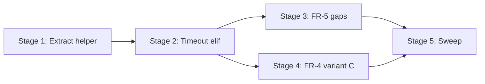

# TASK-007: timeout trigger wiring — Implementation plan

← [[task|Back to task]] | [[requirements|Requirements]] | [[design|Design]]

## Overview

Wire the timeout compression trigger into `Maintenance.compress_conversations` by extracting the existing size-trigger apply body into a shared `_run_compression_apply` helper parameterized by trigger label (`"size"` | `"timeout"`), adding an `elif "timeout" in triggers` branch that calls `CompressionCore.select_timeout_trigger_window` instead of `select_size_trigger_window`, and extending tests for FR-4 variant C (parallel inline summaries) and FR-5 quiet/gap behaviour. No changes to `CompressionCore`, `CompressionApplyCore`, `MemoryProvider`, or stash schema — only Integration orchestration and tests.

## Goal / Non-goals

- **Goal:** On each Maintenance tick, conversations whose timeout predicate passes (and size predicate did not claim the tick) run the full TASK-006 apply pipeline with gap-based window selection; size-trigger behaviour is unchanged; cross-trigger and no-gap scenarios are covered by tests; full suite green.
- **Non-goals:** Apply algorithm changes (snapshot/transform/merge); `CompressionCore` predicate/window changes; Chroma/recall; new schema fields; variant B re-summarisation; `save_conversation_stash` on apply; inline summary excess rebalance ([[TASK-011-inline-summary-excess-rebalance/task|TASK-011]]).

## Context to load

- [[requirements]] — FR-1…FR-6 and acceptance criteria
- [[design]] — «Architecture», «Interfaces», «System impact», Decisions 1–5
- [[EPIC-001-chat-context-management/epic|EPIC-001]] — shared branch `feat/EPIC-001-chat-context-management`; `internal_compat: none`
- [[chat_context_management#Timeout-trigger — clean-chunk compression]] and [[chat_context_management#Interaction between triggers]] — master-design sections from `task.md`
- `yoda/mind/maintenance.py` — current `_run_size_trigger_compression` and dry-run timeout logging
- `tests/test_maintenance.py` — `test_timeout_no_apply_without_size_trigger`, size apply integration test
- `tests/test_compression_apply.py` — `build_compressible_conversation`, `FakeSummarizerProvider`, direct `_run_size_trigger_compression` tests
- `tests/test_compression_core.py` — `_ts()` helper and timeout window fixture patterns
- Root `AGENTS.md` (IODA), `coding_behavior.md`
- [[ADR-000-sensitive-data-persistence]] — in-memory-only apply commit

## Pre-flight

Mandatory before step 1.1. Epic member — use the epic shared branch, not a per-task branch.

- [ ] `git checkout feat/EPIC-001-chat-context-management && git pull` — epic branch current (create from `main` if first task on branch)
- [ ] `git status` — working tree clean
- [ ] `.venv` active; dependencies installed
- [ ] [[TASK-003-compression-window-algorithms-core/task|TASK-003]] and [[TASK-006-compression-apply-and-size-trigger/task|TASK-006]] merged on branch — `CompressionCore.select_timeout_trigger_window` and size apply pipeline present
- [ ] Baseline suite green: `.venv/bin/python -m pytest`

## Files & artifacts

| Path | IODA | Op | FR |
|------|------|----|----|
| `yoda/mind/maintenance.py` — `Maintenance.compress_conversations` | Integration | edit | FR-1, FR-6 |
| `yoda/mind/maintenance.py` — `Maintenance._run_compression_apply` | Integration | create | FR-2, FR-3 |
| `yoda/mind/maintenance.py` — `Maintenance._run_size_trigger_compression` | Integration | delete | FR-3 |
| `tests/test_compression_apply.py` — timeout fixture helpers | Test | edit | FR-4, FR-5 |
| `tests/test_compression_apply.py` — `_run_size_trigger_compression` call sites | Test | edit | FR-3 |
| `tests/test_maintenance.py` | Test | edit | FR-1, FR-4, FR-5, FR-6 |

## Stages

### Stage 1: Extract shared apply helper (size path preserved)

**Goal:** `_run_compression_apply(conversation, trigger, chat_type)` owns the apply pipeline; size trigger behaviour and existing `test_compression_apply` / `test_size_trigger_apply_invokes_compression` tests stay green.

- [x] **1.1** Add size-path test targeting `_run_compression_apply`
  - Files: `tests/test_compression_apply.py`
  - Action: Copy `test_run_size_trigger_compression_happy_path` pattern into `test_run_compression_apply_size_happy_path` calling `maintenance._run_compression_apply(conversation, "size", "private")` with `build_compressible_conversation` + `FakeSummarizerProvider`. Run before implementation — expect `AttributeError` (red).
  - Verify: `.venv/bin/python -m pytest tests/test_compression_apply.py::test_run_compression_apply_size_happy_path -x` (red, then green after 1.2)
  - Commit: `test(TASK-007): 1.1 red test for _run_compression_apply size path`

- [x] **1.2** Extract `_run_compression_apply` from `_run_size_trigger_compression`
  - Files: `yoda/mind/maintenance.py`
  - Action: **Integration** — add `_run_compression_apply(self, conversation, trigger: Literal["size", "timeout"], chat_type: str)` with body of current `_run_size_trigger_compression`; for `trigger == "size"` call `CompressionCore.select_size_trigger_window`; log `logger.debug("compression applied: chat_id=%s trigger=%s", chat_id, trigger)`. Update `compress_conversations` size branch to `await self._run_compression_apply(conversation, "size", chat_type)`. Delete `_run_size_trigger_compression`.
  - Verify: `.venv/bin/python -m pytest tests/test_compression_apply.py::test_run_compression_apply_size_happy_path tests/test_maintenance.py::test_size_trigger_apply_invokes_compression -x`
  - Commit: `refactor(TASK-007): 1.2 extract _run_compression_apply for size trigger`

- [x] **1.3** Update remaining `_run_size_trigger_compression` call sites in tests
  - Files: `tests/test_compression_apply.py`
  - Action: Replace all `maintenance._run_size_trigger_compression(conversation)` with `maintenance._run_compression_apply(conversation, "size", "private")` (or appropriate `chat_type`).
  - Verify: `.venv/bin/python -m pytest tests/test_compression_apply.py -x`
  - Commit: `test(TASK-007): 1.3 point compression_apply tests at _run_compression_apply`

**Checkpoint Stage 1:** `.venv/bin/python -m pytest tests/test_compression_apply.py tests/test_maintenance.py::test_size_trigger_apply_invokes_compression`

---

### Stage 2: Wire timeout `elif` branch

**Goal:** Timeout predicate invokes live apply with `select_timeout_trigger_window`; size-first `elif` precedence; success logs `trigger=timeout`.

- [x] **2.1** Red — timeout apply on qualifying fixture
  - Files: `tests/test_maintenance.py`, `tests/test_compression_apply.py`
  - Action: Add `build_timeout_compressible_conversation()` helper (private chat, `visible_messages > 61`, inter-visible gap > `gap_threshold_seconds` using `_ts()` pattern from `test_compression_core.py`, `last_visible_at` / `last_compressed_at` / `now` patched for quiet-for-N-runs). Rename/rewrite `test_timeout_no_apply_without_size_trigger` → `test_timeout_apply_on_predicate` asserting `compression applied: … trigger=timeout`, one new `summary`, `summarizer.calls` non-empty.
  - Verify: `.venv/bin/python -m pytest tests/test_maintenance.py::test_timeout_apply_on_predicate -x` (red)
  - Commit: `test(TASK-007): 2.1 red test timeout apply on predicate`

- [x] **2.2** Implement timeout branch in `compress_conversations` and window selection
  - Files: `yoda/mind/maintenance.py`
  - Action: **Integration** — after size `if`, add `elif "timeout" in triggers: await self._run_compression_apply(conversation, "timeout", chat_type)`. In `_run_compression_apply`, `else` branch calls `CompressionCore.select_timeout_trigger_window(snapshot.copy.messages, self._compression_settings, chat_type, self._tick_seconds)`; `split is None` → return (no cross-algorithm fallback).
  - Verify: `.venv/bin/python -m pytest tests/test_maintenance.py::test_timeout_apply_on_predicate -x`
  - Commit: `feat(TASK-007): 2.2 wire timeout trigger apply path`

- [x] **2.3** Both triggers same tick — size wins
  - Files: `tests/test_maintenance.py`
  - Action: Add `test_both_triggers_same_tick_size_only`: conversation with `visible_messages=301` and quiet timeout predicates (reuse `test_compress_conversations_dry_run_logs_both_triggers` setup + `build_compressible_conversation`-style messages or size fixture). Assert `trigger=size` in apply log, no `trigger=timeout` apply log, exactly one summariser call.
  - Verify: `.venv/bin/python -m pytest tests/test_maintenance.py::test_both_triggers_same_tick_size_only -x`
  - Commit: `test(TASK-007): 2.3 size predicate blocks timeout on same tick`

**Checkpoint Stage 2:** `.venv/bin/python -m pytest tests/test_maintenance.py -k "timeout or size_trigger_apply or both_triggers"`

---

### Stage 3: FR-5 quiet / gap scenarios

**Goal:** Happy-path compression, continuous-burst no-op, and quiet-gate no-op are locked by tests.

- [x] **3.1** Continuous burst — predicates pass, no qualifying gap
  - Files: `tests/test_compression_apply.py`, `tests/test_maintenance.py`
  - Action: Add `build_continuous_burst_conversation()` — inter-visible gaps ≤ `gap_threshold_seconds` (pattern from `test_timeout_trigger_window_no_gap_returns_none`); timeout predicates pass on counters/timestamps. Test `test_timeout_continuous_burst_no_op`: no `summary`, `summarizer.calls == []`, counters unchanged.
  - Verify: `.venv/bin/python -m pytest tests/test_maintenance.py::test_timeout_continuous_burst_no_op -x`
  - Commit: `test(TASK-007): 3.1 continuous burst timeout no-op`

- [x] **3.2** Quiet gate — recent `last_visible_at` blocks despite internal gap
  - Files: `tests/test_compression_apply.py`, `tests/test_maintenance.py`
  - Action: Add `build_quiet_but_internal_gap_conversation()` — large internal gap but `last_visible_at` too recent for `is_quiet_for_n_runs`. Test `test_timeout_quiet_gate_blocks_apply`: timeout not in trigger candidates (or predicate false), no apply.
  - Verify: `.venv/bin/python -m pytest tests/test_maintenance.py::test_timeout_quiet_gate_blocks_apply -x`
  - Commit: `test(TASK-007): 3.2 quiet gate blocks timeout apply`

- [x] **3.3** Happy path invariants
  - Files: `tests/test_maintenance.py`
  - Action: Extend `test_timeout_apply_on_predicate` (or dedicated test) to assert FR-5 happy-path invariants: `visible_messages` decremented by compressed chunk visible count, `last_compressed_at == snapshot_ts`, `user_introduction` post-apply invariant, `Chat.history` compression audit entry present.
  - Verify: `.venv/bin/python -m pytest tests/test_maintenance.py::test_timeout_apply_on_predicate -x`
  - Commit: `test(TASK-007): 3.3 timeout happy path counter and audit invariants`

**Checkpoint Stage 3:** `.venv/bin/python -m pytest tests/test_maintenance.py -k timeout`

---

### Stage 4: FR-4 variant C — cross-trigger parallel summaries

**Goal:** Size then timeout on separate ticks yields ≥2 inline summaries; prior summary `Message.text` byte-identical; new distinct `summary_id`.

- [x] **4.1** Cross-trigger integration test
  - Files: `tests/test_maintenance.py`
  - Action: `test_cross_trigger_size_then_timeout_variant_c`: tick 1 — `build_compressible_conversation` + `low_compression_settings()` → `compress_conversations` (size apply); capture pre-existing summary `Message.text` and `summary_id` from envelope. Tick 2 — patch `time.time`, set `last_compressed_at` / `last_visible_at` on live conversation, add tail messages with qualifying gap via helper or in-test mutation; `compress_conversations` again. Assert ≥2 `kind == "summary"` messages; pre-existing summary text byte-identical; new `summary_id` distinct; order `[prompt, …existing summaries…, new_summary, …tail…]`.
  - Verify: `.venv/bin/python -m pytest tests/test_maintenance.py::test_cross_trigger_size_then_timeout_variant_c -x`
  - Commit: `test(TASK-007): 4.1 cross-trigger variant C parallel summaries`

- [x] **4.2** Timeout-then-timeout variant C
  - Files: `tests/test_maintenance.py`
  - Action: `test_cross_trigger_timeout_then_timeout_variant_c`: two timeout applies on separate ticks with existing summary from first run; same byte-identical and `summary_id` assertions as 4.1.
  - Verify: `.venv/bin/python -m pytest tests/test_maintenance.py::test_cross_trigger_timeout_then_timeout_variant_c -x`
  - Commit: `test(TASK-007): 4.2 timeout-to-timeout variant C`

**Checkpoint Stage 4:** `.venv/bin/python -m pytest tests/test_maintenance.py -k "cross_trigger or variant"`

---

### Stage 5: Test sweep & coverage

- [x] **5.1** Full suite + FR traceability pass
  - Files: `tests/test_maintenance.py`, `tests/test_compression_apply.py`, `yoda/mind/maintenance.py`
  - Action: Run full suite; confirm `test_maintenance_does_not_import_llm_or_embedding_apis` still passes; grep maintenance module for any accidental `select_size_trigger_window` in timeout branch or vice versa; confirm candidate log preserved alongside apply log.
  - Verify: `.venv/bin/python -m pytest`
  - Commit: `test(TASK-007): 5.1 full suite green`

- [x] **5.2** Manual AC checklist
  - FR-1: `test_both_triggers_same_tick_size_only`, `test_timeout_apply_on_predicate`, dry-run candidate logs unchanged
  - FR-2: timeout test uses gap window (no halving) — inspect `summariser.calls[0]` chunk boundaries vs `select_timeout_trigger_window` split
  - FR-3: size apply tests in `test_compression_apply.py` still pass via shared helper
  - FR-4: `test_cross_trigger_size_then_timeout_variant_c`, `test_cross_trigger_timeout_then_timeout_variant_c`
  - FR-5: `test_timeout_apply_on_predicate`, `test_timeout_continuous_burst_no_op`, `test_timeout_quiet_gate_blocks_apply`
  - FR-6: audit entry + `user_introduction` invariant in 3.3; `trigger=timeout` debug log in 2.1
  - Verify: all items checked; no manual deploy smoke required (`internal_compat: none`)
  - Commit: (no commit — verification only)

**Checkpoint Stage 5:** `.venv/bin/python -m pytest`

## Stage dependencies

## FR coverage (traceability)

| FR | Steps | Verification |
|----|-------|--------------|
| FR-1 | 2.2, 2.3 | `test_timeout_apply_on_predicate`, `test_both_triggers_same_tick_size_only`, dry-run candidate tests |
| FR-2 | 2.2, 3.1 | `test_timeout_apply_on_predicate` (gap split); `test_timeout_continuous_burst_no_op` (`None` abort) |
| FR-3 | 1.2, 1.3 | `tests/test_compression_apply.py` size-path tests via `_run_compression_apply` |
| FR-4 | 4.1, 4.2 | `test_cross_trigger_size_then_timeout_variant_c`, `test_cross_trigger_timeout_then_timeout_variant_c` |
| FR-5 | 2.1, 3.1, 3.2, 3.3 | `test_timeout_apply_on_predicate`, `test_timeout_continuous_burst_no_op`, `test_timeout_quiet_gate_blocks_apply` |
| FR-6 | 2.1, 3.3, 5.1 | `trigger=timeout` debug log; audit + `user_introduction` in 3.3; full suite |

## Risks

| Risk | Probability | Impact | Mitigation |
|------|-------------|--------|------------|
| Fixture timestamps misaligned with `gap_threshold_seconds` / `tick_seconds` → flaky timeout window `None` | Medium | High — red tests that should pass | Reuse `_ts()` and settings from `test_compression_core.py`; `tick_minutes=1` → `tick_seconds=60`; private `gap_threshold = 0.5 * 8 * 3600 = 14400s` |
| `elif` blocks timeout when size predicate true but size apply no-ops | Low | Medium — surprise on combined tick | Explicit `test_both_triggers_same_tick_size_only` (step 2.3); document in test name |
| Refactor breaks direct `_run_size_trigger_compression` tests | Medium | Medium — Stage 1 red | Step 1.3 updates all call sites before Stage 2 |

## Rollback

- Code: `git revert` on the epic branch — pure Integration + test changes; no stash schema or Redis migration in this task.
- State: Apply is in-memory only per ADR-000; no persistent-state cleanup required.

## Definition of Done

- [x] All plan steps checked (`last_step` = `5.2`)
- [x] All FR-1…FR-6 acceptance criteria pass
- [x] Full suite green: `.venv/bin/python -m pytest`
- [x] IODA respected: predicates/windows in `CompressionCore`, transform in `CompressionApplyCore`, orchestration only in `Maintenance`
- [x] `Maintenance` does not import LLM/embedding/vector APIs
- [x] `task.md`: `status: done`, `updated: 2026-06-22` (or execution date)
- [x] `design.md` updated only if execution diverged (e.g. helper signature change)
- [ ] No new ADR required unless apply contract changed (not expected)
