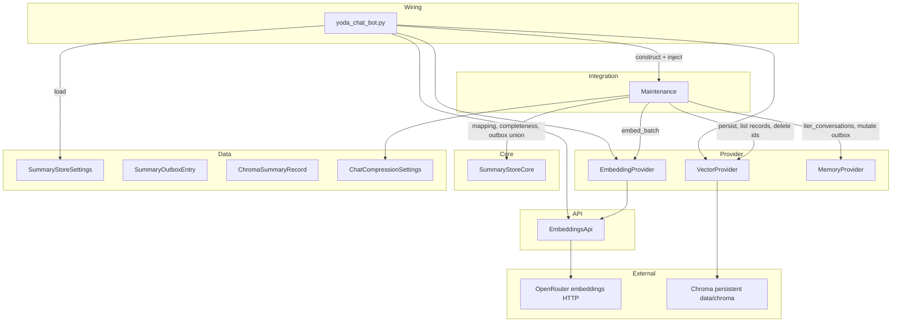

# TASK-008: summary store and outbox flush — Design

← [[task|Back to task]] | [[requirements|Requirements]]

## Solution overview

Implement the externalised summary store as three new Operations plus one API façade: `EmbeddingsApi` (OpenRouter `POST /embeddings`), `EmbeddingProvider`, and `VectorProvider` (Chroma persistent under `data/chroma`), orchestrated by `Maintenance.flush_summary_outbox` and a one-shot Chroma hygiene pass in `run_initial_pass`. Each Maintenance tick drains `Conversation.pending_vectorization` per chat in FIFO order — embed batch → Chroma upsert by deterministic `summary_id` → remove flushed entries from the live in-memory outbox on full success only; compression paths stay unchanged and never await the vector store per [[chat_context_management#Persistence flow]]. Same-process retry idempotency comes from upserting the same `summary_id`. **Complete** Chroma records (document + embedding present) are **never** deleted at reconciliation — including after crash when the outbox is empty de-facto (successful persist, lost in-memory pop). Startup hygiene deletes only **incomplete** records whose `summary_id` is absent from every in-memory `pending_vectorization` (retry impossible). `Chat.history` is audit only, not a reconciliation input. Dropping Chroma collections for deleted chats / `delete_user_data` is a follow-up task. Identity encrypt/decrypt hooks wrap the `document` field; settings load from `mind.memory.summary_store` with fail-fast validation.

## Architecture

Per [[chat_context_management#Summary store]], [[chat_context_management#Persistence flow]], [[ADR-000-sensitive-data-persistence]].



| Component | IODA | Role |
|-----------|------|------|
| `EmbeddingsApi` | API | Async OpenRouter-compatible embeddings HTTP; mockable in tests |
| `EmbeddingProvider` | Provider | `embed` / `embed_batch`; model dimension registry; no Chroma/Redis |
| `VectorProvider` | Provider | Chroma lifecycle, per-chat collections, upsert/list/delete, encrypt hooks, private `_flatten_metadata` for upsert |
| `SummaryStoreCore` | Core | Outbox→record mapping, outbox `flatten_metadata`, record completeness, delete candidates |
| `SummaryStoreSettings` | Data | `persist_directory`, `collection_prefix`, `embeddings.*`; fail-fast `from_dict` |
| `ChromaSummaryRecord` | Data | One upsert row: `summary_id`, `document`, `embedding`, scalar metadata |
| `Maintenance` | Integration | `flush_summary_outbox`, startup `reconcile_chroma_incomplete_records`; AST guard forbids `yoda.api.embeddings_api` and `chromadb` (Providers are injected) |
| `MemoryProvider` | Provider | `iter_conversations`, in-memory outbox mutation (unchanged surface beyond existing iterator) |
| `yoda_chat_bot.py` | Wiring | Construct API/Providers, extend `Maintenance` ctor, `settings.json` block |

## Key decisions

### Decision 1: `EmbeddingsApi` as a dedicated API module (OpenRouter MVP)

**Context:** [[requirements|FR-1]] requires mockable HTTP isolation; chat completions already use `LLMApi` / `OpenRouterApi` but embeddings are a separate endpoint and credential block.
**Options:** (A) extend `OpenRouterApi` with `embed`; (B) new `EmbeddingsApi` in `yoda/api/embeddings_api.py`; (C) call httpx from `EmbeddingProvider` directly.
**Choice:** B — single-responsibility façade mirroring `OpenRouterApi` error/logging style; `EmbeddingProvider` stays the only consumer; satisfies Maintenance import guard (no `yoda.api.*` in `maintenance.py`).
**FR:** FR-1, FR-4, FR-8

### Decision 2: `SummaryStoreCore` for pure mapping and reconciliation logic

**Context:** [[requirements|FR-3]], [[requirements|FR-6]] need metadata flattening, outbox→Chroma record assembly, and delete-candidate selection without I/O in testable pure functions.
**Options:** (A) logic inside `VectorProvider`; (B) logic inside `Maintenance`; (C) new `SummaryStoreCore`.
**Choice:** C — `Maintenance` stays orchestration-only; Core depends only on Data types per IODA.
**As-built refinement:** metadata flattening is split so Operations never depend on each other:
- `SummaryStoreCore.flatten_metadata(SummaryOutboxEntry)` — Core helper for outbox-entry consumers/tests.
- `VectorProvider._flatten_metadata(ChromaSummaryRecord)` — private Chroma adapter used on upsert (Provider must not import Core).
**FR:** FR-3, FR-6

### Decision 3: One flush batch per conversation per tick (full outbox)

**Context:** [[requirements|FR-4]] describes embed → persist → pop per batch; master design drains FIFO per conversation each tick.
**Options:** (A) one entry at a time per tick; (B) entire `pending_vectorization` list per conversation as one batch; (C) configurable `flush_batch_size`.
**Choice:** B — matches master design step sequence; one embed API call per chat per tick; all-or-nothing removal on failure preserves FR-4 retry semantics. `flush_batch_size` remains deferred per requirements.
**FR:** FR-4, FR-5

### Decision 4: Chroma upsert for same-process idempotency

**Context:** [[requirements|FR-5]] — failed flush after Chroma landed must overwrite the same `summary_id` on retry.
**Options:** (A) `collection.add` with duplicate check; (B) `collection.upsert` with explicit ids; (C) delete-then-add.
**Choice:** B — Chroma `upsert` with `ids=[summary_id]` is the documented idempotent write; no extra read round-trip.
**FR:** FR-5

### Decision 5: Chroma hygiene at startup only (`run_initial_pass`)

**Context:** [[requirements|FR-6]] allows startup and/or flush hook; requirements open question on placement.
**Options:** (A) every `flush_summary_outbox` tick; (B) `Maintenance.run_initial_pass` after stash restore; (C) dedicated `yoda_chat_bot.py` hook.
**Choice:** B — runs once per process after `restore_conversation_stash`, before the periodic loop; flush tick stays embed+drain only. `run_initial_pass` order: `reconcile_active_jobs` → `reconcile_chroma_incomplete_records`.
**FR:** FR-6

### Decision 6: Reconciliation deletes incomplete records only when retry is impossible

**Context:** [[requirements|FR-6]] must not delete legitimately flushed summaries; design review clarified that complete records are recall-ready and that an empty outbox after successful persist is the target state (including crash de-facto pop).
**Options:** (A) delete Chroma ids absent from `Chat.history` ∪ outbox; (B) delete any id absent from outbox; (C) delete only incomplete records absent from ⋃ `pending_vectorization`; keep all complete records.
**Choice:** C —
  - **Complete record** (`document` non-empty and `embedding` present with expected dimension): **always keep**, regardless of outbox or `Chat.history`. The only writer is `persist_summaries`; a complete record is usable for recall ([[TASK-009-recall-conversation-skill/task|TASK-009]]).
  - **Incomplete record**: **keep** if `summary_id ∈ pending_outbox_ids` (union across all in-memory conversations from `iter_conversations`) — next flush tick will re-embed and upsert. **Delete** if incomplete and `summary_id ∉ pending_outbox_ids` — narrative is unrecoverable without outbox.
  - **`Chat.history`** is not consulted for reconciliation (audit / traceability only).
**FR:** FR-6

### Decision 7: Reconciliation scans all Chroma collections; no collection drops in this task

**Context:** Incomplete records may exist in collections whose chat is not currently in the in-memory cache.
**Options:** (A) reconcile only `iter_conversations()` chat ids; (B) scan every collection from `VectorProvider.list_chat_ids()`; (C) scan all collections and drop those with no Redis `chats` entry.
**Choice:** B for **per-record** incomplete cleanup only — `list_chat_ids()` drives the scan; apply Decision 6 per record. **Do not** drop entire collections here — that is lifecycle cleanup (deleted chats, `delete_user_data`) deferred to a follow-up task.
**FR:** FR-6

### Decision 8: Chroma test strategy — ephemeral persistent client in tests

**Context:** [[requirements|FR-3]], [[requirements|FR-9]] require a documented test approach.
**Options:** (A) full fake `VectorProvider`; (B) ephemeral `tempfile` directory + real `chromadb` per test; (C) shared global Chroma dir.
**Choice:** B for integration tests (`VectorProvider`, flush, incomplete cleanup, idempotency) — exercises real Chroma upsert/list/delete/metadata constraints; pytest `tmp_path` fixture isolates collections. Unit tests for `Maintenance.flush_summary_outbox` use injected fakes of `EmbeddingProvider` / `VectorProvider` (no network, no disk). Add `chromadb` to `requirements.txt`.
**FR:** FR-3, FR-9

### Decision 9: Identity encrypt/decrypt hooks on `VectorProvider`

**Context:** [[requirements|FR-3]], [[chat_context_management#Security baseline]] — hooks now, AES-GCM later.
**Options:** (A) module-level functions; (B) instance methods with overridable defaults; (C) separate `DocumentEncryptionProvider`.
**Choice:** B — `VectorProvider.encrypt` / `decrypt` as methods defaulting to identity; `persist_summaries` encrypts `document` before write; future TASK wires real crypto from `document_encryption` settings without changing call sites.
**FR:** FR-3

### Decision 10: Model dimension registry in `EmbeddingProvider`

**Context:** [[requirements|FR-1]] — dimension from code, not settings; fail fast on unknown model.
**Options:** (A) settings field; (B) `EmbeddingProvider.MODEL_DIMENSIONS` dict; (C) probe API on startup.
**Choice:** B — MVP map `{"openai/text-embedding-3-small": 1536}`; `EmbeddingProvider` validates `settings.model_name` at construction; `SummaryStoreCore.is_complete_record` uses the same dimension for reconciliation. **ADR candidate** if the registry grows beyond one model.
**FR:** FR-1, FR-2, FR-6

### Decision 11: Deleted-chat Chroma lifecycle deferred to follow-up

**Context:** `delete_user_data` does not touch Chroma today; dropping `chat_{chat_id}` collections on user/chat deletion is privacy-relevant but orthogonal to outbox flush.
**Options:** (A) include in TASK-008 (`VectorProvider.delete_collection`, wire `DeleteUserDataTool`); (B) follow-up task after TASK-008/009.
**Choice:** B — keeps TASK-008 focused on delivery + incomplete-record hygiene; note follow-up in [[task#Notes]]. Complete records may remain in Chroma for deleted private chats until that task lands.
**FR:** — (out of scope)

## Interfaces

### `EmbeddingsApi` (`yoda/api/embeddings_api.py`)

```python
_DEFAULT_BASE_URL = "https://openrouter.ai/api/v1"

class EmbeddingsApi:
    def __init__(self, api_key: str, base_url: str = _DEFAULT_BASE_URL) -> None: ...

    async def embed(self, model_name: str, texts: list[str]) -> list[list[float]]:
        """POST {base_url}/embeddings; return vectors in input order.
        Raises ValueError on HTTP/parse failure after logging status + body prefix."""
```

Request body: `{"model": model_name, "input": texts}`. Response: `data[i].embedding` sorted by `index`.

### `EmbeddingProvider` (`yoda/mind/memory/embedding.py`)

```python
MODEL_DIMENSIONS: dict[str, int] = {"openai/text-embedding-3-small": 1536}

class EmbeddingProvider:
    def __init__(self, embeddings_api: EmbeddingsApi, settings: EmbeddingsSettings) -> None: ...

    @property
    def model_name(self) -> str: ...

    @property
    def vector_dimension(self) -> int: ...

    async def embed_batch(self, texts: list[str]) -> list[list[float]]:
        """Empty input → [] without HTTP."""

    async def embed(self, text: str) -> list[float]:
        """Single-text wrapper over embed_batch."""
```

### `VectorProvider` (`yoda/mind/memory/vector.py`)

```python
@dataclass(frozen=True)
class StoredSummaryRecord:
    summary_id: str
    document: str
    embedding: list[float]

class VectorProvider:
    def __init__(self, settings: SummaryStoreSettings) -> None: ...

    def collection_name(self, chat_id: int) -> str:
        """{collection_prefix}{chat_id}"""

    def encrypt(self, plaintext: str) -> str: ...  # identity default
    def decrypt(self, ciphertext: str) -> str: ...  # identity default

    @staticmethod
    def _flatten_metadata(record: ChromaSummaryRecord) -> dict[str, str | float]:
        """Comma-separate skills/topics for Chroma metadata (Provider-local; not Core)."""

    async def persist_summaries(
        self, chat_id: int, records: list[ChromaSummaryRecord]
    ) -> None:
        """Lazy-create collection; upsert ids, embeddings, encrypted documents, metadata."""

    async def list_stored_records(self, chat_id: int) -> list[StoredSummaryRecord]:
        """Load id, decrypted document, embedding for each record; [] if collection absent."""

    async def delete_summary_ids(self, chat_id: int, ids: list[str]) -> None:
        """No-op when ids empty or collection missing."""

    def list_chat_ids(self) -> list[int]:
        """Parse chat_id from collection names with collection_prefix."""
```

Chroma metadata per [[chat_context_management#Record schema]]: `compressed_at` (float), `content_from_ts`, `content_to_ts` (str), `skills`, `topics` (comma-separated). No cross-chat search API in this task.

### `SummaryStoreCore` (`yoda/mind/memory/summary_store_core.py`)

```python
class SummaryStoreCore:
    @staticmethod
    def outbox_entries_to_records(
        entries: list[SummaryOutboxEntry],
        embeddings: list[list[float]],
    ) -> list[ChromaSummaryRecord]: ...

    @staticmethod
    def flatten_metadata(entry: SummaryOutboxEntry) -> dict[str, str | float]: ...

    @staticmethod
    def pending_outbox_ids(conversations: list[Conversation]) -> set[str]: ...

    @staticmethod
    def is_complete_record(
        record: StoredSummaryRecord,
        *,
        expected_dimension: int,
    ) -> bool: ...

    @staticmethod
    def incomplete_ids_to_delete(
        records: list[StoredSummaryRecord],
        pending_outbox_ids: set[str],
        *,
        expected_dimension: int,
    ) -> list[str]:
        """Delete candidates: not complete AND summary_id not in pending_outbox_ids."""
```

### `Maintenance` changes

```python
class Maintenance:
    def __init__(
        self,
        *,
        ...
        embedding_provider: EmbeddingProvider,
        vector_provider: VectorProvider,
    ) -> None: ...

    async def run_initial_pass(self) -> None:
        await reconcile_active_jobs(...)
        await self.reconcile_chroma_incomplete_records()

    async def flush_summary_outbox(self) -> None: ...

    async def reconcile_chroma_incomplete_records(self) -> int:
        """Scan all Chroma collections; delete incomplete records with no outbox retry path."""
```

`reconcile_chroma_incomplete_records` pseudocode:

```
pending_ids = SummaryStoreCore.pending_outbox_ids(list(memory_provider.iter_conversations()))
deleted = 0
for chat_id in vector_provider.list_chat_ids():
    records = await vector_provider.list_stored_records(chat_id)
    to_delete = SummaryStoreCore.incomplete_ids_to_delete(
        records, pending_ids, expected_dimension=embedding_provider.vector_dimension,
    )
    await vector_provider.delete_summary_ids(chat_id, to_delete)
    deleted += len(to_delete)
return deleted
```

`flush_summary_outbox` pseudocode:

```
for conversation in memory_provider.iter_conversations():
    outbox = conversation.pending_vectorization
    if not outbox:
        continue
    if len(outbox) > compression_settings.outbox_health_threshold:
        logger.warning("summary outbox depth exceeded: chat_id=%s depth=%s", ...)
    texts = [e.document for e in outbox]
    try:
        embeddings = await embedding_provider.embed_batch(texts)
        records = SummaryStoreCore.outbox_entries_to_records(outbox, embeddings)
        await vector_provider.persist_summaries(conversation.chat_id, records)
    except Exception:
        logger.warning("flush_summary_outbox failed for chat_id=%s", ..., exc_info=True)
        continue  # retain entire outbox for this chat
    conversation.pending_vectorization.clear()  # mutate live object; no stash write
```

### Data model

```python
@dataclass(frozen=True)
class EmbeddingsSettings:
    model_name: str
    openrouter_api_key: str

@dataclass(frozen=True)
class SummaryStoreSettings:
    persist_directory: str
    collection_prefix: str
    embeddings: EmbeddingsSettings

    @classmethod
    def from_dict(cls, block: dict) -> SummaryStoreSettings: ...

@dataclass(frozen=True)
class ChromaSummaryRecord:
    summary_id: str
    document: str
    embedding: list[float]
    compressed_at: float
    content_from_ts: str
    content_to_ts: str
    skills: list[str]
    topics: list[str]
```

`SummaryOutboxEntry` (existing) is the flush input shape from TASK-006; no schema change.

### Settings (`settings.json`)

Add under `mind.memory` per [[requirements#Proposed settings structure]]:

```json
"summary_store": {
  "persist_directory": "data/chroma",
  "collection_prefix": "chat_",
  "embeddings": {
    "model_name": "openai/text-embedding-3-small",
    "openrouter_api_key": "<key>"
  }
}
```

`search` and `document_encryption` keys may exist for forward compatibility; TASK-008 `from_dict` ignores them.

## System impact

| Path / class | IODA | Change | FR |
|--------------|------|--------|-----|
| `yoda/api/embeddings_api.py` — `EmbeddingsApi` | API | **create** — OpenRouter embeddings HTTP | FR-1 |
| `yoda/mind/memory/data/summary_store_settings.py` — `EmbeddingsSettings`, `SummaryStoreSettings` | Data | **create** — fail-fast `from_dict` | FR-8 |
| `yoda/mind/memory/data/chroma_summary_record.py` — `ChromaSummaryRecord` | Data | **create** — upsert DTO | FR-3 |
| `yoda/mind/memory/vector.py` — `VectorProvider`, `StoredSummaryRecord` | Provider | **create** — Chroma client, upsert/list/delete, encrypt hooks | FR-3, FR-5, FR-6 |
| `yoda/mind/memory/embedding.py` — `EmbeddingProvider` | Provider | **create** — `embed` / `embed_batch`, dimension registry | FR-1, FR-2 |
| `yoda/mind/memory/summary_store_core.py` — `SummaryStoreCore` | Core | **create** — mapping, completeness, incomplete delete candidates | FR-3, FR-6 |
| `yoda/mind/maintenance.py` — `Maintenance` | Integration | **edit** — inject providers; `flush_summary_outbox`, `reconcile_chroma_incomplete_records`; extend `run_initial_pass` | FR-4, FR-5, FR-6, FR-7 |
| `yoda/yoda_chat_bot.py` | Wiring | **edit** — load `SummaryStoreSettings`, construct API/Providers, pass to `Maintenance` | FR-8 |
| `settings.json` | Config | **edit** — add `mind.memory.summary_store` MVP block | FR-8 |
| `requirements.txt` | Deps | **edit** — add `chromadb` | FR-3 |
| `data/chroma/` | Runtime | **create** on first use (gitignore if not already) | FR-3 |
| `tests/test_embeddings_api.py` | Test | **create** — mock httpx, failure paths | FR-1 |
| `tests/test_embedding_provider.py` | Test | **create** — fake API, empty batch, dimension guard | FR-2 |
| `tests/test_vector_provider.py` | Test | **create** — ephemeral Chroma, upsert, metadata, collection isolation | FR-3, FR-5 |
| `tests/test_summary_store_core.py` | Test | **create** — completeness, incomplete delete candidates, metadata flatten | FR-6 |
| `tests/test_maintenance.py` | Test | **edit** — flush happy/fail/retry/warning/incomplete cleanup; fake providers | FR-4, FR-5, FR-6, FR-7, FR-9 |

No changes to compression apply, `SummaryOutboxEntry` shape, `MemoryProvider` Redis/history APIs, `save_conversation_stash` timing, or `delete_user_data`.

## Decisions made (from requirements review)

| Topic | Resolution |
|-------|------------|
| Settings tree | `SummaryStoreSettings.from_dict` on `mind.memory.summary_store`; outbox threshold stays in `ChatCompressionSettings` |
| Embeddings backend | OpenRouter-only MVP via `EmbeddingsApi`; `openrouter_api_key` + `model_name`; no `provider` enum |
| Reconciliation algorithm | Keep all **complete** records; delete **incomplete** only when `summary_id ∉ ⋃ pending_vectorization`; `Chat.history` not used |
| Reconciliation hook placement | `Maintenance.run_initial_pass` after `reconcile_active_jobs`, before `start()` |
| Chroma test strategy | Ephemeral `tmp_path` persistent Chroma for provider/integration tests; fakes for Maintenance unit tests |
| `flush_batch_size` | Deferred — full per-conversation outbox per tick |
| Deleted-chat Chroma cleanup | Follow-up task — not TASK-008 |

## Open questions

None.
