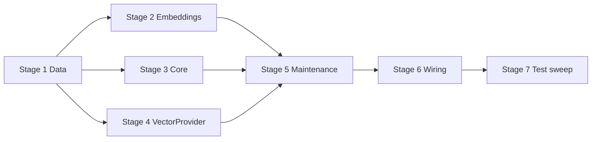

# TASK-008: summary store and outbox flush — Implementation plan

← [[task|Back to task]] | [[requirements|Requirements]] | [[design|Design]]

## Overview

Implement the externalised summary store: `EmbeddingsApi` (OpenRouter embeddings HTTP), `EmbeddingProvider`, `VectorProvider` (Chroma persistent under `data/chroma`), and pure `SummaryStoreCore` mapping/reconciliation helpers. Replace the TASK-004 `flush_summary_outbox` no-op with embed → Chroma upsert → in-memory outbox pop per conversation each Maintenance tick; add one-shot startup hygiene in `run_initial_pass` that deletes **incomplete** Chroma records only when retry is impossible while **always** keeping complete records. Wire providers in `yoda_chat_bot.py` from `mind.memory.summary_store`. Compression paths stay unchanged; flush never blocks compression and does not write conversation stash.

## Goal / Non-goals

- **Goal:** Each Maintenance tick drains `Conversation.pending_vectorization` FIFO per chat (embed batch → Chroma upsert by deterministic `summary_id` → clear outbox on full success); same-process retry overwrites the same Chroma id; startup reconciliation removes orphan incomplete records; operators get outbox-depth warnings above `outbox_health_threshold`; `python -m pytest` passes with mocked embeddings and ephemeral Chroma.
- **Non-goals:** `recall_conversation` skill and `VectorProvider.search` (TASK-009); compression apply / outbox push changes (TASK-006/007); promotion of retrieved summaries into inline tail; `save_conversation_stash` on flush; real AES-GCM encryption (identity hooks only); Chroma collection drop on deleted chats / `delete_user_data`; `flush_batch_size`; in-process LRU cache.

## Context to load

Files to read before starting:

- [[requirements]] — FR-1…FR-9 and acceptance criteria
- [[design]] — «Architecture», «Interfaces», «System impact», «Key decisions»
- [[EPIC-001-chat-context-management/epic|EPIC-001 epic.md]] — shared branch, `internal_compat: none`, `external_contract: migrate-on-merge`
- [[EPIC-001-chat-context-management/chat_context_management|chat_context_management.md]] — Summary store, Persistence flow, Record schema, Crash recovery, Security baseline
- [[ADR-000-sensitive-data-persistence]] — Chroma derived narratives only; stash on graceful shutdown only
- Root `AGENTS.md` (IODA), `coding_behavior.md`
- Upstream code: `yoda/mind/maintenance.py`, `yoda/mind/memory/data/summary_outbox_entry.py`, `yoda/mind/memory/compression_apply_core.py` (`compute_summary_id`), `yoda/mind/memory/memory.py` (`iter_conversations`), `yoda/api/openrouter_api.py` (HTTP error style)
- Dependency designs: [[TASK-006-compression-apply-and-size-trigger/design]], [[TASK-004-maintenance-integration-shell/design]]

## Pre-flight

Mandatory conditions before implementation starts.
If any item below fails and cannot be satisfied immediately, do not proceed to implementation.

- [x] On shared epic branch: `git checkout feat/EPIC-001-chat-context-management` (create from `main` if first epic task on this machine)
- [x] `git pull` — branch is current; working tree clean
- [x] `.venv` active; `pip install -r requirements.txt` after `chromadb` is added (step 6.1)
- [x] Upstream on branch: TASK-006 (`SummaryOutboxEntry`, FIFO eviction into `pending_vectorization`), TASK-007 (timeout apply), TASK-004 (`Maintenance` tick shell, `flush_summary_outbox` stub)
- [x] Baseline tests green: `.venv/bin/python -m pytest`
- [x] Unit tests use fakes/mocks only — no live OpenRouter or Redis required; integration tests use `tmp_path` Chroma
- [x] `settings.json` will gain `mind.memory.summary_store` with a valid `openrouter_api_key` for local manual smoke (not used in pytest)

## Files & artifacts

| Path | IODA | Op | FR |
|------|------|----|----|
| `yoda/mind/memory/data/summary_store_settings.py` — `EmbeddingsSettings`, `SummaryStoreSettings` | Data | create | FR-8 |
| `yoda/mind/memory/data/chroma_summary_record.py` — `ChromaSummaryRecord` | Data | create | FR-3 |
| `yoda/api/embeddings_api.py` — `EmbeddingsApi` | API | create | FR-1 |
| `yoda/mind/memory/embedding.py` — `EmbeddingProvider` | Provider | create | FR-1, FR-2 |
| `yoda/mind/memory/summary_store_core.py` — `SummaryStoreCore` | Core | create | FR-3, FR-6 |
| `yoda/mind/memory/vector.py` — `VectorProvider`, `StoredSummaryRecord` | Provider | create | FR-3, FR-5, FR-6 |
| `yoda/mind/maintenance.py` — `Maintenance` | Integration | edit | FR-4, FR-5, FR-6, FR-7 |
| `yoda/yoda_chat_bot.py` | Wiring | edit | FR-8 |
| `settings.json` | Config | edit | FR-8 |
| `requirements.txt` | Deps | edit | FR-3 |
| `.gitignore` | Config | edit | FR-3 |
| `data/chroma/` | Runtime | create on first use | FR-3 |
| `tests/test_embeddings_api.py` | Test | create | FR-1 |
| `tests/test_embedding_provider.py` | Test | create | FR-2 |
| `tests/test_summary_store_core.py` | Test | create | FR-6 |
| `tests/test_vector_provider.py` | Test | create | FR-3, FR-5 |
| `tests/test_maintenance.py` | Test | edit | FR-4, FR-5, FR-6, FR-7, FR-9 |

## Stages

### Stage 1: Data DTOs and settings

**Goal:** Summary-store settings and Chroma upsert DTOs load fail-fast and round-trip.

- [x] **1.1** Create `SummaryStoreSettings` and `EmbeddingsSettings`
  - Files: `yoda/mind/memory/data/summary_store_settings.py`, `tests/test_summary_store_core.py`
  - Action: Data dataclasses per [[design#Data model]] — `EmbeddingsSettings(model_name, openrouter_api_key)`; `SummaryStoreSettings(persist_directory, collection_prefix, embeddings)` with `from_dict` validating required keys; ignore forward-compat keys `search`, `document_encryption`. TDD: valid block parses; missing `embeddings.openrouter_api_key` raises.
  - Verify: `.venv/bin/python -m pytest tests/test_summary_store_core.py -k "summary_store_settings"`
  - Commit: `feat(TASK-008): 1.1 SummaryStoreSettings`

- [x] **1.2** Create `ChromaSummaryRecord`
  - Files: `yoda/mind/memory/data/chroma_summary_record.py`, `tests/test_summary_store_core.py`
  - Action: Frozen dataclass per [[design#ChromaSummaryRecord]] — `summary_id`, `document`, `embedding`, `compressed_at`, `content_from_ts`, `content_to_ts`, `skills`, `topics`. TDD: construct from sample values; assert immutability.
  - Verify: `.venv/bin/python -m pytest tests/test_summary_store_core.py -k "chroma_summary_record"`
  - Commit: `feat(TASK-008): 1.2 ChromaSummaryRecord DTO`

**Checkpoint Stage 1:** `.venv/bin/python -m pytest tests/test_summary_store_core.py -k "summary_store_settings or chroma_summary_record"`

---

### Stage 2: Embeddings API and Provider

**Goal:** Mockable embeddings HTTP façade and thin Provider with dimension registry.

- [x] **2.1** Create `EmbeddingsApi`
  - Files: `yoda/api/embeddings_api.py`, `tests/test_embeddings_api.py`
  - Action: API class per [[design#EmbeddingsApi]] — `POST {base_url}/embeddings` with `{"model", "input"}`; parse `data[i].embedding` sorted by `index`; log status + body prefix on HTTP/parse failure; raise `ValueError`. TDD with `httpx` mock/respx: happy path returns vectors in order; 4xx/5xx raises; malformed JSON raises. No live network.
  - Verify: `.venv/bin/python -m pytest tests/test_embeddings_api.py`
  - Commit: `feat(TASK-008): 2.1 EmbeddingsApi`

- [x] **2.2** Create `EmbeddingProvider`
  - Files: `yoda/mind/memory/embedding.py`, `tests/test_embedding_provider.py`
  - Action: Provider per [[design#EmbeddingProvider]] — `MODEL_DIMENSIONS = {"openai/text-embedding-3-small": 1536}`; validate `settings.model_name` at construction; `embed_batch` delegates to API (empty list → `[]` without HTTP); `embed` wraps single text; expose `model_name` and `vector_dimension` properties. No Chroma/Redis imports. TDD: fake API; empty batch skips call; unknown model raises at init.
  - Verify: `.venv/bin/python -m pytest tests/test_embedding_provider.py`
  - Commit: `feat(TASK-008): 2.2 EmbeddingProvider`

**Checkpoint Stage 2:** `.venv/bin/python -m pytest tests/test_embeddings_api.py tests/test_embedding_provider.py`

---

### Stage 3: SummaryStoreCore

**Goal:** Pure mapping, metadata flattening, completeness checks, and delete-candidate selection.

- [x] **3.1** Implement `SummaryStoreCore`
  - Files: `yoda/mind/memory/summary_store_core.py`, `tests/test_summary_store_core.py`
  - Action: Core static methods per [[design#SummaryStoreCore]] — `flatten_metadata` (comma-separate `skills`/`topics`); `outbox_entries_to_records` (zip `SummaryOutboxEntry` + embeddings → `ChromaSummaryRecord`); `pending_outbox_ids`; `is_complete_record` (non-empty document + embedding length == `expected_dimension`); `incomplete_ids_to_delete` (not complete AND `summary_id ∉ pending_outbox_ids`). Depends only on Data types. TDD: complete vs incomplete fixtures; delete candidates when outbox empty; keep incomplete when id still in outbox union.
  - Verify: `.venv/bin/python -m pytest tests/test_summary_store_core.py -k "summary_store_core"`
  - Commit: `feat(TASK-008): 3.1 SummaryStoreCore`

**Checkpoint Stage 3:** `.venv/bin/python -m pytest tests/test_summary_store_core.py`

---

### Stage 4: VectorProvider (Chroma)

**Goal:** Persistent per-chat Chroma collections with upsert, list, delete, and identity encrypt hooks.

- [x] **4.1** Add `chromadb` dependency
  - Files: `requirements.txt`
  - Action: Add pinned or minimum `chromadb` version compatible with Python 3.12+ in this repo; `pip install -r requirements.txt` in `.venv`.
  - Verify: `.venv/bin/python -c "import chromadb"`
  - Commit: `chore(TASK-008): 4.1 add chromadb dependency`

- [x] **4.2** Implement `VectorProvider`
  - Files: `yoda/mind/memory/vector.py`, `tests/test_vector_provider.py`
  - Action: Provider per [[design#VectorProvider]] — persistent client at `settings.persist_directory` (mkdir parents); `collection_name(chat_id)` → `{prefix}{chat_id}`; lazy collection create; `encrypt`/`decrypt` identity defaults; `persist_summaries` upserts `ids`, `embeddings`, encrypted `documents`, flattened metadata; `list_stored_records` returns `StoredSummaryRecord` list (`[]` if collection absent); `delete_summary_ids` no-op on empty/missing; `list_chat_ids` parses int suffix from prefixed collection names. TDD with `tmp_path`: upsert round-trip; metadata fields; collection isolation (chat 1 vs chat 2); upsert same `summary_id` overwrites (FR-5 idempotency at store layer); delete by id.
  - Verify: `.venv/bin/python -m pytest tests/test_vector_provider.py`
  - Commit: `feat(TASK-008): 4.2 VectorProvider`

**Checkpoint Stage 4:** `.venv/bin/python -m pytest tests/test_vector_provider.py`

---

### Stage 5: Maintenance flush and startup reconciliation

**Goal:** Real outbox drain, idempotent retry semantics, Chroma hygiene, and outbox health warnings — orchestration only.

- [x] **5.1** Extend `Maintenance` constructor and test helpers
  - Files: `yoda/mind/maintenance.py`, `tests/test_maintenance.py`
  - Action: Add required kwargs `embedding_provider: EmbeddingProvider`, `vector_provider: VectorProvider`; store on `self`. Update `make_maintenance` and all direct `Maintenance(...)` constructions in tests with stub/fake providers. Keep AST guard: `maintenance.py` must not import `yoda.api.*` embedding modules or `chroma`/`vector` API paths.
  - Verify: `.venv/bin/python -m pytest tests/test_maintenance.py -k "make_maintenance or maintenance_does_not_import"`
  - Commit: `feat(TASK-008): 5.1 Maintenance provider injection`

- [x] **5.2** Implement `flush_summary_outbox`
  - Files: `yoda/mind/maintenance.py`, `tests/test_maintenance.py`
  - Action: Integration per [[design#flush_summary_outbox pseudocode]] — iterate `memory_provider.iter_conversations()`; skip empty outbox; log warning when `len(outbox) > compression_settings.outbox_health_threshold` (chat_id + depth only, FR-7); `embed_batch` → `SummaryStoreCore.outbox_entries_to_records` → `persist_summaries`; on success `conversation.pending_vectorization.clear()`; on any exception log warning and `continue` (retain full outbox). No `save_conversation_stash`. TDD with fake embed/vector providers: happy path clears outbox; embed failure retains entries; persist failure retains entries.
  - Verify: `.venv/bin/python -m pytest tests/test_maintenance.py -k "flush_summary_outbox"`
  - Commit: `feat(TASK-008): 5.2 flush_summary_outbox`

- [x] **5.3** Same-process idempotent retry test
  - Files: `tests/test_maintenance.py`
  - Action: Fake `VectorProvider` that records persist calls; simulate persist success then raise before outbox clear (or use partial mock); second `flush_summary_outbox` leaves exactly one record for `summary_id` and clears outbox. Complements VectorProvider upsert test (FR-5).
  - Verify: `.venv/bin/python -m pytest tests/test_maintenance.py -k "flush_idempotent_retry"`
  - Commit: `test(TASK-008): 5.3 same-process flush idempotency`

- [x] **5.4** Implement `reconcile_chroma_incomplete_records` and wire `run_initial_pass`
  - Files: `yoda/mind/maintenance.py`, `tests/test_maintenance.py`
  - Action: Add `reconcile_chroma_incomplete_records` per [[design#reconcile_chroma_incomplete_records pseudocode]]; call from `run_initial_pass` after `reconcile_active_jobs`. TDD with fake vector provider seeded records: (a) incomplete + no outbox → deleted; (b) complete + empty outbox → kept; (c) incomplete + matching outbox entry → kept. Update `test_run_initial_pass_calls_reconcile` to assert Chroma reconciliation is also invoked.
  - Verify: `.venv/bin/python -m pytest tests/test_maintenance.py -k "reconcile_chroma or run_initial_pass"`
  - Commit: `feat(TASK-008): 5.4 Chroma startup reconciliation`

- [x] **5.5** Outbox health threshold warning test
  - Files: `tests/test_maintenance.py`
  - Action: Seed conversation with `pending_vectorization` length > `outbox_health_threshold`; assert warning log contains `chat_id` and depth, not document text.
  - Verify: `.venv/bin/python -m pytest tests/test_maintenance.py -k "outbox_health"`
  - Commit: `test(TASK-008): 5.5 outbox health warning`

**Checkpoint Stage 5:** `.venv/bin/python -m pytest tests/test_maintenance.py -k "flush_summary or reconcile_chroma or run_initial_pass or outbox_health"`

---

### Stage 6: Application wiring and runtime paths

**Goal:** Bot startup constructs providers, loads settings, and ignores `data/chroma` in git.

- [x] **6.1** Wire summary store in `yoda_chat_bot.py` and `settings.json`
  - Files: `yoda/yoda_chat_bot.py`, `settings.json`
  - Action: Load `SummaryStoreSettings.from_dict(memory_settings["summary_store"])` fail-fast; construct `EmbeddingsApi(api_key=settings.embeddings.openrouter_api_key)`, `EmbeddingProvider`, `VectorProvider`; pass to `Maintenance(...)`. Add MVP `summary_store` block to `settings.json` per [[design#Settings]] (reuse existing OpenRouter key from `mind.perception` or `agent` if convenient for local dev).
  - Verify: `python -c` import/wiring smoke or existing startup test if present; manual: bot module loads without `KeyError`
  - Commit: `feat(TASK-008): 6.1 wire summary store providers`

- [x] **6.2** Gitignore Chroma data directory
  - Files: `.gitignore`
  - Action: Add `data/chroma/` (or `data/`) so persistent vectors are not committed.
  - Verify: `git check-ignore -v data/chroma` after directory exists
  - Commit: `chore(TASK-008): 6.2 gitignore chroma data dir`

**Checkpoint Stage 6:** `.venv/bin/python -m pytest` (full suite — wiring must not break existing tests)

---

### Stage 7: Test sweep & coverage

**Goal:** Every FR acceptance criterion has an automated or manual check; full suite green.

- [x] **7.1** FR coverage audit and gap fill
  - Files: `tests/test_embeddings_api.py`, `tests/test_embedding_provider.py`, `tests/test_summary_store_core.py`, `tests/test_vector_provider.py`, `tests/test_maintenance.py`
  - Action: Walk FR-1…FR-9 acceptance bullets; add any missing tests (especially cross-chat isolation assertion, `list_chat_ids` scan for reconciliation, `Maintenance` import guard). Remove or replace `test_flush_summary_outbox_is_noop` with real behaviour test.
  - Verify: `.venv/bin/python -m pytest`
  - Commit: `test(TASK-008): 7.1 FR coverage sweep`

- [x] **7.2** Manual acceptance checks
  - FR-8: `settings.json` missing `summary_store` → startup `ValueError` with clear key name
  - FR-4: confirm `flush_summary_outbox` still runs after `compress_conversations` in `_tick_loop` order (read-only code review or log trace)
  - FR-6: optional local run with seeded incomplete Chroma file under `tmp_path` — not required if automated tests cover all three reconciliation cases

**Checkpoint Stage 7:** `.venv/bin/python -m pytest`

## Stage dependencies

## FR coverage (traceability)

| FR | Steps | Verification |
|----|-------|--------------|
| FR-1 | 2.1, 7.1 | `tests/test_embeddings_api.py` — mock HTTP, failure paths |
| FR-2 | 2.2, 7.1 | `tests/test_embedding_provider.py` — fake API, empty batch, dimension guard |
| FR-3 | 1.2, 4.2, 7.1 | `tests/test_vector_provider.py` — ephemeral Chroma, metadata, isolation, encrypt identity |
| FR-4 | 5.2, 7.1 | `tests/test_maintenance.py` — happy flush, failure retains outbox, no stash write (assert fake memory) |
| FR-5 | 4.2, 5.3, 7.1 | `tests/test_vector_provider.py` upsert overwrite; `tests/test_maintenance.py::test_flush_idempotent_retry` |
| FR-6 | 3.1, 5.4, 7.1 | `tests/test_summary_store_core.py`; `tests/test_maintenance.py` — three reconciliation scenarios |
| FR-7 | 5.2, 5.5, 7.1 | `tests/test_maintenance.py -k outbox_health` |
| FR-8 | 1.1, 6.1, 7.2 | `tests/test_summary_store_core.py`; wiring in `yoda_chat_bot.py`; manual missing-key fail-fast |
| FR-9 | 5.2–5.5, 7.1 | aggregate: full `python -m pytest` |

## Risks

| Risk | Probability | Impact | Mitigation |
|------|-------------|--------|------------|
| Chroma persistent client API differs across `chromadb` versions (sync vs async wrappers) | Medium | Medium | Pin version in `requirements.txt`; wrap all Chroma calls inside `VectorProvider` only; isolate with `tmp_path` integration tests in step 4.2 |
| `make_maintenance` / compression tests break when `Maintenance` ctor gains required providers | High | Low | Step 5.1 updates all `Maintenance(...)` call sites in `tests/test_maintenance.py` and dependent modules before implementing flush |
| Accidental `yoda.api` import in `maintenance.py` violates TASK-004 guard | Low | Medium | Keep existing AST test; providers injected only; run `test_maintenance_does_not_import_llm_or_embedding_apis` after edits |
| OpenRouter embeddings response shape drift | Low | Medium | Strict parse with `ValueError`; log body prefix; unit tests lock expected JSON shape |

## Rollback

- **Code:** `git revert` commits on epic branch; no Redis stash schema change in this task.
- **Chroma disk (`external_contract`):** On first deploy after epic merge, `data/chroma/` may appear. Rollback = stop bot and remove `data/chroma/` (or `rm -rf data/chroma`); summaries re-flush from in-memory outbox on next successful ticks after redeploy. Incomplete orphan records are hygiene-only — deleting the directory is safe; complete records would need re-embedding from outbox (still in Redis stash if not yet flushed) or are lost if outbox was already cleared in-process before crash.
- **Settings:** Remove `mind.memory.summary_store` block to prevent startup if reverting wiring only.

## Definition of Done

- [x] All plan steps checked
- [x] All FR-1…FR-9 acceptance criteria pass
- [x] Full suite green: `.venv/bin/python -m pytest`
- [x] IODA + coding guidelines (root `AGENTS.md`) respected — `Maintenance` orchestrates only; no Provider-to-Provider calls
- [x] `maintenance.py` does not import `yoda.api.embeddings_api` or Chroma modules (injection + AST test)
- [x] `chromadb` in `requirements.txt`; `data/chroma/` gitignored
- [x] `settings.json` contains `mind.memory.summary_store` MVP block
- [x] `task.md`: `status: done`, `updated: 2026-07-19`
- [x] `design.md` / ADR updated if execution diverges (e.g. model dimension registry grows → ADR candidate per design Decision 10)
- [x] Follow-up noted: Chroma collection drop on `delete_user_data` remains out of scope
