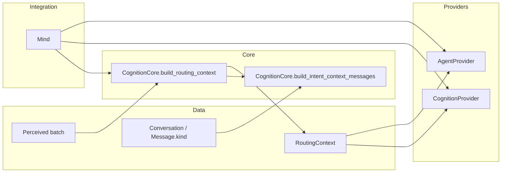

# TASK-010: only visible kinds for intent context — Design

← [[backlog/TASK-010-only-visible-kinds-for-intent-context/task|Back to task]] | [[backlog/TASK-010-only-visible-kinds-for-intent-context/requirements|Requirements]]

## Solution overview

Extend `CognitionCore.build_intent_context_messages` with a kind-based visibility
stage that runs after bootstrap removal and `exclude_trailing`, but before the
tail limit and `Message.to_llm_dict()` conversion. The Core will use a private,
Data-typed `{"user", "assistant"}` kind set whose parity with memory's
`VISIBLE_KINDS` is protected by a regression test; this follows the existing
`CompressionCore` pattern without making one Operation depend on another. The
result remains the single `RoutingContext.recent_messages` value already passed
unchanged by `Mind` to both intent classification and agent skill selection, so
no downstream interface or persistence changes are needed. This is the local
implementation of [[backlog/EPIC-002-agent-routing-reliability/design#Context hygiene]]
and precedes the later selection-contract work in the epic's
[[backlog/EPIC-002-agent-routing-reliability/design#Proposed delivery sequence|delivery sequence]].

## Architecture



`CognitionCore` owns the synchronous visibility decision (FR-1). `RoutingContext`
remains an unchanged Data object that carries the resulting tail to both
Providers (FR-2). `Mind` remains an Integration that only orchestrates the
existing calls; it acquires no filtering logic.

## Key decisions

### Decision 1: Preserve positional exclusion before filtering

**Context:** On ingest, `Mind` appends each perceived current-turn entry before
building routing context. TASK-002 may also insert a `user_introduction`
immediately before the first appended user entry. `exclude_trailing` currently
means “remove this many appended current-turn entries,” not “remove this many
visible entries.”  
**Options:** (A) filter visible kinds before `exclude_trailing`; (B) preserve
positional exclusion, then filter kinds, then limit; (C) special-case only
`user_introduction`.  
**Choice:** B. The ordered pipeline is: omit bootstrap → exclude trailing
current-turn entries → retain visible kinds → apply tail limit → serialize.
This preserves the public meaning of `exclude_trailing`, removes every
non-visible kind, and prevents internal entries from consuming the visible
limit (FR-1, FR-2).

### Decision 2: Keep a private cognition visibility set with parity coverage

**Context:** Cognition must use exactly memory's `user`/`assistant` visibility
semantics, but IODA forbids `CognitionCore` from depending on `MemoryCore`,
`MemoryProvider`, or another Operation. Moving the established memory constant
would broaden this surgical task.  
**Options:** (A) import `VISIBLE_KINDS` from the Operation-bearing
`memory.py`; (B) relocate the shared constant to Data and update all consumers;
(C) define `_VISIBLE_KINDS: frozenset[MessageKind]` in `cognition.py` and assert
parity with memory's public constant in tests.  
**Choice:** C. It matches the existing `CompressionCore` parity pattern, keeps
the production Core dependent only on Data, and turns future semantic drift
into a deterministic test failure (FR-1, FR-3). This local implementation
choice is not an ADR candidate.

### Decision 3: Clean context once at the RoutingContext boundary

**Context:** Intent classification and agent skill selection both consume
`RoutingContext.recent_messages`; filtering either consumer independently could
create divergent routing inputs or allow a later stage to reintroduce internal
messages.  
**Options:** (A) filter separately while formatting each prompt; (B) filter
once while constructing `RoutingContext.recent_messages`.  
**Choice:** B. `build_routing_context` continues to derive the current text from
the perceived batch and delegates the tail to
`build_intent_context_messages`. `CognitionProvider` and `AgentProvider` receive
the same clean list through their existing calls, with no downstream filtering
or contract change (FR-2, FR-3). This is not an ADR candidate because the
cross-task context-hygiene decision already belongs to the EPIC-002 master
design.

## Interfaces

### `CognitionCore.build_intent_context_messages`

The existing signature and defaults remain unchanged:

```python
_VISIBLE_KINDS: frozenset[MessageKind] = frozenset({"user", "assistant"})

@staticmethod
def build_intent_context_messages(
    conversation: Conversation | None,
    *,
    limit: int = 4,
    exclude_trailing: int = 0,
) -> list[dict]:
    ...
```

The method contract is:

1. Return `[]` for a missing or empty conversation.
2. Remove the bootstrap entry with `conversation.messages[1:]`.
3. When `exclude_trailing > 0`, remove that many entries from this
   post-bootstrap sequence using the existing early-empty behavior.
4. Retain only messages whose `kind` belongs to `_VISIBLE_KINDS`; `role` is not
   consulted for visibility.
5. Apply the existing `[-limit:]` tail selection to the filtered sequence.
6. Preserve chronological order and return each selected message's existing
   `to_llm_dict()` representation.

The method does not mutate `Conversation`, `Message`, or their contained lists
(FR-1).

### `CognitionCore.build_routing_context`

The existing interface and construction remain:

```python
@staticmethod
def build_routing_context(
    perceived: list[dict],
    conversation: Conversation | None,
) -> RoutingContext:
    return RoutingContext(
        current_user_text=CognitionCore.extract_user_text(perceived),
        recent_messages=CognitionCore.build_intent_context_messages(
            conversation,
            exclude_trailing=len(perceived),
        ),
    )
```

On first ingest, positional exclusion removes the current user entry and
visibility filtering removes the adjacent `user_introduction`; when no prior
visible history exists, `recent_messages` is empty. In an established
conversation, prior visible entries survive in newest-last order up to the
default limit (FR-2).

### Data model

No Data shape changes. The existing boundary remains:

```python
@dataclass
class RoutingContext:
    current_user_text: str
    recent_messages: list[dict]
```

Each `recent_messages` element remains the dictionary emitted by
`Message.to_llm_dict()`. No stored `Conversation`, `Message`, Redis, or ChromaDB
schema changes are introduced.

## System impact

| Path / class | IODA | Change | FR |
|--------------|------|--------|----|
| `yoda/mind/cognition.py` — `_VISIBLE_KINDS`, `CognitionCore.build_intent_context_messages` | Core | Edit — add Data-typed visibility contract and filter before limiting; signatures and consumers stay unchanged | FR-1, FR-2 |
| `tests/test_cognition_intent.py` — routing-tail tests | Test (Core/Data contract) | Edit — exclude all non-visible kinds, cover first-ingest introduction, assert parity with memory visibility, and verify visible-counted limit/order/formatting | FR-1, FR-2, FR-3 |
| `tests/test_agent_provider.py` — `test_selection_includes_recent_messages` and suite | Test (Provider contract) | Verify only — existing test continues proving eligible `recent_messages` reaches skill selection; no edit expected | FR-2, FR-3 |

No change is required in `Mind`, `RoutingContext`, `MemoryCore`,
`MemoryProvider`, `AgentProvider`, or `Conversation.to_llm_messages()`.

## Persistence and rollout

This task changes only a deterministic in-memory projection of already-loaded
messages. It writes no state and changes no wire schema, so EPIC-002's
`external_contract: additive` is satisfied without migration or cleanup.
`internal_compat: none` requires no machinery for intermediate member-task
states. Rollback is a code-and-test revert; persisted conversations remain
valid before and after rollback.

## Decisions made (from requirements review)

| Item | Resolution |
|------|------------|
| Visibility authority under IODA | Use a private cognition kind set typed from Data and a test-time parity assertion; do not import another Operation into `CognitionCore` |
| First-ingest ordering | Exclude current-turn entries positionally before filtering the inserted introduction |
| Routing consumer ownership | Build one clean `RoutingContext.recent_messages`; retain existing intent and skill-selection consumers |
| Compatibility horizon | No migration, rollout shim, or persisted-state rollback is needed |

## Open questions

None.