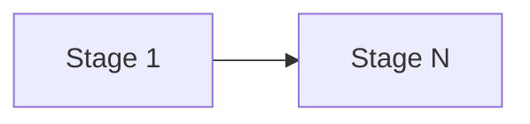

# TASK-010: only visible kinds for intent context — Implementation plan

← [[backlog/TASK-010-only-visible-kinds-for-intent-context/task|Back to task]] | [[backlog/TASK-010-only-visible-kinds-for-intent-context/requirements|Requirements]] | [[backlog/TASK-010-only-visible-kinds-for-intent-context/design|Design]]

## Overview

One paragraph: what we build and why. Minimal context to grasp the task without opening task.md.

## Goal / Non-goals

- **Goal:** observable end state after the plan is executed.
- **Non-goals:** what we explicitly do not do (from requirements Out of scope).

## Context to load

Files to read before starting:

- [[backlog/TASK-010-only-visible-kinds-for-intent-context/requirements|requirements]] — FR-1…FR-N and acceptance criteria
- [[backlog/TASK-010-only-visible-kinds-for-intent-context/design|design]] — «Architecture», «Interfaces», «System impact»
- AGENTS.md (IODA + coding guidelines), coding_behavior.md
- <!-- ADR-XXX, related TASK design.md, runbooks — as needed -->

## Pre-flight

Mandatory conditions before implementation starts.
If any item below fails and cannot be satisfied immediately, do not proceed to implementation.

- [ ] `git checkout main && git pull` — main is up to date
- [ ] `git status` — working tree is clean
- [ ] `git checkout -b <branch from frontmatter>` — feature branch created
- [ ] `.venv` active and dependencies installed
- [ ] Baseline tests green: `.venv/bin/python -m pytest`

## Files & artifacts

| Path | IODA | Op | FR |
|------|------|----|----|
| <yoda/path/to/file.py> | Integration / Core / Provider / Portal / Data / API | create / edit / delete | FR-N |

## Stages

### Stage 1: Name

**Goal:** what is done after the stage.

- [ ] **1.1** Short step name
  - Files: <paths>
  - Action: what exactly to do (cite IODA category + concrete symbols from design)
  - Verify: for behavioral steps write the test first (red), then implement (green) — `.venv/bin/python -m pytest tests/test_x.py::test_y`
  - Commit: `feat(TASK-010): 1.1 <subject>`

- [ ] **1.2** Next step
  - Files:
  - Action:
  - Verify:
  - Commit: `feat(TASK-010): 1.2 <subject>`

**Checkpoint Stage 1:** full suite green — `.venv/bin/python -m pytest`.

---

### Stage N: Test sweep & coverage

- [ ] **N.1** Cover every FR's acceptance criteria with tests
  - Files: tests/test_*.py (fakes in tests/fakes.py; mock API façades)
  - Action: add/extend unit + integration tests for FR-1…FR-N
  - Verify: `.venv/bin/python -m pytest`
  - Commit: `test(TASK-010): N.1 <subject>`

- [ ] **N.2** Manual AC check
  - FR-1: <observable check>
  - FR-2: <observable check>

## Stage dependencies

## FR coverage (traceability)

| FR | Steps | Verification |
|----|-------|--------------|
| FR-1 | 1.1, N.1 | unit + manual |

## Risks

| Risk | Probability | Impact | Mitigation |
|------|-------------|--------|------------|
| | | | |

## Rollback

- Code: `git revert` the merge commit or reset the branch.
- State: how to clear/restore Redis or ChromaDB entries if a step writes persistent state.

## Definition of Done

- [ ] All plan steps checked
- [ ] All acceptance criteria from requirements.md pass
- [ ] Full suite green: `.venv/bin/python -m pytest`
- [ ] IODA + coding guidelines (AGENTS.md) respected
- [ ] `task.md`: `status: done`, `updated: <today>`
- [ ] `design.md` / ADR updated if execution diverged from the plan
