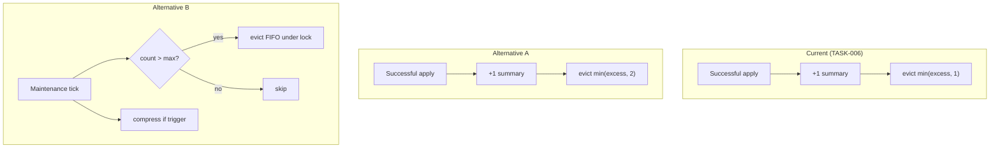

# TASK-011: inline summary excess rebalance — Design

← [[task|Back to task]] | [[requirements|Requirements]]

## Solution overview

**Not chosen yet** — implement [[requirements#Alternative A: Raise per-apply eviction cap (`summaries_added=2`)]] (recommended default) or [[requirements#Alternative B: Eviction-only maintenance pass]]. Fill this section after the decision.

## Architecture

## Key decisions

### Decision 1: Rebalance strategy

**Context:** [[requirements#Problem statement]] — excess stuck at `max + k` under `summaries_added=1`.

**Options:** Alternative A (cap=2) / Alternative B (eviction-only) / Alternative C (document only).

**Choice:** _TBD at design review._

### Decision 2: Eviction burst limit (Alternative B only)

**Context:** Evicting all excess in one tick vs capped per tick (outbox / context cliff).

**Options:** Drain to `max` in one pass / cap at 2 per tick.

**Choice:** _TBD if Alternative B._

## Interfaces

_To be filled after strategy choice. Likely touch points:_

- `yoda/mind/maintenance.py` — `summaries_added` constant and/or `_rebalance_inline_summaries`
- `yoda/mind/memory/compression_apply_core.py` — `evict_summaries_fifo` (reuse as-is for both alternatives)

## System impact

| Path / class | IODA | Change | FR |
|--------------|------|--------|-----|
| `yoda/mind/maintenance.py` | Integration | edit | FR-1, FR-2 |
| `tests/test_compression_apply.py` | Test | edit | FR-1 |
| `tests/test_maintenance.py` | Test | edit (if Alternative B) | FR-1 |

## Open questions

- [ ] Alternative A or B?
- [ ] If B: run rebalance before or after compression on the same tick?
- [ ] If B: new `Chat.history` event type (`summary_eviction`) vs piggyback on `compression`?
