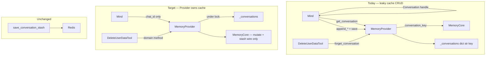

# TASK-012: memory provider cache ownership — Design

← [[task|Back to task]] | [[requirements|Requirements]]

## Solution overview

**Not chosen yet.** Default for design review: **D + B** (register in mutators, rename, int cache keys). If encapsulation is the priority: **D + E + F** (hide CRUD trio, `chat_id`-only `Mind` API, GDPR forget behind Provider).

## Architecture

## Key decisions

### Decision 1: Cache registration owner

**Context:** [[requirements#Problem statement]] — external `save` conflates register and re-put.

**Options:** A / D (register in mutators) / C (rename only).

**Choice:** _TBD._

### Decision 2: In-memory key type

**Context:** `conversation_key` = `str(chat_id)` on every get/save/forget.

**Options:** B (`dict[int, Conversation]`) / keep `str` keys.

**Choice:** _TBD._

### Decision 3: Public CRUD trio fate

**Context:** get/save/forget expose Provider internals; mutable reference leak.

**Options:**
- Keep public (status quo + D)
- Private `_get` / `_register` / `_forget` (D)
- Remove from public API; `chat_id`-only (E)
- `get_conversation` read-only for tests only

**Choice:** _TBD._

### Decision 4: `append_*` signature

**Context:** redundant `conversation: Conversation | None` + `chat_id`.

**Options:** Keep (minimal change) / drop `conversation` param — Provider resolves under lock (E).

**Choice:** _TBD — depends on Decision 3._

### Decision 5: GDPR in-memory drop

**Context:** `DeleteUserDataTool` calls `forget_conversation` after Redis deletes.

**Options:** F — private forget inside Provider helper / leave public forget / full `delete_user_data` on Provider.

**Choice:** _TBD._

### Decision 6: Public naming

**Options:** `register_conversation` vs `_register` / keep `save_conversation` as deprecated alias.

**Choice:** _TBD._

## Interfaces

_To be filled after decisions. Touch points:_

- `yoda/mind/memory/memory.py` — `MemoryProvider`
- `yoda/mind/mind.py` — drop get/save ceremony; optional drop `conversation` param
- `yoda/mind/agent/tools/delete_user_data_tool.py` — if Decision 5 ≠ status quo
- `tests/fakes.py`, `tests/test_memory_operation.py`, mind/compression tests

## System impact

| Path / class | IODA | Change | FR |
|--------------|------|--------|-----|
| `memory.py` — `MemoryProvider` | Provider | edit | FR-1, FR-3 |
| `mind.py` — `Mind` | Integration | edit | FR-1, FR-3 |
| `delete_user_data_tool.py` | Portal/Tool | edit (if F) | FR-3 |
| `tests/fakes.py` | Test double | edit | FR-1…FR-3 |

## Open questions

- [ ] Combo: D+B vs D+E+F vs C-only?
- [ ] Keep `get_conversation` public for tests/maintenance, or `iter_conversations` + `chat_id` only?
- [ ] Return copy from get (safety) vs shared reference (performance) — if get stays public?
- [ ] Deprecation period for `save_conversation` / `get_conversation` if renamed/hidden?
