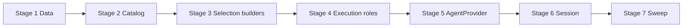

# TASK-014: discriminative skill selection contracts — Implementation plan

← [[backlog/TASK-014-discriminative-skill-selection-contracts/task|Back to task]] | [[backlog/TASK-014-discriminative-skill-selection-contracts/requirements|Requirements]] | [[backlog/TASK-014-discriminative-skill-selection-contracts/design|Design]]

## Overview

Extend skill selection with a compact, code-owned contract (`purpose`, `when_to_use`, `do_not_use_when`, `selection_examples`) on every skill, validated at catalog load and serialized in name-sorted order so catalog position cannot imply priority. Split selection and execution prompts into authoritative `system` control content (catalog, rules, workflow, tools) versus untrusted `user` payload (task, recent conversation, clarification answers), remove the synthetic assistant acknowledgement on activation, and refresh legacy suspended pre-selection sessions from the current catalog before the next selector call. This implements EPIC-002 master decisions 3 and 8 for the selection phase without the phase models or `Agent` Integration owned by TASK-015.

## Goal / Non-goals

- **Goal:** Every discovered skill exposes validated discriminative selection metadata; the selector receives a compact, order-neutral catalog in a `system` message with task/conversation in a separate `user` message; activation workflow/tools are `system`; legacy pre-selection sessions load and refresh; full test suite green.
- **Non-goals:** Separate typed selection/execution response models; selection-before-clarification policy, corrective retries, retry limits, and the new `Agent` Integration boundary; changes to full skill workflows, tool schemas, execution preferences, source enforcement, timezone behavior, or structured outcomes; live-model evaluation thresholds, multilingual routing corpus, and stage-telemetry infrastructure; user-visible completion wording and static-message versus dynamic-task outcome delivery.

## Context to load

Files to read before starting:

- [[backlog/TASK-014-discriminative-skill-selection-contracts/requirements|requirements]] — FR-1…FR-5 and acceptance criteria
- [[backlog/TASK-014-discriminative-skill-selection-contracts/design|design]] — Architecture, Interfaces, System impact, Decisions 1–5
- [[backlog/EPIC-002-agent-routing-reliability/epic|EPIC-002]] — decomposition, shared branch, delivery profile (`internal_compat: none`, `external_contract: additive`)
- [[backlog/EPIC-002-agent-routing-reliability/design|EPIC-002 master design]] — Selection contract versus execution workflow; Static message versus dynamic task; Control-plane authority
- [[backlog/EPIC-002-agent-routing-reliability/suggested_prompts|Suggested prompts]] — Skill selection contracts section (YAML for all five skills)
- [[backlog/TASK-010-only-visible-kinds-for-intent-context/design|TASK-010 design]] — visible-only recent conversation (dependency; must be merged on epic branch)
- `AGENTS.md` (root) — IODA + coding guidelines
- `coding_behavior.md`
- `yoda/mind/agent/AGENTS.md` — current two-phase message accumulation contract
- `yoda/mind/agent/data/agent_data.py`, `yoda/mind/agent/skills/catalog.py`, `yoda/mind/agent/core/react_loop.py`, `yoda/mind/agent/agent_provider.py`, `yoda/mind/agent/session_provider.py`

## Pre-flight

Mandatory conditions before implementation starts.
If any item below fails and cannot be satisfied immediately, do not proceed to implementation.

- [x] `git checkout main && git pull` — main is up to date
- [x] `git status` — working tree is clean
- [x] `git checkout feat/EPIC-002-agent-routing-reliability || git checkout -b feat/EPIC-002-agent-routing-reliability` — shared epic branch (TASK-010 merged or present on branch)
- [x] `.venv` active and dependencies installed
- [x] Baseline tests green: `.venv/bin/python -m pytest`
- [x] All five production specs under `yoda/mind/agent/skills/specs/` present (startup will fail validation once step 2.1 lands until step 2.2 completes — plan stages account for this)

## Files & artifacts

| Path | IODA | Op | FR |
|------|------|----|----|
| `yoda/mind/agent/data/agent_data.py` — `SkillSummary` | Data | edit | FR-1, FR-2, FR-5 |
| `yoda/mind/agent/skills/catalog.py` — `SkillCatalog.load_catalog` | Provider | edit | FR-1, FR-2, FR-5 |
| `yoda/mind/agent/core/react_loop.py` — selection/execution builders, `refresh_selection_messages` | Core | edit | FR-2, FR-3, FR-4, FR-5 |
| `yoda/mind/agent/agent_provider.py` — `run`, `resume`, `_activate_skill_context`, execution nudge | Integration (transitional) | edit | FR-2, FR-4, FR-5 |
| `yoda/mind/agent/session_provider.py` — `AgentSessionProvider` | Provider | verify/edit | FR-5 |
| `yoda/mind/agent/skills/specs/create_picture.md` | Data/config | edit | FR-1 |
| `yoda/mind/agent/skills/specs/manage_jobs.md` | Data/config | edit | FR-1 |
| `yoda/mind/agent/skills/specs/manage_user_data.md` | Data/config | edit | FR-1, FR-2 |
| `yoda/mind/agent/skills/specs/schedule_message.md` | Data/config | edit | FR-1, FR-3 |
| `yoda/mind/agent/skills/specs/search_web.md` | Data/config | edit | FR-1, FR-3 |
| `tests/fixtures/skills/specs/test_skill.md` | Test Data | edit | FR-1 |
| `tests/fixtures/skills/specs/no_tools_skill.md` | Test Data | edit | FR-1 |
| `tests/fixtures/skills/specs/private_skill.md` | Test Data | edit | FR-1 |
| `tests/test_skill_catalog.py` | Test | edit | FR-1, FR-2, FR-3 |
| `tests/test_react_loop.py` | Test | edit | FR-2, FR-3, FR-4 |
| `tests/test_agent_provider.py` | Test | edit | FR-2, FR-4 |
| `tests/test_agent_session.py` | Test | edit | FR-5 |
| `yoda/mind/agent/AGENTS.md` | Documentation | edit | FR-1, FR-2, FR-4 |

## Stages

### Stage 1: Data contract

**Goal:** `SkillSummary` carries additive selection fields with legacy-safe defaults; context copies preserve them.

- [x] **1.1** Extend `SkillSummary` with selection contract fields
  - Files: `yoda/mind/agent/data/agent_data.py`, `tests/test_skill_catalog.py`
  - Action: **Data** — add `purpose: str = ""`, `when_to_use: list[str] = field(default_factory=list)`, `do_not_use_when: list[str] = field(default_factory=list)`, `selection_examples: list[str] = field(default_factory=list)` to `SkillSummary`. Confirm `AgentContext.with_messages` and other copy paths pass through `catalog_summaries` unchanged (no new mutation). Add a minimal unit test constructing a `SkillSummary` with all fields set.
  - Verify: `.venv/bin/python -m pytest tests/test_skill_catalog.py -q` (existing tests still pass; new field test green)
  - Commit: `feat(TASK-014): 1.1 add SkillSummary selection contract fields`

**Checkpoint Stage 1:** `.venv/bin/python -m pytest tests/test_skill_catalog.py`

---

### Stage 2: Catalog validation and skill frontmatter

**Goal:** Current specs fail fast on missing/malformed selection metadata; all production and fixture skills supply valid contracts.

- [x] **2.1** Strict selection-metadata validation in `load_catalog`
  - Files: `yoda/mind/agent/skills/catalog.py`, `tests/test_skill_catalog.py`, `tests/fixtures/skills/specs/*.md`
  - Action: **Provider** — add `_validate_selection_metadata(stem, frontmatter)` called from `load_catalog`. Require non-blank `purpose: str` and non-empty `list[str]` for `when_to_use`, `do_not_use_when`, `selection_examples` with only non-blank string members. Raise `ValueError` naming skill (or filename stem) and field on missing, empty, wrong container type, or blank list members. Stop silently skipping specs without `name`. **TDD:** extend fixture specs with valid metadata first, then add failing tests for missing/empty/malformed fields before implementing validation.
  - Verify: `.venv/bin/python -m pytest tests/test_skill_catalog.py::test_load_catalog_finds_all_specs tests/test_skill_catalog.py -k "selection_metadata or validate_selection" -q`
  - Commit: `feat(TASK-014): 2.1 validate selection metadata at catalog load`

- [x] **2.2** Add production skill selection contracts
  - Files: `yoda/mind/agent/skills/specs/create_picture.md`, `manage_jobs.md`, `manage_user_data.md`, `schedule_message.md`, `search_web.md`
  - Action: **Data/config** — add top-level frontmatter fields per [[design#Skill selection metadata]] and [[backlog/EPIC-002-agent-routing-reliability/suggested_prompts#Skill selection contracts]]. Keep existing `description`, `public`, execution fields, and workflow bodies unchanged. Ensure `schedule_message` and `search_web` encode the static-versus-dynamic boundary explicitly (FR-3).
  - Verify: `.venv/bin/python -m pytest tests/test_skill_catalog.py -q` and manual: `SkillCatalog.load_catalog(Path("yoda/mind/agent/skills"))` succeeds from project root
  - Commit: `feat(TASK-014): 2.2 add production skill selection contracts`

- [x] **2.3** Add fixture skill selection contracts
  - Files: `tests/fixtures/skills/specs/test_skill.md`, `no_tools_skill.md`, `private_skill.md`
  - Action: **Test Data** — add minimal valid selection metadata to every fixture spec so catalog tests and `AgentProvider` fixture wiring keep loading.
  - Verify: `.venv/bin/python -m pytest tests/test_skill_catalog.py tests/test_agent_provider.py -q`
  - Commit: `feat(TASK-014): 2.3 add fixture skill selection contracts`

- [x] **2.4** Static/dynamic contrast tests on production catalog
  - Files: `tests/test_skill_catalog.py`
  - Action: **Test** — load production `yoda/mind/agent/skills` catalog; assert `schedule_message` and `search_web` contracts contain the FR-3 contrasts (recurring static vitamins → schedule; recurring fresh weather → search_web; delayed “check weather” reminder → schedule_message). Assert contracts are identical when summaries are reversed before serialization input (prepare helper that will feed ReactLoop in stage 3). Assert `public_summaries` still excludes `manage_user_data` while full catalog includes it.
  - Verify: `.venv/bin/python -m pytest tests/test_skill_catalog.py -k "static_dynamic or public_summaries" -q`
  - Commit: `test(TASK-014): 2.4 static versus dynamic catalog contrasts`

**Checkpoint Stage 2:** `.venv/bin/python -m pytest tests/test_skill_catalog.py`

---

### Stage 3: ReactLoop selection message builders

**Goal:** Compact, name-sorted selection control in `system`; user task/conversation in separate `user` message; legacy seed refresh.

- [x] **3.1** `build_selection_control_message` with canonical serialization
  - Files: `yoda/mind/agent/core/react_loop.py`, `tests/test_react_loop.py`
  - Action: **Core** — implement `build_selection_control_message(catalog_summaries) -> dict` returning `role: system` with `<skill_selection_control>` marker, explicit “catalog order has no semantic priority” rule, and per-skill blocks sorted by exact `name` with fixed field order (`name`, `purpose`, `when_to_use`, `do_not_use_when`, `selection_examples`). Include private skills. Exclude `description`, workflow prose, tool schemas, and tool-call examples. **TDD:** add failing tests for role, markers, field presence, name sort stability, and reversed input order producing identical content.
  - Verify: `.venv/bin/python -m pytest tests/test_react_loop.py -k "selection_control" -q`
  - Commit: `feat(TASK-014): 3.1 selection control system message builder`

- [x] **3.2** `build_selection_input_message` for user payload
  - Files: `yoda/mind/agent/core/react_loop.py`, `tests/test_react_loop.py`
  - Action: **Core** — implement `build_selection_input_message(task, recent_messages=None) -> dict` returning `role: user` with `<selection_input>`, optional `<recent_conversation>` via `format_recent_messages_block`, and `<task>` sections. No catalog or control instructions. **TDD:** tests for role, markers, recent conversation inclusion, and absence of catalog/control text.
  - Verify: `.venv/bin/python -m pytest tests/test_react_loop.py -k "selection_input" -q`
  - Commit: `feat(TASK-014): 3.2 selection input user message builder`

- [x] **3.3** `refresh_selection_messages` for new and legacy transcripts
  - Files: `yoda/mind/agent/core/react_loop.py`, `tests/test_react_loop.py`
  - Action: **Core** — implement `refresh_selection_messages(context, catalog_summaries) -> AgentContext` per [[design#Selection message builders]]. For new format: replace messages matching selection-control and selection-input markers. For legacy combined `user` message: preserve content before `Available skills:` or `No skills available.`, drop legacy catalog/instruction suffix, insert current `system` control + refreshed `user` input; preserve all subsequent assistant/tool/user clarification messages. Unrecognized shapes raise `ValueError`. **TDD:** cover new-format replacement, legacy prefix preservation, and post-clarification tail retention.
  - Verify: `.venv/bin/python -m pytest tests/test_react_loop.py -k "refresh_selection" -q`
  - Commit: `feat(TASK-014): 3.3 refresh selection messages for resume`

- [x] **3.4** Remove `build_selection_message`
  - Files: `yoda/mind/agent/core/react_loop.py`, `tests/test_react_loop.py`
  - Action: **Core** — delete `build_selection_message` (no compatibility wrapper). Remove or rewrite tests that referenced it; callers will migrate in stage 5.
  - Verify: `.venv/bin/python -m pytest tests/test_react_loop.py -q` (expect failures in provider tests until stage 5 — run react_loop subset only at this step)
  - Commit: `refactor(TASK-014): 3.4 remove legacy build_selection_message`

**Checkpoint Stage 3:** `.venv/bin/python -m pytest tests/test_react_loop.py`

---

### Stage 4: ReactLoop execution role boundary

**Goal:** Activation and execution instructions are `system`; no synthetic assistant acknowledgement.

- [x] **4.1** System activation and compact execution layout
  - Files: `yoda/mind/agent/core/react_loop.py`, `tests/test_react_loop.py`
  - Action: **Core** — change `build_activation_message` to return `role: system` (workflow behavior unchanged). Change `build_compact_execution_messages` to return `[base system, distilled-task user, activation system]` — remove synthetic `assistant` acknowledgement. **TDD:** update `test_build_compact_execution_messages_order_and_content` and `test_build_activation_message_contains_skill_spec_and_tools` for three messages, system activation, no assistant ack.
  - Verify: `.venv/bin/python -m pytest tests/test_react_loop.py -k "activation or compact_execution" -q`
  - Commit: `feat(TASK-014): 4.1 system activation and no synthetic ack`

**Checkpoint Stage 4:** `.venv/bin/python -m pytest tests/test_react_loop.py`

---

### Stage 5: AgentProvider orchestration

**Goal:** Initial and resumed selection use split messages; catalog refresh before resumed selector; execution nudge is `system`.

- [x] **5.1** Install split selection messages in `run`
  - Files: `yoda/mind/agent/agent_provider.py`, `tests/test_agent_provider.py`
  - Action: **Integration** — in `run`, replace `build_selection_message` with `build_selection_control_message(self._catalog_summaries)` + `build_selection_input_message(task, recent_messages)` after base system message. Messages order: `[system base, system selection control, user selection input]`. Update `test_llm_context_static_system_and_tools_in_activation`, `test_selection_includes_recent_messages`, and related tests for role/content separation (control in system, task/conversation in user).
  - Verify: `.venv/bin/python -m pytest tests/test_agent_provider.py -k "selection or llm_context" -q`
  - Commit: `feat(TASK-014): 5.1 split selection messages in run`

- [x] **5.2** Refresh catalog before resumed pre-selection
  - Files: `yoda/mind/agent/agent_provider.py`, `tests/test_agent_provider.py`, `tests/test_react_loop.py`
  - Action: **Integration** — in `resume`, when `context.active_skill is None`, set `catalog_summaries` to `self._catalog_summaries` and call `ReactLoop.refresh_selection_messages` before `_run_until_skill_or_answer`. **TDD:** test that a saved legacy pre-selection transcript (combined user catalog message) loads, refreshes to current contracts in the next LLM call, and preserves clarification tail after resume answer.
  - Verify: `.venv/bin/python -m pytest tests/test_agent_provider.py -k "resume or refresh" -q`
  - Commit: `feat(TASK-014): 5.2 refresh catalog on resumed pre-selection`

- [x] **5.3** System execution nudge and handoff role tests
  - Files: `yoda/mind/agent/agent_provider.py`, `tests/test_agent_provider.py`
  - Action: **Integration** — change execution-loop nudge message from `user` to `system`. Add/update tests asserting selection-to-execution handoff: phase-2 messages have user distilled task, system activation (no assistant ack), clarification answers stay `user`, user text never appears inside system control content even when conversation contains instruction-like strings.
  - Verify: `.venv/bin/python -m pytest tests/test_agent_provider.py -q`
  - Commit: `feat(TASK-014): 5.3 system nudge and role separation tests`

**Checkpoint Stage 5:** `.venv/bin/python -m pytest tests/test_agent_provider.py tests/test_react_loop.py`

---

### Stage 6: Session persistence compatibility

**Goal:** Legacy summary JSON loads; new contract fields round-trip.

- [x] **6.1** Legacy pre-selection session load and new-field round-trip
  - Files: `tests/test_agent_session.py`, `yoda/mind/agent/session_provider.py` (edit only if decode breaks)
  - Action: **Test / Provider verify** — add test loading a legacy `catalog_summaries` payload with only `name`, `description`, `public` (defaults fill new fields). Add test saving/loading summaries with full selection contract fields without loss. Confirm `asdict`/`SkillSummary(**s)` path needs no code change; fix only if test fails.
  - Verify: `.venv/bin/python -m pytest tests/test_agent_session.py -q`
  - Commit: `test(TASK-014): 6.1 legacy and full summary session round-trip`

**Checkpoint Stage 6:** `.venv/bin/python -m pytest tests/test_agent_session.py`

---

### Stage 7: Test sweep & coverage

- [x] **7.1** Full suite and FR gap fill
  - Files: `tests/test_skill_catalog.py`, `tests/test_react_loop.py`, `tests/test_agent_provider.py`, `tests/test_agent_session.py`
  - Action: Run full suite; add any missing assertions from FR coverage matrix (order-neutral reversed catalog in react_loop, private skill in selection control, malformed spec startup failure message identifies skill+field). Ensure no test still expects `build_selection_message`, `user` activation, or synthetic assistant ack.
  - Verify: `.venv/bin/python -m pytest`
  - Commit: `test(TASK-014): 7.1 FR coverage sweep`

- [x] **7.2** Module documentation and manual AC
  - Files: `yoda/mind/agent/AGENTS.md`
  - Action: **Documentation** — document new frontmatter fields, selection `system`/`user` split, execution activation as `system`, removed synthetic assistant ack, and legacy session refresh behavior. Manual AC checklist (see below).
  - Verify: `.venv/bin/python -m pytest` (unchanged green); manual AC items checked
  - Commit: `docs(TASK-014): 7.2 agent module selection contract docs`

**Manual AC (7.2):**
- FR-1: `SkillCatalog.load_catalog` on production dir loads all five skills with four contract elements each; missing field in one spec raises identifiable `ValueError`
- FR-2: Selection LLM payload (via `FakeLanguageProvider.messages_log`) has system catalog with `<skill_selection_control>` and user payload with task only in `<selection_input>`
- FR-3: Production `schedule_message`/`search_web` YAML matches static/dynamic boundary in requirements
- FR-4: Phase-2 activation message role is `system`; no assistant “selected” message between task and activation
- FR-5: Legacy session JSON with old summaries loads; resumed selection uses refreshed contracts

**Checkpoint Stage 7:** `.venv/bin/python -m pytest`

## Stage dependencies

## FR coverage (traceability)

| FR | Steps | Verification |
|----|-------|--------------|
| FR-1 | 1.1, 2.1, 2.2, 2.3, 7.1 | `tests/test_skill_catalog.py` — all fields present, malformed/missing fail-fast, no workflow fallback; manual startup load |
| FR-2 | 2.1, 3.1, 3.2, 3.4, 5.1, 7.1 | `tests/test_react_loop.py` — compact control, order-neutral sort, no workflow in control; `tests/test_agent_provider.py` — role separation |
| FR-3 | 2.2, 2.4, 3.1, 7.1 | `tests/test_skill_catalog.py` — static/dynamic contrasts + reversed order; control serialization includes boundary examples |
| FR-4 | 3.1, 3.2, 4.1, 5.1, 5.3, 7.1, 7.2 | `tests/test_react_loop.py`, `tests/test_agent_provider.py` — system/user roles, no synthetic ack, clarification stays user, system nudge |
| FR-5 | 1.1, 2.1, 3.3, 5.2, 6.1, 7.1 | `tests/test_agent_session.py`, `tests/test_agent_provider.py` — legacy load, refresh before selector, new field round-trip |

## Risks

| Risk | Probability | Impact | Mitigation |
|------|-------------|--------|------------|
| Stage 2.1 validation lands before 2.2/2.3 frontmatter, breaking startup and tests | Medium | High | Complete 2.1 fixture metadata in same commit or immediately follow with 2.2+2.3 before running full suite; stage checkpoint uses targeted pytest until all specs valid |
| Legacy session refresh mis-identifies combined message boundary and drops user data | Low | High | Step 3.3 TDD with explicit legacy fixtures; fail on unrecognized shapes; step 5.2 integration test with full clarification tail |
| Tests assume old `user` activation / assistant ack | Medium | Medium | Stage 4.1 and 5.1 explicitly rewrite react_loop and agent_provider tests; step 7.1 grep for stale expectations |
| Rollback while new-format pre-selection session suspended | Low | Medium | Document rollback: delete affected `agent_sessions` Redis entries only; no profile/job migration |

## Rollback

- **Code/spec/tests:** `git revert` the epic-branch merge commit(s) for TASK-014.
- **Redis sessions (external_contract only):** New suspended pre-selection sessions may contain extra `catalog_summaries` keys and new message shapes. If rolling back code while such a session exists, delete the affected `agent_sessions` hash entries for those chat ids (or complete the session first). No migration of user profiles, `skill_preferences`, scheduled jobs, or conversation history is required.
- **No intermediate deploy states:** EPIC-002 `internal_compat: none` — no rollback steps for partially deployed member-task combinations.

## Definition of Done

- [x] All plan steps marked done (`last_step` = `7.2`)
- [x] All FR-1…FR-5 acceptance criteria pass
- [x] Full suite green: `.venv/bin/python -m pytest`
- [x] IODA respected: Data defaults for legacy decode only; validation in catalog Provider; message formatting/refresh in ReactLoop Core; orchestration wiring in AgentProvider; no Operation-to-Operation imports added
- [x] All five production skills and three fixture skills have valid selection frontmatter
- [x] `yoda/mind/agent/AGENTS.md` updated for new contract and message roles
- [ ] `review.md`: verdict `pass` or `pass-with-follow-ups`
- [ ] `task.md`: `status: done`, `updated: 2026-07-20`
- [ ] `design.md` updated only if execution diverged from plan
