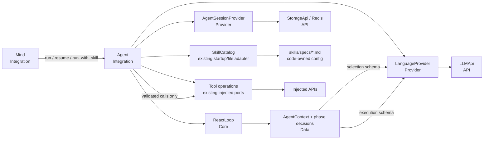

# TASK-015: phase protocol and Agent Integration — Design

← [[backlog/TASK-015-phase-protocol-and-agent-integration/task|Back to task]] | [[backlog/TASK-015-phase-protocol-and-agent-integration/requirements|Requirements]]

## Solution overview

Replace the all-nullable `Decision` with strict, extra-forbidding
`SelectionDecision` and `ExecutionDecision` Data contracts, while keeping
cross-field, catalog-membership, tool-membership, retry, and transition policy
in synchronous `ReactLoop` Core methods. Selection becomes a single capability
decision—select one skill with a non-empty distilled task or return
`no_skill`—and cannot expose or dispatch tools; only execution receives the
active workflow and its filtered tools. Rename and extract the orchestration-heavy
`AgentProvider` into a bare-noun `Agent` Integration that calls language,
catalog, session, and tool Operations, applies one persisted corrective-retry
budget per phase, and assembles typed terminal results. Additive phase,
protocol-version, and retry fields let new Redis sessions round-trip exactly;
legacy sessions infer their phase from `active_skill` and are upgraded lazily
without parsing historical combined-decision messages. This is the task-local
implementation of
[[backlog/EPIC-002-agent-routing-reliability/design#Stage-local correctness]],
[[backlog/EPIC-002-agent-routing-reliability/design#Decision 1: Choose the skill before clarification]],
[[backlog/EPIC-002-agent-routing-reliability/design#Decision 2: Use phase-specific response models]],
and
[[backlog/EPIC-002-agent-routing-reliability/design#Decision 10: Put agent orchestration in an Integration]].

## Architecture



`Mind` remains the top-level Integration and delegates direct requests,
pending-session resumes, and scheduled known-skill runs through explicit
`Agent` entry points. `Agent` contains coordination only: it asks `ReactLoop`
for phase validation and transition results, passes returned Data to the
relevant Operation, and awaits effects. `ReactLoop` remains static,
synchronous, and Data-only. `LanguageProvider`, `AgentSessionProvider`,
`SkillCatalog`, and the existing injected `Tool` ports remain independently
testable adapters; no Provider gains an Operation or Integration dependency.
When a validated execution response contains two or more independent tool
calls, `Agent` dispatches them with `asyncio.gather()`.

## Key decisions

### Decision 1: Use explicit phase models with Core-owned semantic validation

**Context:** Pydantic must reject fields belonging to the other phase and extra
fields, but FR-1 also requires cross-field and membership policy to remain in
Core.  
**Options:** (A) one discriminated union with all validation in Pydantic; (B)
two permissive models and reconstruct phase rules in `Agent`; (C) two strict
models for shape/type validation, with semantic validation in `ReactLoop`.  
**Choice:** C. `SelectionDecision` contains only selection fields and
`ExecutionDecision` contains only execution fields; both use
`ConfigDict(extra="forbid")`. `ReactLoop.validate_selection_decision` enforces
the selected-skill/distilled-task and catalog invariants, while
`ReactLoop.validate_execution_decision` enforces exactly one execution mode,
non-empty content, and allowed tools. A rejected decision is never converted to
an answer or appended as accepted assistant history (FR-1, FR-3, FR-6). This
specializes master Decision 2 and is not a new ADR candidate.

### Decision 2: Make selection tool-free and represent no-skill structurally

**Context:** The former selection loop could call `ask_user` or
`update_profile`, suspend, and then continue selecting; the new selector must
choose the workflow before any workflow-specific clarification (FR-2).  
**Options:** (A) retain infrastructure tools but reject skill tools; (B) expose
`ask_user` only; (C) expose no executable schema and permit only
`select_skill` or `no_skill`.  
**Choice:** C. The selection call is parameterized only by
`SelectionDecision`; it receives the compact TASK-014 catalog and no tool
schema. `select_skill` must name a current catalog member and carry a non-empty
self-contained `distilled_task`. `no_skill` is a valid terminal state mapped to
a typed unsupported failure, not model-authored user-facing prose. Scheduled
`run_with_skill` constructs execution state directly and never invokes the
selector. `ask_user` and other shared infrastructure tools become available
only after activation (FR-1, FR-2, FR-6).

### Decision 3: Persist one corrective budget per phase

**Context:** A local loop variable would reset after tool iterations or
suspend/resume, while persisting raw validation text would leak model or schema
details (FR-3, FR-5, FR-6).  
**Options:** (A) one retry per invalid response; (B) one global retry across the
whole agent run; (C) one code-enforced boolean budget for selection and one for
execution, stored in `AgentContext`.  
**Choice:** C. `selection_retry_used` and `execution_retry_used` default to
`False`, are preserved by every immutable context copy and activation, and are
serialized in suspended sessions. A structured parse/schema exception is
normalized by `LanguageProvider` to a data-free boundary error; cross-field and
membership failures come from `ReactLoop`. If the current phase budget is
unused, `ReactLoop` marks it used and appends one concise `system` correction
selected from a closed failure-category enum. The rejected output and raw
exception are not appended. A second invalid response returns a typed
stage-labelled failure and deletes any pending session (FR-3, FR-5, FR-6).

### Decision 4: Replace `AgentProvider` with `Agent` without a compatibility shim

**Context:** Renaming only the class while leaving a Provider facade would keep
the wrong architectural boundary and two entry paths (FR-4).  
**Options:** (A) retain `AgentProvider` as a delegating compatibility wrapper;
(B) create `Agent` but leave callers on the Provider; (C) move orchestration to
`agent.py`, update all internal callers, and delete `agent_provider.py`.  
**Choice:** C. `Agent` preserves the existing async caller surface—`run`,
`resume`, `run_with_skill`, and `has_pending_session`—so `Mind` changes only its
injected type/name and calls. EPIC-002 has `internal_compat: none`, all callers
are repository-internal, and the external contract is persisted data rather
than Python imports, so a shim would add no required compatibility. The wiring
root constructs `Agent` from the same narrow Operations and tool ports (FR-4).

### Decision 5: Add an explicit phase discriminator and lazily upgrade legacy sessions

**Context:** New retry state needs a durable phase identity, while deployed
Redis may contain TASK-014-era pre-selection or active-execution sessions with
combined `Decision` JSON in historical assistant messages (FR-5).  
**Options:** (A) infer phase forever from `active_skill`; (B) bulk-migrate
Redis; (C) persist a protocol version and phase for new sessions, infer missing
values on load, and upgrade control messages lazily on resume.  
**Choice:** C. New contexts persist `protocol_version=2`,
`phase=selection|execution`, and both retry booleans.
`AgentSessionProvider.load` treats a missing phase as `execution` when
`active_skill` exists and `selection` otherwise; missing retry flags are
`False`, and a missing protocol version is legacy version 1. On legacy
pre-selection resume, the existing structurally safe catalog refresh is applied
after the clarification answer, then the current selector runs. On legacy
active-execution resume, `ReactLoop` replaces only the recognized generated
base protocol message with the execution-specific control contract and
preserves the active skill, task, tool/iteration state, transcript, and answer.
Historical combined-decision assistant JSON remains opaque transcript content
and is never parsed into either new response model. The upgraded context is
written only if it suspends again (FR-3, FR-5).

### Decision 6: Use typed failures internally and one capability-agnostic caller mapping

**Context:** Unknown skills/tools, malformed output, and exhausted iterations
currently become successful-looking strings such as `Unknown tool` or
`Task completed.` (FR-6). TASK-018, not this task, owns the richer grounded
outcome and final failure-rendering contract.  
**Options:** (A) retain answer strings; (B) raise exceptions to `Mind`; (C) add
a minimal typed failure to `AgentResult` and let `Mind` map every such failure
to one safe, generic unsuccessful delivery instruction.  
**Choice:** C. `AgentFailure` carries a stage and closed non-user-data category
for control flow and diagnostics, but no model output, schema text, provider
detail, path, or stack trace. Valid `no_skill`, corrective exhaustion, and
execution iteration exhaustion terminate through this field. `Mind` never
interpolates its stage/category into conversation history; it emits one
capability-agnostic failure instruction and does not claim a tool or job
completed. TASK-018 may later replace this minimal mapping with grounded
ambiguous/transient/unsupported outcomes (FR-2, FR-3, FR-6).

## Interfaces

### API / Public contract

```python
class Agent:
    async def has_pending_session(self, chat_id: int) -> bool: ...

    async def run(
        self,
        task: str,
        profile: UserProfile,
        chat_id: int,
        user_id: int = 0,
        recent_messages: list[dict] | None = None,
    ) -> AgentResult: ...

    async def run_with_skill(
        self,
        *,
        skill_name: str,
        task: str,
        profile: UserProfile,
        chat_id: int,
        user_id: int = 0,
    ) -> AgentResult: ...

    async def resume(self, chat_id: int, user_answer: str) -> AgentResult: ...
```

`run` starts in selection, `run_with_skill` starts in execution with the named
skill, and `resume` continues the persisted `phase`. `Mind` delegates through
these methods and does not inspect or mutate phase state.

The structured LLM boundary is phase-specific:

```python
await language_provider.parse_structured(messages, SelectionDecision)
await language_provider.parse_structured(messages, ExecutionDecision)
```

`LanguageProvider.parse_structured` raises a stable
`StructuredOutputError` for JSON/Pydantic response-shape failures without
including raw response or validation text. Other provider exceptions are not
misrepresented as accepted model decisions. `LLMApi` may log raw model output
only at DEBUG; `Agent` emits WARNING diagnostics with only
`stage=<selection|execution>` and a closed failure category.

Core policy has concrete, synchronous entry points:

```python
@staticmethod
def validate_selection_decision(
    decision: SelectionDecision,
    available_skills: set[str],
) -> ProtocolIssue | None: ...

@staticmethod
def validate_execution_decision(
    decision: ExecutionDecision,
    available_tools: set[str],
) -> ProtocolIssue | None: ...

@staticmethod
def append_correction(
    context: AgentContext,
    issue: ProtocolIssue,
) -> AgentContext: ...

@staticmethod
def upgrade_legacy_protocol(
    context: AgentContext,
    current_catalog: list[SkillSummary],
) -> AgentContext: ...
```

`ProtocolIssue` contains only enum values, so correction text is generated from
code-owned templates. Selection feedback states the selection-only contract;
execution feedback states the execution-only contract and allowed-tool rule.
Neither template interpolates user text, task text, tool results, raw model
output, exception text, or provider details.

### Data model

```python
class AgentPhase(StrEnum):
    SELECTION = "selection"
    EXECUTION = "execution"

class SelectionDecision(BaseModel):
    model_config = ConfigDict(extra="forbid")
    mode: Literal["select_skill", "no_skill"]
    selected_skill: str | None = None
    distilled_task: str | None = None
    reason: Literal["unsupported"] | None = None
    reasoning: str = ""

class ToolCallRequest(BaseModel):
    model_config = ConfigDict(extra="forbid")
    tool_name: str
    arguments: dict

class ExecutionDecision(BaseModel):
    model_config = ConfigDict(extra="forbid")
    mode: Literal["call_tools", "finish"]
    tool_calls: list[ToolCallRequest] | None = None
    final_answer: str | None = None
    reasoning: str = ""

class ProtocolIssueCategory(StrEnum):
    MALFORMED_OUTPUT = "malformed_output"
    INVALID_MODE = "invalid_mode"
    UNKNOWN_SKILL = "unknown_skill"
    UNKNOWN_TOOL = "unknown_tool"
    ITERATION_LIMIT = "iteration_limit"

@dataclass(frozen=True)
class ProtocolIssue:
    stage: AgentPhase
    category: ProtocolIssueCategory

@dataclass(frozen=True)
class AgentFailure:
    stage: AgentPhase
    category: Literal["unsupported", "protocol_exhausted"]
    issue: ProtocolIssueCategory | None = None

@dataclass
class AgentContext:
    # existing task/profile/chat/user/catalog/skill/messages/iteration/tools fields
    phase: AgentPhase = AgentPhase.SELECTION
    selection_retry_used: bool = False
    execution_retry_used: bool = False
    protocol_version: int = 2

@dataclass
class AgentResult:
    answer: str | None = None
    clarification: str | None = None
    failure: AgentFailure | None = None
    tools_used: list[str] = field(default_factory=list)
```

Pydantic validates only field presence/types/literals/extra fields. Core
validates semantic combinations:

- `select_skill`: non-blank known `selected_skill`, non-blank
  `distilled_task`, no `reason`;
- `no_skill`: `reason="unsupported"`, no selected skill or distilled task;
- `call_tools`: one or more calls, no `final_answer`, every name in the active
  allowed-tool set;
- `finish`: non-blank `final_answer`, no tool calls.

An invalid combination yields `ProtocolIssue`; it never becomes
`AgentResult.answer`. A valid suspending `ask_user` result is appended, the
context (including retry state) is saved, and its later answer is appended as a
separate `user` message before execution resumes.

## System impact

| Path / class | IODA | Change | FR |
|--------------|------|--------|----|
| `yoda/mind/agent/agent.py` — `Agent` | Integration | Create from the former Provider implementation; orchestrate selection/execution, bounded correction, skill activation, tool dispatch, session lifecycle, legacy upgrade, and typed terminal assembly | FR-2, FR-3, FR-4, FR-5, FR-6 |
| `yoda/mind/agent/agent_provider.py` — `AgentProvider` | Former Integration with invalid Provider name | Delete after moving orchestration; no compatibility shim | FR-4 |
| `yoda/mind/agent/data/agent_data.py` — phase decisions, protocol/failure DTOs, `AgentContext`, `AgentResult` | Data | Replace `Decision` with strict phase-specific models; add phase/protocol/retry state and typed failure/issue structures; make `ToolCallRequest` extra-forbidding | FR-1, FR-2, FR-3, FR-5, FR-6 |
| `yoda/mind/agent/core/react_loop.py` — `ReactLoop` | Core | Replace combined prompt/schema and `validate_decision` with phase-specific builders and pure validators; generate sanitized correction messages; preserve retry fields in copies; upgrade recognized legacy control messages | FR-1, FR-2, FR-3, FR-4, FR-5, FR-6 |
| `yoda/mind/agent/session_provider.py` — `AgentSessionProvider` | Provider | Persist new phase/protocol/retry fields; infer additive defaults for legacy pre-selection and active-execution payloads | FR-3, FR-5, FR-6 |
| `yoda/mind/perception/language.py` — `LanguageProvider`, `StructuredOutputError` | Provider | Normalize JSON/Pydantic structured-response failures to a stable data-free exception contract | FR-3, FR-6 |
| `yoda/api/llm_api.py` — `LLMApi.parse_chat_async` | API | Stop logging raw invalid model output above DEBUG while preserving parse/schema exception behavior for the Provider adapter | FR-3, FR-6 |
| `yoda/mind/mind.py` — `Mind` | Integration | Inject/call `Agent` for direct, resume, pending-session, and scheduled paths; map typed failures to one safe unsuccessful delivery instruction without exposing stage/category | FR-4, FR-6 |
| `yoda/yoda_chat_bot.py` — startup wiring | Integration/wiring | Construct `Agent`, update imports and `Mind` injection, retain the same catalog/session/tool instances | FR-4 |
| `tests/test_agent.py` — `Agent` orchestration tests | Test (Integration) | Replace/rename Provider tests; cover direct selection-to-execution, no-skill, post-selection clarification/resume, scheduled forced skill, both-phase correction/recovery/exhaustion, no rejected tool dispatch, retry persistence, safe failures, and parallel independent calls | FR-1, FR-2, FR-3, FR-4, FR-5, FR-6 |
| `tests/test_agent_provider.py` | Test (former boundary) | Delete after its scenarios move to `tests/test_agent.py` | FR-4 |
| `tests/test_react_loop.py` — phase contract/policy tests | Test (Core) | Replace combined-decision assertions with every valid mode and representative extra-field, cross-field, blank, unknown-skill/tool, correction-template, retry-state, and legacy-upgrade case | FR-1, FR-2, FR-3, FR-5, FR-6 |
| `tests/test_agent_session.py` — session fixtures | Test (Provider/Data) | Round-trip phase/retry/protocol state; load representative legacy pre-selection and active-execution JSON with inferred defaults | FR-3, FR-5 |
| `tests/test_mind_agent_pipeline.py` — `Mind` delegation tests | Test (Integration boundary) | Rename fake/injection contract; verify direct, resume, pending, scheduled delegation through `Agent` and capability-agnostic handling of typed failures | FR-4, FR-6 |
| `yoda/mind/agent/AGENTS.md` — module contract | Documentation | Document phase schemas, tool-free selection, `Agent` ownership, retry lifetime, suspend/resume state, and legacy upgrade behavior | FR-1, FR-2, FR-3, FR-4, FR-5, FR-6 |

Existing skill metadata/workflows and concrete tool classes do not change.
TASK-014 remains the owner of compact catalog serialization. TASK-016/017
remain the owners of execution preferences and timezone policy, and TASK-018
remains the owner of grounded outcomes and final user-visible failure wording.

## Persistence and rollout

EPIC-002 has `internal_compat: none`; therefore no shim or defensive support is
designed for mixed TASK-014/TASK-015 code on the shared branch. Its
`external_contract: additive` applies to existing Redis
`agent_sessions` payloads. New keys (`phase`, both retry flags, and
`protocol_version`) are additive. Missing keys are decoded as described in
Decision 5, and no bulk migration, Redis key change, profile/job/history
migration, or ChromaDB change is required.

Rollback is a code/test revert. Sessions saved with protocol version 2 contain
new top-level keys that the pre-task loader ignores because it reads named
fields, but their phase-specific assistant JSON and control prompts are not
compatible with the old combined protocol. Before rollback, complete or delete
only affected pending `agent_sessions` entries; do not delete profiles,
scheduled jobs, conversation history, or other user-owned data. INFO/WARNING
rollout diagnostics contain stage/category only; message bodies and model/tool
content remain DEBUG-only, consistent with ADR-000.

## Decisions made (from requirements review)

| Item | Resolution |
|------|------------|
| Response class names | Use `SelectionDecision` and `ExecutionDecision`; remove the shared `Decision` |
| Completion contract before TASK-018 | Keep the existing non-empty `final_answer` execution completion field rather than introducing the future grounded `outcome` model |
| No-skill behavior | Return a typed unsupported failure; selection has no answer field and does not enter execution |
| Corrective budget lifetime | Persist one boolean per phase in `AgentContext`; valid tool iterations and resume do not reset it |
| Structured-boundary exceptions | Normalize JSON/Pydantic failures in `LanguageProvider`; correction and diagnostics use closed data-free categories |
| Orchestration extraction | Move directly from `AgentProvider` to `Agent`; no internal compatibility facade |
| Legacy phase inference | Missing phase means execution when `active_skill` exists, otherwise selection |
| Legacy transcript handling | Replace only recognized generated control content; retain historical assistant/tool/user messages as opaque transcript |
| Terminal exhaustion | No fallback `"Task completed."`; corrective or iteration exhaustion returns typed unsuccessful state |
| IODA boundary | `Agent` coordinates Operations; `ReactLoop` owns all semantic validation/transition policy; Providers do not call Operations |

## Open questions

None.
