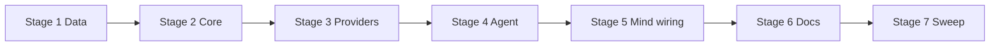

# TASK-015: phase protocol and Agent Integration — Implementation plan

← [[backlog/TASK-015-phase-protocol-and-agent-integration/task|Back to task]] | [[backlog/TASK-015-phase-protocol-and-agent-integration/requirements|Requirements]] | [[backlog/TASK-015-phase-protocol-and-agent-integration/design|Design]]

## Overview

Replace the all-nullable `Decision` with strict `SelectionDecision` and `ExecutionDecision` Data contracts, move cross-field/membership/retry/transition policy into synchronous `ReactLoop` Core, and extract orchestration from `AgentProvider` into a bare-noun `Agent` Integration. Selection becomes tool-free (skill or `no_skill` only); clarification and tools exist only after activation; each phase gets one persisted corrective-retry budget; exhaustion and unsupported outcomes return typed `AgentFailure` without becoming chat answers. Additive Redis session fields plus lazy legacy upgrade satisfy EPIC-002 `external_contract: additive` while `internal_compat: none` means no `AgentProvider` shim.

## Goal / Non-goals

- **Goal:** Selection and execution parse into separate extra-forbidding models with Core-owned semantic validation; selection never exposes or runs tools; one code-enforced corrective retry per phase then typed protocol failure; `Agent` Integration owns phase/tool/session orchestration; legacy and new sessions load/resume correctly; full suite green.
- **Non-goals:** Skill catalog metadata / control-role catalog boundary (TASK-014); preference/domain propagation (TASK-016); IANA timezone guidance (TASK-017); grounded outcomes and user-visible failure wording (TASK-018); multilingual eval corpus and live telemetry (TASK-020/021); new skills, tools, scheduling backends, or bulk Redis migration.

## Context to load

Files to read before starting:

- [[backlog/TASK-015-phase-protocol-and-agent-integration/requirements|requirements]] — FR-1…FR-6 and acceptance criteria
- [[backlog/TASK-015-phase-protocol-and-agent-integration/design|design]] — Architecture, Interfaces, System impact, Decisions 1–6
- [[backlog/EPIC-002-agent-routing-reliability/epic|EPIC-002]] — shared branch, delivery profile (`internal_compat: none`, `external_contract: additive`)
- [[backlog/EPIC-002-agent-routing-reliability/design|EPIC-002 master design]] — Stage-local correctness; Decision 1 (skill before clarification); Decision 2 (phase-specific models); Decision 10 (Agent Integration)
- [[backlog/EPIC-002-agent-routing-reliability/suggested_prompts|Suggested prompts]] — Phase-specific agent prompts; Corrective retry prompts; Message-role contract
- [[backlog/TASK-014-discriminative-skill-selection-contracts/design|TASK-014 design]] — catalog/control contracts already on the epic branch (dependency; `status: done`)
- `AGENTS.md` (root) — IODA + coding guidelines
- `coding_behavior.md`
- `yoda/mind/agent/AGENTS.md` — current two-phase / suspend-resume contract
- `yoda/mind/agent/data/agent_data.py`, `yoda/mind/agent/core/react_loop.py`, `yoda/mind/agent/agent_provider.py`, `yoda/mind/agent/session_provider.py`, `yoda/mind/perception/language.py`, `yoda/api/llm_api.py`, `yoda/mind/mind.py`, `yoda/yoda_chat_bot.py`

## Pre-flight

Mandatory conditions before implementation starts.
If any item below fails and cannot be satisfied immediately, do not proceed to implementation.

- [x] `git checkout main && git pull` — main is up to date
- [x] `git status` — working tree is clean
- [x] `git checkout feat/EPIC-002-agent-routing-reliability || git checkout -b feat/EPIC-002-agent-routing-reliability` — shared epic branch (TASK-014 already done on this branch)
- [x] `.venv` active and dependencies installed
- [x] Baseline tests green: `.venv/bin/python -m pytest`
- [x] Confirm TASK-014 artifacts present: discriminative `SkillSummary` fields, split selection control/input builders, system activation (no synthetic ack)
- [x] No live LLM/Telegram/Redis required for implementation — deterministic fakes suffice; Redis only for optional manual session smoke later

## Files & artifacts

| Path | IODA | Op | FR |
|------|------|----|----|
| `yoda/mind/agent/data/agent_data.py` — phase decisions, protocol/failure DTOs, `AgentContext`, `AgentResult` | Data | edit | FR-1, FR-2, FR-3, FR-5, FR-6 |
| `yoda/mind/agent/core/react_loop.py` — `ReactLoop` | Core | edit | FR-1, FR-2, FR-3, FR-4, FR-5, FR-6 |
| `yoda/mind/agent/agent.py` — `Agent` | Integration | create | FR-2, FR-3, FR-4, FR-5, FR-6 |
| `yoda/mind/agent/agent_provider.py` — `AgentProvider` | Former boundary | delete | FR-4 |
| `yoda/mind/agent/session_provider.py` — `AgentSessionProvider` | Provider | edit | FR-3, FR-5, FR-6 |
| `yoda/mind/perception/language.py` — `LanguageProvider`, `StructuredOutputError` | Provider | edit | FR-3, FR-6 |
| `yoda/api/llm_api.py` — `LLMApi.parse_chat_async` | API | edit | FR-3, FR-6 |
| `yoda/mind/mind.py` — `Mind` | Integration | edit | FR-4, FR-6 |
| `yoda/yoda_chat_bot.py` — startup wiring | Integration/wiring | edit | FR-4 |
| `tests/test_agent.py` — `Agent` orchestration tests | Test | create (from `test_agent_provider.py`) | FR-1…FR-6 |
| `tests/test_agent_provider.py` | Test | delete | FR-4 |
| `tests/test_react_loop.py` | Test | edit | FR-1, FR-2, FR-3, FR-5, FR-6 |
| `tests/test_agent_session.py` | Test | edit | FR-3, FR-5 |
| `tests/test_mind_agent_pipeline.py` | Test | edit | FR-4, FR-6 |
| `tests/test_language_provider.py` or extend existing language/LLM tests | Test | create/edit | FR-3, FR-6 |
| `yoda/mind/agent/AGENTS.md` | Documentation | edit | FR-1…FR-6 |

## Stages

### Stage 1: Data contracts

**Goal:** Strict phase models, protocol/failure DTOs, and context/result fields exist; old `Decision` removed from Data.

- [x] **1.1** Add phase enums and strict decision models; remove `Decision`
  - Files: `yoda/mind/agent/data/agent_data.py`, `tests/test_react_loop.py`
  - Action: **Data** — implement `AgentPhase`, `SelectionDecision`, `ExecutionDecision`, `ToolCallRequest` with `ConfigDict(extra="forbid")` exactly as [[design#Data model]]. Delete `Decision` and its `effective_tool_calls` helper (execution callers will use `tool_calls or []`). **TDD:** add failing construction/extra-field rejection tests in `tests/test_react_loop.py` (or a small `tests/test_agent_data.py` if preferred) for both models before/while adding types; temporarily skip or mark broken old `Decision`-based tests until Stage 2 replaces them.
  - Verify: `.venv/bin/python -m pytest tests/test_react_loop.py -k "SelectionDecision or ExecutionDecision or extra_forbid" -q`
  - Commit: `feat(TASK-015): 1.1 add phase-specific decision models`

- [x] **1.2** Add protocol issue / failure DTOs and extend `AgentContext` / `AgentResult`
  - Files: `yoda/mind/agent/data/agent_data.py`, `tests/test_react_loop.py`
  - Action: **Data** — add `ProtocolIssueCategory`, `ProtocolIssue`, `AgentFailure`. Extend `AgentContext` with `phase`, `selection_retry_used`, `execution_retry_used`, `protocol_version=2` defaults. Extend `AgentResult` with `failure: AgentFailure | None = None`. Update `with_messages` (and any other copy helper) to preserve the new fields. **TDD:** assert defaults and that `with_messages` preserves retry/phase/protocol.
  - Verify: `.venv/bin/python -m pytest tests/test_react_loop.py -k "agent_context or AgentFailure or protocol" -q`
  - Commit: `feat(TASK-015): 1.2 add protocol state and AgentFailure`

**Checkpoint Stage 1:** `.venv/bin/python -m pytest tests/test_react_loop.py -k "SelectionDecision or ExecutionDecision or agent_context or AgentFailure or protocol or extra_forbid" -q`

---

### Stage 2: ReactLoop Core policy

**Goal:** Pure validators, correction templates, phase builders, and legacy upgrade replace combined `validate_decision` answer-coercion.

- [x] **2.1** `validate_selection_decision` and `validate_execution_decision`
  - Files: `yoda/mind/agent/core/react_loop.py`, `tests/test_react_loop.py`
  - Action: **Core** — implement the two static validators from [[design#Interfaces]] returning `ProtocolIssue | None`. Selection: exactly one valid mode (`select_skill` with non-blank known skill + non-blank distilled task and no `reason`; or `no_skill` with `reason="unsupported"` and no skill/task). Execution: exactly one mode (`call_tools` with ≥1 allowed tool names and no `final_answer`; or `finish` with non-blank `final_answer` and no tool calls). Delete `validate_decision`, `_validate_phase1_modes`, `PHASE1_TOOL_CALL_WHITELIST` / selection `INFRA_TOOLS` whitelist usage for phase-1 tools. **TDD first:** replace every old `test_validate_decision_*` with valid-mode and invalid cross-field/blank/unknown-skill/unknown-tool/extra-field cases; assert rejected decisions never become answer strings.
  - Verify: `.venv/bin/python -m pytest tests/test_react_loop.py -k "validate_selection or validate_execution" -q`
  - Commit: `feat(TASK-015): 2.1 phase decision validators`

- [x] **2.2** `append_correction` from closed `ProtocolIssue` templates
  - Files: `yoda/mind/agent/core/react_loop.py`, `tests/test_react_loop.py`
  - Action: **Core** — implement `append_correction(context, issue) -> AgentContext`: mark the phase retry flag used, append one `system` correction message whose wording comes from code-owned templates keyed by stage + category (align with [[backlog/EPIC-002-agent-routing-reliability/suggested_prompts#Corrective retry prompts]]). Do not interpolate user text, task text, model output, exception text, skill/tool names that would leak unavailable identifiers beyond the closed category, or schema dumps. Rejected assistant JSON is not appended. **TDD:** assert role=`system`, retry flag flips once, second call does not invent a second budget, and content contains no user/task fixture strings.
  - Verify: `.venv/bin/python -m pytest tests/test_react_loop.py -k "append_correction" -q`
  - Commit: `feat(TASK-015): 2.2 append sanitized correction messages`

- [x] **2.3** Phase-specific system/schema builders and assistant append
  - Files: `yoda/mind/agent/core/react_loop.py`, `tests/test_react_loop.py`
  - Action: **Core** — split the base executor system message / JSON schema so selection describes only `SelectionDecision` (no tools, no clarification, no final_answer) and execution describes only `ExecutionDecision` + allowed tools under the active skill. Update `append_assistant` to serialize the phase model actually returned. Keep selection control/input builders from TASK-014. Remove selection prompt text that still permits `ask_user` / `update_profile` before skill choice (`SELECTION_INSTRUCTION` and related Phase-1 tool wording). **TDD:** assert selection system content has no tool schema / ask_user; execution system has no selected_skill/distilled_task fields.
  - Verify: `.venv/bin/python -m pytest tests/test_react_loop.py -k "system_message or selection_control or append_assistant or schema" -q`
  - Commit: `feat(TASK-015): 2.3 phase-specific schemas and prompts`

- [x] **2.4** `upgrade_legacy_protocol` and preserve new fields on all context copies
  - Files: `yoda/mind/agent/core/react_loop.py`, `tests/test_react_loop.py`
  - Action: **Core** — implement `upgrade_legacy_protocol(context, current_catalog) -> AgentContext` per [[design#Decision 5]]: for legacy pre-selection, refresh selection seed via existing `refresh_selection_messages`; for legacy active execution, replace only the recognized generated base protocol/system message with the execution-specific control contract; leave historical combined-decision assistant JSON opaque. Update every `AgentContext(...)` construction in this file (`refresh_selection_messages`, `append_tool_results`, activation helpers) to copy `phase`, retry flags, and `protocol_version`. **TDD:** legacy pre-selection and active-execution fixture transcripts upgrade without parsing old assistant JSON into new models; retry flags survive `append_tool_results` / `with_messages`.
  - Verify: `.venv/bin/python -m pytest tests/test_react_loop.py -k "upgrade_legacy or refresh_selection or append_tool or retry" -q`
  - Commit: `feat(TASK-015): 2.4 legacy protocol upgrade and context copy fidelity`

**Checkpoint Stage 2:** `.venv/bin/python -m pytest tests/test_react_loop.py`

---

### Stage 3: Provider and API adapters

**Goal:** Structured-output failures are data-free; sessions persist/infer phase protocol state.

- [x] **3.1** `StructuredOutputError` in `LanguageProvider`
  - Files: `yoda/mind/perception/language.py`, `tests/test_language_provider.py` (create if absent) or extend existing LLM/language tests
  - Action: **Provider** — catch JSON decode and Pydantic validation failures from `parse_chat_async` and raise `StructuredOutputError` with no raw response or validation text in `args`/`str`. Re-raise other exceptions unchanged. **TDD:** fake `LLMApi` returning bad JSON / wrong shape → `StructuredOutputError` without content snippet in the exception message.
  - Verify: `.venv/bin/python -m pytest tests/test_language_provider.py -q` (or the chosen test module)
  - Commit: `feat(TASK-015): 3.1 normalize structured output errors`

- [x] **3.2** Demote raw invalid model logging in `LLMApi`
  - Files: `yoda/api/llm_api.py`, matching API/unit test if present
  - Action: **API** — change the invalid-JSON `logger.error(... content[:500])` path in `parse_chat_async` to `logger.debug` (or remove content from WARNING+). Preserve raise-on-invalid behavior so the Provider can normalize. Do not log raw invalid bodies at INFO/WARNING/ERROR.
  - Verify: unit assertion that the error path uses DEBUG, or manual inspection + suite subset for `llm_api` if covered; otherwise `.venv/bin/python -m pytest tests/test_language_provider.py -q`
  - Commit: `fix(TASK-015): 3.2 keep invalid parse bodies at DEBUG`

- [x] **3.3** Persist and infer phase/retry/protocol in `AgentSessionProvider`
  - Files: `yoda/mind/agent/session_provider.py`, `tests/test_agent_session.py`
  - Action: **Provider** — `save` writes `phase`, `selection_retry_used`, `execution_retry_used`, `protocol_version`. `load` defaults: missing `protocol_version` → `1`; missing retry flags → `False`; missing `phase` → `execution` if `active_skill` else `selection`. Do not parse historical assistant message bodies. **TDD:** round-trip new fields; load representative legacy pre-selection JSON (no phase, `active_skill=null`) and legacy active-execution JSON (no phase, skill present).
  - Verify: `.venv/bin/python -m pytest tests/test_agent_session.py -q`
  - Commit: `feat(TASK-015): 3.3 additive session phase protocol fields`

**Checkpoint Stage 3:** `.venv/bin/python -m pytest tests/test_agent_session.py tests/test_language_provider.py tests/test_react_loop.py`

---

### Stage 4: `Agent` Integration orchestration

**Goal:** Phase-safe loops with bounded retry live in `Agent`; `AgentProvider` is gone; orchestration tests move to `tests/test_agent.py`.

- [x] **4.1** Create `Agent` shell and migrate caller surface
  - Files: `yoda/mind/agent/agent.py` (create), `yoda/mind/agent/agent_provider.py`, `tests/test_agent.py` (create by moving/renaming `tests/test_agent_provider.py`)
  - Action: **Integration** — move `AgentProvider` into `yoda/mind/agent/agent.py` as bare-noun `Agent` with the same `__init__` dependencies and public async methods (`has_pending_session`, `run`, `run_with_skill`, `resume`). Update imports inside the new module. Keep behavior compiling against Stage 1–3 types where already required; leave detailed phase loops for following steps. Point tests at `Agent`. Do **not** leave an `AgentProvider` alias. **TDD:** rename fixture helper and import path; run a smoke subset that still matches transitional behavior until 4.2–4.4 land (expect some failures — fix in subsequent steps of this stage).
  - Verify: `.venv/bin/python -m pytest tests/test_agent.py::test_resume_without_session -q` (minimal green anchor)
  - Commit: `refactor(TASK-015): 4.1 extract Agent Integration shell`

- [x] **4.2** Tool-free selection phase with bounded corrective retry
  - Files: `yoda/mind/agent/agent.py`, `tests/test_agent.py`
  - Action: **Integration** — `run` starts `phase=selection`, builds selection messages, calls `language_provider.parse_structured(..., SelectionDecision)` with **no** tool schemas. On `StructuredOutputError` or `ProtocolIssue`, if `selection_retry_used` is false call `ReactLoop.append_correction` and retry once; on second failure return `AgentResult(failure=AgentFailure(stage=selection, category="protocol_exhausted", ...))` and delete any pending session. Valid `select_skill` activates the skill and enters execution; valid `no_skill` returns `AgentFailure(category="unsupported")` without execution or tools. Remove `_run_until_skill_or_answer` pre-selection `ask_user`/`update_profile` path. **TDD:** selection→execution happy path; no-skill; first-attempt recovery; exhaustion; assert rejected selection never dispatches tools; delete/replace `test_phase1_ask_user_then_skill_then_execute`.
  - Verify: `.venv/bin/python -m pytest tests/test_agent.py -k "selection or no_skill or corrective or phase1" -q`
  - Commit: `feat(TASK-015): 4.2 tool-free selection with one retry`

- [x] **4.3** Execution phase: tools, suspend/resume, execution retry budget
  - Files: `yoda/mind/agent/agent.py`, `tests/test_agent.py`
  - Action: **Integration** — execution calls `parse_structured(..., ExecutionDecision)`; validate via Core; on issue apply one execution correction then typed exhaustion (delete session). Valid `call_tools` builds `ToolCall`s, dispatches with existing `asyncio.gather` when ≥2 calls, suspends on `ask_user` saving full phase/retry state, resumes by appending `user` answer without re-selecting. Valid `finish` / terminal tool success returns answer. Iteration exhaustion returns typed failure — **no** `"Task completed."` fallback for protocol/iteration failure. Rejected execution never runs tools. **TDD:** post-selection clarification+resume; parallel gather still used; execution recovery and exhaustion; retry flag survives suspend/resume and tool iteration.
  - Verify: `.venv/bin/python -m pytest tests/test_agent.py -k "execution or suspend or resume or retry or gather or ask_user" -q`
  - Commit: `feat(TASK-015): 4.3 execution loop with bounded retry`

- [x] **4.4** Forced skill entry, legacy resume upgrade, delete `AgentProvider`
  - Files: `yoda/mind/agent/agent.py`, `yoda/mind/agent/agent_provider.py` (delete), `tests/test_agent.py`, `tests/test_agent_provider.py` (delete if still present)
  - Action: **Integration** — `run_with_skill` constructs execution context directly (never calls selector). `resume` loads session, runs `upgrade_legacy_protocol` when `protocol_version < 2` (and catalog refresh for pre-selection), then continues on persisted `phase`. Ensure no remaining imports of `agent_provider`. **TDD:** scheduled forced skill; legacy pre-selection resume selects then may clarify; legacy active-skill resume stays in execution; safety tests that raw parse/schema strings never appear in `AgentResult.answer` or history.
  - Verify: `.venv/bin/python -m pytest tests/test_agent.py -q`
  - Commit: `feat(TASK-015): 4.4 forced skill, legacy resume, drop AgentProvider`

**Checkpoint Stage 4:** `.venv/bin/python -m pytest tests/test_agent.py tests/test_react_loop.py tests/test_agent_session.py`

---

### Stage 5: Mind wiring and startup

**Goal:** All agent entry points go through `Agent`; typed failures map to one safe unsuccessful delivery instruction.

- [x] **5.1** Inject and call `Agent` from `Mind`
  - Files: `yoda/mind/mind.py`, `tests/test_mind_agent_pipeline.py`
  - Action: **Integration** — replace `AgentProvider` type/import with `Agent`; rename constructor param/attribute to `agent` (update all call sites in the file). In `_handle_agent_result`, if `result.failure` is set, emit one capability-agnostic unsuccessful delivery instruction (do **not** interpolate stage/category into chat history; do not claim tool/job completion). Keep clarification and answer paths for non-failure results. **TDD:** rename `FakeAgentProvider` → `FakeAgent`; assert direct/resume/pending/scheduled delegation; assert failure mapping never places `"protocol_exhausted"`, `"Unknown tool"`, schema text, or stage labels into the chat instruction string beyond the safe generic wording.
  - Verify: `.venv/bin/python -m pytest tests/test_mind_agent_pipeline.py -q`
  - Commit: `feat(TASK-015): 5.1 Mind delegates to Agent and maps failures`

- [x] **5.2** Startup wiring in `yoda_chat_bot.py`
  - Files: `yoda/yoda_chat_bot.py`
  - Action: **Wiring** — construct `Agent` instead of `AgentProvider`; pass `agent=...` into `Mind`. Retain the same catalog/session/tool instances.
  - Verify: import smoke — `.venv/bin/python -c "from yoda.mind.agent.agent import Agent; from yoda.yoda_chat_bot import *"` may be heavy; prefer `.venv/bin/python -m pytest tests/test_mind_agent_pipeline.py tests/test_agent.py -q` plus confirm no `agent_provider` imports remain: `rg AgentProvider yoda tests`
  - Commit: `feat(TASK-015): 5.2 wire Agent at startup`

**Checkpoint Stage 5:** `.venv/bin/python -m pytest tests/test_mind_agent_pipeline.py tests/test_agent.py` and `rg AgentProvider yoda tests` reports no matches

---

### Stage 6: Module documentation

**Goal:** `yoda/mind/agent/AGENTS.md` matches the as-built phase protocol and Integration boundary.

- [x] **6.1** Update agent module AGENTS.md
  - Files: `yoda/mind/agent/AGENTS.md`
  - Action: **Documentation** — document tool-free selection, phase-specific schemas, `Agent` Integration ownership, one retry budget per phase (persisted), suspend/resume state including retry flags, legacy upgrade rules, and typed `AgentFailure`. Remove `AgentProvider` and pre-selection `ask_user` loop language. Update “inject into AgentProvider” tooling notes to `Agent`.
  - Verify: manual read against [[design#Solution overview]]; no stale `AgentProvider` / Phase-1 infra-tool claims
  - Commit: `docs(TASK-015): 6.1 document phase protocol and Agent Integration`

**Checkpoint Stage 6:** documentation review only (no code gate beyond prior stages green)

---

### Stage 7: Test sweep & coverage

**Goal:** Every FR acceptance criterion has automated coverage; suite fully green.

- [x] **7.1** Close FR coverage gaps
  - Files: `tests/test_agent.py`, `tests/test_react_loop.py`, `tests/test_agent_session.py`, `tests/test_mind_agent_pipeline.py`, `tests/test_language_provider.py`
  - Action: **Test** — audit FR-1…FR-6 AC against existing tests; add any missing cases (extra-field rejection both models; parser exception enters corrective path; INFO/WARNING diagnostics stage+category only via log capture if practical; rejected output not in accepted history; no pre-selection ask_user path anywhere). Prefer fakes over live LLM.
  - Verify: `.venv/bin/python -m pytest`
  - Commit: `test(TASK-015): 7.1 close FR coverage gaps`

- [x] **7.2** Manual AC checklist
  - FR-1: Construct invalid extra-field JSON against both models in a REPL or unit — both reject; Core rejects unknown skill/tool without producing an answer string.
  - FR-2: Trace `run` selection call — no tool schemas; scheduled `run_with_skill` never hits selector.
  - FR-3: Force two invalid selection responses — one correction then `AgentFailure`; session deleted.
  - FR-4: Confirm `Mind` / startup import `Agent` only; Core tests run without Redis/LLM.
  - FR-5: Load fixture legacy pre-selection and active-execution session JSON through `AgentSessionProvider.load`.
  - FR-6: Assert failure mapping in Mind produces generic unsuccessful instruction; DEBUG may show raw bodies, WARNING must not.
  - Verify: checklist marked mentally/done; `.venv/bin/python -m pytest` still green
  - Commit: none required if no code change; otherwise `test(TASK-015): 7.2 manual AC follow-ups`

**Checkpoint Stage 7:** `.venv/bin/python -m pytest`

## Stage dependencies

## FR coverage (traceability)

| FR | Steps | Verification |
|----|-------|--------------|
| FR-1 | 1.1, 2.1, 2.3, 7.1 | unit `tests/test_react_loop.py` (models + validators + schemas); integration `tests/test_agent.py` selection/execution parse paths |
| FR-2 | 2.3, 4.2, 4.3, 4.4, 7.1 | unit selection schema has no tools; integration selection→execution, no-skill, post-selection ask_user resume, `run_with_skill`; no pre-selection ask_user test remains |
| FR-3 | 2.2, 3.1, 4.2, 4.3, 7.1 | unit correction templates; `StructuredOutputError`; integration first-attempt recovery + exhaustion both phases; rejected output not in history |
| FR-4 | 4.1, 4.4, 5.1, 5.2, 7.1 | `tests/test_agent.py` orchestration; `tests/test_mind_agent_pipeline.py` delegation; Core/Provider tests independent; `rg AgentProvider` clean |
| FR-5 | 2.4, 3.3, 4.3, 4.4, 7.1 | `tests/test_agent_session.py` legacy + round-trip; `tests/test_agent.py` resume paths; `tests/test_react_loop.py` upgrade |
| FR-6 | 1.2, 3.2, 4.2, 4.3, 5.1, 7.1 | typed `AgentFailure`; Mind generic mapping; no raw details in answer/history; LLM invalid body at DEBUG |

## Risks

| Risk | Probability | Impact | Mitigation |
|------|-------------|--------|------------|
| Large `test_agent_provider.py` rewrite breaks mid-stage green while `Decision` callers still exist | Medium | High (blocked suite) | Keep Stage 1–2 focused on Core/Data with targeted `-k` verifies; migrate orchestration tests only in Stage 4; use Checkpoint Stage 4 before Mind wiring |
| Missed `AgentContext(...)` copy sites drop retry flags after tool/suspend | Medium | High (retry budget resets — FR-3) | Step 2.4 audits all constructions; Stage 4.3 explicitly tests flag survival across tool iteration and resume |
| Legacy session upgrade rewrites wrong messages or re-parses old `Decision` JSON | Medium | High (resume breakage — FR-5) | Only replace recognized generated control content; opaque historical assistant JSON; fixtures from real serialized shapes in 3.3/4.4 |
| Mind failure instruction accidentally includes stage/category | Low | Medium (FR-6 leak) | Step 5.1 asserts instruction text excludes enum values and protocol jargon |

## Rollback

- **Code:** `git revert` commits on `feat/EPIC-002-agent-routing-reliability` (or revert the epic merge later). No `AgentProvider` shim is required under `internal_compat: none`.
- **Redis `agent_sessions`:** Sessions saved with `protocol_version=2` are not compatible with pre-task combined-protocol code. Before rolling back deployed code, complete or `HDEL` only affected pending `agent_sessions` entries for chats mid-clarification. Do **not** delete user profiles, scheduled jobs, conversation history, or ChromaDB data.
- **No bulk migration** to undo — additive keys only.

## Definition of Done

- [x] All plan steps checked; `last_step` reflects final completed step
- [x] All FR-1…FR-6 acceptance criteria pass
- [x] Full suite green: `.venv/bin/python -m pytest`
- [x] IODA + coding guidelines (`AGENTS.md`) respected — `Agent` Integration, pure `ReactLoop`, narrow Providers; no Operation→Operation calls
- [x] No remaining `Decision` / `AgentProvider` / pre-selection `ask_user` selection loop in runtime or tests
- [x] `yoda/mind/agent/AGENTS.md` updated
- [ ] `review.md`: verdict `pass` or `pass-with-follow-ups`
- [ ] `task.md`: `status: done`, `updated: <today>`
- [ ] `design.md` / ADR updated only if execution diverged from design (no new ADR expected per design)
