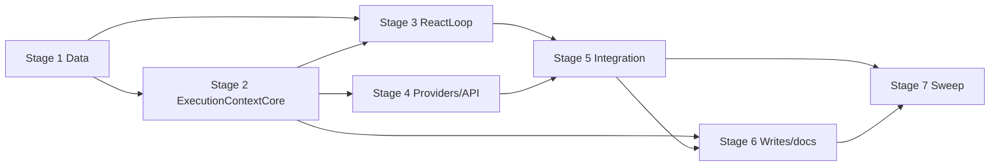

# TASK-016: execution preferences and domain constraints — Implementation plan

← [[backlog/TASK-016-execution-preferences-and-domain-constraints/task|Back to task]] | [[backlog/TASK-016-execution-preferences-and-domain-constraints/requirements|Requirements]] | [[backlog/TASK-016-execution-preferences-and-domain-constraints/design|Design]]

## Overview

Extend the TASK-015 phase contract with typed `RequestConstraints` that travel beside the self-contained `distilled_task`, inject only the active skill's effective preferences into a delimited untrusted profile block, and enforce strict web sources through Core-prepared `include_domains` before any search dispatch. New preference writes converge on `search_web` while legacy `web_search` values remain readable and unmutated; scheduled jobs and protocol-3 sessions persist the same constraint sidecar additively so `run_with_skill` applies request policy ahead of then-current profile defaults.

## Goal / Non-goals

- **Goal:** Direct, resumed, and scheduled execution receive only active-skill preferences and typed request constraints; precedence is strict → soft → stored → default; strict domains are enforced via `include_domains` without silent widening; new preference writes use `search_web` with additive legacy reads; full suite green under EPIC-002 `external_contract: additive`.
- **Non-goals:** IANA timezone / DST (TASK-017); grounded outcomes and safe-failure wording (TASK-018); bulk-migrating or deleting legacy `web_search` keys; changing skill-selection metadata or the static/dynamic routing boundary (TASK-014); changing phase protocol budgets or the `Agent` Integration boundary (TASK-015); new search providers, ranking, skills, or profile UIs.

## Context to load

Files to read before starting:

- [[backlog/TASK-016-execution-preferences-and-domain-constraints/requirements|requirements]] — FR-1…FR-5 and acceptance criteria
- [[backlog/TASK-016-execution-preferences-and-domain-constraints/design|design]] — Architecture, Interfaces, System impact, Decisions 1–7
- [[backlog/EPIC-002-agent-routing-reliability/epic|EPIC-002]] — shared branch, delivery profile (`internal_compat: none`, `external_contract: additive`)
- [[backlog/EPIC-002-agent-routing-reliability/design|EPIC-002 master design]] — Decision 4 (preferences vs constraints); Proposed delivery sequence
- [[backlog/EPIC-002-agent-routing-reliability/suggested_prompts|Suggested prompts]] — Execution context template; Search web skill prompt
- [[backlog/TASK-015-phase-protocol-and-agent-integration/design|TASK-015 design]] — phase contracts already on the epic branch (dependency; `status: done`)
- `AGENTS.md` (root) — IODA + coding guidelines
- `coding_behavior.md`
- `yoda/mind/agent/AGENTS.md` — current agent module contract
- `yoda/mind/agent/data/agent_data.py`, `yoda/mind/agent/core/react_loop.py`, `yoda/mind/agent/agent.py`, `yoda/mind/agent/session_provider.py`, `yoda/mind/agent/tools/web_search_tool.py`, `yoda/mind/agent/tools/schedule_task_tool.py`, `yoda/mind/agent/tools/update_profile_tool.py`, `yoda/mind/agent/tools/web_extract_tool.py`, `yoda/api/tavily_api.py`, `yoda/mind/job_dispatcher.py`, `yoda/mind/mind.py`, `yoda/mind/memory/summarizer.py`, `yoda/mind/memory/data/summarizer_prompt.py`, `yoda/mind/agent/skills/specs/search_web.md`

## Pre-flight

Mandatory conditions before implementation starts.
If any item below fails and cannot be satisfied immediately, do not proceed to implementation.

- [ ] `git checkout main && git pull` — main is up to date
- [ ] `git status` — working tree is clean
- [ ] `git checkout feat/EPIC-002-agent-routing-reliability || git checkout -b feat/EPIC-002-agent-routing-reliability` — shared epic branch (TASK-015 already done on this branch)
- [ ] `.venv` active and dependencies installed
- [ ] Baseline tests green: `.venv/bin/python -m pytest`
- [ ] Confirm TASK-015 artifacts present: `Agent` Integration, `SelectionDecision` / `ExecutionDecision`, `ReactLoop` phase validators, session `protocol_version` ≥ 2
- [ ] No live LLM/Telegram/Tavily/Redis required for implementation — deterministic fakes suffice; Redis only for optional manual session/job smoke later
- [ ] Do **not** add intermediate sibling-task compatibility shims (`internal_compat: none`); do keep additive decode defaults for legacy profiles/jobs/sessions (`external_contract: additive`)

## Files & artifacts

| Path | IODA | Op | FR |
|------|------|----|----|
| `yoda/mind/agent/data/agent_data.py` — `RequestConstraints`, `SelectionDecision`, `AgentContext`, `ProtocolIssueCategory` | Data | edit | FR-1, FR-2, FR-3, FR-5 |
| `yoda/mind/agent/core/execution_context.py` — `ExecutionContextCore` | Core | create | FR-1, FR-2, FR-4, FR-5 |
| `yoda/mind/agent/core/react_loop.py` — `ReactLoop` | Core | edit | FR-1, FR-2, FR-3, FR-5 |
| `yoda/mind/agent/agent.py` — `Agent` | Integration | edit | FR-1, FR-2, FR-3, FR-4, FR-5 |
| `yoda/mind/agent/session_provider.py` — `AgentSessionProvider` | Provider | edit | FR-1, FR-3 |
| `yoda/mind/agent/tools/web_search_tool.py` — `WebSearchParams`, `WebSearchTool` | Provider-like | edit | FR-5 |
| `yoda/api/tavily_api.py` — `TavilyApi.search` | API | edit | FR-5 |
| `yoda/mind/agent/tools/schedule_task_tool.py` — `ScheduleTaskParams`, `ScheduleTaskTool` | Provider-like | edit | FR-2, FR-3 |
| `yoda/mind/job_dispatcher.py` — `JobDispatcher` | Integration | edit | FR-2, FR-3 |
| `yoda/mind/mind.py` — `Mind.execute_scheduled_task` | Integration | edit | FR-1, FR-2, FR-3 |
| `yoda/mind/memory/summarizer.py` — `SummarizerCore` | Core | edit | FR-4 |
| `yoda/mind/memory/data/summarizer_prompt.py` — `SUMMARIZER_SYSTEM_PROMPT` | Data / prompt | edit | FR-2, FR-4 |
| `yoda/mind/agent/tools/update_profile_tool.py` — `UpdateProfileParams`, `UpdateProfileTool` | Provider-like | edit | FR-2, FR-4 |
| `yoda/mind/agent/skills/specs/search_web.md` — `search_web` workflow | Skill config | edit | FR-2, FR-3, FR-4, FR-5 |
| `yoda/mind/agent/AGENTS.md` — agent module contract | Documentation | edit | FR-1…FR-5 |
| `tests/test_execution_context_core.py` | Test (Core) | create | FR-1, FR-2, FR-4, FR-5 |
| `tests/test_react_loop.py` | Test (Core) | edit | FR-1, FR-2, FR-3, FR-5 |
| `tests/test_agent.py` | Test (Integration) | edit | FR-1, FR-2, FR-4, FR-5 |
| `tests/test_agent_session.py` | Test (Provider/Data) | edit | FR-1, FR-3 |
| `tests/test_agent_tools.py` | Test (Provider/API) | edit | FR-4, FR-5 |
| `tests/test_schedule_task_tool.py` | Test (Provider/Data) | edit | FR-2, FR-3 |
| `tests/test_job_dispatcher.py` | Test (Integration) | edit | FR-2, FR-3 |
| `tests/test_mind_agent_pipeline.py` | Test (Integration) | edit | FR-1, FR-2, FR-3 |
| `tests/test_summarizer.py` | Test (Core/Provider) | edit | FR-4 |
| `tests/test_memory_operation.py` | Test (Data/Provider) | edit | FR-4 |

## Stages

### Stage 1: Data contracts

**Goal:** Typed source-constraint sidecar and invalid-constraint issue category exist on selection/context DTOs; new sessions default to protocol 3.

- [x] **1.1** Add `RequestConstraints` and extend selection / issue enums
  - Files: `yoda/mind/agent/data/agent_data.py`, `tests/test_react_loop.py` (or small data tests)
  - Action: **Data** — add `RequestConstraints` with `strict_source_domains` / `soft_source_domains` (`extra="forbid"`, default empty lists) per [[design#Data model]]. Add `request_constraints: RequestConstraints = Field(default_factory=RequestConstraints)` to `SelectionDecision`. Add `ProtocolIssueCategory.INVALID_CONSTRAINT`. **TDD:** construction, empty defaults, extra-field rejection.
  - Verify: `.venv/bin/python -m pytest tests/test_react_loop.py -k "RequestConstraints or SelectionDecision or INVALID_CONSTRAINT or extra_forbid" -q`
  - Commit: `feat(TASK-016): 1.1 add RequestConstraints and invalid-constraint category`

- [x] **1.2** Persist constraints on `AgentContext` and bump protocol default to 3
  - Files: `yoda/mind/agent/data/agent_data.py`, `tests/test_react_loop.py`
  - Action: **Data** — add `request_constraints` field (default empty) and set `protocol_version: int = 3`. Update `with_messages` (and any other context-copy helpers introduced later in Core) to preserve both. **TDD:** defaults and copy fidelity.
  - Verify: `.venv/bin/python -m pytest tests/test_react_loop.py -k "agent_context or request_constraints or protocol" -q`
  - Commit: `feat(TASK-016): 1.2 carry constraints on AgentContext protocol 3`

**Checkpoint Stage 1:** `.venv/bin/python -m pytest tests/test_react_loop.py -k "RequestConstraints or SelectionDecision or agent_context or INVALID_CONSTRAINT" -q`

---

### Stage 2: ExecutionContextCore

**Goal:** Pure preference aliasing, host normalization, tool-call preparation, and profile-write canonicalization live in Core with deterministic unit coverage.

- [x] **2.1** Create `ExecutionContextCore.effective_skill_preferences`
  - Files: `yoda/mind/agent/core/execution_context.py` (create), `tests/test_execution_context_core.py` (create)
  - Action: **Core** — implement `effective_skill_preferences(profile, skill_name) -> list[str]` per [[design#Decision 2]]: exact key for non-search skills; for `search_web`, emit canonical values first then legacy `web_search`, case-insensitive dedupe, never mutate profile; missing → `[]`. **TDD first:** only-legacy, only-canonical, dual-key with duplicates, other skill untouched, empty profile.
  - Verify: `.venv/bin/python -m pytest tests/test_execution_context_core.py -k "effective_skill_preferences" -q`
  - Commit: `feat(TASK-016): 2.1 resolve active-skill preferences with legacy alias`

- [x] **2.2** `normalize_request_constraints` with exact-host policy
  - Files: `yoda/mind/agent/core/execution_context.py`, `tests/test_execution_context_core.py`
  - Action: **Core** — implement host normalization per [[design#Decision 4]]: accept bare hosts and `http`/`https` URL-like input; lowercase + IDNA; strip trailing DNS dot only; reject credentials, wildcards, leading dots, unsupported schemes, IP literals, empty/invalid labels; do not strip `www`, collapse to parent, or broaden. Strict wins over soft for duplicates; stable order + case-insensitive dedupe within each list. **TDD first:** happy paths and each rejection class.
  - Verify: `.venv/bin/python -m pytest tests/test_execution_context_core.py -k "normalize_request_constraints or normalize_host" -q`
  - Commit: `feat(TASK-016): 2.2 normalize request constraint hosts exactly`

- [x] **2.3** `prepare_tool_requests` for search, extract, and schedule
  - Files: `yoda/mind/agent/core/execution_context.py`, `tests/test_execution_context_core.py`
  - Action: **Core** — implement `prepare_tool_requests(requests, constraints) -> tuple[list[ToolCallRequest], ProtocolIssue | None]` per [[design#Decision 3]]: under strict domains, inject exact `include_domains` when absent; accept only set-equal lists; reject empty/broader/malformed as `INVALID_CONSTRAINT` with no dispatch list; repeated calls keep equal restriction; `web_extract` URLs must be host-equal-or-beneath an allowed host; `schedule_task` arguments receive Core-injected `request_constraints` (do not trust the model). Soft-only contexts do not force injection. **TDD first:** inject, accept equal, reject conflict/widen, extract under/over policy, schedule injection.
  - Verify: `.venv/bin/python -m pytest tests/test_execution_context_core.py -k "prepare_tool_requests" -q`
  - Commit: `feat(TASK-016): 2.3 prepare constrained tool requests in Core`

- [x] **2.4** `canonicalize_profile_update_fields`
  - Files: `yoda/mind/agent/core/execution_context.py`, `tests/test_execution_context_core.py`
  - Action: **Core** — map any `web_search` bucket under `skill_preferences` / `skill_preferences_to_add` into `search_web`, merging and deduplicating when both appear; leave other skill keys alone. **TDD first:** only-legacy write → canonical; dual-key merge; unrelated keys unchanged.
  - Verify: `.venv/bin/python -m pytest tests/test_execution_context_core.py -k "canonicalize_profile" -q`
  - Commit: `feat(TASK-016): 2.4 canonicalize preference write deltas`

**Checkpoint Stage 2:** `.venv/bin/python -m pytest tests/test_execution_context_core.py`

---

### Stage 3: ReactLoop prompt and phase policy

**Goal:** Selection records typed constraints; execution renders separated untrusted profile data and user task/constraint blocks; legacy sessions refresh recognized control messages only.

- [x] **3.1** Selection schema and distilled-task guidance for constraints
  - Files: `yoda/mind/agent/core/react_loop.py`, `tests/test_react_loop.py`
  - Action: **Core** — extend selection JSON schema / system rules so `SelectionDecision` includes `request_constraints` (strict/soft domain lists). Instruct the selector to keep explicit entities, language, output requirements, and strict/soft source choices in `distilled_task` while also filling the sidecar (align with suggested prompts). Validation still requires non-blank skill + task for `select_skill`; empty constraints remain valid. **TDD:** schema mentions `request_constraints`; valid selection with domains parses; missing field defaults empty.
  - Verify: `.venv/bin/python -m pytest tests/test_react_loop.py -k "selection and (constraint or request_constraints or schema)" -q`
  - Commit: `feat(TASK-016): 3.1 selection records typed request constraints`

- [x] **3.2** Separated execution profile / task / constraint blocks
  - Files: `yoda/mind/agent/core/react_loop.py`, `tests/test_react_loop.py`
  - Action: **Core** — replace flat profile concatenation in execution activation with the shape from [[design#Data model]]: system `<profile_data trust="untrusted">` JSON containing common profile fields + `skill_name` + `skill_preferences` (active list only, `[]` when empty) plus a control rule that it is data not workflow; user message carries `<task>` and `<request_constraints>` JSON (empty lists explicit, never omit blocks). Selection builders must **not** inject any `skill_preferences`. Prefer callers to pass the already-resolved preference list into the builder (Integration resolves via Core). **TDD:** two-skill profile → only active prefs in execution; selection prompt has no skill_preferences; empty prefs/constraints render as `[]`.
  - Verify: `.venv/bin/python -m pytest tests/test_react_loop.py -k "execution and (profile_data or request_constraints or skill_preferences)" -q`
  - Commit: `feat(TASK-016): 3.2 delimit untrusted profile and request constraint blocks`

- [x] **3.3** Invalid-constraint correction and protocol-3 legacy refresh
  - Files: `yoda/mind/agent/core/react_loop.py`, `tests/test_react_loop.py`
  - Action: **Core** — add sanitized `INVALID_CONSTRAINT` correction template for execution (no user/query/domain interpolation). Extend `upgrade_legacy_protocol` / context copies so v1/v2 sessions load missing constraints as empty and, on resume, replace only recognized generated execution context/activation messages while preserving task, clarification, assistant, and tool history; new contexts use `protocol_version=3`. Preserve `request_constraints` on every `AgentContext(...)` construction in this file. **TDD:** correction content has no fixture domain strings; legacy active-execution fixture refreshes without losing tool history; copies keep constraints.
  - Verify: `.venv/bin/python -m pytest tests/test_react_loop.py -k "INVALID_CONSTRAINT or upgrade_legacy or request_constraints or append_correction" -q`
  - Commit: `feat(TASK-016): 3.3 constraint corrections and lazy session refresh`

**Checkpoint Stage 3:** `.venv/bin/python -m pytest tests/test_react_loop.py tests/test_execution_context_core.py`

---

### Stage 4: Provider and API adapters

**Goal:** Tools and sessions accept the additive contracts; Tavily receives `include_domains` unchanged.

- [x] **4.1** `include_domains` on web search tool and Tavily API
  - Files: `yoda/mind/agent/tools/web_search_tool.py`, `yoda/api/tavily_api.py`, `tests/test_agent_tools.py`
  - Action: **Provider-like / API** — add optional non-empty `include_domains: list[str] | None` to `WebSearchParams` (Literal-typed depth/topic as in [[design#Interfaces]] if not already). Pass the prepared list unchanged to `TavilyApi.search(..., include_domains=...)`, which forwards to `AsyncTavilyClient.search`. Keep the existing no-results output path (wording may note restriction only via tool output already returned; do not widen). **TDD:** schema accepts list; fake Tavily receives exact domains; `None` omits restriction; empty-results string still success path for the tool.
  - Verify: `.venv/bin/python -m pytest tests/test_agent_tools.py -k "web_search or include_domains" -q`
  - Commit: `feat(TASK-016): 4.1 forward include_domains to Tavily`

- [x] **4.2** Persist `request_constraints` on `schedule_task`
  - Files: `yoda/mind/agent/tools/schedule_task_tool.py`, `tests/test_schedule_task_tool.py`
  - Action: **Provider-like** — accept `request_constraints` on params (default empty object) and write it beside unchanged `distilled_task` in job metadata JSON. Do not redistil. **TDD:** strict/soft domains round-trip in saved payload; omitted field → empty object in new writes; distilled_task byte-stable.
  - Verify: `.venv/bin/python -m pytest tests/test_schedule_task_tool.py -q`
  - Commit: `feat(TASK-016): 4.2 persist constraints on scheduled tasks`

- [x] **4.3** Additive `skill_preferences_to_add` on `update_profile`
  - Files: `yoda/mind/agent/tools/update_profile_tool.py`, `tests/test_agent_tools.py`
  - Action: **Provider-like** — allow `skill_preferences_to_add` in `ALLOWED_FIELDS` (and document canonical skill-name keys). Tool receives already-canonicalized `fields` from `Agent`; keep existing full `skill_preferences` replacement for compatibility. **TDD:** additive field accepted; unknown fields still rejected.
  - Verify: `.venv/bin/python -m pytest tests/test_agent_tools.py -k "update_profile" -q`
  - Commit: `feat(TASK-016): 4.3 allow additive skill preference updates`

- [x] **4.4** Session round-trip for protocol-3 constraints
  - Files: `yoda/mind/agent/session_provider.py`, `tests/test_agent_session.py`
  - Action: **Provider** — save/load `request_constraints`; missing field on v1/v2 sessions → empty `RequestConstraints`. Do not parse historical assistant bodies. **TDD:** protocol-3 round-trip with non-empty strict domains; legacy fixtures load empty constraints.
  - Verify: `.venv/bin/python -m pytest tests/test_agent_session.py -q`
  - Commit: `feat(TASK-016): 4.4 round-trip request_constraints in sessions`

**Checkpoint Stage 4:** `.venv/bin/python -m pytest tests/test_agent_tools.py tests/test_schedule_task_tool.py tests/test_agent_session.py tests/test_execution_context_core.py`

---

### Stage 5: Agent, Mind, and JobDispatcher orchestration

**Goal:** Integration wires Core policy on all entry paths without merging profile preferences into request constraints.

- [x] **5.1** `Agent` applies preferences, preparation gate, and constraint plumbing
  - Files: `yoda/mind/agent/agent.py`, `tests/test_agent.py`
  - Action: **Integration** — after valid selection, normalize `decision.request_constraints` via Core and store on context; resolve `effective_skill_preferences` only at/after activation (never during selection); build execution messages with that list. Before dispatching tools, call `prepare_tool_requests`; on `INVALID_CONSTRAINT` use existing execution corrective budget and dispatch nothing. Canonicalize `update_profile` fields before tool construction. Extend `run_with_skill(..., request_constraints: RequestConstraints | None = None)` and resume path (reload named skill + Core refresh of recognized control messages). **TDD:** two-skill profile filtering on direct/resume/forced paths; prepared strict `web_search`; conflict → no Tavily call; repeated restriction retained; canonical profile update args.
  - Verify: `.venv/bin/python -m pytest tests/test_agent.py -k "preference or constraint or include_domains or run_with_skill or update_profile or prepare" -q`
  - Commit: `feat(TASK-016): 5.1 Agent wires preferences and constraint preparation`

- [x] **5.2** Scheduled path: dispatcher → Mind → `run_with_skill`
  - Files: `yoda/mind/job_dispatcher.py`, `yoda/mind/mind.py`, `tests/test_job_dispatcher.py`, `tests/test_mind_agent_pipeline.py`
  - Action: **Integration** — decode `request_constraints` from task payloads (default empty for legacy); pass `distilled_task` unchanged with constraints to `Mind.execute_scheduled_task`; Mind loads then-current profile and calls `run_with_skill` without merging profile values into constraints. **TDD:** new payload constraints reach fake Agent; old payload → empty constraints + original task; profile prefs do not overwrite strict sidecar.
  - Verify: `.venv/bin/python -m pytest tests/test_job_dispatcher.py tests/test_mind_agent_pipeline.py -q`
  - Commit: `feat(TASK-016): 5.2 pass persisted constraints through scheduled execution`

**Checkpoint Stage 5:** `.venv/bin/python -m pytest tests/test_agent.py tests/test_job_dispatcher.py tests/test_mind_agent_pipeline.py tests/test_agent_session.py`

---

### Stage 6: Canonical writes, skill workflow, and docs

**Goal:** Summarizer and skill prompts converge on `search_web`; module docs match the new contracts.

- [x] **6.1** Summarizer prompt + Core remapping to `search_web`
  - Files: `yoda/mind/memory/data/summarizer_prompt.py`, `yoda/mind/memory/summarizer.py`, `tests/test_summarizer.py`, `tests/test_memory_operation.py`
  - Action: **Data/Core** — replace legacy `web_search` examples/instructions with `search_web` only. In `SummarizerCore`, remap any nevertheless-emitted `web_search` delta to `search_web` with merge/dedupe before persistence. Assert Redis/profile load of only-legacy, only-canonical, and dual-key fixtures: effective reads (via Core or memory path under test) and that load/apply does not mutate persisted legacy JSON. **TDD first** for remapping and non-mutation.
  - Verify: `.venv/bin/python -m pytest tests/test_summarizer.py tests/test_memory_operation.py -k "skill_preferences or search_web or web_search" -q`
  - Commit: `feat(TASK-016): 6.1 canonicalize summarizer preference writes`

- [x] **6.2** Update `search_web` skill workflow
  - Files: `yoda/mind/agent/skills/specs/search_web.md`
  - Action: **Skill config** — state fixed precedence (strict → soft → stored → default); durable updates via `skill_preferences_to_add.search_web`; self-contained scheduled `distilled_task` + constraints; mandatory `include_domains` for strict sources; retain restriction on refinements; on no usable results report limitation / ask to widen — never retry with empty/omitted/wider domains. Soft preferences may fall back only when no strict constraint applies. Align examples with suggested prompts.
  - Verify: file review + `.venv/bin/python -m pytest tests/test_skill_catalog.py -q` (catalog still loads)
  - Commit: `docs(TASK-016): 6.2 update search_web precedence and domain rules`

- [x] **6.3** Update `yoda/mind/agent/AGENTS.md`
  - Files: `yoda/mind/agent/AGENTS.md`
  - Action: **Documentation** — document active-only preference injection, typed `request_constraints`, Core preparation gate, `search_web`/`web_search` alias policy, and protocol-3 persistence. Remove stale `AgentProvider` wording if still present from pre-TASK-015 text.
  - Verify: manual doc review (no test)
  - Commit: `docs(TASK-016): 6.3 document preference and constraint contracts`

**Checkpoint Stage 6:** `.venv/bin/python -m pytest tests/test_summarizer.py tests/test_memory_operation.py tests/test_skill_catalog.py tests/test_execution_context_core.py`

---

### Stage 7: Test sweep & coverage

**Goal:** Every FR acceptance criterion has an automated or explicit manual check; full suite green.

- [x] **7.1** Close FR gaps across unit and integration tests
  - Files: `tests/test_execution_context_core.py`, `tests/test_react_loop.py`, `tests/test_agent.py`, `tests/test_agent_session.py`, `tests/test_agent_tools.py`, `tests/test_schedule_task_tool.py`, `tests/test_job_dispatcher.py`, `tests/test_mind_agent_pipeline.py`, `tests/test_summarizer.py`, `tests/test_memory_operation.py`, `tests/fakes.py` as needed
  - Action: Add any missing cases called out in requirements AC: immediate constrained search; scheduled recurring search surviving selection → persist → load → `run_with_skill`; precedence tiers; no unrestricted dispatch on conflict; refinement retention; no-results without widening; dual-key Redis fixtures. Prefer fakes over live APIs.
  - Verify: `.venv/bin/python -m pytest`
  - Commit: `test(TASK-016): 7.1 cover FR acceptance criteria`

- [x] **7.2** Manual AC smoke (optional if Redis/Tavily available; otherwise mark N/A with reason)
  - FR-1: profile with prefs for two skills → only active prefs appear in execution context logs (DEBUG)
  - FR-2: one-off “only from X” does not write `skill_preferences`; explicit “from now on prefer X” can
  - FR-3: schedule constrained search → job payload contains task + `request_constraints`
  - FR-4: pre-epic profile with only `web_search` still influences `search_web` execution; new write lands under `search_web`
  - FR-5: strict search shows `include_domains` on the tool call; conflicting call does not hit Tavily
  - Verify: checklist above + `.venv/bin/python -m pytest`
  - Commit: none (or `chore(TASK-016): 7.2 note manual smoke`) if notes are recorded in `implementation-notes.md`

**Checkpoint Stage 7:** `.venv/bin/python -m pytest`

## Stage dependencies

## FR coverage (traceability)

| FR | Steps | Verification |
|----|-------|--------------|
| FR-1 | 2.1, 3.2, 5.1, 7.1 | unit `tests/test_execution_context_core.py`, `tests/test_react_loop.py`; integration `tests/test_agent.py` (direct/resume/`run_with_skill`); manual DEBUG profile block |
| FR-2 | 2.2, 2.3, 3.2, 5.1, 6.2, 7.1 | unit precedence/prepare tests; integration Agent + mind pipeline; skill workflow review |
| FR-3 | 1.1, 3.1, 4.2, 5.1, 5.2, 7.1 | selection schema tests; `tests/test_schedule_task_tool.py`; `tests/test_job_dispatcher.py`; `tests/test_mind_agent_pipeline.py` end-to-end persistence |
| FR-4 | 2.1, 2.4, 4.3, 6.1, 7.1 | Core alias/canonicalize tests; `tests/test_summarizer.py`; `tests/test_memory_operation.py` non-mutation fixtures |
| FR-5 | 2.2, 2.3, 4.1, 5.1, 6.2, 7.1 | Core prepare/normalize tests; `tests/test_agent_tools.py` Tavily args; `tests/test_agent.py` no-dispatch-on-conflict and refinement |

## Risks

| Risk | Probability | Impact | Mitigation |
|------|-------------|--------|------------|
| Legacy session refresh rewrites user/tool history | Medium | High — broken resume | Step 3.3/5.1: replace only recognized generated control/activation messages; fixtures assert history retention |
| Preparation gate skipped on a dispatch path | Medium | High — unrestricted search | Step 5.1: single pre-dispatch call site; tests assert zero Tavily calls on conflict |
| Soft/strict domain confusion in selector prose-only tasks | Medium | Medium | Sidecar + distilled_task both required (3.1); Core enforces sidecar mechanically |
| Dual-key preference dedupe differs by case/whitespace | Low | Medium | Step 2.1 case-insensitive dedupe tests with mixed-case fixtures |
| Reverting code after protocol-3 / constrained jobs ship | Low | Medium | Rollback section: complete/delete pending sessions; cancel/recreate only jobs with non-empty strict constraints |

## Rollback

- **Code:** `git revert` the epic-branch commits for this task (or reset unpushed commits). No Redis key renames to undo.
- **Profiles:** leave as-is — legacy `web_search` and canonical `search_web` buckets remain valid; do not bulk-delete.
- **Sessions:** before reverting code that expects protocol 3, complete or delete pending agent sessions that carry `request_constraints`.
- **Jobs:** cancel/recreate only dynamic tasks whose payload has non-empty `strict_source_domains` (old code would ignore the sidecar). Unconstrained jobs and message jobs need no action.
- **Do not** delete profiles, conversations, unconstrained jobs, or unrelated user data.

## Definition of Done

- [x] All plan steps checked (`last_step` reflects final completed id)
- [x] All FR-1…FR-5 acceptance criteria pass
- [x] Full suite green: `.venv/bin/python -m pytest`
- [x] IODA + coding guidelines (`AGENTS.md`, `coding_behavior.md`) respected — Core owns policy; `Agent` only orchestrates; no Operation→Operation calls
- [x] Additive external contract honored: legacy profiles/jobs/sessions load without migration; new writes use `search_web`
- [x] `yoda/mind/agent/AGENTS.md` and `search_web.md` updated
- [ ] `review.md`: verdict `pass` or `pass-with-follow-ups` (via review-task)
- [ ] `task.md`: `status: done`, `updated: <today>` after close-task
- [ ] `design.md` / ADR updated only if execution diverged (no ADR expected per design)
