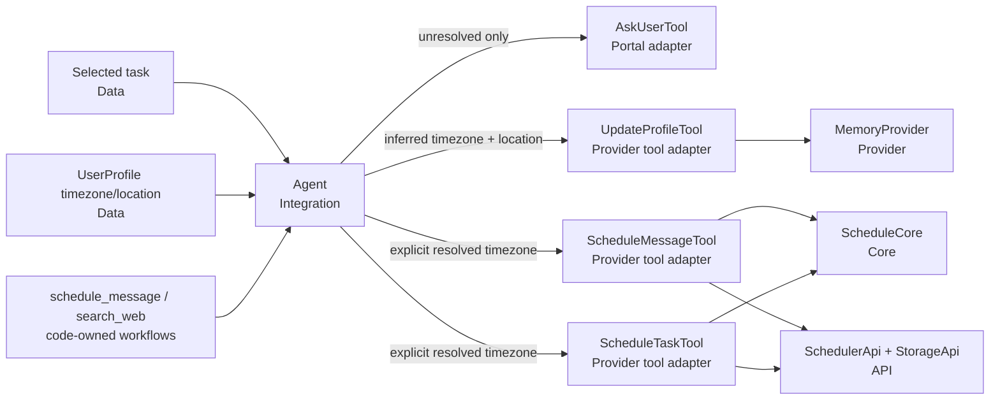

# TASK-017: IANA timezone execution guidance — Design

← [[backlog/TASK-017-iana-timezone-execution-guidance/task|Back to task]] | [[backlog/TASK-017-iana-timezone-execution-guidance/requirements|Requirements]]

## Solution overview

Keep timezone discovery in the already-selected skill workflow and timezone
validity in deterministic scheduling code. The `schedule_message` and
`search_web` workflows apply one ordered rule set for absolute and recurring
local-time schedules: use an explicit valid IANA name, otherwise reuse a valid
profile timezone, otherwise infer and persist a name from an unambiguous named
location, and otherwise suspend through `ask_user` for one direct city/region or
IANA answer. Inferred values are passed explicitly to both `update_profile` and
the scheduling call, so scheduling never depends on rereading the write.
`ScheduleCore` stops coercing missing, invalid, or offset-only local-time
identity to UTC; only relative-delay jobs may proceed without identity and use a
valid timezone or UTC solely for display/metadata. Existing `ZoneInfo`,
`CronTrigger`, profile fields, and job payloads remain unchanged, with
deterministic workflow, tool-boundary, and DST-transition tests protecting the
contract. This is the task-local implementation of
[[backlog/EPIC-002-agent-routing-reliability/design#Decision 5: Use IANA timezone identity]].

## Architecture



`Agent` retains coordination only: the active workflow tells the model which
independent tool requests to produce, and `Agent` dispatches valid requests
through the existing phase protocol from [[TASK-015-phase-protocol-and-agent-integration/design|TASK-015]].
The skill specifications own the prompt-first resolution policy.
`ScheduleCore` remains synchronous and owns `ZoneInfo` validation/conversion and
`CronTrigger` construction. Existing tool adapters own scheduler/profile side
effects and do not infer timezone identity. No new Provider, resolver, API, DTO,
or Integration is introduced.

## Key decisions

### Decision 1: Resolve timezone after selection with explicit precedence

**Context:** Selection must stay compact and tool-free, while execution sees the
profile, selected workflow, task location, and clarification tools. FR-1 and
FR-2 require deterministic ordering without re-entering selection.  
**Options:** (A) add timezone rules to skill-selection metadata; (B) introduce a
location resolver before the agent; (C) keep one ordered policy in both full
scheduling workflows.  
**Choice:** C. For absolute and recurring schedules, execution evaluates:

1. a valid IANA timezone explicitly supplied for the schedule;
2. a profile timezone accepted by `ZoneInfo`;
3. an unambiguous named location in the task or profile, from which execution
   infers an IANA name;
4. one `ask_user` clarification for city/region or an IANA name.

An invalid or offset-only candidate is unresolved and never becomes identity.
Relative-delay schedules bypass this policy. Clarification remains inside the
active workflow and resumes the TASK-015 execution session (FR-1, FR-2). This
specializes master Decision 5 and is not a new ADR candidate.

### Decision 2: Make every local-time scheduling call self-contained

**Context:** The current tools can read `profile_timezone` metadata and silently
fall back to UTC. That makes a call's local-time meaning depend on hidden state
and allows invalid cron identity to register as UTC (FR-1, FR-3, FR-4).  
**Options:** (A) retain metadata fallback; (B) let the tool reread a just-written
profile; (C) require an explicit valid timezone on every absolute/cron tool
request.  
**Choice:** C. A valid profile value is copied into the scheduling arguments by
execution; an inferred value is copied into both the profile update and
scheduling arguments. `schedule_message` and `schedule_task` reject local-time
requests whose explicit timezone is missing or rejected by `ZoneInfo` before
calling `SchedulerApi` or writing metadata. `UTC` remains a valid explicit IANA
name. Relative delays require no timezone and may use the first valid explicit
or profile value, otherwise `UTC`, only for display and metadata (FR-1, FR-2,
FR-3, FR-4).

### Decision 3: Keep inference prompt-first and verify its effects deterministically

**Context:** Resolving arbitrary locations mechanically would require the
geocoding/lookup subsystem excluded from this task, but profile persistence and
clarification timing still need deterministic coverage (FR-1, FR-2, FR-3).  
**Options:** (A) add a location database or Provider; (B) accept prompt-only
copy with no workflow tests; (C) encode the policy in the full skill workflows
and test fixed model decisions and observable tool calls.  
**Choice:** C. Fixed tests use a known unambiguous case such as Saint Petersburg
→ `Europe/Moscow`, an ambiguous case such as Springfield, a missing case, and
offset-only answers. They assert the exact calls, absence of dispatch while
unresolved, profile-write fields, explicit scheduling timezone, and reuse from
a subsequently loaded profile. Corpus-wide and live-model accuracy remains with
TASK-020/TASK-021 (FR-1, FR-2, FR-3). No ADR candidate.

### Decision 4: Test established library semantics outside transition-hour policy

**Context:** An offset identifies one instant's relation to UTC but not future
DST rules. This task must protect regional scheduling without defining behavior
for nonexistent or duplicated local times (FR-4).  
**Options:** (A) assert only timezone strings; (B) mock timezone conversion; (C)
exercise real `ZoneInfo` and `CronTrigger` on unambiguous wall times around both
DST transitions.  
**Choice:** C. Absolute tests assert UTC instants on either side of a transition.
Recurring tests enumerate a fixed daytime cron through spring and autumn and
assert unchanged local wall time with the regional offset changing. Tool tests
also assert the exact IANA name reaches `SchedulerApi` and persisted metadata
unchanged. Transition-hour policy remains out of scope (FR-4). No ADR candidate.

## Interfaces

### API / Public contract

The scheduling tool schemas remain additive-compatible, but their timing
invariants become strict:

```python
class ScheduleMessageParams(BaseModel):
    reminder_text: str
    delay_minutes: int | None = None
    year: int | None = None
    month: int | None = None
    day: int | None = None
    hour: int | None = None
    minute: int | None = None
    timezone: str | None = None
    cron: str | None = None

class ScheduleTaskParams(BaseModel):
    skill_name: str
    distilled_task: str
    description: str
    delay_minutes: int | None = None
    year: int | None = None
    month: int | None = None
    day: int | None = None
    hour: int | None = None
    minute: int | None = None
    timezone: str | None = None
    cron: str | None = None
    # Existing request_constraints field is unchanged.
```

- `delay_minutes`: timezone is optional; no timezone clarification is allowed.
- absolute local time: all five date/time fields plus an explicit valid
  `timezone` are required.
- recurring local time: `cron` plus an explicit valid `timezone` are required.
- exactly one timing mode remains mandatory.

Core exposes separate local-time validation and relative-display resolution so
the latter cannot authorize a local schedule:

```python
class ScheduleCore:
    @staticmethod
    def validate_timezone_name(timezone: str | None) -> str | None: ...

    @staticmethod
    def relative_timezone_name(
        explicit_tz: str | None,
        profile_timezone: str | None,
    ) -> str: ...
```

`validate_timezone_name` returns `None` only when the exact supplied name is
accepted by `ZoneInfo`; otherwise it returns a safe tool-boundary error.
`relative_timezone_name` returns the first valid supplied candidate and defaults
to `UTC`. It is never used for absolute or recurring scheduling.

The inferred persistence/scheduling batch has this concrete shape:

```json
[
  {
    "tool_name": "update_profile",
    "arguments": {
      "fields": {
        "timezone": "Europe/Moscow",
        "location": "Saint Petersburg"
      }
    }
  },
  {
    "tool_name": "schedule_message",
    "arguments": {
      "reminder_text": "take vitamins",
      "cron": "0 9 * * *",
      "timezone": "Europe/Moscow"
    }
  }
]
```

For deferred `search_web`, the second call is `schedule_task` with
`skill_name="search_web"` and the same explicit timezone. The calls may be
parallel because every scheduling argument is already resolved; the scheduling
call never depends on the profile write completing.

### Data model

No new Data contract or schema version is introduced. `UserProfile.location`
and `UserProfile.timezone` remain strings. Existing job payloads retain their
`timezone` field, and valid stored IANA names remain readable unchanged.

## System impact

| Path / class | IODA | Change | FR |
|--------------|------|--------|----|
| `yoda/mind/agent/skills/specs/schedule_message.md` — active workflow | Code-owned execution contract | Replace unconditional missing-timezone clarification with ordered explicit/profile/location resolution, IANA-only identity, explicit scheduling arguments, inferred profile persistence, and relative-delay bypass | FR-1, FR-2, FR-3 |
| `yoda/mind/agent/skills/specs/search_web.md` — deferred/recurring workflow | Code-owned execution contract | Apply the same timezone rules to `schedule_task` while preserving dynamic-task and request-constraint behavior | FR-1, FR-2, FR-3 |
| `yoda/mind/agent/core/schedule_core.py` — `ScheduleCore` | Core | Separate strict IANA validation for local-time schedules from best-effort relative-delay display timezone; retain `ZoneInfo` conversion and `CronTrigger` construction | FR-1, FR-2, FR-4 |
| `yoda/mind/agent/tools/schedule_message_tool.py` — `ScheduleMessageTool` | Provider (existing tool-adapter naming) | Require and validate an explicit timezone for absolute/cron modes before scheduler or storage side effects; use profile/UTC fallback only for relative display/metadata; pass and persist valid IANA names unchanged | FR-1, FR-2, FR-3, FR-4 |
| `yoda/mind/agent/tools/schedule_task_tool.py` — `ScheduleTaskTool` | Provider (existing tool-adapter naming) | Mirror the strict local-time boundary and relative-only fallback for deferred/recurring skill jobs | FR-1, FR-2, FR-3, FR-4 |
| `yoda/mind/agent/AGENTS.md` — module execution contract | Documentation | Document IANA resolution precedence, explicit local-time tool arguments, inferred profile update batching, and relative-delay exception | FR-1, FR-2, FR-3, FR-4 |
| `tests/test_skill_catalog.py` — production workflow contract tests | Test (code-owned config) | Assert both full workflows contain ordered reuse/infer/persist/clarify rules, offset prohibition, explicit scheduling, and relative bypass while compact selection summaries remain unchanged | FR-1, FR-2, FR-3 |
| `tests/test_agent.py` — production-skill execution scenarios | Test (Integration) | Add parameterized static/dynamic fixed-decision cases for valid profile and explicit timezones, unambiguous inference plus profile update, ambiguous/missing/offset clarification and resume, relative delays, no unresolved dispatch, and subsequent profile reuse | FR-1, FR-2, FR-3 |
| `tests/test_schedule_core.py` — timezone and trigger tests | Test (Core) | Cover valid/invalid/offset identity, relative fallback, exact absolute UTC conversion around DST, and fixed local cron behavior through spring/autumn transitions | FR-1, FR-2, FR-4 |
| `tests/test_agent_tools.py` — `ScheduleMessageTool` boundary tests | Test (Provider/API boundary) | Assert missing/invalid/offset local timezone rejection before side effects, unchanged IANA propagation/persistence, and timezone-free relative scheduling | FR-1, FR-2, FR-4 |
| `tests/test_schedule_task_tool.py` — `ScheduleTaskTool` boundary tests | Test (Provider/API boundary) | Mirror static-message local timezone rejection and unchanged propagation/persistence for dynamic jobs, retaining request constraints | FR-1, FR-2, FR-3, FR-4 |

`Agent`, `ReactLoop`, `UserProfile`, `MemoryProvider`, `UpdateProfileTool`,
`SchedulerApi`, and persisted payload schemas do not change. Existing
TASK-015 phase/resume and TASK-016 request-constraint contracts are reused.

## Persistence, rollout, and rollback

EPIC-002 has `internal_compat: none`, so no mixed sibling implementation or
compatibility shim is designed. Its `external_contract: additive` remains in
force: profile schema version 2, Redis keys, and scheduled-job JSON shapes are
unchanged; valid stored IANA names and existing jobs remain readable and retain
their current behavior. No bulk migration, profile rewrite, job recreation, or
ChromaDB change is required.

After deployment, newly attempted absolute/recurring calls with missing,
invalid, or offset-only identity fail before registration instead of becoming
UTC jobs. Existing persisted jobs are not revalidated or cancelled. Rollback is
a code/spec/test revert and requires no data rollback. Timezone/location values
and task text remain DEBUG-only under the project logging policy.

## Decisions made (from requirements review)

| Item | Resolution |
|------|------------|
| Explicit versus stored identity | A valid explicit IANA name for the current schedule takes precedence; otherwise a valid profile timezone is reused |
| Invalid profile timezone | Treat it as unresolved for local-time execution; never coerce it to UTC |
| Named-location inference | Keep it in the active workflow with deterministic fixed-decision tests; do not add a resolver or mapping table |
| Inferred persistence ordering | Send the inferred timezone/location to `update_profile` and the same timezone explicitly to scheduling; batching is allowed only because neither call depends on the other |
| Relative delays | Require no identity or clarification; invalid/missing display timezone falls back to UTC without changing local-time rules |
| Offset strings | Reject `+03:00`, `UTC+03:00`, and other values not accepted by `ZoneInfo`; explicitly supplied `UTC` remains valid |
| DST transition-hour behavior | Test unambiguous daytime wall times around transitions; define no fold/gap policy |
| IODA boundary | Workflow policy stays in code-owned skill specs, pure validation/conversion stays in `ScheduleCore`, `Agent` only coordinates, and existing adapters retain side effects |
| Cross-task compatibility | Reuse TASK-015 execution resume and TASK-016 constraints; add no intermediate-state machinery because `internal_compat: none` |

## Open questions

None.
