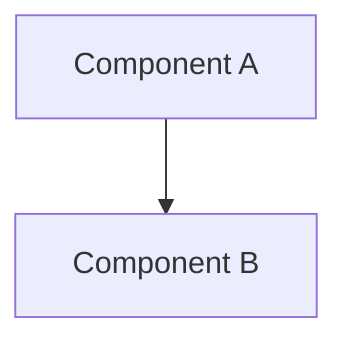

# TASK-018: grounded outcomes and safe failures — Design

← [[backlog/TASK-018-grounded-outcomes-and-safe-failures/task|Back to task]] | [[backlog/TASK-018-grounded-outcomes-and-safe-failures/requirements|Requirements]]

## Solution overview

One paragraph: the chosen approach and why this one.

## Architecture



## Key decisions

### Decision 1: Name

**Context:** what problem we are solving.
**Options:** Option A / Option B
**Choice:** Option A, because...

## Interfaces

### API / Public contract

Method signatures, tool schemas, or message contracts the implementer must follow.

### Data model

```
Entity { id: str, field: str }
```

## System impact

Table: file/class → IODA category → change → FR. This is the seed for the plan's «Files & artifacts».

| Path / class | IODA | Change | FR |
|--------------|------|--------|----|
| <yoda/...> | Integration / Core / Provider / Portal / Data / API | create / edit / delete | FR-N |

## Open questions

- [ ] Question 1
