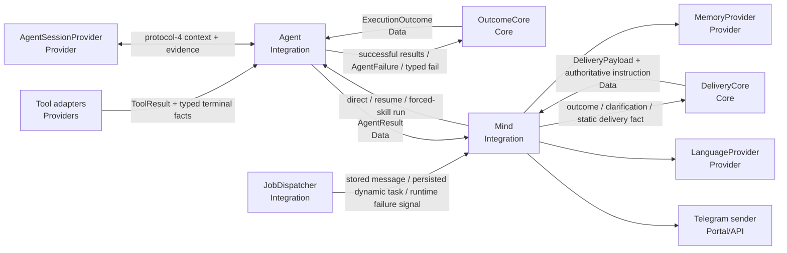

# TASK-018: grounded outcomes and safe failures — Design

← [[backlog/TASK-018-grounded-outcomes-and-safe-failures/task|Back to task]] | [[backlog/TASK-018-grounded-outcomes-and-safe-failures/requirements|Requirements]]

## Solution overview

Replace `AgentResult.answer` plus `tools_used` with one exclusive result contract:
either a structured `ExecutionOutcome` for terminal success/failure or a
`ClarificationResult` for a suspended interaction. `Agent` accumulates
code-derived `OutcomeEvidence` from successful tool results and asks a pure
`OutcomeCore` to authorize terminal success; a model `finish` may supply the
summary, but it cannot choose the operation, result kind, job kind, or failure
category, and a finish without relevant successful evidence becomes a safe
failure. Terminal side-effect tools add typed facts at the point the side effect
succeeds, especially `job_kind=message|task` and the user-relevant schedule.
`DeliveryCore` then converts outcomes and clarifications into a semantic
`DeliveryPayload` with explicit allowed/prohibited claim tokens and serializes
it as an authoritative control instruction whose summaries and questions remain
delimited untrusted data. JSON is additionally escaped for the surrounding
XML-like delimiter. `Mind` only moves these Data objects between the agent, Core
policy, memory, renderer, and Portal. Existing message/task job records stay
unchanged, while agent session protocol 4 additively persists outcome evidence
and an unresolved-terminal-failure guard, and lazily refreshes v1-v3 generated
control messages. This specializes
[[backlog/EPIC-002-agent-routing-reliability/design#Truthful completion]],
[[backlog/EPIC-002-agent-routing-reliability/design#Static message versus dynamic task]],
and
[[backlog/EPIC-002-agent-routing-reliability/design#Decision 9: Keep safe failures capability-agnostic]].

## Architecture



`OutcomeCore` and `DeliveryCore` are independent synchronous Operations; neither
calls the other or performs I/O. `Agent`, `Mind`, and `JobDispatcher` are
Integrations that pass Data between Cores and Providers. Tool adapters report
infrastructure facts but do not decide user-visible claims. Rendering remains
probabilistic only for language and voice after deterministic policy has fixed
the permissible meaning (FR-1 through FR-6).

## Key decisions

### Decision 1: Return one exclusive result shape

**Context:** Optional `answer`, `clarification`, and `failure` fields permit
invalid combinations and make direct, resumed, and forced-skill paths difficult
to compare.  
**Options:** (A) add fields to the current loose DTO; (B) raise exceptions for
all non-success paths; (C) make `AgentResult` an exclusive wrapper around one
terminal outcome or one suspension result.  
**Choice:** C. `AgentResult` contains exactly one of `outcome` and
`clarification`, enforced by consistency-only `__post_init__` validation.
`ExecutionOutcome.status` then enforces its own success/failure field
invariants. Derivation remains in Core, not in either Data class. `run`,
`resume`, and `run_with_skill` all return this same contract; a missing resume
session is an `ambiguous` failure rather than a successful answer (FR-1, FR-5).
No ADR candidate.

### Decision 2: Persist code-derived evidence and require it for success

**Context:** A model-authored finish or a human-readable tool output can claim a
side effect that failed or did not occur, while suspended sessions must retain
enough trusted state to finish after resume.  
**Options:** (A) parse operation and job kind from display text; (B) trust every
non-empty model finish; (C) accumulate typed evidence from successful tool
results and gate success in Core.  
**Choice:** C. `OutcomeCore.evidence_from_results` maps code-known tool/active
skill identities to capability-neutral `UserOperation` and `ResultKind` values.
Terminal adapters additionally return `TerminalResultFacts` with a safe
summary, actual job kind, scheduled operation, and display schedule where
applicable. `AgentContext.outcome_evidence` stores only successful facts, not
failed outputs or exceptions. `AgentContext.terminal_failure_pending` records
whether a terminal side effect failed after earlier successful evidence; it is
persisted across suspension and blocks a later `finish` from reusing that stale
evidence. A successful terminal retry completes from its new typed facts. A
terminal adapter succeeds only from its typed facts; a non-terminal `finish`
succeeds only when relevant evidence exists and no terminal failure remains
pending.
Its model-authored summary is allowed to summarize the task and accepted
successful tool messages, but Core fixes every categorical claim. A failed
terminal call, exception, or evidence-free finish yields `transient` failure
instead of “completed” (FR-1, FR-2, FR-6). No ADR candidate.

### Decision 3: Add a typed active-workflow rejection

**Context:** Selection already has a typed no-skill result, but an activated
workflow has no safe way to state that a discovered capability boundary makes
the requested work unsupported; using `finish` would look like success.  
**Options:** (A) infer refusal from final-answer prose; (B) treat every refusal
as a tool exception; (C) add a validated execution `fail` mode restricted to an
unsupported capability boundary.  
**Choice:** C. Protocol 4 extends `ExecutionDecision.mode` with `fail` and
requires `failure_reason="unsupported"` with no answer or tool calls.
Ambiguous input continues to use `ask_user` and suspend; code-originated
missing-session input maps to `ambiguous`; runtime, tool, validation, and
exhausted-protocol failures map to `transient`. `OutcomeCore` owns this mapping
and emits only the three safe categories and their fixed next-step dispositions
(FR-1, FR-5). This is a task-local extension of master Decision 9, not an ADR
candidate.

### Decision 4: Make semantic claim tokens authoritative

**Context:** Free-form instructions in `Mind` mix policy with orchestration and
allow the companion model to strengthen a grounded result. User/tool text in
the summary is also untrusted and must not become control content.  
**Options:** (A) rely on a shorter prose prompt; (B) render deterministic final
sentences in code; (C) derive semantic claim tokens in Core, then allow
voice/language rendering inside those boundaries.  
**Choice:** C. `DeliveryCore.build_payload` emits operation/result facts,
`AllowedClaim` tokens, `ProhibitedClaim` tokens, the permitted next step, and a
language policy. `DeliveryCore.build_instruction` places code-owned rendering
rules outside a JSON-encoded `<delivery_data trust="untrusted">` block and uses
the stable `GROUNDED DELIVERY:` prefix. Because JSON quoting alone does not
neutralize the outer delimiter, serialized untrusted data additionally replaces
`&`, `<`, and `>` with their JSON Unicode escapes. The renderer may preserve or
rephrase the supplied summary/question in the recent user language and Yoda
voice, but may not add a fact, change certainty, disclose internal names, or
imply an unproven side effect. Tests assert payload semantics, adversarial
delimiter round-trips, and the authoritative instruction, not exact prose
(FR-3, FR-5, FR-6). No ADR candidate.

### Decision 5: Treat job creation and job firing as separate outcomes

**Context:** A static reminder and a dynamic task may share a schedule, but only
the dynamic task recomputes content when fired. Creation text is not evidence
that later execution succeeded.  
**Options:** (A) distinguish by recurrence; (B) inspect reminder wording; (C)
carry the persisted/typed job kind through separate creation and firing
policies.  
**Choice:** C. Successful creation has `result_kind=scheduled_job` and exactly
one `job_kind`. For `message`, policy authorizes only stored-text delivery on
the supplied schedule and prohibits lookup/recompute claims. For `task`, policy
authorizes that the named capability-neutral operation will run later but
prohibits any future-result claim. At trigger time `JobDispatcher` continues to
branch on persisted `kind`: message records create a fresh
`delivered_stored_message` fact with static prohibitions, while task records
execute `run_with_skill` and deliver that new execution's outcome. One-shot and
recurring jobs use identical claim rules (FR-2, FR-3, FR-4). No ADR candidate.

### Decision 6: Upgrade sessions additively to protocol 4

**Context:** New suspended sessions need structured evidence, but deployed
v1-v3 sessions and existing job/conversation records must work without a bulk
migration. Legacy messages do not contain trustworthy typed outcome evidence.  
**Options:** (A) reconstruct evidence by parsing old display text; (B) reject
legacy sessions; (C) load missing evidence as empty and lazily refresh generated
control/schema messages.  
**Choice:** C. `AgentSessionProvider` defaults missing
`outcome_evidence` to `[]`. On resume, `Agent` reloads the active skill and
protocol-4 schemas, preserves all user-authored content, constraints, answers,
accepted tool history, retry state, and profile/task fields, and marks old tool
history as model context rather than typed completion evidence. The refreshed
execution control requires a new relevant successful result before `finish` if
no typed evidence exists. New sessions persist every evidence field. Existing
message/task job JSON and conversation messages are read unchanged; no job or
history is rewritten (FR-4, FR-7). No ADR candidate.

## Interfaces

### API / Public contract

All agent entry points keep their arguments and return the exclusive wrapper:

```python
class Agent:
    async def run(...) -> AgentResult: ...
    async def resume(self, chat_id: int, user_answer: str) -> AgentResult: ...
    async def run_with_skill(...) -> AgentResult: ...

@dataclass(frozen=True)
class AgentResult:
    outcome: ExecutionOutcome | None = None
    clarification: ClarificationResult | None = None

    def __post_init__(self) -> None:
        # Exactly one field must be present; consistency validation only.
        ...
```

The phase schema gains one explicit non-success terminal mode:

```python
class ExecutionDecision(BaseModel):
    model_config = ConfigDict(extra="forbid")
    mode: Literal["call_tools", "finish", "fail"]
    tool_calls: list[ToolCallRequest] | None = None
    final_answer: str | None = None
    failure_reason: Literal["unsupported"] | None = None
    reasoning: str = ""
```

`ReactLoop.validate_execution_decision` permits exactly:
- `call_tools`: non-empty calls, no answer/failure reason;
- `finish`: non-empty answer, no calls/failure reason;
- `fail`: `failure_reason="unsupported"`, no calls/answer.

Core entry points are synchronous and receive all state as Data:

```python
class OutcomeCore:
    @staticmethod
    def evidence_from_results(
        active_skill_name: str,
        results: list[ToolResult],
    ) -> list[OutcomeEvidence]: ...

    @staticmethod
    def success_from_terminal(
        evidence: list[OutcomeEvidence],
    ) -> ExecutionOutcome: ...

    @staticmethod
    def success_from_finish(
        active_skill_name: str,
        summary: str,
        evidence: list[OutcomeEvidence],
    ) -> ExecutionOutcome: ...

    @staticmethod
    def failure_from_agent(
        failure: AgentFailure,
        operation: UserOperation,
    ) -> ExecutionOutcome: ...

    @staticmethod
    def failure(
        operation: UserOperation,
        category: SafeFailureCategory,
    ) -> ExecutionOutcome: ...

class DeliveryCore:
    @staticmethod
    def build_payload(
        result: ExecutionOutcome | ClarificationResult | StaticMessageDelivery,
    ) -> DeliveryPayload: ...

    @staticmethod
    def build_instruction(
        payload: DeliveryPayload,
        current_time_utc: str,
    ) -> str: ...
```

`OutcomeCore.success_from_finish` returns a transient failure when evidence is
empty, does not authorize the active operation, or
`AgentContext.terminal_failure_pending` is true. It never reads failed
`ToolResult.output`. `DeliveryCore.build_instruction` JSON-encodes all
outcome/user text, Unicode-escapes delimiter-significant characters, and never
interpolates untrusted text into the code-owned instruction.

`Mind` keeps one delivery path:

```python
class Mind:
    async def _handle_agent_result(
        self,
        chat_id: int,
        result: AgentResult,
        system_prompt: str,
        conversation: Conversation | None,
    ) -> None: ...

    async def deliver_scheduled_reminder(
        self,
        chat_id: int,
        user_id: int,
        reminder_text: str,
    ) -> None: ...

    async def notify_scheduled_failure(self, chat_id: int) -> None: ...
```

`notify_scheduled_failure` accepts no exception/brief text; it asks
`OutcomeCore` for a capability-neutral transient outcome. All three paths call
`DeliveryCore`, append one `task_result` system instruction, and then invoke the
existing voice renderer.

### Data model

```python
class OutcomeStatus(StrEnum):
    SUCCESS = "success"
    FAILURE = "failure"

class UserOperation(StrEnum):
    REQUESTED_WORK = "requested_work"
    RETRIEVE_INFORMATION = "retrieve_information"
    SCHEDULE_WORK = "schedule_work"
    CREATE_PICTURE = "create_picture"
    MANAGE_SCHEDULED_JOBS = "manage_scheduled_jobs"
    MANAGE_USER_DATA = "manage_user_data"
    DELIVER_STORED_MESSAGE = "deliver_stored_message"

class ResultKind(StrEnum):
    INFORMATION = "information"
    SCHEDULED_JOB = "scheduled_job"
    PICTURE_SENT = "picture_sent"
    JOB_STATE = "job_state"
    USER_DATA = "user_data"
    STORED_MESSAGE_DELIVERED = "stored_message_delivered"

class JobKind(StrEnum):
    MESSAGE = "message"
    TASK = "task"

class SafeFailureCategory(StrEnum):
    AMBIGUOUS = "ambiguous"
    TRANSIENT = "transient"
    UNSUPPORTED = "unsupported"

class NextStep(StrEnum):
    CLARIFY_OR_REPHRASE = "clarify_or_rephrase"
    TRY_LATER = "try_later"
    STATE_CAPABILITY_BOUNDARY = "state_capability_boundary"

@dataclass(frozen=True)
class TerminalResultFacts:
    result_kind: ResultKind
    summary: str
    job_kind: JobKind | None = None
    scheduled_skill_name: str | None = None  # internal evidence only
    schedule: str | None = None

@dataclass
class ToolResult:
    tool_name: str
    output: str
    success: bool
    suspend: bool = False
    terminal_facts: TerminalResultFacts | None = None

@dataclass(frozen=True)
class OutcomeEvidence:
    operation: UserOperation
    result_kind: ResultKind
    terminal: bool
    safe_summary: str | None = None
    job_kind: JobKind | None = None
    scheduled_operation: UserOperation | None = None
    schedule: str | None = None

@dataclass(frozen=True)
class ExecutionOutcome:
    operation: UserOperation
    status: OutcomeStatus
    summary: str
    result_kind: ResultKind | None = None
    job_kind: JobKind | None = None
    scheduled_operation: UserOperation | None = None
    schedule: str | None = None
    failure_category: SafeFailureCategory | None = None
    next_step: NextStep | None = None

@dataclass(frozen=True)
class ClarificationResult:
    question: str

@dataclass(frozen=True)
class StaticMessageDelivery:
    reminder_text: str

@dataclass(frozen=True)
class DeliveryPayload:
    status: Literal["success", "failure", "clarification"]
    operation: UserOperation
    source_text: str
    facts: tuple[str, ...]
    allowed_claims: tuple[AllowedClaim, ...]
    prohibited_claims: tuple[ProhibitedClaim, ...]
    next_step: NextStep | None
    language_policy: Literal["preserve_source", "match_recent_user"]
```

`AgentContext` additionally carries `terminal_failure_pending: bool = False`.
Protocol-4 session writes persist it, legacy session reads default it to
`False`, and context-copy helpers preserve it.

Data validation enforces only structural consistency:
- success requires `result_kind` and forbids failure fields;
- failure requires `failure_category` plus its fixed matching `next_step` and
  forbids result/job/schedule fields;
- `job_kind` is present only for `scheduled_job`;
- `job_kind=task` may carry `scheduled_operation`, while `message` may not;
- `TerminalResultFacts` exists only on successful terminal tool results.

`AllowedClaim` includes distinct tokens for `stored_text_scheduled`,
`dynamic_operation_scheduled`, `operation_completed`,
`picture_sent`, `stored_text_delivered`, and `safe_limitation`.
`ProhibitedClaim` includes `live_recomputation`, `future_result`,
`uncreated_job`, `unproved_side_effect`, `internal_details`, and
`changed_certainty`. Message-job creation and firing always include
`live_recomputation`; task-job creation always includes `future_result`.

## System impact

| Path / class | IODA | Change | FR |
|--------------|------|--------|----|
| `yoda/mind/agent/data/agent_data.py` — `ExecutionDecision`, `ToolResult`, `AgentContext`, `AgentResult` | Data | Add typed execution rejection, terminal facts, protocol-4 evidence, persisted terminal-failure state, and the frozen exclusive result wrapper; keep consistency validation only | FR-1, FR-2, FR-5, FR-7 |
| `yoda/mind/agent/data/outcome_data.py` — outcome/evidence/delivery enums and DTOs | Data | Create capability-neutral operation, result, safe-failure, next-step, evidence, outcome, clarification, static-delivery, and claim-payload contracts | FR-1, FR-2, FR-3, FR-4, FR-5, FR-6 |
| `yoda/mind/agent/core/outcome_core.py` — `OutcomeCore` | Core | Create pure tool/skill-to-operation evidence mapping, success authorization, terminal fact derivation, and internal-to-safe failure classification | FR-1, FR-2, FR-5, FR-6 |
| `yoda/mind/agent/core/delivery_core.py` — `DeliveryCore` | Core | Create pure allowed/prohibited claim policy and authoritative delimiter-safe JSON renderer instruction for success, clarification, failure, and static trigger delivery | FR-3, FR-4, FR-5, FR-6 |
| `yoda/mind/agent/core/react_loop.py` — `ReactLoop` | Core | Validate execution `fail`, label failed tool messages as non-evidence, copy outcome evidence, emit protocol-4 instructions, and refresh recognized v1-v3 generated messages lazily | FR-1, FR-2, FR-5, FR-6, FR-7 |
| `yoda/mind/agent/agent.py` — `Agent` | Integration | Accumulate Core-derived successful evidence, retain unresolved terminal failure state, persist both on suspension, return one structured result on direct/resume/forced paths, reject ungrounded success, and map missing sessions/internal failures safely | FR-1, FR-2, FR-5, FR-7 |
| `yoda/mind/agent/session_provider.py` — `AgentSessionProvider` | Provider | Round-trip protocol-4 outcome evidence and terminal-failure state; decode missing legacy fields as safe empty/false defaults without mutating stored sessions | FR-1, FR-7 |
| `yoda/mind/agent/tools/schedule_message_tool.py` — `ScheduleMessageTool` | Provider tool adapter | Attach successful `scheduled_job/message` terminal facts with safe summary and schedule; retain existing job JSON | FR-1, FR-2, FR-3, FR-4 |
| `yoda/mind/agent/tools/schedule_task_tool.py` — `ScheduleTaskTool` | Provider tool adapter | Attach successful `scheduled_job/task` terminal facts with internal scheduled skill, safe description, and schedule; retain existing job JSON | FR-1, FR-2, FR-3, FR-4 |
| `yoda/mind/agent/tools/send_picture_tool.py` — `SendPictureTool` | Portal-facing Provider tool adapter | Attach `picture_sent` terminal facts only after Telegram succeeds; exclude file paths/errors from safe summary | FR-1, FR-2, FR-5 |
| `yoda/mind/agent/tools/delete_user_data_tool.py` — `DeleteUserDataTool` | Provider tool adapter | Attach `user_data` terminal facts after deletion completes, without exposing storage details | FR-1, FR-2, FR-5 |
| `yoda/mind/mind.py` — `Mind` | Integration | Remove inline completion/failure business logic and tool-name delivery; pass outcomes/static facts through `DeliveryCore` before memory and voice rendering | FR-1, FR-3, FR-4, FR-5, FR-6 |
| `yoda/mind/job_dispatcher.py` — `JobDispatcher` | Integration | Preserve persisted message/task routing, use new execution outcomes for dynamic jobs, and send exception paths as category-only scheduled failure signals | FR-4, FR-5, FR-7 |
| `yoda/mind/memory/memory.py` — `KNOWN_TASK_RESULT_PREFIXES` | Core | Recognize the new authoritative delivery prefix while retaining every legacy prefix and message kind | FR-6, FR-7 |
| `yoda/mind/agent/AGENTS.md` — module contract | Documentation | Document protocol 4, evidence gating, safe failure mapping, typed job facts, and deterministic delivery boundaries | FR-1, FR-2, FR-3, FR-4, FR-5, FR-7 |
| `tests/test_outcome_core.py` — `OutcomeCore` tests | Test (Core) | Create deterministic operation/result mapping, terminal success/failure contrast, no-evidence rejection, typed unsupported path, safe category, and job-kind cases | FR-1, FR-2, FR-5, FR-6 |
| `tests/test_delivery_core.py` — `DeliveryCore` tests | Test (Core) | Create semantic payload tests for message/task/no-job/picture/static-trigger/clarification/all failure categories and implementation-detail markers | FR-3, FR-4, FR-5, FR-6 |
| `tests/test_agent.py` — `Agent` orchestration tests | Test (Integration) | Cover equivalent direct/resume/run-with-skill outcomes, protocol-4 rejection, terminal failure/exception, non-terminal evidence gating, suspension evidence, and missing-session failure | FR-1, FR-2, FR-5, FR-7 |
| `tests/test_agent_session.py` — session compatibility tests | Test (Provider/Data) | Round-trip protocol-4 evidence and load/resume representative v1-v3 sessions while preserving task, skill, answers, constraints, retries, and accepted history | FR-1, FR-7 |
| `tests/test_agent_tools.py` — static schedule/picture/deletion facts | Test (Provider/Portal boundary) | Assert facts appear only on successful side effects, `message` is exact, schedules are user-relevant, and errors/paths never enter safe facts | FR-1, FR-2, FR-3, FR-5 |
| `tests/test_schedule_task_tool.py` — dynamic schedule facts | Test (Provider/Data) | Assert `task` terminal facts and one-shot/recurring schedules while preserving old/new persisted payload compatibility | FR-1, FR-2, FR-3, FR-4, FR-7 |
| `tests/test_mind_agent_pipeline.py` — grounded delivery integration | Test (Integration) | Inspect authoritative instructions for direct/resumed/scheduled paths and prove raw failures, issues, tool output, exceptions, skill/tool names, and static live-task claims never enter delivery history | FR-1, FR-3, FR-4, FR-5, FR-6 |
| `tests/test_job_dispatcher.py` — trigger routing tests | Test (Integration) | Contrast one-shot/recurring message/task firing, static delivery policy, fresh dynamic outcomes, legacy job records, and category-only runtime failure | FR-4, FR-5, FR-7 |
| `tests/test_memory_operation.py` — task-result compatibility tests | Test (Core/Data) | Preserve legacy prefixes/history and recognize the new delivery prefix without migration or rerendering | FR-6, FR-7 |

## Persistence, rollout, and rollback

EPIC-002 has `internal_compat: none`, so no shim is added for partial sibling
implementations. Its `external_contract: additive` remains in force:

- new suspended sessions use `protocol_version=4` and persist
  `outcome_evidence` and `terminal_failure_pending`; v1-v3 decode them as empty
  and false, respectively, and upgrade generated control messages lazily on
  resume;
- the upgrade preserves active skill, distilled task, profile, request
  constraints, clarification answers, accepted assistant/tool history, retry
  flags, user-authored content, and iteration state;
- existing scheduled-job records continue to use their current `kind=message`
  or `kind=task` JSON and execute without rewrites;
- existing conversation/history records remain readable and are never
  retrospectively rerendered; legacy task-result prefixes remain recognized;
- terminal facts and delivery payloads are in-memory contracts, so no Redis,
  ChromaDB, profile, job, or conversation schema migration is required.

Rollout is code-first. INFO/WARNING logs may contain stage, safe failure category,
operation enum, and result/job kind, but never task text, summary, question, tool
output, profile data, job description, or schedule; those remain DEBUG-only.

Rollback does not require job/profile/conversation migration. Before reverting
to code that does not understand protocol 4, complete or delete pending v4
agent sessions; old code would ignore their typed evidence and restore the
weaker free-form completion path. Existing jobs do not need cancellation because
their persisted shapes are unchanged.

## Decisions made (from requirements review)

| Item | Resolution |
|------|------------|
| Result exclusivity | `AgentResult` wraps exactly one terminal `ExecutionOutcome` or one suspended `ClarificationResult` |
| Operation vocabulary | Use closed capability-neutral enums; tool/skill identities remain internal evidence |
| Non-terminal finish | Require relevant successful typed evidence; a model answer supplies summary only |
| Active capability rejection | Add protocol-4 `fail/unsupported`; never infer refusal from prose |
| Ambiguous input | Suspend with `ask_user` when possible; missing/non-resumable context maps to `ambiguous` |
| Runtime/protocol/tool failures | Map to `transient` unless typed evidence establishes ambiguity or unsupported work |
| Static versus dynamic creation | `job_kind` is code-authored and exact; recurrence never determines semantics |
| Trigger-time boundary | Static jobs deliver stored text only; dynamic jobs deliver a fresh execution outcome |
| Language and voice | Preserve supplied source meaning or match recent user language after semantic policy is fixed |
| Legacy sessions | Add protocol-4 evidence; load v1-v3 as empty and require new evidence rather than parsing old display text |
| Existing jobs/history | Read unchanged, do not bulk migrate, rewrite, or rerender |
| IODA boundary | Cores derive outcomes/claims; Integrations pass Data; Providers report facts and perform side effects |

## Open questions

None.
