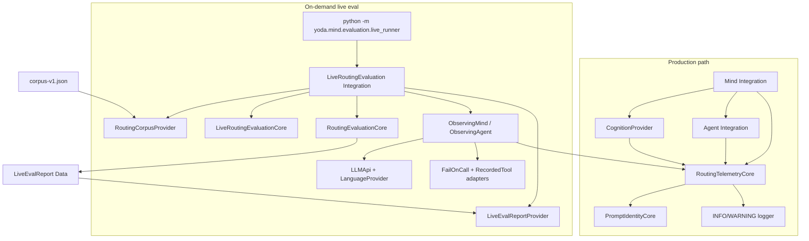

# TASK-021: stage telemetry and live eval runner — Design

← [[backlog/TASK-021-stage-telemetry-and-live-eval-runner/task|Back to task]] | [[backlog/TASK-021-stage-telemetry-and-live-eval-runner/requirements|Requirements]]

## Solution overview

Specialize
[[backlog/EPIC-002-agent-routing-reliability/design#Decision 7: Evaluate stages, not only end-to-end replies]]
into production stage diagnostics plus an on-demand live-model corpus runner.
`RoutingTelemetryCore` owns privacy-safe stage/outcome formatting and canonical
prompt hashing; `Mind`, `Agent`, and `CognitionProvider` emit INFO/WARNING
diagnostics that name the five canonical stages without user content.
Versioned prompt IDs (`intent_classifier/v1`, `skill_selector/v1`,
`skill_executor/v1`, `grounded_delivery/v1`, `<skill>/v1`) and SHA-256 control-
plane hashes travel with every LLM-backed stage. Observation-capturing
Integrations move into `yoda/mind/evaluation/` so both the deterministic
TASK-020 harness and the new `LiveRoutingEvaluation` Integration can score the
same `RoutingObservation` contract. The live runner replaces only eligible
recorded LLM decisions with the configured `LLMApi`, keeps corpus tools/state
isolated behind fail-on-call adapters, excludes forced-malformed fixtures via
pure Core policy, and writes a unique privacy-safe JSON report under
`artifacts/live_routing_eval/`. Standard pytest never invokes it.

## Architecture



| Component | IODA | Role |
|-----------|------|------|
| `StageDiagnostic`, `PromptIdentity`, `LiveEvalReport`, … | Data | Strict DTOs for diagnostics and run artifacts |
| `RoutingTelemetryCore` | Core | Format privacy-safe log records; map outcomes to stage labels |
| `PromptIdentityCore` | Core | Stable prompt IDs + canonical SHA-256 over control-plane material |
| `LiveRoutingEvaluationCore` | Core | Live eligibility/exclusion, run aggregation, summary text, report build |
| `RoutingEvaluationCore` | Core | Unchanged structural scoring (TASK-020) |
| `LiveEvalReportProvider` | Provider | Async write of versioned JSON; no network |
| `RoutingCorpusProvider` | Provider | Unchanged corpus load |
| `ObservingCognitionProvider` / `ObservingMind` / `ObservingAgent` | Integration / Provider subclass | Capture accepted stage Data; emit telemetry; shared `prompt_sink` |
| `LiveRoutingEvaluation` | Integration | Orchestrate live corpus runs; never import `tests.*` |
| `LLMApi` | API | Sole external service used by the live runner |
| Fail-on-call stubs / recorded tools | API / Provider | Isolate Telegram, search, media, Redis, scheduler, Chroma |

## Key decisions

### Decision 1: Emit production diagnostics from Integrations via Core formatters

**Context:** FR-1 requires stage-labelled diagnostics on the production path without
changing routing behavior or leaking user content at INFO/WARNING.  
**Options:** (A) only test-harness capture; (B) optional observer callback injected
into constructors; (C) always-on Integration log points that call
`RoutingTelemetryCore.format_*` and never change control flow.  
**Choice:** C. `Mind`, `Agent`, and `CognitionProvider` log after each applicable
stage transition using Core-produced records. Resume, scheduled-task, chat, and
bypass paths log only stages that actually ran (or an explicit
`not_applicable`/`bypassed` category when a stage was intentionally skipped),
never as success/failure of work that did not happen. Failure/recovery/
exhaustion categories are logged at the stage that rejected the operation so a
later delivery cannot hide them (FR-1). No ADR candidate.

### Decision 2: Versioned prompt IDs + SHA-256 control-plane hashes

**Context:** FR-2 and
[[backlog/EPIC-002-agent-routing-reliability/suggested_prompts#Prompt identity and logging]]
require comparable prompt/model identity across code and model changes.  
**Options:** (A) hash full message lists including user text; (B) hash only static
prompt constants; (C) hash canonical control-plane material per stage
(instructions + catalog/workflow/tool schemas when applicable), excluding
user/profile/tool-result/model-output/timestamps.  
**Choice:** C with IDs `intent_classifier/v1`, `skill_selector/v1`,
`skill_executor/v1`, `grounded_delivery/v1`, and `<skill_name>/v1` for each
activated skill workflow. Algorithm is SHA-256 hex of UTF-8 bytes of a
deterministic concatenation of ordered control-plane parts (NUL-separated
UTF-8 segments). `PromptIdentityCore` owns the rule. Selection/execution helpers
take Integration-built variable control-plane strings (`catalog_control_text`,
`workflow_text`, `tool_schemas_canonical_json`); intent/delivery helpers hash
static prompt constants loaded via **lazy imports** inside the Core methods
(avoids a `cognition` ↔ `PromptIdentityCore` cycle — see As-built notes). Live
reports retain every distinct ID/hash pair actually invoked in the run (FR-2)
via a shared `prompt_sink` on observing Integrations. No ADR candidate.

### Decision 3: Promote observation Integrations into production evaluation

**Context:** Live scoring needs the same `RoutingObservation` capture as
TASK-020, but runtime must not import `tests.routing_evaluation`.  
**Options:** (A) duplicate Observation subclasses under live modules; (B) leave
capture test-only and rebuild observations from logs; (C) move
`ObservingMind` / `ObservingAgent` (today’s `EvaluationMind` /
`EvaluationAgent`) into `yoda/mind/evaluation/` and thin the test harness.  
**Choice:** C. Shared observation Integrations capture accepted intent,
selection, planning, execution, and delivery Data for scoring. The test harness
imports them and keeps recorded adapters test-local. Live evaluation wires the
same observers with a real `LLMApi` (FR-3, FR-5). No ADR candidate.

### Decision 4: Exclude forced-malformed fixtures by Core policy (no schema bump)

**Context:** FR-3 requires excluding cases whose expectations depend on forced
malformed/rejected recorded responses, with stable IDs and reasons, without
weakening deterministic CI.  
**Options:** (A) add `live_eligible` to corpus schema (schema_version bump);
(B) exclude by case-ID allowlist in code; (C) pure Core heuristic over existing
expectation fields.  
**Choice:** C. A case is live-excluded when any turn expects intent
`rejected_fallback_chat`, selection/planning `recovery` in
`{corrected, exhausted}`, or selection `mode=protocol_exhausted`. Exclusion
reasons are stable enums plus the case ID. Eligible cases ignore recorded
`model_responses` entirely for decision acquisition; tool fixtures and fixed
inputs remain (FR-3). No ADR candidate.

### Decision 5: Live runner uses production LLM only; all other boundaries fail closed

**Context:** FR-4 forbids Telegram, Tavily, image/vision, Redis, Chroma, and
production scheduler during live corpus runs.  
**Options:** (A) reuse production bot wiring with feature flags; (B) dedicated
Integration assembling LanguageProvider + fail-on-call APIs + recorded tools +
in-memory storage, mirroring the TASK-020 harness topology.  
**Choice:** B. Only `LLMApi` may perform network I/O. Unexpected tool/skill
selection still hits production schemas/policy, then recorded/local adapters;
any call into a forbidden boundary raises and becomes an operational error, not
a scored pass (FR-4). Fail-on-call stubs and recorded-tool / in-memory storage
adapters live in `yoda/mind/evaluation/live_fakes.py` (duplicated from
`tests/routing_evaluation/fakes.py` so live code never imports `tests.*`). No
ADR candidate.

### Decision 6: Persist unique privacy-safe JSON reports; keep live eval opt-in

**Context:** FR-6/FR-7 need reproducible artifacts without PR gating or user-
content replicas (ADR-000).  
**Options:** (A) overwrite a fixed path; (B) stdout only; (C) unique files under
`artifacts/live_routing_eval/` plus console summary.  
**Choice:** C. Filename includes UTC timestamp and a short run UUID.
`report_schema_version: 1`. Default artifact omits prompt bodies, synthetic
user text, raw model responses, tool payloads, and credentials. Entry point
`python -m yoda.mind.evaluation.live_runner` is documented and never imported by
pytest/CI. Live score failures do not mutate corpus expectations or routing
code (FR-6, FR-7). No ADR candidate.

## Interfaces

### Prompt identity

```python
INTENT_CLASSIFIER_PROMPT_ID = "intent_classifier/v1"
SKILL_SELECTOR_PROMPT_ID = "skill_selector/v1"
SKILL_EXECUTOR_PROMPT_ID = "skill_executor/v1"
GROUNDED_DELIVERY_PROMPT_ID = "grounded_delivery/v1"

def skill_workflow_prompt_id(skill_name: str) -> str:
    return f"{skill_name}/v1"

class PromptIdentity(BaseModel):
    model_config = ConfigDict(extra="forbid")
    prompt_id: str
    prompt_hash: str  # sha256 hex

class PromptIdentityCore:
    @staticmethod
    def hash_control_plane(parts: Sequence[str]) -> str: ...

    @staticmethod
    def intent_identity() -> PromptIdentity: ...

    @staticmethod
    def selection_identity(catalog_control_text: str) -> PromptIdentity: ...

    @staticmethod
    def execution_identity(
        skill_name: str,
        workflow_text: str,
        tool_schemas_canonical_json: str,
    ) -> list[PromptIdentity]:
        """Returns skill_executor/v1 and <skill>/v1 identities."""

    @staticmethod
    def delivery_identity() -> PromptIdentity:
        """Hash stable grounded-delivery rules template only (no source_text)."""
```

`LanguageProvider.model_name` (read-only property) supplies the configured model
identifier for diagnostics and reports. No API keys or provider response IDs.

### Stage diagnostics

```python
class DiagnosticOutcome(StrEnum):
    SUCCESS = "success"
    REJECTED = "rejected"
    CORRECTED = "corrected"
    EXHAUSTED = "exhausted"
    FAILED = "failed"
    BYPASSED = "bypassed"
    NOT_APPLICABLE = "not_applicable"
    BLOCKED = "blocked"

class StageDiagnostic(BaseModel):
    model_config = ConfigDict(extra="forbid")
    stage: StageName
    outcome: DiagnosticOutcome
    model_id: str | None = None
    prompts: tuple[PromptIdentity, ...] = ()
    detail: str | None = None  # closed category token only, never user text

class RoutingTelemetryCore:
    @staticmethod
    def format_info(diagnostic: StageDiagnostic) -> str: ...

    @staticmethod
    def format_warning(diagnostic: StageDiagnostic) -> str: ...
```

INFO/WARNING strings contain only stage, outcome, model_id, prompt_id(s),
prompt_hash(es), and closed `detail` tokens. User text, profiles, distilled
tasks, prompt bodies, tool args/results, and delivery source text remain
DEBUG-only when logged at all (FR-1, ADR-000).

### Live evaluation

```python
class LiveExclusionReason(StrEnum):
    FORCED_MALFORMED_INTENT = "forced_malformed_intent"
    FORCED_SELECTION_RECOVERY = "forced_selection_recovery"
    FORCED_PLANNING_RECOVERY = "forced_planning_recovery"
    FORCED_PROTOCOL_EXHAUSTION = "forced_protocol_exhaustion"

class LiveCaseExclusion(BaseModel):
    model_config = ConfigDict(extra="forbid")
    case_id: str
    reason: LiveExclusionReason

class LiveRunStatus(StrEnum):
    COMPLETED = "completed"
    PARTIAL = "partial"
    FAILED = "failed"

class OperationalErrorCategory(StrEnum):
    PROVIDER_AUTH = "provider_auth"
    PROVIDER_RATE_LIMIT = "provider_rate_limit"
    PROVIDER_ERROR = "provider_error"
    FORBIDDEN_SIDE_EFFECT = "forbidden_side_effect"
    INTERRUPTED = "interrupted"
    INTERNAL = "internal"

class LiveStageMetrics(BaseModel):
    model_config = ConfigDict(extra="forbid")
    stage: StageName
    passed: int
    failed: int
    applicable: int
    blocked: int
    pass_rate: float  # passed / applicable; 0.0 when applicable == 0

class LiveEvalReport(BaseModel):
    model_config = ConfigDict(extra="forbid")
    report_schema_version: Literal[1]
    run_id: str
    started_at_utc: datetime
    ended_at_utc: datetime
    status: LiveRunStatus
    corpus_schema_version: int
    corpus_version: str
    case_filter: str | None
    model_id: str
    prompts_used: list[PromptIdentity]  # distinct pairs, stable sort
    exclusions: list[LiveCaseExclusion]
    case_results: list[RoutingCaseResult]  # scored live-eligible attempts
    incomplete_case_ids: list[str]
    unattempted_case_ids: list[str]
    stage_metrics: list[LiveStageMetrics]
    attempted: int
    passed: int
    failed: int
    excluded: int
    incomplete: int
    operational_errors: list[OperationalErrorCategory]

class LiveRoutingEvaluationCore:
    @staticmethod
    def live_eligibility(case: RoutingCase) -> LiveCaseExclusion | None: ...

    @staticmethod
    def build_report(...) -> LiveEvalReport: ...

    @staticmethod
    def format_console_summary(report: LiveEvalReport, artifact_path: Path) -> str: ...

class LiveEvalReportProvider:
    async def write(self, report: LiveEvalReport, directory: Path) -> Path: ...

class LiveRoutingEvaluation:
    last_artifact_path: Path | None  # set after successful report write (CLI)

    async def run(
        self,
        corpus_path: Path,
        *,
        case_id: str | None = None,
        report_dir: Path | None = None,
    ) -> LiveEvalReport: ...
```

CLI contract:

```text
.venv/bin/python -m yoda.mind.evaluation.live_runner \
  [--case CASE_ID] \
  [--corpus PATH] \
  [--report-dir PATH] \
  [--settings PATH]
```

Defaults: checked-in `tests/fixtures/routing_evaluation/corpus-v1.json`,
`artifacts/live_routing_eval/`, project `settings.json` agent `model_name` +
LLM credentials. Unknown `--case` fails before any model call. Provider errors
mark incomplete/unattempted cases and set `status=partial|failed`; they never
count as stage passes (FR-3, FR-4, FR-6).

### Observation Integrations (shared)

```python
class ObservingCognitionProvider(CognitionProvider):
    """Emits intent diagnostics; appends intent PromptIdentity to prompt_sink."""

class ObservingAgent(Agent):
    """Captures accepted selection/planning/execution; appends prompt IDs."""

class ObservingMind(Mind):
    """Captures intent + delivery; appends prompt IDs; production routing."""
```

Live and deterministic harnesses pass a shared `prompt_sink: list[PromptIdentity]`
into these observers so `LiveEvalReport.prompts_used` accumulates every distinct
ID/hash actually invoked (not a hard-seeded intent+delivery pair).
`tests/routing_evaluation/harness.py` imports these instead of defining local
subclasses. Recorded LLM/tool adapters remain under `tests/routing_evaluation/`.

## Data model

```python
# Additive Data in yoda/mind/evaluation/ (and prompt-id constants near prompts)

StageDiagnostic, PromptIdentity, DiagnosticOutcome
LiveExclusionReason, LiveCaseExclusion, LiveRunStatus
OperationalErrorCategory, LiveStageMetrics, LiveEvalReport
```

`RoutingCase` / `RoutingObservation` / `RoutingEvaluationReport` remain the
TASK-020 scoring substrate. Live reports wrap case results with run metadata
and exclusion lists; they do not change corpus schema_version.

## System impact

| Path / class | IODA | Change | FR |
|--------------|------|--------|----|
| `yoda/mind/evaluation/data.py` — `StageDiagnostic`, `PromptIdentity`, `LiveEvalReport`, live enums/metrics | Data | Add strict live/telemetry DTOs; keep TASK-020 corpus models unchanged | FR-1, FR-2, FR-5, FR-6 |
| `yoda/mind/evaluation/telemetry_core.py` — `RoutingTelemetryCore` | Core | Create privacy-safe diagnostic formatting helpers | FR-1 |
| `yoda/mind/evaluation/prompt_identity_core.py` — `PromptIdentityCore` | Core | Create prompt ID constants helpers + SHA-256 control-plane hashing | FR-2 |
| `yoda/mind/evaluation/live_core.py` — `LiveRoutingEvaluationCore` | Core | Create live eligibility, metrics aggregation, console summary, report assembly | FR-3, FR-5, FR-6, FR-7 |
| `yoda/mind/evaluation/live_report_provider.py` — `LiveEvalReportProvider` | Provider | Create async unique JSON report writer + stable serialization | FR-6 |
| `yoda/mind/evaluation/observation.py` — `ObservingCognitionProvider`, `ObservingMind`, `ObservingAgent` | Integration / Provider subclass | Relocate capture from test harness; emit telemetry; shared `prompt_sink` for live `prompts_used` | FR-1, FR-2, FR-3, FR-5, FR-6 |
| `yoda/mind/evaluation/live_evaluation.py` — `LiveRoutingEvaluation` | Integration | Orchestrate corpus load, exclusion, live observe/score, report write; isolate state per case | FR-3, FR-4, FR-5, FR-6 |
| `yoda/mind/evaluation/live_fakes.py` — fail-on-call API stubs | API | Create Telegram/search/media/Redis/scheduler/Chroma stubs that raise on use | FR-4 |
| `yoda/mind/evaluation/live_runner.py` — `__main__` CLI | Integration entry | Parse args, load settings, invoke `LiveRoutingEvaluation`, print summary | FR-3, FR-6, FR-7 |
| `yoda/mind/evaluation/__init__.py` | Package | Export new public contracts needed by tests/docs | FR-3, FR-6 |
| `yoda/mind/cognition.py` — `INTENT_CLASSIFIER_PROMPT_ID`, `CognitionProvider` | Data + Provider | Attach prompt ID; emit intent-stage diagnostics with model/prompt identity | FR-1, FR-2 |
| `yoda/mind/agent/core/react_loop.py` — selector/executor prompt ID constants | Data (constants) | Expose stable IDs beside `SELECTION_SYSTEM_PROMPT` / `EXECUTION_SYSTEM_PROMPT` | FR-2 |
| `yoda/mind/agent/core/delivery_core.py` — `GROUNDED_DELIVERY_PROMPT_ID`, stable rules template for hashing | Core / Data | Expose delivery prompt identity material excluding per-run source text | FR-2 |
| `yoda/mind/agent/agent.py` — `Agent` | Integration | Emit selection/planning/execution stage diagnostics; pass control-plane text into hash helpers | FR-1, FR-2 |
| `yoda/mind/mind.py` — `Mind` | Integration | Emit intent/delivery/bypass diagnostics on applicable paths only | FR-1, FR-2 |
| `yoda/mind/perception/language.py` — `LanguageProvider.model_name` | Provider | Expose configured model id for diagnostics/reports | FR-2 |
| `tests/routing_evaluation/harness.py` | Integration (test) | Import `ObservingMind`/`ObservingAgent`; keep recorded adapters local | FR-3, FR-7 |
| `tests/test_routing_telemetry.py` | Test | Assert stage labels, privacy-safe INFO/WARNING payloads, bypass paths | FR-1 |
| `tests/test_prompt_identity.py` | Test | Assert stable hashes, user-text independence, multi-prompt retention | FR-2 |
| `tests/test_live_routing_evaluation.py` | Test | Eligibility exclusions, fail-on-call isolation, report round-trip, no pytest→live import from default suite beyond unit tests with fakes | FR-3, FR-4, FR-5, FR-6, FR-7 |
| `yoda/mind/agent/AGENTS.md` | Documentation | Document live runner invocation, credentials, report path, side-effect boundary, caveats | FR-7 |
| `.gitignore` | Repo hygiene | Ignore `artifacts/live_routing_eval/` | FR-6 |

## Persistence, rollout, and rollback

EPIC-002 `internal_compat: none` — no mixed-sibling shims. `external_contract:
additive` remains in force:

- no Redis/ChromaDB/profile/conversation/session/job schema changes;
- live runs use in-memory storage and recorded tool results only;
- report artifacts are local developer files, not production persistence;
- ADR-000: artifacts and INFO/WARNING logs never store user-message replicas.

Rollout is additive modules + logging. Rollback removes the live/telemetry
modules and reverts harness imports; no data migration.

## Decisions made (from requirements review)

| Item | Resolution |
|------|------------|
| Telemetry mechanism | Always-on Integration log points via `RoutingTelemetryCore`; no control-flow observer required for production |
| Observation capture | Promote `ObservingMind`/`ObservingAgent` into `yoda/mind/evaluation/`; tests keep recorded adapters |
| Prompt hashing | SHA-256 over control-plane parts only; IDs per suggested_prompts contract |
| Live eligibility | Core heuristic on expectation fields; no corpus schema bump |
| Side-effect boundary | Dedicated live Integration + fail-on-call stubs; only `LLMApi` networks |
| Report storage | Unique JSON under `artifacts/live_routing_eval/` + console path |
| CLI | `python -m yoda.mind.evaluation.live_runner` |
| CI gating | Unchanged deterministic corpus; live runner never required by pytest |
| IODA | Data DTOs, Core hash/format/eligibility/score, Provider report I/O, Integration orchestration |

## As-built notes (close-task harvest)

- **PromptIdentityCore lazy imports:** stage helpers import prompt constants from
  `cognition` / `react_loop` / `delivery_core` inside methods to break a circular
  import. Revisit if Core should take control-plane strings only (Integrations
  pass all material) so Core depends on Data alone without lazy imports.
- **`live_fakes` duplication:** production-safe copies of in-memory storage /
  recorded tools; extract a shared module under `yoda/mind/evaluation/` only if
  a third consumer appears.
- **`last_artifact_path`:** `LiveRoutingEvaluation.run` returns `LiveEvalReport`
  and sets `last_artifact_path` for the CLI summary (single write).

## Open questions

None.
