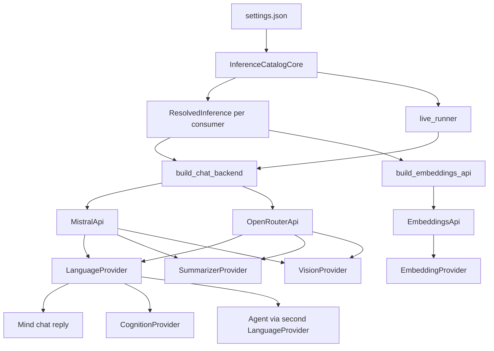

# TASK-023: ai inference profiles — Design

← [[backlog/TASK-023-ai-inference-profiles/task|Back to task]] | [[backlog/TASK-023-ai-inference-profiles/requirements|Requirements]]

## Solution overview

A pure `InferenceCatalogCore` in `yoda/api/inference/` loads the top-level `inference` catalog and resolves each consumer's `model` id to a `ResolvedInference` (backend, credentials, `model_name`) before any network client exists. Startup and the live-eval CLI — both Integrations — then build one chat or embeddings façade per consumer from that result. `LanguageProvider`, `SummarizerProvider`, and `LiveRoutingEvaluation` depend on a `ChatBackend` protocol implemented by both `MistralApi` (`yoda/api/mistral_api.py`, renamed from `LLMApi`) and `OpenRouterApi`, so OpenRouter can serve the same `json_object` structured calls as Mistral. Providers never see profile ids or API keys; changing a consumer's `model` id is enough to retarget it.

## Architecture



| Component | IODA | Role |
|-----------|------|------|
| `ResolvedInference`, `ConfiguredInference` (`yoda/api/inference/data.py`) | Data | Resolved backend, credentials, `model_name`; the five startup consumers |
| `InferenceCatalogCore` (`yoda/api/inference/catalog.py`) | Core | Parse and validate the catalog; resolve profile ids; no I/O. Lives under `api/` next to the façades; still depends only on Data |
| `build_chat_backend`, `build_embeddings_api` (`yoda/api/inference/backends.py`) | Integration (functions) | Instantiate API façades from an already-resolved value. Not Core: they import `MistralApi` / `OpenRouterApi` / `EmbeddingsApi` |
| `ChatBackend` | API (Protocol) | `complete_chat_async` + `parse_chat_async`. No I/O of its own |
| `MistralApi`, `OpenRouterApi` | API | Mistral and OpenRouter chat façades |
| `EmbeddingsApi` | API | OpenRouter embeddings façade (unchanged HTTP) |
| `LanguageProvider`, `SummarizerProvider`, `VisionProvider`, `EmbeddingProvider` | Provider | Keep today's call patterns; receive a resolved `model_name` and a façade |
| `main` in `yoda_chat_bot.py`, `live_runner` | Integration | Read settings, call the Core, construct façades, pass them in |

Cognition and agent selection/execution keep using the `LanguageProvider` they are given. Chat and cognition share the language provider; the agent gets a second provider so `agent.model` can differ ([[requirements#FR-3]]).

## Key decisions

### Decision 1: Resolve profiles in Core; construct clients in the Integration

**Context:** [[requirements#FR-2]] and [[requirements#FR-3]] need fail-fast profile resolution, and IODA forbids a Provider from calling another Operation or doing config policy. `LanguageProvider` today both reads `model_name` and holds `LLMApi`.
**Options:** (A) Providers accept a profile id plus the catalog. (B) Core returns `ResolvedInference`; Integrations build `MistralApi` / `OpenRouterApi` / `EmbeddingsApi` and pass `model_name` plus the façade into existing Providers.
**Choice:** B. Profile ids and API keys stay out of Providers. `LanguageProvider` still takes a settings dict with resolved `model_name` so chat, cognition, and agent call sites stay the same shape. Recorded in [[design/decisions/ADR-005-inference-catalog-resolves-before-clients|ADR-005]]. The catalog is the settings contract [[TASK-022-live-agent-eval-improvements/task|TASK-022]] and any later backend must extend.

### Decision 2: One `ChatBackend` protocol, `json_object` on OpenRouter

**Context:** [[requirements#FR-4]] requires cognition, agent phases, and the summarizer to parse structured JSON on OpenRouter as well as Mistral. `OpenRouterApi` only implements `complete_chat_async`. `VisionChatBackend` is complete-only and stays local to vision.
**Options:** (A) Add `parse_chat_async` to `OpenRouterApi` and type callers against a shared protocol. (B) Branch inside `LanguageProvider` on a backend string and import both clients.
**Choice:** A. `ChatBackend` lives in `yoda/api/chat_backend.py`. `OpenRouterApi.parse_chat_async` posts `response_format: {"type": "json_object"}`, `json.loads` the string content, and `model_validate`s — the same contract as `MistralApi.parse_chat_async`. `JSONDecodeError` and `ValidationError` propagate so `LanguageProvider` still raises `StructuredOutputError` with no raw content in the message. A non-string `content` raises `ValueError("OpenRouter structured content is not a string")` and is not wrapped. Debug logs may include a content prefix; exception messages must not.

### Decision 3: Embeddings accept only an OpenRouter provider

**Context:** [[requirements]] assumption: an embeddings profile whose backend cannot serve embeddings fails at wiring. `EmbeddingsApi` is an OpenRouter HTTP client. This task does not add a Mistral embeddings client.
**Options:** (A) Fail when `backend != "openrouter"`. (B) Allow Mistral and no-op until call time.
**Choice:** A. `InferenceCatalogCore.resolve_configured` raises `ValueError` naming the profile id and backend: `Embeddings profile '{profile_id}' requires backend 'openrouter', got '{backend}'`. `build_embeddings_api` repeats that check. Vision may use either backend; image payload shape follows `ResolvedInference.backend` ([[requirements#FR-3]]).

### Decision 4: Required summarizer profile; no language fallback

**Context:** `SummarizerSettings.from_settings` falls back to `language.model_name`. [[requirements#FR-3]] forbids that fallback and moves the selector to `mind.memory.summarizer.model`. Nothing in Redis or Chroma stores the old path.
**Options:** (A) Keep `from_settings` and only remove the fallback. (B) Delete `from_settings`; the dataclass holds the resolved `model_name` the provider sends to the API.
**Choice:** B. The profile id is resolved by the catalog. `SummarizerProvider` stores that concrete `model_name`, not the profile id. Existing fallback tests are replaced by catalog tests.

### Decision 5: Mistral provider rejects `base_url`; OpenRouter defaults it

**Context:** [[requirements#FR-1]] allows `base_url` on OpenRouter and names the two backends. `MistralApi` has no base-URL argument.
**Options:** (A) Ignore `base_url` on Mistral. (B) Reject it.
**Choice:** B. A Mistral provider that includes `base_url` raises at catalog load so the field cannot look active. Omitted OpenRouter `base_url` becomes `https://openrouter.ai/api/v1` (the constant already used by `OpenRouterApi` and `EmbeddingsApi`). A present `base_url` is a non-empty string, stored with any trailing slash removed. The catalog constant duplicates the façade default. `InferenceCatalogCore` does not import `MistralApi` or `OpenRouterApi`.

### Decision 6: Which credential strings move

**Context:** Committed `settings.json` has a Mistral key on `mind.perception.language.api_key` and a different key on top-level `llm.api_key` (live eval only). OpenRouter keys under vision, the dead `perception.openrouter` block, and embeddings are the same value.
**Options:** (A) Keep the language Mistral key on `inference.providers.mistral`. (B) Keep `llm.api_key`.
**Choice:** A. Production rollback to the Mistral text profile must use the key that already served chat. `llm.api_key` is removed with the rest of the obsolete fields ([[requirements#FR-1]], [[requirements#FR-5]]). Do not rotate or inline secret values in docs or tests.

### Decision 7: Rename the Mistral façade to `MistralApi`

**Context:** The Mistral client lives in `yoda/api/llm_api.py` as `LLMApi`, while the other HTTP clients are `OpenRouterApi` and `EmbeddingsApi`.
**Options:** (A) Keep `LLMApi` and only add the catalog. (B) Rename the module to `mistral_api.py` and the class to `MistralApi`.
**Choice:** B. File and class match `openrouter_api.py` / `OpenRouterApi`. Behavior of chat, parse, and debug exchange logging stays the same. `RecordedLLMApi` keeps its test-double name and subclasses `MistralApi`. Call sites that only need the protocol (`LanguageProvider`, `SummarizerProvider`, `LiveRoutingEvaluation`) import `ChatBackend` and drop the `LLMApi` import.

### Decision 8: Inference package under `yoda/api`

**Context:** The catalog is the settings contract for the chat and embeddings façades. Placing it under `yoda/mind/` would split that contract away from `MistralApi`, `OpenRouterApi`, and `EmbeddingsApi`.
**Options:** (A) `yoda/mind/inference/`. (B) `yoda/api/inference/`.
**Choice:** B. Layout:

```
yoda/api/mistral_api.py
yoda/api/openrouter_api.py
yoda/api/embeddings_api.py
yoda/api/chat_backend.py
yoda/api/inference/data.py       # Data
yoda/api/inference/catalog.py    # Core
yoda/api/inference/backends.py   # Integration functions
```

IODA categories do not change with the folder. `InferenceCatalogCore` stays sync and pure. Only `backends.py` constructs clients. No `__init__.py` — the rest of `yoda/api` and `yoda/mind` already import submodules without one.

## Interfaces

### API / Public contract

```python
BackendName = Literal["mistral", "openrouter"]

@dataclass(frozen=True)
class ResolvedInference:
    profile_id: str
    provider_id: str
    backend: BackendName
    api_key: str
    base_url: str | None  # openrouter: default or explicit; mistral: None
    model_name: str

@dataclass(frozen=True)
class ConfiguredInference:
    language: ResolvedInference
    agent: ResolvedInference
    summarizer: ResolvedInference
    vision: ResolvedInference
    embeddings: ResolvedInference

class InferenceCatalogCore:
    @staticmethod
    def from_settings(settings: dict) -> InferenceCatalogCore: ...

    def resolve(self, profile_id: str) -> ResolvedInference: ...

    @staticmethod
    def resolve_configured(settings: dict) -> ConfiguredInference: ...

class ChatBackend(Protocol):
    async def complete_chat_async(self, model_name: str, messages: list[dict]) -> str: ...
    async def parse_chat_async(
        self,
        model_name: str,
        messages: list[dict],
        response_format: type[BaseModel],
    ) -> BaseModel: ...

def build_chat_backend(
    resolved: ResolvedInference,
    debug_log_dir: Path | None = None,
) -> ChatBackend: ...

def build_embeddings_api(resolved: ResolvedInference) -> EmbeddingsApi: ...
```

`build_chat_backend`: `mistral` → `MistralApi(api_key, debug_log_dir=debug_log_dir)`; `openrouter` → `OpenRouterApi(api_key, base_url=resolved.base_url)`. Debug exchange files stay Mistral-only. `complete_chat_via_thread` stays on `MistralApi` and is not part of `ChatBackend` (no callers).

`LanguageProvider.__init__(self, settings: dict, chat_backend: ChatBackend)` — `settings["model_name"]` is the resolved model id. `SummarizerProvider.__init__(self, chat_backend: ChatBackend, settings: SummarizerSettings)`. `LiveRoutingEvaluation.__init__(..., chat_backend: ChatBackend, model_name: str, ...)`. `VisionProvider.__init__(self, settings: dict, chat_backend: VisionChatBackend, backend: BackendName)` — `backend` selects the image part (`image_url` as a string for Mistral, `{"url": data_url}` for OpenRouter). No default backend.

Startup (`main`) calls `resolve_configured` once, then:

- language and cognition: one chat backend + `LanguageProvider({"model_name": language.model_name}, ...)`
- agent: its own chat backend + `LanguageProvider`, even when the profile id matches language
- summarizer: its own chat backend + `SummarizerSettings(model_name=summarizer.model_name)`
- vision: chat backend from `vision.backend` + `backend=vision.backend`
- embeddings: `EmbeddingsApi` + `EmbeddingsSettings(model_name=embeddings.model_name)`

Separate client instances per consumer. No credential pooling.

`live_runner` loads JSON, `InferenceCatalogCore.from_settings`, then `resolve(agent["model"])`, then `build_chat_backend`. `KeyError` or catalog `ValueError` becomes `SystemExit` with that message before `LiveRoutingEvaluation.run`. It does not require the other four consumer ids to be present.

### Data model

Catalog object (ids fixed in repo `settings.json`, matching [[task#Target settings shape (example)]]):

```
inference.providers.mistral     { backend: "mistral", api_key }
inference.providers.openrouter  { backend: "openrouter", api_key, base_url? }
inference.profiles.text_qwen27_free    { provider: "openrouter", model_name: "qwen/qwen3.8-27b:free" }
inference.profiles.text_ministral14    { provider: "mistral",    model_name: "ministral-14b-latest" }
inference.profiles.vision_qwen_vl      { provider: "openrouter", model_name: "qwen/qwen3-vl-235b-a22b-thinking" }
inference.profiles.embed_openai_small  { provider: "openrouter", model_name: "openai/text-embedding-3-small" }

mind.perception.language.model = "text_qwen27_free"
mind.perception.vision.model   = "vision_qwen_vl"
mind.perception.audio          unchanged
mind.memory.summarizer.model   = "text_qwen27_free"
mind.memory.summary_store.embeddings.model = "embed_openai_small"
agent.model                    = "text_qwen27_free"
```

`summary_store` keeps `persist_directory` and `collection_prefix`. `EmbeddingsSettings` keeps `model_name` only (resolved). `SummaryStoreSettings` drops the embeddings credential object; `VectorProvider` already ignores it.

Validation at `from_settings` (whole catalog, including unused entries), all `ValueError`, messages name ids and never keys:

| Condition | Message |
|-----------|---------|
| `inference` missing or not an object | `Settings missing required key: inference` |
| `providers` / `profiles` missing, not an object, or empty | `inference.providers must be a non-empty object` (same for profiles) |
| provider missing `backend` or `api_key`, or profile missing `provider` or `model_name` | `Inference provider '{id}' missing required field '{field}'` / `Inference profile '{id}' missing required field '{field}'` |
| `api_key` or `model_name` not a non-empty string after strip | same missing-field message |
| `backend` not `mistral` or `openrouter` | `Inference provider '{id}' has unknown backend '{backend}'` |
| Mistral provider has `base_url` | `Inference provider '{id}' does not support base_url` |
| OpenRouter `base_url` present but not a non-empty string | `Inference provider '{id}' has invalid base_url` |
| profile `provider` not in `providers` | `Inference profile '{id}' references unknown provider '{provider_id}'` |

`resolve`:

| Condition | Message |
|-----------|---------|
| unknown profile id | `Unknown inference profile: '{profile_id}'` |

`resolve_configured` missing consumer selector: `Settings missing required inference model: {dotted.path}` using `mind.perception.language.model`, `agent.model`, `mind.memory.summarizer.model`, `mind.perception.vision.model`, `mind.memory.summary_store.embeddings.model`.

### Committed settings

Relocate the current language Mistral key and the current OpenRouter key into the two providers. Delete `mind.perception.language.api_key` / `model_name`, top-level `llm`, `mind.perception.openrouter`, `vision.provider` / `api_key` / `model_name`, `embeddings.model_name` / `openrouter_api_key`, and `agent.model_name`. Leave embodiment, agent tool keys, compression, maintenance, and emotions as they are.

## System impact

| Path / class | IODA | Change | FR |
|--------------|------|--------|----|
| `yoda/api/inference/data.py` — `ResolvedInference`, `ConfiguredInference` | Data | create | FR-1, FR-2, FR-3 |
| `yoda/api/inference/catalog.py` — `InferenceCatalogCore` | Core | create | FR-1, FR-2, FR-3, FR-6 |
| `yoda/api/inference/backends.py` — `build_chat_backend`, `build_embeddings_api` | Integration | create | FR-3, FR-4, FR-5 |
| `yoda/api/chat_backend.py` — `ChatBackend` | API | create | FR-4 |
| `yoda/api/openrouter_api.py` — `OpenRouterApi.parse_chat_async` | API | edit | FR-4 |
| `yoda/api/llm_api.py` → `yoda/api/mistral_api.py` — `MistralApi` | API | rename module and class; behavior unchanged; satisfies `ChatBackend` | FR-4 |
| `yoda/mind/perception/language.py` — `LanguageProvider` | Provider | drop `LLMApi` import; type the chat dependency as `ChatBackend` | FR-3, FR-4 |
| `yoda/mind/memory/summarizer.py` — `SummarizerProvider` | Provider | drop `LLMApi` import; type the chat dependency as `ChatBackend` | FR-3, FR-4 |
| `yoda/mind/memory/data/summarizer_settings.py` — `SummarizerSettings` | Data | remove `from_settings` | FR-3 |
| `yoda/mind/perception/vision.py` — `VisionProvider` | Provider | required `backend` argument; stop reading `provider` from settings | FR-3 |
| `yoda/mind/memory/data/summary_store_settings.py` — `SummaryStoreSettings`, `EmbeddingsSettings` | Data | drop API key; `EmbeddingsSettings.model_name` only; store settings ignore embeddings | FR-1, FR-3 |
| `yoda/mind/memory/embedding.py` — `EmbeddingProvider` | Provider | construct from `model_name` only | FR-3 |
| `yoda/yoda_chat_bot.py` — `main` | Integration | catalog resolve + per-consumer façades | FR-1, FR-2, FR-3, FR-4, FR-6 |
| `yoda/mind/evaluation/live_runner.py` | Integration | resolve `agent.model`; drop `llm.api_key` | FR-5 |
| `yoda/mind/evaluation/live_evaluation.py` — `LiveRoutingEvaluation` | Integration | `chat_backend: ChatBackend` instead of `llm_api: LLMApi` | FR-4, FR-5 |
| `settings.json` | Config | catalog shape and consumer `model` ids | FR-1, FR-6 |
| `doc/runbooks/live-routing-eval.md` | Doc | prerequisites are `inference` + `agent.model`; side effects are the resolved chat façade | FR-5 |
| `yoda/mind/evaluation/AGENTS.md` | Doc | side-effect wording is the resolved façade (`MistralApi` or `OpenRouterApi`) | FR-5 |
| `tests/test_llm_api.py` → `tests/test_mistral_api.py` | Test | rename; import `MistralApi` from `yoda.api.mistral_api` | FR-4 |
| `tests/routing_evaluation/fakes.py` — `RecordedLLMApi` | Test | subclass `MistralApi`; keep the double's class name | FR-4 |
| `tests/test_maintenance.py` | Test | forbidden-import string `yoda.api.llm_api` → `yoda.api.mistral_api` | FR-4 |
| `tests/test_inference_catalog.py` | Test | create: happy path, missing profile, missing provider, unknown backend, embeddings backend, distinct language vs agent profiles, default text profile ids | FR-2, FR-3, FR-6 |
| `tests/test_openrouter_api.py` | Test | structured parse success and invalid JSON, no live network | FR-4 |
| `tests/test_vision_provider.py` | Test | create: image part shape for `openrouter` vs `mistral` | FR-3 |
| `tests/test_summarizer.py` | Test | delete fallback cases | FR-3 |
| `tests/test_summary_store_core.py` | Test | settings fixture without embedding credentials | FR-1 |
| `tests/test_embedding_provider.py` | Test | `EmbeddingsSettings` without `openrouter_api_key` | FR-3 |
| `tests/test_vector_provider.py` | Test | `SummaryStoreSettings` without embeddings | FR-1 |
| `tests/test_live_routing_evaluation.py` | Test | `chat_backend=` keyword; missing `agent.model` / bad profile → `SystemExit` before a corpus case (this file may import `live_runner`; other test modules must not) | FR-5 |
| `tests/test_language_provider.py` | Test | existing `StructuredOutputError` cases stay valid against the protocol | FR-4 |

No Redis, Chroma, or conversation migration. Rollback is editing consumer `model` ids (and restoring `settings.json` if the catalog itself is reverted).

## Decisions made (from requirements review)

| Item | Resolution |
|------|------------|
| Requirements review | Pass on completeness, feasibility, testability, consistency, design alignment, IODA, traceability, and unambiguity. |
| Requirements sync | FR-4 and the IODA constraint name `MistralApi` / `yoda/api/mistral_api.py` and place the catalog under `yoda/api/inference/`. |
| Two Mistral keys in `settings.json` | Language key moves to `inference.providers.mistral`. Top-level `llm.api_key` is dropped (Decision 6). |
| Dead `mind.perception.openrouter` | Present in settings, unread in code. Removed with the other obsolete fields. |
| Mistral module name | `yoda/api/llm_api.py` / `LLMApi` become `yoda/api/mistral_api.py` / `MistralApi` (Decision 7). |
| Inference package location | `yoda/api/inference/`, not `yoda/mind/inference/` (Decision 8). Categories stay Data / Core / Integration functions. |

## Open questions

None.
