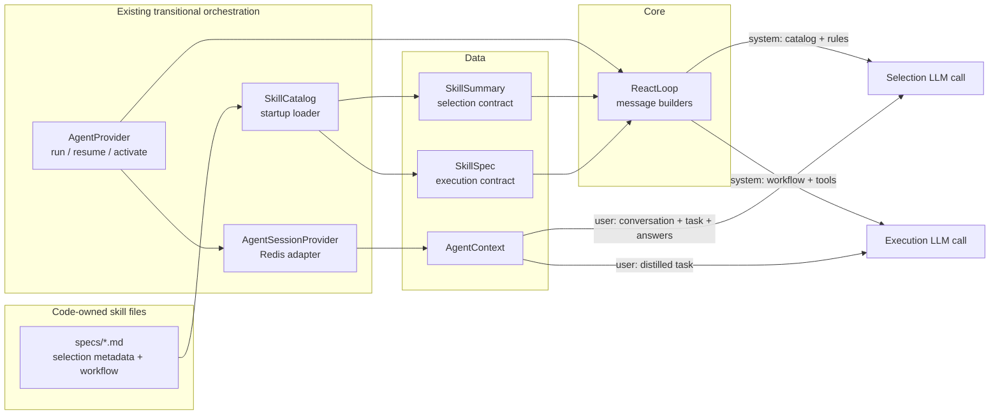

# TASK-014: discriminative skill selection contracts — Design

← [[backlog/archive/TASK-014-discriminative-skill-selection-contracts/task|Back to task]] | [[backlog/archive/TASK-014-discriminative-skill-selection-contracts/requirements|Requirements]]

## Solution overview

Extend the existing `SkillSummary` Data contract with code-owned `purpose`,
`when_to_use`, `do_not_use_when`, and `selection_examples` fields while retaining
`description` for the unchanged public-capabilities view. `SkillCatalog` will
fail fast when any discovered current skill omits or malforms those fields, and
`ReactLoop` will render the validated contracts in a canonical, name-sorted
selection `system` message. Recent conversation and the current task remain in a
separate `user` message. On activation, the full workflow, required inputs, tool
schemas, and execution instruction also move to `system`; the distilled task
stays `user`, and the synthetic assistant acknowledgement is removed. Legacy
pre-selection sessions remain loadable through Data defaults, but
`AgentProvider` refreshes their structurally recognized selection seed from the
current validated catalog before the next selector call. This is the local implementation of
[[backlog/archive/EPIC-002-agent-routing-reliability/design#Selection contract versus execution workflow]],
[[backlog/archive/EPIC-002-agent-routing-reliability/design#Static message versus dynamic task]],
and [[backlog/archive/EPIC-002-agent-routing-reliability/design#Control-plane authority]]
without introducing the phase models or `Agent` Integration owned by TASK-015.

## Architecture



`SkillSummary`, `SkillSpec`, and `AgentContext` remain Data. `ReactLoop` remains
a synchronous Core that only transforms Data into messages.
`AgentSessionProvider` continues to adapt Redis. `AgentProvider` performs only
the existing run/resume coordination needed to substitute current catalog Data
before selection; its architectural extraction and rename to an `Agent`
Integration remain explicitly deferred to TASK-015. No Operation gains a new
dependency on another Operation in this task.

## Key decisions

### Decision 1: Add an explicit selection contract without replacing public descriptions

**Context:** `description` currently serves both public capability advertising
and skill selection. Reinterpreting it as a selector-only purpose would couple
the user-facing capabilities view to control-plane wording (FR-1, FR-2).  
**Options:** (A) replace `description`; (B) parse headings from the workflow
body; (C) retain `description` and add explicit top-level selection fields.  
**Choice:** C. Every spec receives `purpose: str`, `when_to_use: list[str]`,
`do_not_use_when: list[str]`, and `selection_examples: list[str]`.
`description` and `public` keep their current semantics. Workflow headings,
execution inputs, tools, and examples in the body are never inferred into the
selection contract (FR-1, FR-2). This specializes master Decision 3 and is not a
new ADR candidate.

### Decision 2: Validate current files strictly while decoding legacy session Data additively

**Context:** Startup must reject incomplete current specs, but Redis may contain
a suspended pre-selection session whose serialized summaries have only `name`,
`description`, and `public` (FR-1, FR-5).  
**Options:** (A) make new dataclass fields constructor-required everywhere; (B)
default missing fields and permit current specs to fall back to description;
(C) default fields only for deserialization compatibility and validate every
discovered current spec in `SkillCatalog.load_catalog`.  
**Choice:** C. The Data fields use empty-list/string defaults so legacy JSON
loads, while catalog loading requires a non-blank string for `purpose` and a
non-empty list of non-blank strings for each list field. Missing, empty, wrong
container types, and non-string/blank members raise `ValueError` naming the
skill (or filename stem if `name` itself is unavailable) and field. There is no
description fallback or silent skip (FR-1, FR-5).

### Decision 3: Canonicalize selection serialization by skill name

**Context:** A prompt that changes with discovery order can accidentally imply
priority and makes order-neutral regression tests weak (FR-2, FR-3).  
**Options:** (A) preserve caller order and add only a prose disclaimer; (B)
shuffle on each call; (C) sort by exact skill name and render a fixed field
order plus an explicit no-priority rule.  
**Choice:** C. `ReactLoop` serializes contracts sorted by `name`, with fields in
the fixed order `name`, `purpose`, `when_to_use`, `do_not_use_when`,
`selection_examples`. Reversing the input list therefore produces the same
control content. All summaries, including `public: false`, remain available to
selection; `SkillCatalog.public_summaries` remains the sole public-view filter
(FR-2, FR-3).

### Decision 4: Separate control content from user-authored data at both phases

**Context:** The current selection message combines task data, recent
conversation, catalog, and instructions as `user`; activation is also `user`
and inserts a synthetic assistant acknowledgement (FR-4).  
**Options:** (A) change only the outer role of the combined message; (B) keep
the combined shape but quote user text; (C) emit separate control and payload
messages and remove synthetic assistant state.  
**Choice:** C. Selection emits a catalog/instruction `system` message followed
by one `user` payload containing recent conversation and task. Execution emits
the distilled task as `user` and active-skill metadata, required inputs, tool
schemas, workflow, and execution instruction as `system`. The synthetic
assistant acknowledgement is deleted, and agent-initiated nudges use `system`.
Clarification answers remain separate `user` messages. User text is never
formatted into either control message (FR-2, FR-4).

### Decision 5: Refresh only the catalog seed when resuming legacy pre-selection sessions

**Context:** A legacy suspended selection transcript contains the broad catalog
inside its initial combined `user` message. Loading the new fields with defaults
is insufficient: the next model call must see current validated contracts
without losing the original task, recent conversation, clarification exchange,
or answer (FR-4, FR-5).  
**Options:** (A) continue with the persisted snapshot; (B) discard and recreate
the whole transcript from `AgentContext.task`; (C) replace the recognized
selection seed while preserving its user-data prefix and every later message.  
**Choice:** C. Before a resumed context with `active_skill is None` calls the
selector, `AgentProvider` replaces `catalog_summaries` with the startup-validated
current catalog and asks `ReactLoop` to refresh the selection seed. For new
transcripts, explicit selection-control and selection-input markers identify
the seed. For the legacy combined format, the Core preserves the content before
the exact persisted-catalog suffix beginning at `Available skills:` (or
`No skills available.`), and inserts the current control message. Recognition
is structural: new transcripts require the adjacent generated `system` control
and `user` input wrapper pair, while legacy transcripts require an exact suffix
reconstructed from the persisted catalog. Marker or delimiter text elsewhere
in user-authored content is preserved. Subsequent assistant decisions, tool
results, and user clarification answers retain their order. Unrecognized shapes
fail rather than risk promoting or deleting user data (FR-4, FR-5).

## Interfaces

### Skill selection metadata

Each `skills/specs/*.md` frontmatter keeps its existing execution fields and
adds:

```yaml
name: schedule_message
description: Schedule a reminder message for later delivery.
public: true
purpose: Deliver static user-specified text at a later time.
when_to_use:
  - The payload is known when the job is created and should be delivered later.
do_not_use_when:
  - The payload requires fresh data, search, computation, or monitoring at trigger time.
selection_examples:
  - '"Every day at 9 remind me to take vitamins" -> use'
  - '"Every day at 9 send fresh weather" -> do not use; search_web'
```

All five current skills follow the contract suggestions in
[[backlog/archive/EPIC-002-agent-routing-reliability/suggested_prompts#Skill selection contracts]].
In particular, `schedule_message` owns delayed or recurring static stored text;
`search_web` owns current external information and deferred or recurring
results recomputed at trigger time. “Remind me later to check the weather” is
static reminder text and belongs to `schedule_message` (FR-1, FR-3).

### Data model

```python
@dataclass
class SkillSummary:
    name: str
    description: str
    public: bool = True
    purpose: str = ""
    when_to_use: list[str] = field(default_factory=list)
    do_not_use_when: list[str] = field(default_factory=list)
    selection_examples: list[str] = field(default_factory=list)
```

The defaults are a persisted-data compatibility mechanism only.
`SkillCatalog.load_catalog` never emits an empty current contract. `asdict` and
the existing JSON session encoding preserve all fields for new sessions.
`SkillSpec` remains unchanged because it is loaded only after selection and
continues to carry execution-only fields (FR-1, FR-5).

### Selection message builders

```python
@staticmethod
def build_selection_control_message(
    catalog_summaries: list[SkillSummary],
) -> dict:
    """Return code-owned catalog and selection rules as one system message."""

@staticmethod
def build_selection_input_message(
    task: str,
    recent_messages: list[dict] | None = None,
) -> dict:
    """Return quoted recent conversation and current task as one user message."""

@staticmethod
def refresh_selection_messages(
    context: AgentContext,
    catalog_summaries: list[SkillSummary],
) -> AgentContext:
    """Replace a structurally recognized seed while preserving user data and later messages."""
```

The control content has an explicit stable marker and fixed shape:

```text
<skill_selection_control>
Select by requested outcome. Catalog order has no semantic priority.
<skill name="schedule_message">
purpose: ...
when_to_use:
- ...
do_not_use_when:
- ...
selection_examples:
- ...
</skill>
...
</skill_selection_control>
```

The user payload has a separate marker and contains no catalog or control
instruction:

```text
<selection_input>
<recent_conversation>
...
</recent_conversation>
<task>
...
</task>
</selection_input>
```

`ReactLoop.build_selection_message` is replaced by these explicit builders; no
compatibility wrapper is retained because callers are internal and a wrapper
would invite recombining trust domains (FR-2, FR-4).

### Execution handoff

```python
@staticmethod
def build_compact_execution_messages(
    profile: UserProfile,
    task: str,
    skill: SkillSpec,
    activation_msg: dict,
) -> list[dict]:
    # [base system, distilled-task user, active-skill system]
    ...

@staticmethod
def build_activation_message(
    skill: SkillSpec,
    tool_schemas: list[dict],
) -> dict:
    # role == "system"
    ...
```

`activation_msg` contains the unchanged full workflow behavior and filtered
tools. There is no synthetic `assistant` message between the task and
activation. `AgentProvider.resume(..., user_answer)` continues to append the
answer with role `user`; execution nudges change from `user` to `system`
(FR-4).

## System impact

| Path / class | IODA | Change | FR |
|--------------|------|--------|----|
| `yoda/mind/agent/data/agent_data.py` — `SkillSummary`, `AgentContext` copy paths | Data | Edit — add additive selection-contract fields and preserve them through immutable context copies | FR-1, FR-2, FR-5 |
| `yoda/mind/agent/skills/catalog.py` — `SkillCatalog.load_catalog` | Provider (existing synchronous startup adapter) | Edit — parse and strictly validate current selection metadata while retaining `description`, `public`, and full-spec loading semantics | FR-1, FR-2, FR-5 |
| `yoda/mind/agent/core/react_loop.py` — selection builders, execution builders, refresh logic | Core | Edit — canonical contract serialization, system/user separation, legacy seed refresh, system activation, and no synthetic acknowledgement | FR-2, FR-3, FR-4, FR-5 |
| `yoda/mind/agent/agent_provider.py` — `run`, `resume`, `_activate_skill_context`, execution nudge | Integration (transitional `*Provider` name; extraction/rename in TASK-015) | Edit — install split selection messages, refresh current catalog before resumed pre-selection, retain user answers as user, and emit control nudge as system | FR-2, FR-4, FR-5 |
| `yoda/mind/agent/session_provider.py` — `AgentSessionProvider.load` / `save` contract | Provider | Verify/edit only if needed — legacy summary JSON decodes through Data defaults; new fields survive `asdict` round-trip | FR-5 |
| `yoda/mind/agent/skills/specs/create_picture.md` — frontmatter | Data/config | Edit — add validated image-selection purpose, positive boundary, negative boundary, and contrasts | FR-1 |
| `yoda/mind/agent/skills/specs/manage_jobs.md` — frontmatter | Data/config | Edit — add validated existing-job management selection contract | FR-1 |
| `yoda/mind/agent/skills/specs/manage_user_data.md` — frontmatter | Data/config | Edit — add validated private data-management contract without changing `public: false` | FR-1, FR-2 |
| `yoda/mind/agent/skills/specs/schedule_message.md` — frontmatter | Data/config | Edit — add static stored-message selection contract | FR-1, FR-3 |
| `yoda/mind/agent/skills/specs/search_web.md` — frontmatter | Data/config | Edit — add current/fresh-at-trigger-time selection contract | FR-1, FR-3 |
| `tests/fixtures/skills/specs/*.md` — catalog fixtures | Test Data | Edit — provide valid selection metadata for all discovered fixture skills | FR-1 |
| `tests/test_skill_catalog.py` — catalog and production-contract tests | Test (Data/catalog contract) | Edit — cover all fields, malformed/missing fail-fast cases, visibility, exact static/dynamic contrasts, and no workflow-derived fallback | FR-1, FR-2, FR-3 |
| `tests/test_react_loop.py` — prompt construction tests | Test (Core/Data contract) | Edit — cover canonical reversed-order output, compact field set, role/content separation, private inclusion, system activation, and absent acknowledgement | FR-2, FR-3, FR-4 |
| `tests/test_agent_provider.py` — phase context tests | Test (orchestration contract) | Edit — assert initial/recent selection roles, selection-to-execution roles, clarification answer trust boundary, and system nudge | FR-2, FR-4 |
| `tests/test_agent_session.py` — compatibility tests | Test (Provider/Data contract) | Edit — load a legacy pre-selection payload and round-trip new summary fields without loss | FR-5 |
| `yoda/mind/agent/AGENTS.md` — module contract | Documentation | Edit — document new frontmatter fields and corrected selection/execution message accumulation | FR-1, FR-2, FR-4 |

No change is required to public capability assembly in `yoda/yoda_chat_bot.py`;
it continues to use `description` from `public_summaries`. No full workflow body,
tool schema, tool behavior, user profile, scheduled job, Redis key, or ChromaDB
shape changes.

## Persistence and rollout

EPIC-002 has `internal_compat: none`, so no machinery is designed for partially
deployed combinations of member-task code. Its `external_contract: additive`
still applies to Redis sessions at first boot after merge. Existing profiles,
preferences, jobs, workflow markdown bodies, and active execution sessions need
no migration. A legacy pre-selection session loads because new `SkillSummary`
fields default, then refreshes from the current validated catalog before
selection; a new session serializes and reloads all contract fields. Rollback
is a code/spec/test revert. New session JSON has extra summary keys, which old
dataclass construction would not accept, so rollback while a new pre-selection
session is suspended requires deleting only affected `agent_sessions` entries
or completing them before rollback; no user-owned profile, job, or conversation
data is removed.

## Decisions made (from requirements review)

| Item | Resolution |
|------|------------|
| Selection field names and types | Use top-level `purpose: str` and three `list[str]` fields named `when_to_use`, `do_not_use_when`, and `selection_examples` |
| Public capability compatibility | Retain `description` and `public`; selector ignores `description`, public view ignores selection-only fields |
| Validation boundary | Current files fail fast in `load_catalog`; empty Data defaults exist solely for legacy session decoding |
| Catalog ordering | Sort by exact skill name and state explicitly that order has no semantic priority |
| Trust boundary | Catalog/workflow/tools/instructions/nudges are system; task/recent conversation/answers are user |
| Suspended legacy selection | Preserve user-data prefix and later transcript, replace only the recognized legacy catalog seed |
| IODA staging | Keep pure formatting/refresh rules in `ReactLoop`; defer the existing `AgentProvider` orchestration extraction to TASK-015 as required by epic scope |

## Open questions

None.
