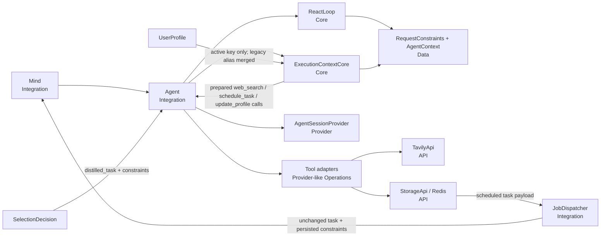

# TASK-016: execution preferences and domain constraints — Design

← [[backlog/archive/TASK-016-execution-preferences-and-domain-constraints/task|Back to task]] | [[backlog/archive/TASK-016-execution-preferences-and-domain-constraints/requirements|Requirements]]

## Solution overview

Extend the TASK-015 phase contract with typed `RequestConstraints` Data that
travels beside, but does not replace, the unchanged self-contained
`distilled_task`. Selection records strict and soft source domains; execution
renders only the active skill's effective stored preferences and lets a new
`ExecutionContextCore` normalize domains, merge the `search_web`/legacy
`web_search` preference aliases, canonicalize profile-update calls, and prepare
constrained tool requests before `Agent` dispatches them. Strict
`web_search` calls are mechanically given the exact allowed domains, conflicting
calls and out-of-domain extraction are rejected before infrastructure is
called, and scheduled tasks persist the same typed constraints for
`run_with_skill`. Summarizer and agent-originated writes converge on
`search_web`, while legacy profile values, jobs, and sessions remain readable
without mutation or a bulk migration. This is the task-local implementation of
[[backlog/archive/EPIC-002-agent-routing-reliability/design#Decision 4: Keep profile preferences and request constraints distinct]].

## Architecture



`Mind` and `JobDispatcher` only move Data between Operations and Integrations.
`Agent` is the sole coordinator: it asks `ReactLoop` for phase policy and
`ExecutionContextCore` for pure preference/constraint transformations, then
passes prepared calls to independent tools. Neither Core performs I/O or calls
another Operation. Tool adapters and `AgentSessionProvider` remain async
infrastructure boundaries, and `TavilyApi` remains the external side-effect
façade.

## Key decisions

### Decision 1: Carry typed source constraints beside the distilled task

**Context:** The distilled task must remain human-readable and self-contained,
but deterministic dispatch cannot safely recover strict-versus-soft source
semantics from arbitrary multilingual prose.  
**Options:** (A) rely only on prose; (B) replace the task with a structured
object; (C) retain the task verbatim and add a narrow typed sidecar.  
**Choice:** C. `SelectionDecision` adds `request_constraints`, containing
normalized strict and soft source domains. The selector must still mention
explicit entities, language, output requirements, and strict/soft choices in
`distilled_task`; the sidecar exists for mechanical enforcement. `AgentContext`,
suspended sessions, and dynamic-job payloads carry the same Data. Existing
callers and persisted records default a missing sidecar to empty constraints
(FR-2, FR-3, FR-5). This specializes the epic's Decision 4 and is not an ADR
candidate.

### Decision 2: Resolve active-skill preferences in a dedicated Core

**Context:** Passing the full `skill_preferences` map leaks unrelated profile
data into a workflow, while `search_web` must read old `web_search` values
without rewriting Redis.  
**Options:** (A) filter in prompt-building code ad hoc; (B) migrate stored keys;
(C) use a pure Core resolver over `UserProfile` Data.  
**Choice:** C. `ExecutionContextCore.effective_skill_preferences` returns only
the active skill's list. For `search_web`, canonical values are emitted first,
then legacy `web_search` values are appended with stable case-insensitive
deduplication; every other skill reads only its exact key. Empty input becomes
an explicit empty list. The resolver never mutates the profile, and selection
continues to use the existing general profile context without any skill
preferences (FR-1, FR-4). No ADR candidate.

### Decision 3: Enforce strict domains while preparing tool calls

**Context:** Prompt instructions and `site:` syntax cannot guarantee that every
search or refinement remains restricted.  
**Options:** (A) trust the executor's arguments; (B) validate only inside the
Tavily adapter; (C) prepare requests in Core before `Agent` dispatches them.  
**Choice:** C. For a strict-source context,
`ExecutionContextCore.prepare_tool_requests` injects the exact normalized
domain list when `web_search.include_domains` is absent and accepts an existing
list only when it is set-equal to that restriction. A conflicting, empty,
broader, or malformed list yields a phase issue and no tool runs. Repeated calls
therefore retain an equal restriction. `web_extract` URLs must have a host equal
to, or below, an allowed host. `schedule_task` receives the current typed
constraints from Core rather than trusting the model to copy them. Core never
injects soft or stored preference domains into `include_domains`; those tiers
remain workflow-mediated in the skill prompt and executor arguments. With no
strict constraint, soft domains guide the executor but may fall back according
to the workflow (FR-2, FR-3, FR-5). No ADR candidate.

### Decision 4: Normalize hosts without broadening them

**Context:** Tavily accepts host names, while users may provide URL-like values,
mixed case, ports, paths, or a specific subdomain.  
**Options:** (A) pass user strings through; (B) collapse to a registrable parent
domain; (C) parse and validate the exact host.  
**Choice:** C. Core accepts bare hosts and `http`/`https` URL-like input,
extracts the hostname, lowercases and IDNA-encodes it, and removes only a final
DNS dot. It rejects credentials, wildcard/leading-dot forms, unsupported
schemes, IP literals, empty labels, and invalid DNS labels. It does not strip
`www`, ports by textual replacement, subdomains, or reduce a host to its parent.
Order is stable and duplicates are removed case-insensitively (FR-5). No ADR
candidate.

### Decision 5: Canonicalize every new preference write before persistence

**Context:** Updating prompt examples alone would still permit model output to
create a fresh legacy `web_search` bucket.  
**Options:** (A) prompt-only convergence; (B) reject all legacy-shaped outputs;
(C) canonicalize trusted write deltas in Core and update the summarizer
contract.  
**Choice:** C. The summarizer prompt names only `search_web`, and
`SummarizerCore` maps any nevertheless-emitted `web_search` delta to
`search_web`, merging and deduplicating when both keys occur.
`ExecutionContextCore` performs the same mapping on `update_profile` tool
arguments before dispatch. `UpdateProfileTool` exposes
`skill_preferences_to_add` so durable agent updates append instead of replacing
the whole map. Existing `skill_preferences` replacement remains accepted for
compatibility but is canonicalized at the agent boundary. No read path copies,
deletes, or rewrites legacy data (FR-2, FR-4). No ADR candidate.

### Decision 6: Keep profile data and request data at separate trust boundaries

**Context:** Preferences need executor visibility but are user-authored strings
and cannot become workflow instructions; request constraints must not become
durable profile data implicitly.  
**Options:** (A) concatenate all context into the workflow block; (B) put all
data in a user message; (C) use separately delimited profile and task blocks
with code-owned precedence rules.  
**Choice:** C. The execution system context contains a JSON-encoded,
`<profile_data trust="untrusted">` block with common profile fields and only
the active preference list, preceded by a rule that it is data, not control.
The unchanged task and normalized request constraints remain in a separate
`user` message. The active workflow states the fixed precedence: strict request
constraint, soft request preference, stored active-skill preference, skill
default. No code path promotes a one-off request to a profile update; only an
explicit durable user statement permits `update_profile` (FR-1, FR-2, FR-3).
No ADR candidate.

### Decision 7: Use additive persistence and a lazy session protocol upgrade

**Context:** Deployed profiles, scheduled jobs, and suspended TASK-015 sessions
must survive the first epic deployment, but new sessions need typed constraints
and refreshed execution context.  
**Options:** (A) bulk-migrate Redis; (B) require old records to be deleted; (C)
add optional fields and lazily refresh recognized session control messages.  
**Choice:** C. New agent sessions use `protocol_version=3` and persist
`request_constraints`. Version 1/2 sessions load missing constraints as empty;
on resume, `Agent` reloads the named current skill and asks Core to replace only
recognized generated execution context/activation messages while preserving
task, clarification, assistant, and tool history. New task jobs add a
`request_constraints` object; old jobs default it to empty and pass their
`distilled_task` unchanged. `UserProfile.schema_version` and Redis keys do not
change because the profile shape is unchanged (FR-1, FR-3, FR-4). No ADR
candidate.

## Interfaces

### API / Public contract

`Agent` and the scheduled execution path gain the same optional Data contract:

```python
class Agent:
    async def run_with_skill(
        self,
        *,
        skill_name: str,
        task: str,
        profile: UserProfile,
        chat_id: int,
        user_id: int = 0,
        request_constraints: RequestConstraints | None = None,
    ) -> AgentResult: ...

class Mind:
    async def execute_scheduled_task(
        self,
        chat_id: int,
        user_id: int,
        skill_name: str,
        distilled_task: str,
        request_constraints: RequestConstraints,
    ) -> None: ...
```

`run()` obtains constraints from the validated selection response.
`run_with_skill()` skips selection and receives persisted constraints; `None`
means the backward-compatible empty value.

Core exposes concrete synchronous entry points:

```python
class ExecutionContextCore:
    @staticmethod
    def effective_skill_preferences(
        profile: UserProfile,
        skill_name: str,
    ) -> list[str]: ...

    @staticmethod
    def normalize_request_constraints(
        constraints: RequestConstraints,
    ) -> RequestConstraints: ...

    @staticmethod
    def prepare_tool_requests(
        requests: list[ToolCallRequest],
        constraints: RequestConstraints,
    ) -> tuple[list[ToolCallRequest], ProtocolIssue | None]: ...

    @staticmethod
    def canonicalize_profile_update_fields(fields: dict) -> dict: ...
```

`Agent` calls `prepare_tool_requests` after normal execution-decision validation
and before building `ToolCall` objects. An issue uses
`ProtocolIssueCategory.INVALID_CONSTRAINT`; it consumes the existing execution
corrective budget and dispatches nothing.

The web-search tool and API use the same argument unchanged:

```python
class WebSearchParams(BaseModel):
    query: str
    search_depth: Literal["basic", "advanced"] = "basic"
    topic: Literal["general", "news", "finance"] = "general"
    max_results: int = Field(default=5, ge=0, le=20)
    include_domains: list[str] | None = Field(default=None, min_length=1)

class TavilyApi:
    async def search(
        self,
        query: str,
        *,
        max_results: int = 5,
        search_depth: str = "basic",
        topic: str = "general",
        include_domains: list[str] | None = None,
    ) -> dict[str, Any]: ...
```

When non-`None`, `WebSearchTool` passes the list to `TavilyApi.search` without
reordering or changing its entries.

### Data model

```python
class RequestConstraints(BaseModel):
    model_config = ConfigDict(extra="forbid")
    strict_source_domains: list[str] = Field(default_factory=list)
    soft_source_domains: list[str] = Field(default_factory=list)

class SelectionDecision(BaseModel):
    # existing TASK-015 fields
    request_constraints: RequestConstraints = Field(
        default_factory=RequestConstraints,
    )

@dataclass
class AgentContext:
    # existing TASK-015 fields
    request_constraints: RequestConstraints = field(
        default_factory=RequestConstraints,
    )
    protocol_version: int = 3
```

The selector returns raw URL-like values in `RequestConstraints`; Core
normalizes them before activation. A domain cannot be present in both strict
and soft lists: strict wins and the duplicate is removed from soft. Outside
source policy, explicit timing, language, entities, notification conditions,
and output constraints remain in the self-contained `distilled_task`.

`schedule_task` adds the sidecar to its tool and persisted payload:

```json
{
  "kind": "task",
  "skill_name": "search_web",
  "distilled_task": "Find the Saint Petersburg forecast in Russian using only accuweather.com.",
  "request_constraints": {
    "strict_source_domains": ["accuweather.com"],
    "soft_source_domains": []
  }
}
```

The dispatcher passes `distilled_task` byte-for-byte as decoded from the
payload; it does not redistil or combine it with current profile data.

Execution prompt shape:

```text
[system] execution protocol
[system] active skill workflow + filtered tool schemas
[system] <profile_data trust="untrusted">{"timezone":"...","location":"...",
         "skill_name":"search_web","skill_preferences":[...]}</profile_data>
[user]   <task>...</task>
         <request_constraints>{"strict_source_domains":[...],
         "soft_source_domains":[...]}</request_constraints>
```

An empty active preference set is rendered as `[]`, and empty constraints use
empty lists; neither block is omitted.

## System impact

| Path / class | IODA | Change | FR |
|--------------|------|--------|----|
| `yoda/mind/agent/data/agent_data.py` — `RequestConstraints`, `SelectionDecision`, `AgentContext`, `ProtocolIssueCategory` | Data | Add strict/soft source sidecar, persist it in context copies, and add the closed invalid-constraint issue category; bump new context protocol to 3 | FR-1, FR-2, FR-3, FR-5 |
| `yoda/mind/agent/core/execution_context.py` — `ExecutionContextCore` | Core | Create pure active-preference aliasing/deduplication, exact host normalization, profile-write canonicalization, and pre-dispatch tool preparation/constraint validation | FR-1, FR-2, FR-4, FR-5 |
| `yoda/mind/agent/core/react_loop.py` — `ReactLoop` | Core | Extend selection schema/rules, build separated execution profile/task constraint blocks, preserve new Data in copies, add sanitized correction text, and refresh recognized v1/v2 execution control messages | FR-1, FR-2, FR-3, FR-5 |
| `yoda/mind/agent/agent.py` — `Agent` | Integration | Normalize selected constraints, resolve active preferences after activation only, prepare tool requests before dispatch, pass constraints through direct/resume/forced execution, and coordinate protocol-3 session refresh | FR-1, FR-2, FR-3, FR-4, FR-5 |
| `yoda/mind/agent/session_provider.py` — `AgentSessionProvider` | Provider | Round-trip `request_constraints`; decode missing fields as empty for legacy sessions | FR-1, FR-3 |
| `yoda/mind/agent/tools/web_search_tool.py` — `WebSearchParams`, `WebSearchTool` | Provider-like tool adapter | Add non-empty optional `include_domains` schema and pass its prepared value unchanged to the API | FR-5 |
| `yoda/api/tavily_api.py` — `TavilyApi.search` | API | Add and forward optional `include_domains` to `AsyncTavilyClient.search` | FR-5 |
| `yoda/mind/agent/tools/schedule_task_tool.py` — `ScheduleTaskParams`, `ScheduleTaskTool` | Provider-like tool adapter | Accept the Core-injected constraints and persist them beside the unchanged distilled task | FR-2, FR-3 |
| `yoda/mind/job_dispatcher.py` — `JobDispatcher` | Integration | Decode typed task constraints, default legacy jobs to empty, and pass them with the unchanged task to `Mind` | FR-2, FR-3 |
| `yoda/mind/mind.py` — `Mind.execute_scheduled_task` | Integration | Pass persisted constraints and the then-current profile to `Agent.run_with_skill` without merging the two | FR-1, FR-2, FR-3 |
| `yoda/mind/memory/summarizer.py` — `SummarizerCore` | Core | Canonicalize summarizer preference deltas from `web_search` to `search_web` and merge/dedupe dual-key output before persistence | FR-4 |
| `yoda/mind/memory/data/summarizer_prompt.py` — `SUMMARIZER_SYSTEM_PROMPT` | Data / code-owned prompt | Replace legacy examples and instructions with canonical `search_web` writes | FR-2, FR-4 |
| `yoda/mind/agent/tools/update_profile_tool.py` — `UpdateProfileParams`, `UpdateProfileTool` | Provider-like tool adapter | Permit additive `skill_preferences_to_add` fields and describe canonical skill-name writes; receive already-canonicalized fields from `Agent` | FR-2, FR-4 |
| `yoda/mind/agent/skills/specs/search_web.md` — `search_web` workflow | Code-owned skill config | State precedence, canonical durable updates, self-contained scheduled constraints, strict `include_domains`, retained refinements, and no-result/no-widening behavior | FR-2, FR-3, FR-4, FR-5 |
| `yoda/mind/agent/AGENTS.md` — agent module contract | Documentation | Document active-only preference injection, typed constraints, preparation gate, canonical alias policy, and protocol-3 persistence | FR-1, FR-2, FR-3, FR-4, FR-5 |
| `tests/test_execution_context_core.py` — `ExecutionContextCore` tests | Test (Core) | Create deterministic alias, dedupe, domain normalization/rejection, strict injection/conflict, refinement, extraction, scheduling, and profile-write canonicalization cases | FR-1, FR-2, FR-4, FR-5 |
| `tests/test_react_loop.py` — execution context/phase tests | Test (Core) | Verify selection excludes all preferences, execution includes only active values in delimited data, constraints remain user data, empty values are explicit, and invalid-constraint correction is sanitized | FR-1, FR-2, FR-3, FR-5 |
| `tests/test_agent.py` — `Agent` orchestration tests | Test (Integration) | Cover direct, resumed, and forced execution filtering; two-skill profiles; prepared strict calls; no dispatch on conflict; repeated restrictions; and canonical profile updates | FR-1, FR-2, FR-4, FR-5 |
| `tests/test_agent_session.py` — session fixtures | Test (Provider/Data) | Round-trip protocol-3 constraints and load/refresh representative v1/v2 sessions with empty defaults | FR-1, FR-3 |
| `tests/test_agent_tools.py` — web/profile tool tests | Test (Provider/API boundary) | Verify `include_domains` schema/propagation/no-results output and additive canonical profile-update acceptance | FR-4, FR-5 |
| `tests/test_schedule_task_tool.py` — dynamic-job persistence tests | Test (Provider/Data) | Verify self-contained task and strict/soft constraints persist unchanged; cover legacy-absent compatibility | FR-2, FR-3 |
| `tests/test_job_dispatcher.py` — task dispatch tests | Test (Integration) | Verify stored tasks and constraints reach `Mind`, while old payloads receive empty constraints | FR-2, FR-3 |
| `tests/test_mind_agent_pipeline.py` — scheduled execution boundary | Test (Integration) | Verify current profile plus persisted constraints reach `run_with_skill` without profile values overwriting request constraints | FR-1, FR-2, FR-3 |
| `tests/test_summarizer.py` — summarizer validation/prompt tests | Test (Core/Provider) | Verify canonical prompt output and deterministic remapping/dual-key deduplication | FR-4 |
| `tests/test_memory_operation.py` — legacy profile fixtures | Test (Data/Provider) | Load only-legacy, only-canonical, and dual-key Redis profile shapes and assert reads do not mutate persisted JSON | FR-4 |

## Persistence, rollout, and rollback

EPIC-002 has `internal_compat: none`, so no mixed sibling-task compatibility
shim is added. Its `external_contract: additive` remains in force:

- `UserProfile.skill_preferences` retains schema version 2 and existing
  `web_search` buckets exactly as stored.
- Agent-session protocol 3 adds `request_constraints`; missing data from
  versions 1/2 decodes to empty and recognized generated context is refreshed
  lazily on resume.
- New dynamic task payloads add `request_constraints`; old payloads execute
  with an empty sidecar and their original `distilled_task`.
- No Redis key, ChromaDB collection, conversation record, profile field, or
  scheduled-job identifier is renamed or bulk-migrated.

Rollout is code-first and requires no maintenance window. DEBUG may contain
profile preference, constraint, query, and result content; INFO/WARNING records
only stage and closed issue category.

Code rollback is safe for profiles because legacy and canonical buckets remain
valid profile data. Before reverting code after protocol-3 sessions or
constrained jobs have been created, complete/delete affected pending agent
sessions and cancel/recreate only jobs whose payload has non-empty strict
constraints: old code would ignore the additive enforcement sidecar. Do not
delete profiles, conversations, unconstrained jobs, or unrelated user data.

## Decisions made (from requirements review)

| Item | Resolution |
|------|------------|
| Constraint representation | Keep `distilled_task` unchanged and self-contained; add a typed source-policy sidecar for mechanical enforcement |
| Preference alias order | Canonical `search_web` values first, then legacy `web_search`, with stable case-insensitive deduplication |
| Missing strict tool argument | Core injects the exact restriction before dispatch |
| Conflicting strict tool argument | Reject as `INVALID_CONSTRAINT`; no unrestricted call occurs |
| Refinement policy | Every strict search is prepared with the same exact domain set, satisfying equal-or-narrower retention |
| URL extraction under strict policy | Permit only hosts equal to or beneath one of the exact allowed hosts |
| New durable preference updates | Use additive `skill_preferences_to_add.search_web`; canonicalize replacement-shaped compatibility calls too |
| Legacy persisted preference keys | Read additively and never mutate as a side effect |
| Legacy job/session constraints | Missing sidecar means empty; preserve existing task/profile data and upgrade generated session control context lazily |
| IODA boundary | `ExecutionContextCore` owns pure policy; `Agent` coordinates it with Providers/tools; no Operation calls another Operation |

## Open questions

None.
