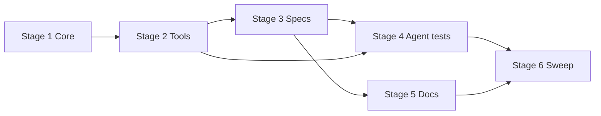

# TASK-017: IANA timezone execution guidance — Implementation plan

← [[backlog/archive/TASK-017-iana-timezone-execution-guidance/task|Back to task]] | [[backlog/archive/TASK-017-iana-timezone-execution-guidance/requirements|Requirements]] | [[backlog/archive/TASK-017-iana-timezone-execution-guidance/design|Design]]

## Overview

Make absolute and recurring local-time schedules self-contained IANA contracts: skill workflows reuse a valid profile timezone, infer and persist one from an unambiguous named location, or ask once via `ask_user` — never from a clock reading or UTC offset. `ScheduleCore` and both scheduling tools stop coercing missing/invalid/offset identity to UTC for local-time modes, while relative delays keep best-effort display timezone. Deterministic Core, tool-boundary, catalog, and fixed-decision agent tests protect ZoneInfo/CronTrigger DST behavior and the reuse/infer/clarify/persist tool sequences.

## Goal / Non-goals

- **Goal:** Absolute/recurring `schedule_message` and deferred/recurring `search_web` paths resolve IANA identity with design precedence, pass it explicitly into scheduling (and `update_profile` when inferred), reject offset-only/invalid identity before any job registration, and keep existing valid profiles/jobs readable without migration; full suite green under EPIC-002 `external_contract: additive`.
- **Non-goals:** Geocoding / location-to-timezone Provider; preference precedence or source constraints (TASK-016); skill selection / phase protocol changes (TASK-014/015); grounded outcomes (TASK-018); DST fold/gap policy; bulk profile/job migration; corpus or live-model eval (TASK-020/021).

## Context to load

Files to read before starting:

- [[backlog/archive/TASK-017-iana-timezone-execution-guidance/requirements|requirements]] — FR-1…FR-4 and acceptance criteria
- [[backlog/archive/TASK-017-iana-timezone-execution-guidance/design|design]] — Architecture, Interfaces, System impact, Decisions 1–4
- [[backlog/archive/EPIC-002-agent-routing-reliability/epic|EPIC-002]] — shared branch, delivery profile (`internal_compat: none`, `external_contract: additive`)
- [[backlog/archive/EPIC-002-agent-routing-reliability/design|EPIC-002 master design]] — Decision 5 (IANA timezone identity); Proposed delivery sequence
- [[backlog/archive/EPIC-002-agent-routing-reliability/suggested_prompts|Suggested prompts]] — Schedule message / Search web / Execution context (guidance; **design precedence is authoritative**, including explicit valid IANA before profile reuse)
- [[backlog/archive/TASK-015-phase-protocol-and-agent-integration/design|TASK-015 design]] — `ask_user` suspend/resume inside active execution (dependency; `status: done`)
- [[backlog/archive/TASK-016-execution-preferences-and-domain-constraints/design|TASK-016 design]] — retain `request_constraints` on `schedule_task` unchanged
- `AGENTS.md` (root) — IODA + coding guidelines
- `coding_behavior.md`
- `yoda/mind/agent/AGENTS.md` — current agent module contract
- `yoda/mind/agent/core/schedule_core.py`, `yoda/mind/agent/tools/schedule_message_tool.py`, `yoda/mind/agent/tools/schedule_task_tool.py`, `yoda/mind/agent/skills/specs/schedule_message.md`, `yoda/mind/agent/skills/specs/search_web.md`
- Existing tests: `tests/test_schedule_core.py`, `tests/test_agent_tools.py`, `tests/test_schedule_task_tool.py`, `tests/test_agent.py`, `tests/test_skill_catalog.py`

## Pre-flight

Mandatory conditions before implementation starts.
If any item below fails and cannot be satisfied immediately, do not proceed to implementation.

- [ ] `git checkout main && git pull` — main is up to date
- [ ] `git status` — working tree is clean
- [ ] `git checkout feat/EPIC-002-agent-routing-reliability || git checkout -b feat/EPIC-002-agent-routing-reliability` — shared epic branch (TASK-015/016 expected on this branch)
- [ ] `.venv` active and dependencies installed
- [ ] Baseline tests green: `.venv/bin/python -m pytest`
- [ ] Confirm TASK-015 resume path works for production skills (`ask_user` suspend → `resume` stays in active workflow)
- [ ] Confirm TASK-016 `request_constraints` sidecar on `schedule_task` is present and must remain untouched by this task
- [ ] No live LLM/Telegram/Redis required for implementation — deterministic fakes suffice; Redis only for optional manual smoke
- [ ] Do **not** add intermediate sibling-task compatibility shims (`internal_compat: none`); do **not** migrate or rewrite existing valid profile/job payloads (`external_contract: additive`)

## Files & artifacts

| Path | IODA | Op | FR |
|------|------|----|----|
| `yoda/mind/agent/core/schedule_core.py` — `ScheduleCore` | Core | edit | FR-1, FR-2, FR-4 |
| `yoda/mind/agent/tools/schedule_message_tool.py` — `ScheduleMessageTool` | Provider (tool adapter) | edit | FR-1, FR-2, FR-3, FR-4 |
| `yoda/mind/agent/tools/schedule_task_tool.py` — `ScheduleTaskTool` | Provider (tool adapter) | edit | FR-1, FR-2, FR-3, FR-4 |
| `yoda/mind/agent/skills/specs/schedule_message.md` — active workflow | Code-owned execution contract | edit | FR-1, FR-2, FR-3 |
| `yoda/mind/agent/skills/specs/search_web.md` — deferred/recurring workflow | Code-owned execution contract | edit | FR-1, FR-2, FR-3 |
| `yoda/mind/agent/AGENTS.md` — module execution contract | Documentation | edit | FR-1, FR-2, FR-3, FR-4 |
| `tests/test_schedule_core.py` | Test (Core) | edit | FR-1, FR-2, FR-4 |
| `tests/test_agent_tools.py` — `ScheduleMessageTool` boundary | Test (Provider/API) | edit | FR-1, FR-2, FR-4 |
| `tests/test_schedule_task_tool.py` — `ScheduleTaskTool` boundary | Test (Provider/API) | edit | FR-1, FR-2, FR-3, FR-4 |
| `tests/test_skill_catalog.py` — production workflow contract | Test (code-owned config) | edit | FR-1, FR-2, FR-3 |
| `tests/test_agent.py` — production-skill execution scenarios | Test (Integration) | edit | FR-1, FR-2, FR-3 |

No changes to `Agent`, `ReactLoop`, `UserProfile`, `MemoryProvider`, `UpdateProfileTool`, `SchedulerApi`, or persisted payload schemas.

## Stages

### Stage 1: ScheduleCore timezone contracts

**Goal:** Strict IANA validation for local-time schedules is separated from relative-delay display fallback; DST conversion/cron semantics have deterministic unit coverage.

- [x] **1.1** Add `validate_timezone_name` and replace `effective_timezone_name` with `relative_timezone_name`
  - Files: `yoda/mind/agent/core/schedule_core.py`, `tests/test_schedule_core.py`
  - Action: **Core** — per [[design#Interfaces]] / Decision 2: implement `validate_timezone_name(timezone) -> str | None` (None = accepted by `ZoneInfo`; else safe error string — mirror `validate_distilled_task`). Rename/replace `effective_timezone_name` with `relative_timezone_name(explicit_tz, profile_timezone) -> str` that returns the first `ZoneInfo`-accepted candidate else `"UTC"`. **Do not** use relative fallback for absolute/cron paths. Reject offset-only strings (`+03:00`, `UTC+03:00`) via `ZoneInfo` failure. Keep `resolve_absolute` / `parse_cron` ZoneInfo behavior. Update any in-module callers. **TDD first:** valid IANA → None; `None`/empty/invalid/offset → error; relative picks explicit, else valid profile, else UTC; invalid profile does not poison a valid explicit.
  - Verify: `.venv/bin/python -m pytest tests/test_schedule_core.py -k "validate_timezone or relative_timezone or effective_timezone" -q`
  - Commit: `feat(TASK-017): 1.1 separate strict and relative timezone helpers`

- [x] **1.2** Absolute DST-transition conversion coverage
  - Files: `tests/test_schedule_core.py`
  - Action: **Test (Core)** — per Decision 4 / FR-4: pick a well-known regional zone with DST (e.g. `Europe/Berlin` or `America/New_York`). Assert `resolve_absolute` UTC instants and offsets for unambiguous local wall times on both sides of spring and autumn transitions. Avoid nonexistent/duplicated transition-hour wall times.
  - Verify: `.venv/bin/python -m pytest tests/test_schedule_core.py -k "dst or transition or resolve_absolute" -q`
  - Commit: `test(TASK-017): 1.2 cover absolute DST wall-time conversion`

- [x] **1.3** Recurring local cron DST coverage
  - Files: `tests/test_schedule_core.py`
  - Action: **Test (Core)** — parse a fixed daytime cron (e.g. `0 9 * * *`) with a DST zone; enumerate occurrences through spring and autumn and assert local wall-clock hour/minute stay at the requested time while UTC offset changes. Use real `CronTrigger` / `ZoneInfo` (no mocked conversion).
  - Verify: `.venv/bin/python -m pytest tests/test_schedule_core.py -k "cron and (dst or transition or wall)" -q`
  - Commit: `test(TASK-017): 1.3 cover recurring local cron across DST`

**Checkpoint Stage 1:** `.venv/bin/python -m pytest tests/test_schedule_core.py`

---

### Stage 2: Scheduling tool boundaries

**Goal:** Absolute and cron modes require an explicit `ZoneInfo`-valid timezone before any scheduler or storage side effect; relative delays alone may use profile/UTC for display/metadata.

- [x] **2.1** Harden `ScheduleMessageTool` local-time identity
  - Files: `yoda/mind/agent/tools/schedule_message_tool.py`, `tests/test_agent_tools.py`
  - Action: **Provider (tool adapter)** — detect absolute mode from the five date/time fields (not from timezone presence). For absolute and cron: require `params.timezone`, run `validate_timezone_name`, and on failure return `success=False` **before** `SchedulerApi` / `_save_job_metadata`. Pass the validated IANA name unchanged to scheduler and metadata. For relative: use `relative_timezone_name(params.timezone, profile_timezone)` for display/metadata only; no clarification path in the tool. Preserve exactly-one timing mode. **TDD first:** missing/invalid/offset timezone on absolute and cron → no scheduler call, no metadata write; valid IANA propagates unchanged; relative without timezone still schedules with UTC (or valid profile) metadata; existing happy-path cron/absolute/relative stay green.
  - Verify: `.venv/bin/python -m pytest tests/test_agent_tools.py -k "schedule_message or scheduler_tool or timezone" -q`
  - Commit: `feat(TASK-017): 2.1 require explicit IANA on schedule_message local times`

- [x] **2.2** Mirror strict boundary on `ScheduleTaskTool`
  - Files: `yoda/mind/agent/tools/schedule_task_tool.py`, `tests/test_schedule_task_tool.py`
  - Action: **Provider (tool adapter)** — same absolute/cron validation and relative-only fallback as 2.1. Keep `request_constraints` persistence and distilled-task behavior from TASK-016 byte-stable. **TDD first:** mirror rejection/propagation cases for dynamic jobs; constraints sidecar unchanged.
  - Verify: `.venv/bin/python -m pytest tests/test_schedule_task_tool.py -q`
  - Commit: `feat(TASK-017): 2.2 require explicit IANA on schedule_task local times`

**Checkpoint Stage 2:** `.venv/bin/python -m pytest tests/test_schedule_core.py tests/test_agent_tools.py tests/test_schedule_task_tool.py`

---

### Stage 3: Skill workflow contracts

**Goal:** Both full execution workflows encode ordered IANA resolution, offset prohibition, explicit scheduling args, inferred profile persistence, and relative-delay bypass; compact selection summaries stay unchanged.

- [x] **3.1** Rewrite `schedule_message` execution workflow timezone policy
  - Files: `yoda/mind/agent/skills/specs/schedule_message.md`, `tests/test_skill_catalog.py`
  - Action: **Code-owned execution contract** — replace unconditional “ask if timezone missing” with Decision 1 precedence for absolute/recurring: (1) explicit valid IANA in the request, (2) valid profile timezone, (3) infer from unambiguous named location + `update_profile` with both `timezone` and `location` + explicit scheduling timezone, (4) one `ask_user` for city/region or IANA. Prohibit clock questions and offset-only identity. State that scheduling args must be self-contained; batch `update_profile` + `schedule_message` only when scheduling does not depend on the write. Relative delay: no timezone clarification. Update examples (ambiguous ask, inference batch, offset rejection). Do **not** change frontmatter selection fields/`when_to_use` beyond what FR-1 allows (rules stay out of compact selection contract). Align wording with suggested prompts but keep **explicit-before-profile** from design. **TDD:** catalog assertions that instructions contain ordered reuse/infer/persist/clarify, offset prohibition, explicit timezone on schedule, relative bypass; selection description/summary unchanged in compactness checks already present.
  - Verify: `.venv/bin/python -m pytest tests/test_skill_catalog.py -k "schedule_message or timezone or workflow" -q`
  - Commit: `feat(TASK-017): 3.1 encode IANA resolution in schedule_message workflow`

- [x] **3.2** Apply the same timezone rules to deferred/recurring `search_web`
  - Files: `yoda/mind/agent/skills/specs/search_web.md`, `tests/test_skill_catalog.py`
  - Action: **Code-owned execution contract** — in the deferred/recurring section, apply the same ordered IANA policy for `schedule_task` (explicit timezone required; infer+persist; clarify; no clock/offset). Preserve TASK-016 precedence/source/`request_constraints` / distilled_task rules and “do not run `web_search` in the same run”. Immediate search path unchanged regarding timezone. **TDD:** assert search_web instructions cover the same timezone contract markers without regressing preference/constraint assertions from TASK-016.
  - Verify: `.venv/bin/python -m pytest tests/test_skill_catalog.py -k "search_web or timezone or workflow or precedence" -q`
  - Commit: `feat(TASK-017): 3.2 encode IANA resolution in search_web schedule path`

**Checkpoint Stage 3:** `.venv/bin/python -m pytest tests/test_skill_catalog.py tests/test_schedule_core.py`

---

### Stage 4: Agent fixed-decision execution scenarios

**Goal:** Deterministic Integration tests prove reuse, explicit IANA, inference+persist, clarification/resume, relative bypass, no unresolved dispatch, and subsequent profile reuse for both static and dynamic scheduling paths.

- [x] **4.1** Parameterized static `schedule_message` timezone scenarios
  - Files: `tests/test_agent.py` (helpers/fakes as needed in `tests/fakes.py` only if already the pattern)
  - Action: **Test (Integration)** — using production `schedule_message` skill + fixed LLM decisions (no live model): cover (a) valid profile timezone → schedule with that explicit tz, no ask; (b) explicit valid IANA in decision args → schedule, no ask; (c) unambiguous location (e.g. Saint Petersburg → `Europe/Moscow`) → batched `update_profile`(`timezone`+`location`) + `schedule_message` with explicit tz; (d) relative `delay_minutes` → schedule without ask; (e) ambiguous location (Springfield) / missing data → single `ask_user`, no schedule dispatch; (f) offset-only answer after clarify → still no schedule (or corrective path) until valid IANA; (g) resume after valid clarify → schedule with explicit tz; (h) subsequent run with updated profile reuses persisted tz without ask. Assert tool call names/args and that scheduler fakes are untouched while unresolved.
  - Verify: `.venv/bin/python -m pytest tests/test_agent.py -k "schedule_message and (timezone or iana or dst or profile or ask_user or relative)" -q`
  - Commit: `test(TASK-017): 4.1 cover schedule_message IANA execution paths`

- [x] **4.2** Parameterized deferred `search_web` / `schedule_task` timezone scenarios
  - Files: `tests/test_agent.py`
  - Action: **Test (Integration)** — mirror 4.1 for `search_web` deferred/recurring fixed decisions ending in `schedule_task` (with `skill_name=search_web`): profile reuse, explicit IANA, unambiguous infer+`update_profile`+explicit tz, relative delay, ambiguous/missing/offset clarification without dispatch, resume, subsequent reuse. Keep `request_constraints` defaults empty unless needed for skill activation. Do not require live Tavily.
  - Verify: `.venv/bin/python -m pytest tests/test_agent.py -k "search_web and (timezone or schedule_task or iana or ask_user)" -q`
  - Commit: `test(TASK-017): 4.2 cover search_web schedule_task IANA paths`

**Checkpoint Stage 4:** `.venv/bin/python -m pytest tests/test_agent.py tests/test_skill_catalog.py tests/test_agent_tools.py tests/test_schedule_task_tool.py`

---

### Stage 5: Module documentation

**Goal:** Agent module contract documents IANA precedence, explicit local-time tool arguments, inferred profile batching, and relative-delay exception.

- [x] **5.1** Document timezone execution contract in `AGENTS.md`
  - Files: `yoda/mind/agent/AGENTS.md`
  - Action: **Documentation** — add a short invariant block covering Decision 1–2: ordered resolution after skill selection; absolute/cron require explicit valid IANA on the tool call; inferred values go to both `update_profile` and scheduling args; relative delays skip clarification; offset-only rejected; `ScheduleCore` owns ZoneInfo validation. Do not invent new architecture beyond design.
  - Verify: file contains IANA/precedence/`update_profile` batching notes; `.venv/bin/python -m pytest tests/test_skill_catalog.py -q` still green
  - Commit: `docs(TASK-017): 5.1 document IANA timezone execution contract`

**Checkpoint Stage 5:** `.venv/bin/python -m pytest tests/test_schedule_core.py tests/test_skill_catalog.py tests/test_agent_tools.py tests/test_schedule_task_tool.py`

---

### Stage 6: Test sweep & coverage

**Goal:** Full suite green; every FR acceptance criterion has an automated or explicit manual check.

- [x] **6.1** FR gap fill and full suite
  - Files: `tests/test_*.py` touched above as needed
  - Action: Walk FR-1…FR-4 acceptance criteria; add any missing assertions (especially: invalid profile timezone not reused for local schedules; compact selection summaries unchanged; IANA name retained in persisted job metadata; no UTC coercion for invalid local identity). Run full suite.
  - Verify: `.venv/bin/python -m pytest`
  - Commit: `test(TASK-017): 6.1 close FR coverage gaps`

- [x] **6.2** Manual AC smoke (optional if Redis/scheduler available)
  - FR-1: With profile `timezone=Europe/Moscow`, schedule “tomorrow 15:00” → job metadata stores `Europe/Moscow`, no clarify.
  - FR-2: Absolute schedule with no tz/location → one city/IANA question; answering `+03:00` does not create a job.
  - FR-3: “daily 9:00 vitamins, I am in Saint Petersburg” → profile gains timezone+location and cron job uses `Europe/Moscow`.
  - FR-4: Existing Redis job with valid IANA still lists/fires after deploy (no migration).
  - If services unavailable: document skip in `implementation-notes.md` and rely on automated suite.

## Stage dependencies

## FR coverage (traceability)

| FR | Steps | Verification |
|----|-------|--------------|
| FR-1 | 1.1, 2.1, 2.2, 3.1, 3.2, 4.1, 4.2, 6.1 | unit `test_schedule_core` / tool boundaries; catalog workflow markers; integration fixed-decision cases (profile, explicit, location, relative) for both skills |
| FR-2 | 1.1, 2.1, 2.2, 3.1, 3.2, 4.1, 4.2, 6.1 | offset rejection unit+tool; ambiguous/missing → `ask_user` only; resume stays in workflow; no schedule while unresolved |
| FR-3 | 3.1, 3.2, 4.1, 4.2, 6.1 | integration asserts `update_profile` fields + explicit schedule tz + subsequent reuse for message and `search_web` |
| FR-4 | 1.1, 1.2, 1.3, 2.1, 2.2, 6.1 | DST absolute/cron Core tests; tool rejects invalid/offset before side effects; IANA propagated to scheduler/metadata; additive external contract (no migration) |

## Risks

| Risk | Probability | Impact | Mitigation |
|------|-------------|--------|------------|
| Changing absolute-mode detection (timezone no longer required to *detect* absolute) breaks existing tool tests that omit date fields inconsistently | Medium | Medium | Stage 2 TDD first; keep exactly-one-mode errors for incomplete absolute field sets; run full `test_agent_tools` / `test_schedule_task_tool` at checkpoint |
| Fixed-decision agent tests become brittle if skill frontmatter tool lists or phase prompts drift | Medium | Medium | Reuse existing `test_agent.py` patterns; assert tool names/args, not full prompt text; pin production skill load like TASK-016 tests |
| Prompt-first location inference cannot be proven for arbitrary cities | Low | Low | Scope tests to fixed cases (Saint Petersburg / Springfield / missing / offset); leave corpus eval to TASK-020 (Decision 3) |
| Stricter tool validation rejects previously “working” absolute/cron calls that omitted timezone and relied on profile metadata fallback | Medium | Medium (behavior change, intended) | Specs require copying profile tz into args (Stage 3); agent tests cover profile-reuse path; `external_contract` keeps existing *persisted* jobs untouched |

## Rollback

- Code/specs/tests: `git revert` the epic-branch commits for this task (or reset unpushed commits). No Redis/ChromaDB data rollback — schema and job payload shapes are unchanged; existing valid jobs were never rewritten.
- After revert, absolute/cron calls may again silently fall back to UTC via the old `effective_timezone_name` path; that is expected rollback behavior, not a data repair step.

## Definition of Done

- [x] All plan steps checked
- [x] All FR-1…FR-4 acceptance criteria from requirements.md pass
- [x] Full suite green: `.venv/bin/python -m pytest`
- [x] IODA + coding guidelines (`AGENTS.md`) respected — policy in skill specs, validation in `ScheduleCore`, side effects in existing tools, no new Provider/resolver
- [x] No profile schema or job-payload migration introduced
- [x] `yoda/mind/agent/AGENTS.md` documents IANA execution contract
- [ ] `review.md`: verdict `pass` or `pass-with-follow-ups`
- [ ] `task.md`: `status: done`, `updated: <today>`
- [x] `design.md` / ADR updated only if execution diverged from design (no new ADR expected)
