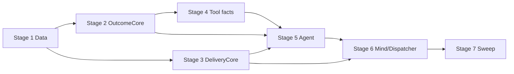

# TASK-018: grounded outcomes and safe failures — Implementation plan

← [[backlog/archive/TASK-018-grounded-outcomes-and-safe-failures/task|Back to task]] | [[backlog/archive/TASK-018-grounded-outcomes-and-safe-failures/requirements|Requirements]] | [[backlog/archive/TASK-018-grounded-outcomes-and-safe-failures/design|Design]]

## Overview

Replace free-form `AgentResult.answer` / `tools_used` / loose failure delivery with one exclusive structured contract: `ExecutionOutcome` or `ClarificationResult`. Code-derived `OutcomeEvidence` and terminal tool facts gate success in `OutcomeCore`; `DeliveryCore` turns outcomes into semantic claim tokens and an authoritative JSON-delimited instruction. `Mind` and `JobDispatcher` stop inventing completion prose — they only pass Data through Core policy into memory and voice rendering — so a static `message` job can never be described as a live recomputation, and failures stay capability-agnostic.

## Goal / Non-goals

- **Goal:** Direct, resumed, forced-skill, and scheduled paths return one exclusive structured result; success and failure delivery are constrained by deterministic Core claim policy (message vs task, no-job, clarification, three safe failure categories); protocol-4 sessions and existing message/task jobs remain readable without migration; full suite green under EPIC-002 `external_contract: additive`.
- **Non-goals:** Skill selection / static-vs-dynamic routing (TASK-014); phase protocol ownership beyond consuming terminal results and adding `fail` (TASK-015); preference/domain constraints (TASK-016); IANA/DST scheduling (TASK-017); corpus/live eval (TASK-020/021); exact Yoda wording; new capabilities/tools/storage; bulk job migration or repair of the July 20 test session.

## Context to load

Files to read before starting:

- [[backlog/archive/TASK-018-grounded-outcomes-and-safe-failures/requirements|requirements]] — FR-1…FR-7 and acceptance criteria
- [[backlog/archive/TASK-018-grounded-outcomes-and-safe-failures/design|design]] — Architecture, Interfaces, System impact, Decisions 1–6
- [[backlog/archive/EPIC-002-agent-routing-reliability/epic|EPIC-002]] — shared branch; `internal_compat: none`, `external_contract: additive`
- [[backlog/archive/EPIC-002-agent-routing-reliability/design|EPIC-002 master design]] — Truthful completion; Static message versus dynamic task; Decision 9; Proposed delivery sequence step 5
- [[backlog/archive/EPIC-002-agent-routing-reliability/suggested_prompts|Suggested prompts]] — Grounded delivery / schedule-message / search-web guardrails (guidance only; **design Interfaces are authoritative**)
- [[backlog/archive/TASK-015-phase-protocol-and-agent-integration/design|TASK-015 design]] — phase contracts, resume upgrade pattern (dependency; `status: done`)
- [[backlog/archive/TASK-016-execution-preferences-and-domain-constraints/design|TASK-016 design]] — keep `request_constraints` on dynamic jobs untouched
- [[backlog/archive/TASK-017-iana-timezone-execution-guidance/design|TASK-017 design]] — schedule tools already emit IANA-valid schedules; do not reopen timezone policy
- `AGENTS.md` (root) — IODA + coding guidelines
- `coding_behavior.md`
- `yoda/mind/agent/AGENTS.md` — current agent module contract (update in Stage 6)
- Current code: `yoda/mind/agent/data/agent_data.py`, `yoda/mind/agent/agent.py`, `yoda/mind/agent/core/react_loop.py`, `yoda/mind/agent/session_provider.py`, `yoda/mind/mind.py`, `yoda/mind/job_dispatcher.py`, `yoda/mind/memory/memory.py`, schedule/picture/delete tools
- Existing tests: `tests/test_agent.py`, `tests/test_agent_session.py`, `tests/test_agent_tools.py`, `tests/test_schedule_task_tool.py`, `tests/test_mind_agent_pipeline.py`, `tests/test_job_dispatcher.py`, `tests/test_memory_operation.py`

## Pre-flight

Mandatory conditions before implementation starts.
If any item below fails and cannot be satisfied immediately, do not proceed to implementation.

- [x] `git checkout main && git pull` — main is up to date
- [x] `git status` — working tree is clean *(waived: leave TASK-018 docs unstaged per user)*
- [x] `git checkout feat/EPIC-002-agent-routing-reliability || git checkout -b feat/EPIC-002-agent-routing-reliability` — shared epic branch (TASK-015/016/017 already landed here)
- [x] `.venv` active and dependencies installed
- [x] Baseline tests green: `.venv/bin/python -m pytest`
- [x] Confirm TASK-015/016/017 contracts present: phase protocol, `request_constraints` on `schedule_task`, IANA-strict schedule tools
- [x] No live LLM/Telegram/Redis required for implementation — deterministic fakes suffice; Redis only for optional manual smoke
- [x] Do **not** add intermediate sibling-task compatibility shims (`internal_compat: none`)
- [x] Do **not** migrate, rewrite, or cancel existing job/conversation/profile payloads (`external_contract: additive`); protocol-4 evidence is additive with empty default for v1–v3

## Files & artifacts

| Path | IODA | Op | FR |
|------|------|----|----|
| `yoda/mind/agent/data/outcome_data.py` — outcome/evidence/delivery enums and DTOs | Data | create | FR-1, FR-2, FR-3, FR-4, FR-5, FR-6 |
| `yoda/mind/agent/data/agent_data.py` — `ExecutionDecision`, `ToolResult`, `AgentContext`, `AgentResult` | Data | edit | FR-1, FR-2, FR-5, FR-7 |
| `yoda/mind/agent/core/outcome_core.py` — `OutcomeCore` | Core | create | FR-1, FR-2, FR-5, FR-6 |
| `yoda/mind/agent/core/delivery_core.py` — `DeliveryCore` | Core | create | FR-3, FR-4, FR-5, FR-6 |
| `yoda/mind/agent/core/react_loop.py` — `ReactLoop` | Core | edit | FR-1, FR-2, FR-5, FR-6, FR-7 |
| `yoda/mind/agent/agent.py` — `Agent` | Integration | edit | FR-1, FR-2, FR-5, FR-7 |
| `yoda/mind/agent/session_provider.py` — `AgentSessionProvider` | Provider | edit | FR-1, FR-7 |
| `yoda/mind/agent/tools/schedule_message_tool.py` — `ScheduleMessageTool` | Provider tool adapter | edit | FR-1, FR-2, FR-3, FR-4 |
| `yoda/mind/agent/tools/schedule_task_tool.py` — `ScheduleTaskTool` | Provider tool adapter | edit | FR-1, FR-2, FR-3, FR-4 |
| `yoda/mind/agent/tools/send_picture_tool.py` — `SendPictureTool` | Portal-facing Provider tool adapter | edit | FR-1, FR-2, FR-5 |
| `yoda/mind/agent/tools/delete_user_data_tool.py` — `DeleteUserDataTool` | Provider tool adapter | edit | FR-1, FR-2, FR-5 |
| `yoda/mind/mind.py` — `Mind` | Integration | edit | FR-1, FR-3, FR-4, FR-5, FR-6 |
| `yoda/mind/job_dispatcher.py` — `JobDispatcher` | Integration | edit | FR-4, FR-5, FR-7 |
| `yoda/mind/memory/memory.py` — `KNOWN_TASK_RESULT_PREFIXES` | Core | edit | FR-6, FR-7 |
| `yoda/mind/agent/AGENTS.md` — module contract | Documentation | edit | FR-1, FR-2, FR-3, FR-4, FR-5, FR-7 |
| `tests/test_outcome_core.py` | Test (Core) | create | FR-1, FR-2, FR-5, FR-6 |
| `tests/test_delivery_core.py` | Test (Core) | create | FR-3, FR-4, FR-5, FR-6 |
| `tests/test_agent.py` | Test (Integration) | edit | FR-1, FR-2, FR-5, FR-7 |
| `tests/test_agent_session.py` | Test (Provider/Data) | edit | FR-1, FR-7 |
| `tests/test_agent_tools.py` | Test (Provider/Portal boundary) | edit | FR-1, FR-2, FR-3, FR-5 |
| `tests/test_schedule_task_tool.py` | Test (Provider/Data) | edit | FR-1, FR-2, FR-3, FR-4, FR-7 |
| `tests/test_mind_agent_pipeline.py` | Test (Integration) | edit | FR-1, FR-3, FR-4, FR-5, FR-6 |
| `tests/test_job_dispatcher.py` | Test (Integration) | edit | FR-4, FR-5, FR-7 |
| `tests/test_memory_operation.py` | Test (Core/Data) | edit | FR-6, FR-7 |

## Stages

### Stage 1: Data contracts

**Goal:** Exclusive result wrapper, protocol-4 evidence fields, terminal facts, and delivery DTOs exist with consistency-only validation; no business logic in Data.

- [x] **1.1** Create outcome/delivery Data module
  - Files: `yoda/mind/agent/data/outcome_data.py`, `tests/test_outcome_core.py` (validation-only cases may live here or a thin data test section — prefer asserting via constructors used by Core)
  - Action: **Data** — implement enums and frozen DTOs from [[design#Data model]]: `OutcomeStatus`, `UserOperation`, `ResultKind`, `JobKind`, `SafeFailureCategory`, `NextStep`, `AllowedClaim`, `ProhibitedClaim`, `TerminalResultFacts`, `OutcomeEvidence`, `ExecutionOutcome`, `ClarificationResult`, `StaticMessageDelivery`, `DeliveryPayload`. Consistency validation only (success/failure field invariants; `job_kind` only with `scheduled_job`; message vs task scheduled_operation rules). No derivation logic.
  - Verify: `.venv/bin/python -m pytest tests/test_outcome_core.py -k "consistency or validation or ExecutionOutcome or DeliveryPayload" -q` (write these assertions first; expect import/construct failures until types exist)
  - Commit: `feat(TASK-018): 1.1 add outcome and delivery data contracts`

- [x] **1.2** Extend agent Data for exclusive results, terminal facts, and protocol 4
  - Files: `yoda/mind/agent/data/agent_data.py`
  - Action: **Data** — per [[design#Decision 1]] / Interfaces: `ExecutionDecision.mode` gains `fail` + `failure_reason`; `ToolResult` gains optional `terminal_facts`; `AgentContext` gains `outcome_evidence: list[OutcomeEvidence]` (default `[]`), bump default `protocol_version` to `4`, extend `with_messages` (and any copy helpers) to preserve evidence; replace `AgentResult` with exclusive `outcome | clarification` (`__post_init__` enforces exactly one). Remove `answer` / `failure` / `tools_used` from the public result shape (callers migrate in later stages).
  - Verify: import/construct smoke via `.venv/bin/python -c "from yoda.mind.agent.data.agent_data import AgentResult, ExecutionDecision, ToolResult, AgentContext; ..."` plus any new unit asserts co-located in `tests/test_agent_session.py` or `tests/test_outcome_core.py` for exclusivity / fail-mode fields
  - Commit: `feat(TASK-018): 1.2 exclusive AgentResult and protocol-4 evidence fields`

**Checkpoint Stage 1:** constructors and consistency validation covered; suite may still be red on downstream callers — that is expected until Stages 4–6. Prefer running targeted data/outcome tests only at this checkpoint if the full suite is not yet green: `.venv/bin/python -m pytest tests/test_outcome_core.py -q`.

---

### Stage 2: OutcomeCore

**Goal:** Pure evidence mapping, success authorization, and safe-failure classification are independently testable without I/O.

- [x] **2.1** Implement `OutcomeCore` evidence and success paths
  - Files: `yoda/mind/agent/core/outcome_core.py`, `tests/test_outcome_core.py`
  - Action: **Core** — implement `evidence_from_results`, `success_from_terminal`, `success_from_finish` per [[design#Interfaces]] / Decision 2. Map code-known tool/active-skill identities to `UserOperation` / `ResultKind`. Terminal success uses typed `TerminalResultFacts` (`message` vs `task` job kinds exact). `success_from_finish` requires relevant successful evidence; never reads failed `ToolResult.output`; evidence-free finish → transient failure, not success. **TDD first.**
  - Verify: `.venv/bin/python -m pytest tests/test_outcome_core.py -k "evidence or success_from_terminal or success_from_finish or message or task" -q`
  - Commit: `feat(TASK-018): 2.1 authorize success from typed outcome evidence`

- [x] **2.2** Implement safe failure classification
  - Files: `yoda/mind/agent/core/outcome_core.py`, `tests/test_outcome_core.py`
  - Action: **Core** — implement `failure_from_agent` and `failure` per Decision 3 / FR-5: map `AgentFailure` / missing session / typed unsupported to `ambiguous` | `transient` | `unsupported` with fixed `NextStep` pairs only. No skill/tool/schema/provider strings in summaries. Cover no-skill, protocol exhaustion, terminal tool exception path inputs, and typed `fail/unsupported`. **TDD first.**
  - Verify: `.venv/bin/python -m pytest tests/test_outcome_core.py -k "failure or ambiguous or transient or unsupported" -q`
  - Commit: `feat(TASK-018): 2.2 map internal failures to safe categories`

**Checkpoint Stage 2:** `.venv/bin/python -m pytest tests/test_outcome_core.py`

---

### Stage 3: DeliveryCore

**Goal:** Semantic claim payloads and authoritative renderer instructions are deterministic and free of implementation-detail leakage.

- [x] **3.1** Implement `DeliveryCore.build_payload`
  - Files: `yoda/mind/agent/core/delivery_core.py`, `tests/test_delivery_core.py`
  - Action: **Core** — per Decision 4 / 5: map `ExecutionOutcome` | `ClarificationResult` | `StaticMessageDelivery` → `DeliveryPayload` with explicit `facts`, `AllowedClaim`, `ProhibitedClaim`, `next_step`, `language_policy`. Enforce: `job_kind=message` → allow stored-text schedule only + prohibit `live_recomputation`; `job_kind=task` → allow scheduled operation, prohibit `future_result`; no-job → no schedule/job claims; failures never imply success/side effects; clarification is non-completion. Assert tokens, not final prose. Include a test that fails if a message payload authorizes a live-task claim or a failure payload contains implementation-detail markers. **TDD first.**
  - Verify: `.venv/bin/python -m pytest tests/test_delivery_core.py -k "payload or claim or message or task or failure or clarification" -q`
  - Commit: `feat(TASK-018): 3.1 derive semantic delivery claim payloads`

- [x] **3.2** Implement `DeliveryCore.build_instruction`
  - Files: `yoda/mind/agent/core/delivery_core.py`, `tests/test_delivery_core.py`
  - Action: **Core** — serialize payload into an authoritative control instruction: code-owned rules outside a JSON-encoded `<delivery_data trust="untrusted">` (or equivalent design-specified delimiter) block; never interpolate user/outcome text into control prose. Define a stable leading prefix constant used later by `KNOWN_TASK_RESULT_PREFIXES`. Voice may rephrase source meaning only. **TDD first:** instruction contains claim tokens / category; raw exception/tool/schema strings never appear; JSON round-trips source text safely.
  - Verify: `.venv/bin/python -m pytest tests/test_delivery_core.py -k "instruction or prefix or untrusted or json" -q`
  - Commit: `feat(TASK-018): 3.2 build authoritative delivery instructions`

**Checkpoint Stage 3:** `.venv/bin/python -m pytest tests/test_outcome_core.py tests/test_delivery_core.py`

---

### Stage 4: Terminal tool facts

**Goal:** Successful side-effect tools attach typed `TerminalResultFacts`; failures/errors never populate safe facts.

- [x] **4.1** Attach schedule-message and schedule-task terminal facts
  - Files: `yoda/mind/agent/tools/schedule_message_tool.py`, `yoda/mind/agent/tools/schedule_task_tool.py`, `tests/test_agent_tools.py`, `tests/test_schedule_task_tool.py`
  - Action: **Provider tool adapters** — on success only, set `terminal_facts` with `result_kind=scheduled_job`, exact `job_kind=message|task`, safe summary, user-relevant `schedule`; task facts may carry internal `scheduled_skill_name` for evidence mapping only. Retain existing job JSON unchanged. Failures: `success=False`, no `terminal_facts`. Preserve TASK-016/017 behavior (constraints sidecar, IANA validation). **TDD first.**
  - Verify: `.venv/bin/python -m pytest tests/test_agent_tools.py tests/test_schedule_task_tool.py -k "terminal_facts or schedule_message or schedule_task or job_kind" -q`
  - Commit: `feat(TASK-018): 4.1 attach typed facts on schedule tools`

- [x] **4.2** Attach picture and delete-user-data terminal facts
  - Files: `yoda/mind/agent/tools/send_picture_tool.py`, `yoda/mind/agent/tools/delete_user_data_tool.py`, `tests/test_agent_tools.py`
  - Action: **Provider tool adapters** — after Telegram/deletion succeeds, attach `picture_sent` / `user_data` facts with safe summaries; never put file paths, storage keys, or exception text into `terminal_facts`. Failed sends/deletes: no facts. **TDD first.**
  - Verify: `.venv/bin/python -m pytest tests/test_agent_tools.py -k "send_picture or delete_user_data or terminal_facts or picture" -q`
  - Commit: `feat(TASK-018): 4.2 attach typed facts on picture and deletion tools`

**Checkpoint Stage 4:** `.venv/bin/python -m pytest tests/test_agent_tools.py tests/test_schedule_task_tool.py tests/test_outcome_core.py tests/test_delivery_core.py`

---

### Stage 5: Agent orchestration and sessions

**Goal:** `run` / `resume` / `run_with_skill` return the exclusive outcome contract; evidence accumulates and persists; protocol-4 `fail` and lazy v1–v3 upgrades work.

- [x] **5.1** Extend `ReactLoop` for fail mode, evidence copy, and protocol-4 refresh
  - Files: `yoda/mind/agent/core/react_loop.py`, `tests/test_agent.py`
  - Action: **Core** — validate `fail` with `failure_reason="unsupported"` only; label failed tool messages as non-evidence; copy/append `outcome_evidence` on successful results; emit protocol-4 execution schema/instructions including `fail`; lazily refresh recognized v1–v3 generated control messages on upgrade paths (preserve user-authored content). **TDD first** for validation matrix and evidence non-pollution.
  - Verify: `.venv/bin/python -m pytest tests/test_agent.py -k "fail or unsupported or evidence or protocol or validate_execution" -q`
  - Commit: `feat(TASK-018): 5.1 validate fail mode and protocol-4 loop evidence`

- [x] **5.2** Wire `Agent` to OutcomeCore and exclusive results
  - Files: `yoda/mind/agent/agent.py`, `tests/test_agent.py`
  - Action: **Integration** — accumulate Core-derived evidence after successful tools; on terminal success call `success_from_terminal`; on finish call `success_from_finish`; on `fail` / `AgentFailure` / missing session use `failure` / `failure_from_agent` (`ambiguous` for missing resume session — not a fake answer); clarification returns `ClarificationResult`; persist evidence on suspend; delete session after terminal outcome. Equivalent contracts for `run`, `resume`, `run_with_skill`. Update existing assertions off `answer`/`failure`/`tools_used`. **TDD first** for contrasting terminal success/failure and evidence-free finish.
  - Verify: `.venv/bin/python -m pytest tests/test_agent.py -q`
  - Commit: `feat(TASK-018): 5.2 return structured outcomes from Agent paths`

- [x] **5.3** Round-trip protocol-4 evidence in `AgentSessionProvider`
  - Files: `yoda/mind/agent/session_provider.py`, `tests/test_agent_session.py`
  - Action: **Provider** — serialize/deserialize `outcome_evidence`; missing legacy field → `[]` without mutating stored Redis payloads on read; new sessions write every evidence field needed after resume. Compatibility: load representative v1–v3 fixtures, resume under protocol 4, preserve skill/task/answers/constraints/retries/accepted history. **TDD first.**
  - Verify: `.venv/bin/python -m pytest tests/test_agent_session.py -q`
  - Commit: `feat(TASK-018): 5.3 persist protocol-4 outcome evidence`

**Checkpoint Stage 5:** `.venv/bin/python -m pytest tests/test_agent.py tests/test_agent_session.py tests/test_outcome_core.py`

---

### Stage 6: Mind delivery, dispatcher, and docs

**Goal:** All user-visible completion paths go through `DeliveryCore`; static vs dynamic trigger boundary preserved; module docs updated.

- [x] **6.1** Rewire `Mind` delivery through DeliveryCore
  - Files: `yoda/mind/mind.py`, `yoda/mind/memory/memory.py`, `tests/test_mind_agent_pipeline.py`, `tests/test_memory_operation.py`
  - Action: **Integration + Core** — `_handle_agent_result` consumes `AgentResult.outcome|clarification` only; `deliver_scheduled_reminder` builds `StaticMessageDelivery` → DeliveryCore; `notify_scheduled_failure(chat_id)` takes **no** brief/exception text — ask `OutcomeCore` for a capability-neutral transient outcome, then DeliveryCore. Append one `task_result` system line from `build_instruction`. Add new delivery prefix to `KNOWN_TASK_RESULT_PREFIXES` while retaining every legacy prefix. Remove tool-name / free-form completion business logic. **TDD first:** inspect authoritative instruction in history; assert raw `AgentFailure` / `ProtocolIssue` / tool output / exceptions / skill/tool names and static live-task claims never enter delivery history.
  - Verify: `.venv/bin/python -m pytest tests/test_mind_agent_pipeline.py tests/test_memory_operation.py -q`
  - Commit: `feat(TASK-018): 6.1 ground Mind delivery in DeliveryCore`

- [x] **6.2** Preserve JobDispatcher message/task routing under new outcomes
  - Files: `yoda/mind/job_dispatcher.py`, `tests/test_job_dispatcher.py`
  - Action: **Integration** — keep branching on persisted `kind`; message → static delivery; task → `run_with_skill` then Mind outcome delivery; exception path → category-only `notify_scheduled_failure` (no exception string). Cover one-shot and recurring message/task; legacy job JSON unchanged. **TDD first.**
  - Verify: `.venv/bin/python -m pytest tests/test_job_dispatcher.py -q`
  - Commit: `feat(TASK-018): 6.2 deliver scheduled jobs via grounded outcomes`

- [x] **6.3** Update agent module contract docs
  - Files: `yoda/mind/agent/AGENTS.md`
  - Action: **Documentation** — document protocol 4, evidence gating, `fail/unsupported`, typed job facts, safe failure mapping, and deterministic delivery boundaries; remove obsolete `answer`/`tools_used` completion description.
  - Verify: manual read-through against design Decisions 1–6; no code change required beyond docs
  - Commit: `docs(TASK-018): 6.3 document grounded outcomes in agent AGENTS`

**Checkpoint Stage 6:** `.venv/bin/python -m pytest tests/test_mind_agent_pipeline.py tests/test_job_dispatcher.py tests/test_memory_operation.py tests/test_agent.py tests/test_delivery_core.py`

---

### Stage 7: Test sweep & coverage

**Goal:** Full suite green; every FR acceptance criterion has deterministic coverage; claim policy remains wording-independent.

- [x] **7.1** FR-level gap fill and regression sweep
  - Files: `tests/test_outcome_core.py`, `tests/test_delivery_core.py`, `tests/test_agent.py`, `tests/test_agent_session.py`, `tests/test_agent_tools.py`, `tests/test_schedule_task_tool.py`, `tests/test_mind_agent_pipeline.py`, `tests/test_job_dispatcher.py`, `tests/test_memory_operation.py`, `tests/fakes.py` (only if needed)
  - Action: Close any remaining AC gaps: exclusive outcome (FR-1); terminal success/failure contrast + job kinds (FR-2); message/task/no-job claim tokens (FR-3); one-shot/recurring static vs dynamic trigger (FR-4); three failure categories + marker absence (FR-5); payload-before-voice + instruction inspection (FR-6); v1–v3 session + legacy job/history (FR-7). Prefer semantic field asserts over exact renderer sentences.
  - Verify: `.venv/bin/python -m pytest`
  - Commit: `test(TASK-018): 7.1 close FR coverage gaps`

- [x] **7.2** Manual AC spot-check (optional if Redis/Telegram available)
  - FR-2/FR-3: schedule a static reminder whose text mentions weather → creation delivery must not promise a live fetch
  - FR-4: fire a `kind=message` job → stored text only; fire a `kind=task` job → fresh execution outcome
  - FR-5: force a transient path (e.g. tool exception) → user message suggests try later without internals
  - FR-7: resume a pre-change suspended session fixture under new code
  - If live env unavailable: rely on 7.1 deterministic coverage and note assumption in implementation notes

**Checkpoint Stage 7:** `.venv/bin/python -m pytest`

## Stage dependencies

Stages 2 and 3 may proceed in parallel after Stage 1. Stage 4 can start after 2.1 (facts consumed by OutcomeCore mapping). Stage 5 needs 2–4. Stage 6 needs 3 and 5.

## FR coverage (traceability)

| FR | Steps | Verification |
|----|-------|--------------|
| FR-1 | 1.1, 1.2, 2.1, 2.2, 5.1, 5.2, 5.3, 7.1 | unit `tests/test_outcome_core.py`; integration `tests/test_agent.py`, `tests/test_agent_session.py` |
| FR-2 | 2.1, 4.1, 4.2, 5.2, 7.1 | unit `tests/test_outcome_core.py`; tool `tests/test_agent_tools.py`, `tests/test_schedule_task_tool.py`; integration `tests/test_agent.py` |
| FR-3 | 3.1, 3.2, 6.1, 7.1 | unit `tests/test_delivery_core.py`; integration `tests/test_mind_agent_pipeline.py` |
| FR-4 | 3.1, 4.1, 6.1, 6.2, 7.1 | unit `tests/test_delivery_core.py`; integration `tests/test_job_dispatcher.py`, `tests/test_mind_agent_pipeline.py` |
| FR-5 | 2.2, 3.1, 5.2, 6.1, 6.2, 7.1 | unit `tests/test_outcome_core.py`, `tests/test_delivery_core.py`; integration `tests/test_agent.py`, `tests/test_mind_agent_pipeline.py`, `tests/test_job_dispatcher.py` |
| FR-6 | 2.1, 3.1, 3.2, 6.1, 7.1 | unit payload/instruction tests; integration instruction inspection in `tests/test_mind_agent_pipeline.py`; prefix compat `tests/test_memory_operation.py` |
| FR-7 | 1.2, 5.1, 5.3, 6.1, 6.2, 7.1 | `tests/test_agent_session.py`, `tests/test_job_dispatcher.py`, `tests/test_memory_operation.py`, `tests/test_schedule_task_tool.py` |

## Risks

| Risk | Probability | Impact | Mitigation |
|------|-------------|--------|------------|
| Broad `AgentResult` API break cascades through many tests/callers | High | Medium — long red suite mid-change | Land Data + Core first; migrate Agent then Mind in dedicated stages; update tests with each stage rather than one mega-diff |
| Model `finish` still treated as success somewhere after wiring | Medium | High — false “completed” claims | Stage 2/5 tests for evidence-free finish → transient; Stage 7 asserts no success without evidence |
| Delivery instruction prefix forgotten in `KNOWN_TASK_RESULT_PREFIXES` breaks history migration inference | Medium | Medium — `MigrationError` on reload | Step 6.1 + `tests/test_memory_operation.py` retain legacy prefixes and add the new constant |
| Protocol-4 sessions left pending if code is reverted | Low | Medium — old code ignores typed evidence | Rollback note: complete/delete pending v4 sessions before reverting; no job rewrite required |

## Rollback

- **Code:** `git revert` commits for this task on `feat/EPIC-002-agent-routing-reliability` (or revert the epic merge later). No Redis/ChromaDB schema migration to undo.
- **Sessions:** Before running code that does not understand protocol 4, complete or delete pending v4 agent sessions (they would otherwise resume without typed evidence and fall back to weaker free-form completion).
- **Jobs / history / profiles:** No rollback actions — persisted shapes are unchanged and must not be rewritten by this task.

## Definition of Done

- [x] All plan steps checked
- [x] All acceptance criteria from requirements.md (FR-1…FR-7) pass
- [x] Full suite green: `.venv/bin/python -m pytest`
- [x] IODA + coding guidelines (`AGENTS.md`, `coding_behavior.md`) respected — Outcomes/Delivery are Data; derivation in Core; Agent/Mind/JobDispatcher only pass Data
- [x] `yoda/mind/agent/AGENTS.md` documents protocol 4, evidence gating, and delivery boundaries
- [x] No bulk migration of jobs, conversations, or profiles; legacy prefixes retained
- [ ] `review.md`: verdict `pass` or `pass-with-follow-ups`
- [ ] `task.md`: `status: done`, `updated: <today>`
- [ ] `design.md` / ADR updated only if execution diverged from design (no ADR expected per design Decisions)
