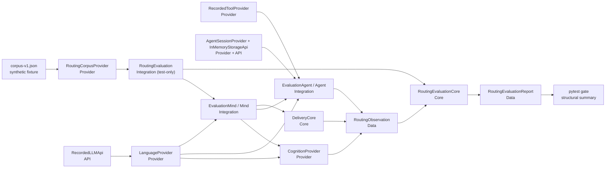

# TASK-020: deterministic routing evaluation corpus — Design

← [[backlog/archive/TASK-020-deterministic-routing-evaluation-corpus/task|Back to task]] | [[backlog/archive/TASK-020-deterministic-routing-evaluation-corpus/requirements|Requirements]]

## Solution overview

Add a strict JSON corpus contract and reusable evaluation Data/Core/Provider
modules under `yoda/mind/evaluation/`, then run that contract in normal CI
through a test-only `RoutingEvaluation` Integration. Each synthetic English or
Russian case supplies raw model responses, local tool outcomes, profile/session
state, and a fixed clock separately from its expected stage contracts. The
harness feeds those raw responses through `LLMApi`/`LanguageProvider`, runs the
production `Mind`, `CognitionProvider`, `Agent`, `ReactLoop`,
`ExecutionContextCore`, `OutcomeCore`, and `DeliveryCore` paths, and captures
accepted decisions and dispatched calls without adding production telemetry.
`RoutingEvaluationCore` validates corpus coverage and deterministically scores
intent, selection, planning, execution, and delivery as independent stages,
using exact enums, argument subsets, semantic text fragments, and claim tokens
rather than model reasoning or final Yoda prose. This specializes
[[backlog/archive/EPIC-002-agent-routing-reliability/design#Decision 7: Evaluate stages, not only end-to-end replies]]
and leaves live-model execution and production diagnostics to TASK-021.

## Architecture



`RoutingEvaluation` owns only sequencing: load a case, establish its isolated
recorded APIs/Providers, invoke production Operations/Integrations, pass captured
Data to `RoutingEvaluationCore`, and await the next turn. `EvaluationMind` and
`EvaluationAgent` are test-only Integration subclasses that delegate production
message routing, selection/execution, and grounded delivery while recording the
already accepted intent, `SelectionDecision`, `ExecutionDecision`,
`AgentResult`, `ToolCall`, and `DeliveryPayload` Data; neither contains
validation or scoring policy.
The scorer never calls another Core or performs I/O. The corpus Provider never
scores. Recorded adapters never decide expected behavior.

## Key decisions

### Decision 1: Use one strict JSON contract with two explicit versions

**Context:** The corpus must be machine-readable, fail fast on unknown data, and
distinguish contract evolution from expected-case evolution.  
**Options:** (A) executable Python parametrization; (B) YAML with ad hoc
dictionaries; (C) JSON validated into strict Pydantic Data.  
**Choice:** C. The root contains `schema_version: 1`,
`corpus_version: "<major>.<minor>.<revision>"`, and `cases`. Every nested
Pydantic model uses `extra="forbid"` and closed enums where the vocabulary is
finite. Schema-breaking changes increment `schema_version`; case additions or
changed expectations increment `corpus_version`. The filename
`corpus-v1.json` identifies the supported schema, while the result always
reports the full corpus version. `RoutingEvaluationCore.validate_corpus`
performs cross-record checks such as unique IDs, stage applicability,
model/tool fixture consumption, language coverage, and current skill coverage
(FR-1, FR-2, FR-3). No ADR candidate.

### Decision 2: Keep reusable contracts in production code and the deterministic runner in tests

**Context:** TASK-021 must consume the same corpus and scoring vocabulary for an
on-demand live run, but TASK-020 must not introduce live-model or production
telemetry behavior.  
**Options:** (A) put everything in `tests/`; (B) add a production evaluation
runner now; (C) share only Data, pure scoring, and corpus loading, while keeping
recorded orchestration and adapters test-only.  
**Choice:** C. `yoda/mind/evaluation/` owns reusable Data,
`RoutingEvaluationCore`, and `RoutingCorpusProvider`.
`tests/routing_evaluation/` owns `RoutingEvaluation`, `EvaluationMind`,
`EvaluationAgent`, and recorded/local adapters. TASK-021 may add its own live
Integration over the shared contract without importing test code or changing
corpus expectations
(FR-1, FR-3, FR-4). This is cross-task continuity already required by the epic,
not a new ADR candidate.

### Decision 3: Exercise raw parsing and production orchestration without a telemetry hook

**Context:** Returning pre-built Pydantic decisions would bypass production JSON
parsing, while adding a stage observer to `Agent` would overlap TASK-021
production telemetry.  
**Options:** (A) inject final observed objects; (B) add production callbacks;
(C) use recorded raw API responses and a passive test subclass around the
existing Integration.  
**Choice:** C. `RecordedLLMApi` supplies staged raw strings and performs the same
JSON decode + Pydantic `model_validate` steps as production
`LLMApi.parse_chat_async` (inlined so stage-queue checks wrap the parse), letting
raw `JSONDecodeError` / `ValidationError` propagate so `LanguageProvider` still
maps them to `StructuredOutputError`. `EvaluationMind` delegates
`Mind.process_message_batch` and scheduled entry points so pending-session
intent override, classifier fallback, Agent handoff, and delivery orchestration
remain production behavior. `EvaluationAgent` delegates `Agent` methods and
captures only decisions that production validation accepted.
`RecordedToolProvider` captures the post-`ExecutionContextCore` `ToolCall` and
returns the declared fixture `ToolResult`; `OutcomeCore` and `DeliveryCore`
derive the observed outcome and claim policy. Expected values are never returned
by an adapter (FR-3, FR-5, FR-6, FR-7). No ADR candidate.

### Decision 4: Make applicability and dependency state explicit per turn

**Context:** A chat-only case has no selection or execution, and an upstream
failure may prevent later stages from running. Treating omission as success
would inflate metrics.  
**Options:** (A) omit unused stages; (B) use nullable expectations; (C) require
all five stage keys with an explicit applicability discriminator.  
**Choice:** C. Every turn declares `intent`, `selection`, `planning`,
`execution`, and `delivery` as either `applicable` with a typed expectation or
`not_applicable` with a reason enum. Scoring emits `pass`, `fail`,
`not_applicable`, or `blocked`. A skipped applicable stage names its first
failed prerequisite in `blocked_by`; a later observation that production
actually emitted remains available and is scored. Overall case failure is
independent of final delivery, and the report records the first divergent stage
(FR-1, FR-4). No ADR candidate.

### Decision 5: Compare semantic structure, not whole free-form strings

**Context:** Exact distilled-task and final-language matching is brittle, but
the harness must detect dropped entities, constraints, timing, and unsafe
claims deterministically.  
**Options:** (A) exact strings; (B) another model as judge; (C) typed structural
comparators plus corpus-owned text fragments.  
**Choice:** C. Intent, modes, skills, tool names, outcome enums, and job kinds
use exact enum equality. Delivery `allowed_claims` / `prohibited_claims` are
scored as exact sets (extra or missing tokens fail), not required subsets.
Tool arguments use recursive expected subsets, with ordered batches only where
the fixture marks order semantic. Distilled tasks and safe summaries use
Unicode-casefolded `required_fragments`/`prohibited_fragments` stored in the
corpus; therefore Russian or future-language knowledge never enters test code.
Source domains are compared via an IODA-safe local
`RoutingEvaluationCore.normalize_domains` copy of the production host rules
(not by calling `ExecutionContextCore`). Delivery is scored from
`DeliveryPayload` claim sets before voice rendering. Dedicated Core tests
mutate otherwise valid observations to prove that a prohibited claim,
internal-detail marker, dropped constraint, or widened domain fails
(FR-2, FR-4, FR-5, FR-7). No ADR candidate.

### Decision 6: Model multi-turn scenarios as ordered isolated events with shared case state

**Context:** Clarification, suspension, refinement, and scheduled execution need
state across turns, while cases must remain independent and reproducible.  
**Options:** (A) flatten every turn into unrelated cases; (B) replay Telegram
end to end; (C) keep ordered event fixtures over an isolated in-memory session
and tool environment.  
**Choice:** C. A case owns ordered turns with event
`message`, `resume`, or `scheduled_task`. Turns share only that case's
`AgentSessionProvider`, in-memory storage, profile fixture, and recorded queues;
all are recreated before the next case. Message and resume events enter through
`Mind.process_message_batch`; a resume event requires a pending session and
therefore exercises production `agent_resume` routing before `Agent.resume`.
Scheduled events enter through `Mind.execute_scheduled_task`, which delegates to
`Agent.run_with_skill`. Each turn has a fixed UTC instant and deterministic
identifiers. This tests preserved task, constraints, evidence, active skill,
retry budget, continuation, and top-level handoffs without Redis, scheduler, or
wall-clock dependence (FR-1, FR-3, FR-6, FR-8). No ADR candidate.

### Decision 7: Treat intent malformed-output behavior as rejection/fallback, not a new retry

**Context:** The requirements review found that `CognitionProvider` currently
has no bounded correction loop; `Mind` catches classification failure and falls
back to chat. Adding one would change routing behavior outside this
corpus/harness task.  
**Options:** (A) expand TASK-020 to change cognition; (B) narrow the evaluation
contract to existing production behavior; (C) emulate a retry only in the
harness.  
**Choice:** B, as resolved during requirements review. Intent fixtures cover
valid decisions, semantically rejected values, malformed parsing, and the safe
`Mind` fallback path. Successful bounded correction and budget exhaustion are
required for selection and execution, where production implements them. The
harness never emulates a nonexistent production retry. `requirements.md` needs
the corresponding FR-6 wording clarification before implementation review
(FR-3, FR-6). No ADR candidate.

### Decision 8: Persist only synthetic regression data and emit structural reports

**Context:** A checked-in corpus necessarily persists messages and model
responses, while ADR-000 forbids replicas of real user messages and project
logging policy keeps user data at DEBUG.  
**Options:** (A) copy the July 20 transcript; (B) redact a copied transcript;
(C) reconstruct every case from synthetic text and non-production identities.  
**Choice:** C. The July 20 case is a named synthetic reconstruction of the
required weather/schedule/source facts, not a transcript excerpt. The corpus
contains no real IDs, secrets, file paths, job IDs, or provider payloads.
Default reports contain corpus version, case ID, turn ID, stage, enum/category,
and structural field paths only; full fixture/observed content is available
only under an explicit DEBUG diagnostic path. This satisfies ADR-000 and
preserves local reproducibility without creating a user-message replica
(FR-3, FR-7, FR-8). No ADR candidate.

## Interfaces

### API / Public contract

The reusable IODA contracts are:

```python
class RoutingCorpusProvider:
    async def load(self, path: Path) -> RoutingCorpus: ...

class RoutingEvaluationCore:
    @staticmethod
    def validate_corpus(
        corpus: RoutingCorpus,
        discovered_skills: frozenset[str],
    ) -> tuple[CorpusIssue, ...]: ...

    @staticmethod
    def score_case(
        case: RoutingCase,
        observation: RoutingObservation,
    ) -> RoutingCaseResult: ...

    @staticmethod
    def aggregate(
        corpus_version: str,
        case_results: list[RoutingCaseResult],
    ) -> RoutingEvaluationReport: ...

    @staticmethod
    def format_summary(report: RoutingEvaluationReport) -> str: ...
```

The deterministic test Integration is the only component that invokes runtime
paths:

```python
class RoutingEvaluation:
    async def run_case(self, case: RoutingCase) -> RoutingCaseResult: ...

    async def run_corpus(
        self,
        corpus: RoutingCorpus,
        *,
        case_id: str | None = None,
    ) -> RoutingEvaluationReport: ...
```

`case_id` supports a reproducible local rerun. Unknown IDs fail before execution.
The default pytest gate loads the whole corpus, validates it against
`SkillCatalog.load_catalog(...)`, runs every case, and fails once with the
aggregate structural summary if any applicable stage fails. A focused rerun
uses `ROUTING_EVAL_CASE=<stable-id> python -m pytest
tests/test_routing_evaluation.py`.

Recorded model entries are consumed in declared order and declare the expected
production response type:

```python
class RecordedModelResponse(BaseModel):
    model_config = ConfigDict(extra="forbid")
    stage: Literal["intent", "selection", "planning"]
    raw: str
```

`RecordedLLMApi` fails the case if production requests a different stage, a
response remains unused, or an undeclared response is requested. Recorded tool
fixtures similarly require exact tool-name order; the scorer separately applies
ordered or unordered matching to semantic batches.

### Data model

```python
class StageName(StrEnum):
    INTENT = "intent"
    SELECTION = "selection"
    PLANNING = "planning"
    EXECUTION = "execution"
    DELIVERY = "delivery"

class StageStatus(StrEnum):
    PASS = "pass"
    FAIL = "fail"
    NOT_APPLICABLE = "not_applicable"
    BLOCKED = "blocked"

class RoutingCorpus(BaseModel):
    model_config = ConfigDict(extra="forbid")
    schema_version: Literal[1]
    corpus_version: str
    cases: list[RoutingCase]

class RoutingCase(BaseModel):
    model_config = ConfigDict(extra="forbid")
    id: str
    language: str  # normalized BCP-47 tag; initially en or ru
    purpose: str
    turns: list[RoutingTurn]

JsonValue = (
    str | int | float | bool | None
    | list["JsonValue"]
    | dict[str, "JsonValue"]
)

class RoutingMessage(BaseModel):
    model_config = ConfigDict(extra="forbid")
    role: Literal["user", "assistant"]
    content: str

class UserProfileFixture(BaseModel):
    model_config = ConfigDict(extra="forbid")
    preferred_name: str = ""
    location: str = ""
    timezone: str = ""
    skill_preferences: dict[str, list[str]] = Field(default_factory=dict)

class TurnInput(BaseModel):
    model_config = ConfigDict(extra="forbid")
    text: str
    recent_messages: list[RoutingMessage] = Field(default_factory=list)
    forced_skill: str | None = None
    request_constraints: RequestConstraints = Field(
        default_factory=RequestConstraints,
    )

class RoutingTurn(BaseModel):
    model_config = ConfigDict(extra="forbid")
    id: str
    event: Literal["message", "resume", "scheduled_task"]
    input: TurnInput
    fixed_now_utc: datetime
    profile: UserProfileFixture
    model_responses: list[RecordedModelResponse]
    tool_results: list[RecordedToolResult]
    expected: StageExpectations  # all five stage keys are required

class NotApplicableExpectation(BaseModel):
    model_config = ConfigDict(extra="forbid")
    kind: Literal["not_applicable"]
    reason: Literal[
        "chat_route", "resume_bypass", "scheduled_bypass", "upstream_stop",
    ]

class TextExpectation(BaseModel):
    model_config = ConfigDict(extra="forbid")
    required_fragments: list[str] = Field(default_factory=list)
    prohibited_fragments: list[str] = Field(default_factory=list)

class IntentExpectation(BaseModel):
    model_config = ConfigDict(extra="forbid")
    kind: Literal["intent"]
    route: Literal["agent_task", "chat", "agent_resume", "rejected_fallback_chat"]

class SelectionExpectation(BaseModel):
    model_config = ConfigDict(extra="forbid")
    kind: Literal["selection"]
    mode: Literal["select_skill", "no_skill", "protocol_exhausted"]
    selected_skill: str | None = None
    distilled_task: TextExpectation | None = None
    request_constraints: RequestConstraints = Field(
        default_factory=RequestConstraints,
    )
    recovery: Literal["none", "corrected", "exhausted"] = "none"

class ExpectedToolCall(BaseModel):
    model_config = ConfigDict(extra="forbid")
    tool_name: str
    arguments: dict[str, JsonValue] = Field(default_factory=dict)

class ExpectedToolBatch(BaseModel):
    model_config = ConfigDict(extra="forbid")
    matching: Literal["ordered", "unordered"]
    calls: list[ExpectedToolCall]  # arguments are recursive expected subsets

class PlanningExpectation(BaseModel):
    model_config = ConfigDict(extra="forbid")
    kind: Literal["planning"]
    accepted_modes: list[Literal["call_tools", "finish", "fail"]]
    tool_batches: list[ExpectedToolBatch] = Field(default_factory=list)
    recovery: Literal["none", "corrected", "exhausted"] = "none"

class ExecutionExpectation(BaseModel):
    model_config = ConfigDict(extra="forbid")
    kind: Literal["execution"]
    result: Literal["success", "failure", "clarification"]
    operation: UserOperation | None = None
    result_kind: ResultKind | None = None
    job_kind: JobKind | None = None
    scheduled_operation: UserOperation | None = None
    schedule: TextExpectation | None = None
    failure_category: SafeFailureCategory | None = None
    next_step: NextStep | None = None

class DeliveryExpectation(BaseModel):
    model_config = ConfigDict(extra="forbid")
    kind: Literal["delivery"]
    status: Literal["success", "failure", "clarification"]
    facts: list[str] = Field(default_factory=list)
    allowed_claims: list[AllowedClaim] = Field(default_factory=list)
    prohibited_claims: list[ProhibitedClaim] = Field(default_factory=list)
    source_text: TextExpectation = Field(default_factory=TextExpectation)

class StageExpectations(BaseModel):
    model_config = ConfigDict(extra="forbid")
    intent: IntentExpectation | NotApplicableExpectation
    selection: SelectionExpectation | NotApplicableExpectation
    planning: PlanningExpectation | NotApplicableExpectation
    execution: ExecutionExpectation | NotApplicableExpectation
    delivery: DeliveryExpectation | NotApplicableExpectation

class RecordedToolResult(BaseModel):
    model_config = ConfigDict(extra="forbid")
    tool_name: str
    output: str
    success: bool
    suspend: bool = False
    terminal_facts: TerminalResultFacts | None = None

@dataclass(frozen=True)
class StructuralDiff:
    path: str
    expected: object
    observed: object

@dataclass(frozen=True)
class StageResult:
    stage: StageName
    turn_id: str
    status: StageStatus
    blocked_by: StageName | None
    diffs: tuple[StructuralDiff, ...]

@dataclass(frozen=True)
class StageCounts:
    passed: int
    failed: int
    applicable: int
    blocked: int

@dataclass(frozen=True)
class RoutingCaseResult:
    case_id: str
    stages: tuple[StageResult, ...]
    first_divergence: StageName | None
    passed: bool

@dataclass(frozen=True)
class RoutingEvaluationReport:
    corpus_version: str
    case_results: tuple[RoutingCaseResult, ...]
    stage_counts: dict[StageName, StageCounts]
```

`RoutingObservation` mirrors those five payloads but contains only values
captured from production paths. It never contains an expected value.

## System impact

| Path / class | IODA | Change | FR |
|--------------|------|--------|----|
| `yoda/mind/evaluation/data.py` — corpus, expectation, observation, stage-result, and aggregate-report DTOs/enums | Data | Create strict `extra="forbid"` schema-v1 Data, consistency-only validators, stage applicability/status vocabulary, semantic text/argument expectation shapes, and immutable result contracts | FR-1, FR-2, FR-4, FR-5, FR-6, FR-7, FR-8 |
| `yoda/mind/evaluation/core.py` — `RoutingEvaluationCore` | Core | Create pure cross-case validation, discovered-skill/language coverage checks, stage comparators, first-divergence/blocking rules, per-stage aggregation, and redacted structural summary formatting | FR-1, FR-2, FR-3, FR-4, FR-5, FR-6, FR-7, FR-8 |
| `yoda/mind/evaluation/corpus_provider.py` — `RoutingCorpusProvider` | Provider | Create async UTF-8 JSON loading and strict Data construction with path/case/field errors and no network or production-store access | FR-1, FR-3 |
| `tests/routing_evaluation/harness.py` — `RoutingEvaluation`, `EvaluationMind`, `EvaluationAgent` | Integration | Create deterministic per-case/turn orchestration over production Mind routing/fallback, Agent phase/recovery, outcome, and delivery paths; capture accepted Data; isolate state; freeze time; verify all recorded inputs are consumed | FR-2, FR-3, FR-4, FR-5, FR-6, FR-7, FR-8 |
| `tests/routing_evaluation/fakes.py` — `RecordedLLMApi`, `InMemoryStorageApi`, `RecordedToolProvider` | API / Provider | Create network-free raw-response API, isolated session storage API, and typed tool adapters that capture post-policy calls and return declared local results/IDs without deciding expectations | FR-1, FR-3, FR-5, FR-6, FR-8 |
| `tests/fixtures/routing_evaluation/corpus-v1.json` — schema-v1 corpus | Data fixture | Synthetic English/Russian corpus (as-built: `corpus_version` **1.1.1**, **26** cases) covering intent, all-skill/no-skill, static/dynamic/delayed scheduling, immediate/deferred search, picture, job/data management, preference/domain, timezone, clarification/resume, selection/planning recovery (`corrected` and `exhausted`), safe-failure, claim-boundary, and named July 20 cases | FR-1, FR-2, FR-5, FR-6, FR-7, FR-8 |
| `tests/fixtures/routing_evaluation/build_corpus.py` — corpus regenerator | Test maintenance | Regenerates `corpus-v1.json` after skill or stage-family additions; not imported by CI gate | FR-1, FR-2 |
| `tests/test_routing_corpus.py` — corpus contract/coverage tests | Test (Data/Core/Provider) | Assert strict failures identify case/field, versions are surfaced, IDs are unique, all production skills are covered, both languages cover every stage family, N/A is explicit, fixtures are synthetic, and no recorded item is orphaned | FR-1, FR-2, FR-3, FR-8 |
| `tests/test_routing_evaluation_core.py` — scorer/report tests | Test (Core) | Prove deterministic repeatability, subset/order/text comparisons, blocked-stage rules, stage counts, final-delivery non-masking, prohibited-claim/internal-detail negatives, and structural-only reports | FR-3, FR-4, FR-5, FR-7 |
| `tests/test_routing_evaluation.py` — default deterministic CI gate | Test (Integration) | Load and run the complete corpus under standard pytest, support stable case-ID reruns, assert zero applicable failures, and print version plus per-stage passed/failed/applicable counts on failure | FR-2, FR-3, FR-4, FR-5, FR-6, FR-7, FR-8 |
| `yoda/mind/agent/AGENTS.md` — evaluation contract note | Documentation | Document the deterministic corpus boundary, synthetic-data rule, reusable scoring contract, and TASK-021 ownership of live runs/production telemetry | FR-1, FR-3, FR-7 |

## Persistence, rollout, and rollback

EPIC-002 has `internal_compat: none`, so the design adds no machinery for mixed
sibling-task code. Its `external_contract: additive` remains fully in force:

- no Redis, ChromaDB, profile, conversation, agent-session, or scheduled-job
  schema changes are made;
- each deterministic case receives a fresh in-memory storage/session namespace,
  fixed IDs, fixed tool outcomes, and fixed UTC time;
- the only new at-rest artifact is synthetic repository fixture data; the July
  20 case contains no copied transcript or production identifier;
- normal CI performs no network call and does not instantiate production
  storage/scheduler/search/image clients;
- result summaries at normal verbosity contain only versions, stable IDs,
  stages, categories, counts, and structural field paths; full content is
  DEBUG-only.

Rollout is the addition of a standard pytest test module, so a failing corpus
blocks CI exactly like any other deterministic test. Rollback removes the
evaluation modules/tests/fixture and requires no data cleanup or migration.
TASK-021 may later consume the Data/Core/Provider contracts additively.

## Decisions made (from requirements review)

| Item | Resolution |
|------|------------|
| Intent malformed-output recovery | Keep current production rejection/fallback behavior; require bounded correction and exhaustion only for selection/execution; propose narrowing FR-6 wording |
| July 20 source material | Use a synthetic reconstruction of required facts, never the original transcript |
| Corpus ownership | Shared Data/Core/Provider are production-importable; recorded CI orchestration remains test-only |
| Stage observation | Passive test API/Integration capture only; do not add production telemetry before TASK-021 |
| Semantic text scoring | Corpus-owned Unicode-casefolded required/prohibited fragments; no language-specific test branches or model judge |
| Delivery claim scoring | Exact set equality for allowed and prohibited claim tokens (not subset) |
| Domain normalization in Core | Local `normalize_domains` copy of production host rules to keep Core free of Operation→Operation deps |
| Applicability | Every turn declares all five stages; unused stages are explicit N/A and upstream-skipped stages are blocked |
| Persistent state | In-memory case-local session/tool state only; no deployed data or contract changes |
| IODA boundary | Data defines contracts, Core validates/scores, Provider loads, test Integration orchestrates, APIs/Providers record deterministic side effects |
| Recorded LLM parse | Inline `json.loads` + `model_validate` with production exception types; do not call `super().parse_chat_async` |

## Open questions

None.
