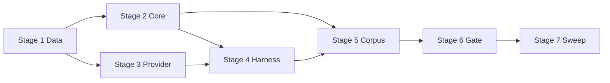

# TASK-020: deterministic routing evaluation corpus — Implementation plan

← [[backlog/archive/TASK-020-deterministic-routing-evaluation-corpus/task|Back to task]] | [[backlog/archive/TASK-020-deterministic-routing-evaluation-corpus/requirements|Requirements]] | [[backlog/archive/TASK-020-deterministic-routing-evaluation-corpus/design|Design]]

## Overview

Introduce a versioned multilingual routing evaluation corpus and deterministic
CI harness that scores structural decisions at intent, selection, planning,
execution, and delivery stages independently. Reusable Data, Core, and Provider
modules live under `yoda/mind/evaluation/`; test-only Integration orchestration,
recorded adapters, and the synthetic `corpus-v1.json` fixture live under
`tests/routing_evaluation/` and `tests/fixtures/routing_evaluation/`. The
harness feeds recorded raw LLM responses through production parsing and
`Mind`/`Agent` paths, captures accepted decisions via passive subclasses, and
scores them with pure `RoutingEvaluationCore` logic — no live models, network,
or production storage.

## Goal / Non-goals

- **Goal:** A checked-in schema-v1 corpus with English and Russian contrastive
  cases (including the named July 20 synthetic scenario), a deterministic pytest
  gate that fails on any applicable stage mismatch, per-stage aggregate counts,
  and reusable evaluation contracts importable by TASK-021.
- **Non-goals:** Live-model CI or release thresholds; production telemetry,
  dashboards, or on-demand live runner (TASK-021); grading model reasoning or
  final Yoda prose; fixing unrelated routing defects discovered by the corpus;
  adding new skills/tools/providers; migrating production jobs or sessions.

## Context to load

- [[backlog/archive/TASK-020-deterministic-routing-evaluation-corpus/requirements|requirements]] — FR-1…FR-8
- [[backlog/archive/TASK-020-deterministic-routing-evaluation-corpus/design|design]] — architecture, interfaces, system impact, Decision 7 (intent retry scope)
- [[backlog/archive/EPIC-002-agent-routing-reliability/epic|EPIC-002 epic]] — shared branch, `internal_compat: none`, `external_contract: additive`
- [[backlog/archive/EPIC-002-agent-routing-reliability/design#Decision 7: Evaluate stages, not only end-to-end replies|EPIC-002 Decision 7]]
- Root `AGENTS.md` (IODA), `coding_behavior.md`
- `yoda/mind/agent/AGENTS.md` — two-phase protocol, suspend/resume, outcomes/delivery
- `yoda/mind/agent/data/agent_data.py`, `yoda/mind/agent/data/outcome_data.py` — production enums/DTOs to reuse
- `yoda/mind/mind.py`, `yoda/mind/agent/agent.py`, `yoda/mind/cognition.py` — orchestration paths under test
- `tests/fakes.py`, `tests/test_mind_agent_pipeline.py` — existing test-double patterns
- [[backlog/archive/TASK-018-grounded-outcomes-and-safe-failures/task|TASK-018]] design — `OutcomeCore`, `DeliveryCore`, claim tokens

## Pre-flight

Mandatory conditions before implementation starts.
If any item below fails and cannot be satisfied immediately, do not proceed.

- [x] `git checkout main && git pull` — main is up to date
- [x] `git status` — working tree is clean
- [x] `git checkout feat/EPIC-002-agent-routing-reliability || git checkout -b feat/EPIC-002-agent-routing-reliability` — shared epic branch
- [x] `.venv` active; dependencies installed (`pip install -e .` or project equivalent)
- [x] TASK-018 grounded-outcome contracts present (`DeliveryCore`, `OutcomeCore`, claim enums)
- [x] Baseline suite green: `.venv/bin/python -m pytest`
- [x] No Redis, ChromaDB, Telegram, OpenRouter, Tavily, or scheduler services required — evaluation is fully local

## Files & artifacts

| Path | IODA | Op | FR |
|------|------|----|----|
| `yoda/mind/evaluation/__init__.py` | Data | create | FR-1 |
| `yoda/mind/evaluation/data.py` — corpus, expectation, observation, stage-result, report DTOs/enums | Data | create | FR-1, FR-2, FR-4, FR-5, FR-6, FR-7, FR-8 |
| `yoda/mind/evaluation/core.py` — `RoutingEvaluationCore` | Core | create | FR-1, FR-2, FR-3, FR-4, FR-5, FR-6, FR-7, FR-8 |
| `yoda/mind/evaluation/corpus_provider.py` — `RoutingCorpusProvider` | Provider | create | FR-1, FR-3 |
| `tests/routing_evaluation/__init__.py` | — | create | FR-3 |
| `tests/routing_evaluation/fakes.py` — `RecordedLLMApi`, `InMemoryStorageApi`, `RecordedToolProvider` | API / Provider | create | FR-1, FR-3, FR-5, FR-6, FR-8 |
| `tests/routing_evaluation/harness.py` — `RoutingEvaluation`, `EvaluationMind`, `EvaluationAgent` | Integration | create | FR-2, FR-3, FR-4, FR-5, FR-6, FR-7, FR-8 |
| `tests/fixtures/routing_evaluation/corpus-v1.json` | Data fixture | create | FR-1, FR-2, FR-5, FR-6, FR-7, FR-8 |
| `tests/test_routing_corpus.py` | Test | create | FR-1, FR-2, FR-3, FR-8 |
| `tests/test_routing_evaluation_core.py` | Test | create | FR-3, FR-4, FR-5, FR-7 |
| `tests/test_routing_evaluation.py` | Test | create | FR-2, FR-3, FR-4, FR-5, FR-6, FR-7, FR-8 |
| `yoda/mind/agent/AGENTS.md` | Documentation | edit | FR-1, FR-3, FR-7 |

## Stages

### Stage 1: Evaluation Data contracts

**Goal:** Strict schema-v1 Pydantic Data and immutable result DTOs compile and
reject unknown fields before any harness code exists.

- [x] **1.1** Package scaffold and stage vocabulary
  - Files: `yoda/mind/evaluation/__init__.py`, `yoda/mind/evaluation/data.py`
  - Action: Create evaluation package. Add `StageName`, `StageStatus`, `JsonValue`,
    `StructuralDiff`, `StageResult`, `StageCounts`, `RoutingCaseResult`,
    `RoutingEvaluationReport` per [[design#Data model]]. Import and reuse
    production enums (`RequestConstraints`, `UserOperation`, `ResultKind`,
    `JobKind`, `SafeFailureCategory`, `NextStep`, `AllowedClaim`,
    `ProhibitedClaim`, `TerminalResultFacts`) from `agent_data` / `outcome_data`
    rather than duplicating vocabulary (Data).
  - Verify: `.venv/bin/python -c "from yoda.mind.evaluation.data import StageName, RoutingEvaluationReport"`
  - Commit: `feat(TASK-020): 1.1 evaluation package and result DTOs`

- [x] **1.2** Expectation and fixture models
  - Files: `yoda/mind/evaluation/data.py`
  - Action: Add `RecordedModelResponse`, `RecordedToolResult`, `NotApplicableExpectation`,
    `TextExpectation`, `IntentExpectation`, `SelectionExpectation`,
    `ExpectedToolCall`, `ExpectedToolBatch`, `PlanningExpectation`,
    `ExecutionExpectation`, `DeliveryExpectation`, `StageExpectations` — all
    `extra="forbid"` with closed enums per design (Data).
  - Verify: `.venv/bin/python -m pytest tests/test_routing_corpus.py::test_unknown_top_level_field_rejected -x` (write failing test first)
  - Commit: `feat(TASK-020): 1.2 stage expectation models`

- [x] **1.3** Case, turn, and corpus models
  - Files: `yoda/mind/evaluation/data.py`
  - Action: Add `RoutingMessage`, `UserProfileFixture`, `TurnInput`, `RoutingTurn`,
    `RoutingCase`, `RoutingCorpus` (`schema_version: Literal[1]`,
    `corpus_version`, `cases`). Add `RoutingObservation` mirroring captured
    production payloads (no expected values). Add minimal consistency validators
    only (e.g. turn IDs unique within case) — no cross-case policy (Data).
  - Verify: `.venv/bin/python -m pytest tests/test_routing_corpus.py::test_minimal_valid_corpus_round_trips -x`
  - Commit: `feat(TASK-020): 1.3 corpus case and observation models`

**Checkpoint Stage 1:** `.venv/bin/python -m pytest tests/test_routing_corpus.py -k "round_trip or rejected" -x`

---

### Stage 2: Core validation and scoring

**Goal:** Pure `RoutingEvaluationCore` validates corpus coverage and scores
observations deterministically with explicit applicability, blocking, and
first-divergence rules.

- [x] **2.1** Corpus validation
  - Files: `yoda/mind/evaluation/core.py`, `tests/test_routing_corpus.py`
  - Action: Implement `RoutingEvaluationCore.validate_corpus(corpus,
    discovered_skills)` — unique case IDs, explicit N/A on all five stages per
    turn, en/ru language tags, every discovered skill referenced at least once,
    every stage family represented in both languages, model/tool fixture
    consumption pre-checks. Return `CorpusIssue` tuples with case/field paths
    (Core).
  - Verify: `.venv/bin/python -m pytest tests/test_routing_corpus.py::test_validate_corpus_reports_duplicate_case_id -x`
  - Commit: `feat(TASK-020): 2.1 corpus validation`

- [x] **2.2** Structural comparators
  - Files: `yoda/mind/evaluation/core.py`, `tests/test_routing_evaluation_core.py`
  - Action: Add pure helpers for Unicode-casefolded `required_fragments` /
    `prohibited_fragments`, recursive expected-subset tool arguments, ordered vs
    unordered tool batches, normalized `include_domains` comparison (reuse
    production normalization path from `ExecutionContextCore` where applicable),
    and claim-token equality (Core).
  - Verify: `.venv/bin/python -m pytest tests/test_routing_evaluation_core.py::test_tool_argument_subset_and_ordered_batch -x`
  - Commit: `feat(TASK-020): 2.2 structural comparators`

- [x] **2.3** Per-stage scoring and blocking
  - Files: `yoda/mind/evaluation/core.py`, `tests/test_routing_evaluation_core.py`
  - Action: Implement `score_case(case, observation)` emitting `pass` /
    `fail` / `not_applicable` / `blocked` per stage per turn; set `blocked_by`
    when an applicable downstream stage cannot run because of upstream failure;
    record `first_divergence`; overall case `passed` is false when any
    applicable stage fails regardless of delivery (Core). Intent route
    `rejected_fallback_chat` maps to observed `Mind` chat fallback per Decision 7.
  - Verify: `.venv/bin/python -m pytest tests/test_routing_evaluation_core.py::test_blocked_stage_not_scored_as_pass -x`
  - Commit: `feat(TASK-020): 2.3 stage scoring and blocking`

- [x] **2.4** Aggregation and redacted summary
  - Files: `yoda/mind/evaluation/core.py`, `tests/test_routing_evaluation_core.py`
  - Action: Implement `aggregate(corpus_version, case_results)` with per-stage
    passed/failed/applicable/blocked counts and `format_summary(report)` that
    emits only corpus version, case/turn IDs, stages, categories, counts, and
    structural field paths — no full user text at default verbosity (Core).
  - Verify: `.venv/bin/python -m pytest tests/test_routing_evaluation_core.py::test_aggregate_and_summary_redacted -x`
  - Commit: `feat(TASK-020): 2.4 aggregate report formatting`

**Checkpoint Stage 2:** `.venv/bin/python -m pytest tests/test_routing_evaluation_core.py -x`

---

### Stage 3: Corpus Provider

**Goal:** Async JSON loading with path/case/field-level fail-fast errors.

- [x] **3.1** `RoutingCorpusProvider`
  - Files: `yoda/mind/evaluation/corpus_provider.py`, `tests/test_routing_corpus.py`
  - Action: Implement `async load(path: Path) -> RoutingCorpus` — UTF-8 read,
    strict Pydantic construction, wrap validation errors with corpus path and
    case/field identity. No network or production store access (Provider).
  - Verify: `.venv/bin/python -m pytest tests/test_routing_corpus.py::test_load_invalid_json_identifies_case_and_field -x`
  - Commit: `feat(TASK-020): 3.1 corpus provider`

**Checkpoint Stage 3:** `.venv/bin/python -m pytest tests/test_routing_corpus.py -x`

---

### Stage 4: Deterministic harness and recorded adapters

**Goal:** Test-only Integration runs production `Mind`/`Agent` paths with frozen
time, isolated session state, and consumed recorded queues — never injecting
expected outcomes.

- [x] **4.1** Recorded LLM and in-memory storage APIs
  - Files: `tests/routing_evaluation/fakes.py`, `tests/routing_evaluation/__init__.py`
  - Action: Implement `RecordedLLMApi` subclassing/wrapping production `LLMApi`
    — pop staged `RecordedModelResponse` entries in order, delegate
    `parse_chat_async` to production JSON decode + Pydantic validation; fail on
    stage mismatch, unused responses, or undeclared requests. Implement
    `InMemoryStorageApi` for isolated per-case session/profile storage (API).
  - Verify: `.venv/bin/python -m pytest tests/test_routing_evaluation.py::test_recorded_llm_consumes_staged_responses_in_order -x` (add focused test in gate module or small harness unit test)
  - Commit: `feat(TASK-020): 4.1 recorded LLM and storage fakes`

- [x] **4.2** Recorded tool Provider
  - Files: `tests/routing_evaluation/fakes.py`
  - Action: Implement `RecordedToolProvider` implementing the tool port —
    capture post-`ExecutionContextCore` `ToolCall`, return declared fixture
    `ToolResult` / suspend flags / `terminal_facts`; fail on tool-name order
    mismatch or orphan fixtures (Provider).
  - Verify: `.venv/bin/python -m pytest tests/test_routing_evaluation.py::test_recorded_tool_provider_returns_fixture_and_captures_call -x`
  - Commit: `feat(TASK-020): 4.2 recorded tool provider`

- [x] **4.3** `EvaluationAgent` observation capture
  - Files: `tests/routing_evaluation/harness.py`
  - Action: Subclass `Agent`; delegate selection/execution/resume/run methods;
    after production validation accepts a decision, append to turn-local
    `RoutingObservation` (`SelectionDecision`, `ExecutionDecision`, dispatched
    `ToolCall`s, `AgentResult`). Do not add scoring or retry policy (Integration).
  - Verify: `.venv/bin/python -m pytest tests/test_routing_evaluation.py::test_evaluation_agent_captures_accepted_selection -x`
  - Commit: `feat(TASK-020): 4.3 evaluation agent capture`

- [x] **4.4** `EvaluationMind` and delivery observation
  - Files: `tests/routing_evaluation/harness.py`
  - Action: Subclass `Mind`; delegate `process_message_batch` and
    `execute_scheduled_task`; capture intent route (including classifier
    fallback), `DeliveryPayload` from `DeliveryCore.build_payload`, and
  scheduled-entry observations. Wire minimal fakes for `Perception`,
    `MemoryProvider`, `AffectProvider`, `CognitionProvider` using case fixtures
    (Integration).
  - Verify: `.venv/bin/python -m pytest tests/test_routing_evaluation.py::test_evaluation_mind_captures_delivery_payload -x`
  - Commit: `feat(TASK-020): 4.4 evaluation mind capture`

- [x] **4.5** `RoutingEvaluation` orchestration
  - Files: `tests/routing_evaluation/harness.py`
  - Action: Implement `run_case` / `run_corpus` — per case recreate isolated
    storage/session/tool/LLM queues; freeze `fixed_now_utc`; route `message`,
    `resume`, and `scheduled_task` events through production entry points; build
    `RoutingObservation`; call `RoutingEvaluationCore.score_case`; support
    `case_id` filter with fail-fast on unknown IDs. Verify all recorded fixtures
    consumed (Integration).
  - Verify: `.venv/bin/python -m pytest tests/test_routing_evaluation.py::test_harness_runs_single_turn_chat_case -x`
  - Commit: `feat(TASK-020): 4.5 routing evaluation harness`

**Checkpoint Stage 4:** `.venv/bin/python -m pytest tests/test_routing_evaluation.py -k "harness or recorded or evaluation_" -x`

---

### Stage 5: Synthetic corpus fixture

**Goal:** Checked-in `corpus-v1.json` satisfies FR-2 coverage, FR-5/6/7
contracts, and the named July 20 scenario with synthetic data only.

- [x] **5.1** Corpus shell and intent families
  - Files: `tests/fixtures/routing_evaluation/corpus-v1.json`
  - Action: Add `schema_version: 1`, initial `corpus_version`, and English/Russian
    intent cases: `agent_task` vs `chat` contrasts, current-information questions,
    refinements with `recent_messages`, malformed intent JSON →
    `rejected_fallback_chat`, semantically rejected intent values. All five
    stages declared per turn with explicit N/A (Data fixture).
  - Verify: `.venv/bin/python -m pytest tests/test_routing_corpus.py::test_corpus_has_en_and_ru_intent_families -x`
  - Commit: `feat(TASK-020): 5.1 intent corpus cases`

- [x] **5.2** Skill selection coverage
  - Files: `tests/fixtures/routing_evaluation/corpus-v1.json`
  - Action: Add selection cases for every discovered skill (`search_web`,
    `schedule_message`, `create_picture`, `manage_jobs`, `manage_user_data`),
    `no_skill` / `protocol_exhausted`, preference vs strict-constraint precedence,
    and contrastive pairs where surface keywords overlap but expected skill differs
    (Data fixture).
  - Verify: `.venv/bin/python -m pytest tests/test_routing_corpus.py::test_corpus_covers_all_discovered_skills -x`
  - Commit: `feat(TASK-020): 5.2 skill selection corpus cases`

- [x] **5.3** Scheduling and search contrastive cases
  - Files: `tests/fixtures/routing_evaluation/corpus-v1.json`
  - Action: Add en/ru cases for recurring static text (`job_kind=message`),
    recurring fresh information (`job_kind=task` + `search_web`), delayed
    dynamic reminder, immediate vs deferred web search, picture creation, job
    management, and user-data management — recurrence alone must not determine
    expected skill/kind (Data fixture).
  - Verify: `.venv/bin/python -m pytest tests/test_routing_evaluation.py::test_scheduling_contrast_cases_pass -x`
  - Commit: `feat(TASK-020): 5.3 scheduling and capability corpus cases`

- [x] **5.4** Planning, domain, timezone, and outcome cases
  - Files: `tests/fixtures/routing_evaluation/corpus-v1.json`
  - Action: Add planning expectations for ordered tool batches, terminal
    `finish`/`fail`, `include_domains` propagation and no silent widen on retry,
    IANA timezone on absolute/recurring schedules, relative-delay cases without
    timezone clarification, and outcome categories (success, clarification,
    transient/unsupported failure) (Data fixture).
  - Verify: `.venv/bin/python -m pytest tests/test_routing_evaluation.py::test_domain_constraint_case_passes -x`
  - Commit: `feat(TASK-020): 5.4 planning execution outcome cases`

- [x] **5.5** Multi-turn, clarification, and malformed recovery
  - Files: `tests/fixtures/routing_evaluation/corpus-v1.json`
  - Action: Add refinement multi-turn cases, clarification suspend/resume
    (`ask_user` after selection, no success claim, preserved task/constraints/
    evidence/retry budget), selection/execution malformed output with bounded
    correction and exhausted safe-failure paths. Intent malformed cases remain
    rejection/fallback only per Decision 7 — do not emulate nonexistent cognition
    retry (Data fixture).
  - Verify: `.venv/bin/python -m pytest tests/test_routing_evaluation.py::test_clarification_suspend_resume_case -x`
  - Commit: `feat(TASK-020): 5.5 multi-turn and recovery corpus cases`

- [x] **5.6** July 20 scenario and delivery claim negatives
  - Files: `tests/fixtures/routing_evaluation/corpus-v1.json`, `tests/test_routing_evaluation_core.py`
  - Action: Add stable-id synthetic `july-20-recurring-spb-weather-accuweather` case
    (`agent_task` → `search_web` not `schedule_message`, strict
    `accuweather.com`, `kind=task`, schedule + IANA timezone, creation delivery
    allows only dynamic-operation-scheduled claims). Add dedicated negative scorer
    tests proving prohibited claims / internal-detail markers fail delivery even
    when other stages pass (Data fixture + Core test).
  - Verify: `.venv/bin/python -m pytest tests/test_routing_evaluation.py::test_july_20_regression_case -x`
  - Commit: `feat(TASK-020): 5.6 july 20 and claim boundary cases`

**Checkpoint Stage 5:** `.venv/bin/python -m pytest tests/test_routing_corpus.py tests/test_routing_evaluation.py -x`

---

### Stage 6: Default CI gate and documentation

**Goal:** Standard pytest entrypoint runs full corpus; agent module docs describe
the evaluation boundary for TASK-021.

- [x] **6.1** Pytest gate module
  - Files: `tests/test_routing_evaluation.py`
  - Action: Load `tests/fixtures/routing_evaluation/corpus-v1.json` via
    `RoutingCorpusProvider`, validate against `SkillCatalog.load_catalog(...)`,
    run full corpus through `RoutingEvaluation`, assert zero applicable stage
    failures, print `format_summary` on failure. Support focused rerun via
    `ROUTING_EVAL_CASE=<stable-id>` env var (Test / Integration).
  - Verify: `.venv/bin/python -m pytest tests/test_routing_evaluation.py`
  - Commit: `feat(TASK-020): 6.1 routing evaluation pytest gate`

- [x] **6.2** Agent module evaluation note
  - Files: `yoda/mind/agent/AGENTS.md`
  - Action: Document deterministic corpus location, synthetic-data rule
    (ADR-000), reusable `yoda/mind/evaluation/` contract, test-only harness
    boundary, and TASK-021 ownership of live runs/production telemetry (Docs).
  - Verify: manual — section present and links to evaluation package path
  - Commit: `docs(TASK-020): 6.2 agent evaluation contract note`

**Checkpoint Stage 6:** `.venv/bin/python -m pytest tests/test_routing_evaluation.py tests/test_routing_corpus.py tests/test_routing_evaluation_core.py`

---

### Stage 7: Test sweep & coverage

- [x] **7.1** FR acceptance test sweep
  - Files: `tests/test_routing_corpus.py`, `tests/test_routing_evaluation_core.py`, `tests/test_routing_evaluation.py`
  - Action: Close any FR gaps — repeatability (same inputs → same scores),
    aggregate non-masking of earlier-stage failures, DEBUG-only full-content
    diagnostic path, orphan fixture detection, and env-based case rerun. Add
    tests only where Stage 1–6 steps left coverage holes.
  - Verify: `.venv/bin/python -m pytest`
  - Commit: `test(TASK-020): 7.1 FR coverage sweep`

- [x] **7.2** Manual acceptance checklist
  - FR-1: `corpus_version` appears in failing summary; invalid fixture errors name case/field
  - FR-2: grep corpus for `"language": "en"` and `"language": "ru"` — each stage family present in both
  - FR-3: `ROUTING_EVAL_CASE=july-20-recurring-spb-weather-accuweather .venv/bin/python -m pytest tests/test_routing_evaluation.py -q` reruns one case with no network
  - FR-4: induce one stage failure — summary shows per-stage counts and `first_divergence`
  - FR-6: clarification case shows `blocked`/`not_applicable` semantics in scorer output
  - FR-7: prohibited-claim negative test fails delivery stage independently
  - FR-8: July 20 case id stable and included in default gate
  - Verify: manual observations recorded in implementation notes if any AC needs nuance
  - Commit: `chore(TASK-020): 7.2 manual AC verification`

**Checkpoint Stage 7:** `.venv/bin/python -m pytest`

## Stage dependencies

## FR coverage (traceability)

| FR | Steps | Verification |
|----|-------|--------------|
| FR-1 | 1.1–1.3, 2.1, 3.1, 5.1, 6.1 | `tests/test_routing_corpus.py`; gate prints `corpus_version` |
| FR-2 | 2.1, 5.1–5.3, 6.1, 7.1 | `tests/test_routing_corpus.py::test_corpus_covers_all_discovered_skills`; en/ru stage-family tests |
| FR-3 | 4.1–4.5, 6.1, 7.1 | `tests/test_routing_evaluation.py`; repeatability test in `test_routing_evaluation_core.py` |
| FR-4 | 2.3–2.4, 6.1, 7.1 | `tests/test_routing_evaluation_core.py`; gate failure summary |
| FR-5 | 2.2, 5.3–5.4, 7.1 | `tests/test_routing_evaluation_core.py`; domain/timezone integration cases |
| FR-6 | 4.3–4.5, 5.5, 6.1, 7.2 | `tests/test_routing_evaluation.py::test_clarification_suspend_resume_case`; malformed recovery cases |
| FR-7 | 2.2, 5.6, 7.1–7.2 | `tests/test_routing_evaluation_core.py` prohibited-claim negatives |
| FR-8 | 5.6, 6.1, 7.2 | `tests/test_routing_evaluation.py::test_july_20_regression_case`; manual stable-id rerun |

## Risks

| Risk | Probability | Impact | Mitigation |
|------|-------------|--------|------------|
| Harness wiring diverges from production `Mind`/`Agent` paths | Medium | High | Delegate to superclass methods; capture only post-validation Data; add focused harness tests in Stage 4 before corpus growth |
| Corpus cases fail due to pre-existing routing bugs | Medium | Medium | Treat failures as regressions to fix in owning tasks; do not weaken expectations — document in `implementation-notes.md` if blocked |
| Intent malformed-output scope confusion (no cognition retry loop) | Low | Medium | Follow Decision 7 — intent cases use `rejected_fallback_chat`; bounded correction only in selection/execution fixtures (step 5.5) |
| Corpus maintenance burden as skills grow | Medium | Low | `validate_corpus` enforces all-skill coverage; failing validation forces intentional corpus version bump |
| Accidental real user data in fixtures | Low | High | Synthetic text only (Decision 8); `test_corpus_has_no_production_identifiers` in Stage 7 |

## Rollback

- **Code:** `git revert` the TASK-020 commits on `feat/EPIC-002-agent-routing-reliability`.
- **State:** No persistent-state writes — evaluation uses per-case in-memory
  storage only. Removing modules, tests, and `corpus-v1.json` requires no Redis,
  ChromaDB, or profile migration.

## Definition of Done

- [x] All plan steps checked (`last_step` at 7.2)
- [x] All FR-1…FR-8 acceptance criteria pass
- [x] Full suite green: `.venv/bin/python -m pytest`
- [x] IODA respected: Data/Core/Provider in `yoda/mind/evaluation/`; harness/adapters test-only; scorer has no I/O
- [x] `corpus-v1.json` is synthetic; July 20 case uses stable id `july-20-recurring-spb-weather-accuweather`
- [x] Default pytest gate fails on any applicable stage mismatch with per-stage counts
- [x] `yoda/mind/agent/AGENTS.md` documents evaluation boundary and TASK-021 handoff
- [ ] `review.md`: verdict `pass` or `pass-with-follow-ups`
- [ ] `task.md`: `status: done`, `updated: 2026-07-21` (or execution date)
- [x] `design.md` updated only if implementation diverges from recorded interfaces
