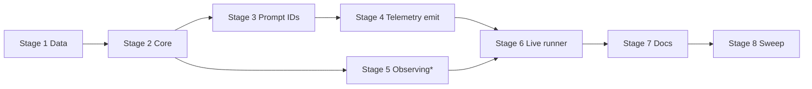

# TASK-021: stage telemetry and live eval runner — Implementation plan

← [[backlog/archive/TASK-021-stage-telemetry-and-live-eval-runner/task|Back to task]] | [[backlog/archive/TASK-021-stage-telemetry-and-live-eval-runner/requirements|Requirements]] | [[backlog/archive/TASK-021-stage-telemetry-and-live-eval-runner/design|Design]]

## Overview

Add privacy-safe stage-labelled routing diagnostics on the production
`Mind`/`Agent`/`CognitionProvider` path and an explicit on-demand live-model
corpus runner under `yoda/mind/evaluation/`. `RoutingTelemetryCore` formats
INFO/WARNING records for the five canonical stages; `PromptIdentityCore`
supplies versioned prompt IDs and SHA-256 control-plane hashes.
`ObservingMind`/`ObservingAgent` move from the test harness into production
evaluation so deterministic and live runs share the same
`RoutingObservation` capture. `LiveRoutingEvaluation` swaps only eligible
recorded LLM decisions for the configured `LLMApi`, keeps all other
boundaries fail-closed, scores with `RoutingEvaluationCore`, and writes a
unique privacy-safe JSON report under `artifacts/live_routing_eval/`. Standard
pytest never invokes the live runner.

## Goal / Non-goals

- **Goal:** Production paths emit stage/outcome/model/prompt diagnostics
  without user content at INFO/WARNING; developers can run
  `python -m yoda.mind.evaluation.live_runner` over the TASK-020 corpus and
  get stage-local metrics plus a reproducible JSON artifact; deterministic CI
  remains unchanged and non-blocking for live scores.
- **Non-goals:** PR/release live gating or thresholds; scheduled remote runs,
  dashboards, alerting, or report upload; calling real tools/services other
  than the configured LLM; persisting prompt bodies, raw model responses, or
  user-content replicas; changing corpus expectations or routing behavior to
  accommodate model variance; grading reasoning or Yoda wording; new
  skills/tools/providers or production-data migrations.

## Context to load

- [[backlog/archive/TASK-021-stage-telemetry-and-live-eval-runner/requirements|requirements]] — FR-1…FR-7
- [[backlog/archive/TASK-021-stage-telemetry-and-live-eval-runner/design|design]] — Architecture, Interfaces, System impact, Decisions 1–6
- [[backlog/archive/EPIC-002-agent-routing-reliability/epic|EPIC-002 epic]] — shared branch, `internal_compat: none`, `external_contract: additive`
- [[backlog/archive/EPIC-002-agent-routing-reliability/design#Decision 7: Evaluate stages, not only end-to-end replies|EPIC-002 Decision 7]]
- [[backlog/archive/EPIC-002-agent-routing-reliability/design#Stage-local correctness|Stage-local correctness]]
- [[backlog/archive/EPIC-002-agent-routing-reliability/suggested_prompts#Prompt identity and logging|Prompt identity and logging]]
- [[backlog/archive/EPIC-002-agent-routing-reliability/suggested_prompts#Evaluation contract|Evaluation contract]]
- Root `AGENTS.md` (IODA), `coding_behavior.md`
- [[design/decisions/ADR-000-sensitive-data-persistence|ADR-000]] — no user-message replicas in logs/artifacts
- `yoda/mind/evaluation/` — TASK-020 Data/Core/Provider contracts (`data.py`, `core.py`, `corpus_provider.py`)
- `tests/routing_evaluation/harness.py` — today’s `EvaluationMind` / `EvaluationAgent` to relocate
- `yoda/mind/mind.py`, `yoda/mind/agent/agent.py`, `yoda/mind/cognition.py`, `yoda/mind/perception/language.py`
- `yoda/mind/agent/core/react_loop.py`, `yoda/mind/agent/core/delivery_core.py` — prompt material for hashing
- `yoda/mind/agent/AGENTS.md` — extend with live-runner docs
- [[backlog/archive/TASK-020-deterministic-routing-evaluation-corpus/design|TASK-020 design]] — scoring/observation substrate

## Pre-flight

Mandatory conditions before implementation starts.
If any item below fails and cannot be satisfied immediately, do not proceed.

- [ ] `git status` — working tree clean enough to work on the shared epic branch
- [ ] `git checkout feat/EPIC-002-agent-routing-reliability || git checkout -b feat/EPIC-002-agent-routing-reliability` — shared epic branch (`plan.md` `branch:` stays empty)
- [ ] `.venv` active; dependencies installed
- [ ] TASK-020 contracts present: `yoda/mind/evaluation/{data,core,corpus_provider}.py`, `tests/fixtures/routing_evaluation/corpus-v1.json`, `tests/routing_evaluation/harness.py`
- [ ] Baseline suite green: `.venv/bin/python -m pytest`
- [ ] No Redis/Chroma/Telegram/Tavily/scheduler required for unit tests (fail-on-call fakes)
- [ ] Live CLI smoke (Stage 6 manual AC only) needs `settings.json` with agent `model_name` + LLM credentials; unit/integration tests use fakes and must not require a live key

## Files & artifacts

| Path | IODA | Op | FR |
|------|------|----|----|
| `yoda/mind/evaluation/data.py` — `StageDiagnostic`, `PromptIdentity`, `DiagnosticOutcome`, live enums/metrics/`LiveEvalReport` | Data | edit | FR-1, FR-2, FR-5, FR-6 |
| `yoda/mind/evaluation/telemetry_core.py` — `RoutingTelemetryCore` | Core | create | FR-1 |
| `yoda/mind/evaluation/prompt_identity_core.py` — `PromptIdentityCore` + ID helpers | Core | create | FR-2 |
| `yoda/mind/evaluation/live_core.py` — `LiveRoutingEvaluationCore` | Core | create | FR-3, FR-5, FR-6, FR-7 |
| `yoda/mind/evaluation/live_report_provider.py` — `LiveEvalReportProvider` | Provider | create | FR-6 |
| `yoda/mind/evaluation/observation.py` — `ObservingMind`, `ObservingAgent` | Integration | create | FR-1, FR-3, FR-5 |
| `yoda/mind/evaluation/live_evaluation.py` — `LiveRoutingEvaluation` | Integration | create | FR-3, FR-4, FR-5, FR-6 |
| `yoda/mind/evaluation/live_fakes.py` — fail-on-call API stubs | API | create | FR-4 |
| `yoda/mind/evaluation/live_runner.py` — CLI `__main__` | Integration entry | create | FR-3, FR-6, FR-7 |
| `yoda/mind/evaluation/__init__.py` | Package | edit | FR-3, FR-6 |
| `yoda/mind/cognition.py` — `INTENT_CLASSIFIER_PROMPT_ID`, intent diagnostics | Data + Provider | edit | FR-1, FR-2 |
| `yoda/mind/agent/core/react_loop.py` — selector/executor prompt ID constants | Data (constants) | edit | FR-2 |
| `yoda/mind/agent/core/delivery_core.py` — `GROUNDED_DELIVERY_PROMPT_ID`, hashable rules template | Core / Data | edit | FR-2 |
| `yoda/mind/agent/agent.py` — selection/planning/execution diagnostics + hash inputs | Integration | edit | FR-1, FR-2 |
| `yoda/mind/mind.py` — intent/delivery/bypass diagnostics | Integration | edit | FR-1, FR-2 |
| `yoda/mind/perception/language.py` — `LanguageProvider.model_name` | Provider | edit | FR-2 |
| `tests/routing_evaluation/harness.py` | Integration (test) | edit | FR-3, FR-7 |
| `tests/test_routing_telemetry.py` | Test | create | FR-1 |
| `tests/test_prompt_identity.py` | Test | create | FR-2 |
| `tests/test_live_routing_evaluation.py` | Test | create | FR-3, FR-4, FR-5, FR-6, FR-7 |
| `yoda/mind/agent/AGENTS.md` | Documentation | edit | FR-7 |
| `.gitignore` | Repo hygiene | edit | FR-6 |

## Stages

### Stage 1: Telemetry and live-report Data

**Goal:** Strict additive DTOs/enums for diagnostics and live reports compile
and reject unknown fields; TASK-020 corpus models stay unchanged.

- [x] **1.1** Diagnostic and prompt-identity Data
  - Files: `yoda/mind/evaluation/data.py`
  - Action: Add `DiagnosticOutcome`, `PromptIdentity`, `StageDiagnostic` per
    [[design#Interfaces]] (Data, `extra="forbid"`). Reuse existing `StageName`.
  - Verify: `.venv/bin/python -c "from yoda.mind.evaluation.data import StageDiagnostic, PromptIdentity, DiagnosticOutcome"`
  - Commit: `feat(TASK-021): 1.1 stage diagnostic and prompt identity DTOs`

- [x] **1.2** Live evaluation report Data
  - Files: `yoda/mind/evaluation/data.py`, `yoda/mind/evaluation/__init__.py`
  - Action: Add `LiveExclusionReason`, `LiveCaseExclusion`, `LiveRunStatus`,
    `OperationalErrorCategory`, `LiveStageMetrics`, `LiveEvalReport`
    (`report_schema_version: Literal[1]`) per [[design#Interfaces]]. Export
    public contracts needed by tests from `__init__.py`.
  - Verify: `.venv/bin/python -c "from yoda.mind.evaluation.data import LiveEvalReport, LiveExclusionReason"`
  - Commit: `feat(TASK-021): 1.2 live eval report DTOs`

**Checkpoint Stage 1:** `.venv/bin/python -m pytest tests/test_routing_corpus.py tests/test_routing_evaluation_core.py -q`

---

### Stage 2: Prompt identity and telemetry Core

**Goal:** Pure Core owns SHA-256 control-plane hashing and privacy-safe
diagnostic string formatting.

- [x] **2.1** `PromptIdentityCore` hashing and stage helpers
  - Files: `yoda/mind/evaluation/prompt_identity_core.py`, `tests/test_prompt_identity.py`
  - Action: TDD — assert stable SHA-256 over ordered control-plane parts,
    user-text independence, and helpers
    `intent_identity` / `selection_identity` / `execution_identity` /
    `delivery_identity` plus ID constants
    `intent_classifier/v1`, `skill_selector/v1`, `skill_executor/v1`,
    `grounded_delivery/v1`, `skill_workflow_prompt_id` (Core). Hash rule:
    UTF-8 SHA-256 of length-prefixed or NUL-separated segments
    ([[design#Decision 2]]).
  - Verify: `.venv/bin/python -m pytest tests/test_prompt_identity.py -q`
  - Commit: `feat(TASK-021): 2.1 prompt identity core hashing`

- [x] **2.2** `RoutingTelemetryCore` formatters
  - Files: `yoda/mind/evaluation/telemetry_core.py`, `tests/test_routing_telemetry.py`
  - Action: TDD — `format_info` / `format_warning` emit only stage, outcome,
    model_id, prompt_id(s), prompt_hash(es), and closed `detail` tokens; assert
    absence of user text / prompt bodies / tool payloads (Core).
  - Verify: `.venv/bin/python -m pytest tests/test_routing_telemetry.py -q`
  - Commit: `feat(TASK-021): 2.2 routing telemetry formatters`

**Checkpoint Stage 2:** `.venv/bin/python -m pytest tests/test_prompt_identity.py tests/test_routing_telemetry.py -q`

---

### Stage 3: Production prompt IDs and model identity

**Goal:** Stable prompt ID constants sit beside production prompt material;
`LanguageProvider` exposes configured `model_name`.

- [x] **3.1** `LanguageProvider.model_name` property
  - Files: `yoda/mind/perception/language.py`, `tests/test_language_provider.py`
  - Action: TDD — add read-only `model_name` returning configured model id
    (Provider). No API keys or provider response IDs.
  - Verify: `.venv/bin/python -m pytest tests/test_language_provider.py -q`
  - Commit: `feat(TASK-021): 3.1 expose LanguageProvider.model_name`

- [x] **3.2** Intent / selection / execution / delivery prompt ID constants
  - Files: `yoda/mind/cognition.py`, `yoda/mind/agent/core/react_loop.py`,
    `yoda/mind/agent/core/delivery_core.py`, `tests/test_prompt_identity.py`
  - Action: Expose `INTENT_CLASSIFIER_PROMPT_ID` beside classifier instructions;
    selector/executor IDs beside `SELECTION_SYSTEM_PROMPT` /
    `EXECUTION_SYSTEM_PROMPT`; `GROUNDED_DELIVERY_PROMPT_ID` plus a stable
    rules template (excluding per-run `source_text` / timestamps) for
    `PromptIdentityCore.delivery_identity` (Data constants / Core). Extend
    hash tests to use real constant strings where practical.
  - Verify: `.venv/bin/python -m pytest tests/test_prompt_identity.py -q`
  - Commit: `feat(TASK-021): 3.2 versioned prompt ID constants`

**Checkpoint Stage 3:** `.venv/bin/python -m pytest tests/test_prompt_identity.py tests/test_language_provider.py -q`

---

### Stage 4: Production stage diagnostics

**Goal:** Always-on Integration/Provider log points emit stage diagnostics
without changing routing control flow or leaking user content at INFO/WARNING.

- [x] **4.1** Intent-stage diagnostics in `CognitionProvider` / `Mind`
  - Files: `yoda/mind/cognition.py`, `yoda/mind/mind.py`, `tests/test_routing_telemetry.py`
  - Action: TDD — after intent classification (success, rejected, chat/pass
    bypass), log via `RoutingTelemetryCore` with stage=`intent`, model/prompt
    identity, and closed outcomes (`success` / `rejected` / `bypassed` /
    `not_applicable`). Resume/scheduled/chat paths must not report inapplicable
    stages as success/failure (Integration / Provider). User content DEBUG-only.
  - Verify: `.venv/bin/python -m pytest tests/test_routing_telemetry.py -q`
  - Commit: `feat(TASK-021): 4.1 intent and bypass stage diagnostics`

- [x] **4.2** Selection / planning / execution diagnostics in `Agent`
  - Files: `yoda/mind/agent/agent.py`, `tests/test_routing_telemetry.py`
  - Action: TDD — emit `selection`, `planning`, and `execution` diagnostics
    distinguishing skill selection from planning and from tool/job execution;
    corrected/exhausted/failed outcomes attach to the stage that rejected the
    operation; pass control-plane catalog/workflow/tool-schema text into
    `PromptIdentityCore` (Integration). Assert multi-prompt retention for
    skill_executor + `<skill>/v1`.
  - Verify: `.venv/bin/python -m pytest tests/test_routing_telemetry.py -q`
  - Commit: `feat(TASK-021): 4.2 agent stage diagnostics`

- [x] **4.3** Delivery-stage diagnostics in `Mind`
  - Files: `yoda/mind/mind.py`, `tests/test_routing_telemetry.py`
  - Action: TDD — emit `delivery` diagnostics with grounded-delivery prompt
    identity; ensure earlier-stage failures remain visible and are not hidden
    by a later delivery log (Integration). Cover success and failure delivery
    paths.
  - Verify: `.venv/bin/python -m pytest tests/test_routing_telemetry.py -q`
  - Commit: `feat(TASK-021): 4.3 delivery stage diagnostics`

**Checkpoint Stage 4:** `.venv/bin/python -m pytest tests/test_routing_telemetry.py tests/test_mind_agent_pipeline.py tests/test_mind_pipelines.py -q`

---

### Stage 5: Promote observation Integrations

**Goal:** Shared `ObservingMind` / `ObservingAgent` live under
`yoda/mind/evaluation/`; deterministic harness imports them and keeps recorded
adapters test-local.

- [x] **5.1** Relocate observation capture to production evaluation
  - Files: `yoda/mind/evaluation/observation.py`, `tests/routing_evaluation/harness.py`,
    `tests/test_routing_evaluation.py`
  - Action: Move `EvaluationMind` / `EvaluationAgent` (and any cognition helper
    required for rejection capture) into `observation.py` as
    `ObservingMind` / `ObservingAgent`; thin harness to import them; keep
    `RecordedLLMApi` / recorded tools under `tests/routing_evaluation/`
    (Integration). Do not import `tests.*` from runtime packages.
  - Verify: `.venv/bin/python -m pytest tests/test_routing_evaluation.py -q`
  - Commit: `refactor(TASK-021): 5.1 promote ObservingMind and ObservingAgent`

**Checkpoint Stage 5:** `.venv/bin/python -m pytest tests/test_routing_evaluation.py tests/test_routing_corpus.py -q`

---

### Stage 6: Live Core, isolation fakes, report I/O, runner

**Goal:** Pure live eligibility/aggregation, fail-closed side-effect stubs,
unique JSON report writer, and Integration+CLI that score live observations
without mutating corpus expectations.

- [x] **6.1** `LiveRoutingEvaluationCore` eligibility and metrics
  - Files: `yoda/mind/evaluation/live_core.py`, `tests/test_live_routing_evaluation.py`
  - Action: TDD — `live_eligibility` excludes cases with any turn expecting
    intent `rejected_fallback_chat`, selection/planning `recovery` in
    `{corrected, exhausted}`, or selection `mode=protocol_exhausted`
    ([[design#Decision 4]]); `build_report` aggregates per-stage
    passed/failed/applicable/blocked + pass_rate; `format_console_summary`
    includes artifact path; incomplete/excluded cases do not inflate accuracy
    (Core).
  - Verify: `.venv/bin/python -m pytest tests/test_live_routing_evaluation.py -q`
  - Commit: `feat(TASK-021): 6.1 live eligibility and report aggregation`

- [x] **6.2** Fail-on-call live fakes
  - Files: `yoda/mind/evaluation/live_fakes.py`, `tests/test_live_routing_evaluation.py`
  - Action: TDD — Telegram/search/media/Redis/scheduler/Chroma stubs raise on
    any call; prove unexpected skill/tool selection cannot silently succeed via
    those boundaries (API). Recorded/local tool adapters remain the only
    execution path for tools.
  - Verify: `.venv/bin/python -m pytest tests/test_live_routing_evaluation.py -q`
  - Commit: `feat(TASK-021): 6.2 fail-on-call live isolation stubs`

- [x] **6.3** `LiveEvalReportProvider` unique JSON writer
  - Files: `yoda/mind/evaluation/live_report_provider.py`, `tests/test_live_routing_evaluation.py`
  - Action: TDD — async `write` creates unique filename
    (`UTC timestamp` + short run UUID) under
    `artifacts/live_routing_eval/` (or override dir); stable JSON round-trip
    without importing runner classes; default artifact omits prompt bodies,
    user text, raw model responses, tool payloads, credentials (Provider).
  - Verify: `.venv/bin/python -m pytest tests/test_live_routing_evaluation.py -q`
  - Commit: `feat(TASK-021): 6.3 live eval report provider`

- [x] **6.4** `LiveRoutingEvaluation` Integration
  - Files: `yoda/mind/evaluation/live_evaluation.py`, `tests/test_live_routing_evaluation.py`
  - Action: TDD — load corpus via `RoutingCorpusProvider`, validate before first
    live call, apply case-ID filter (unknown ID fails before model call),
    exclude forced-malformed cases with reasons, wire `ObservingMind`/
    `ObservingAgent` + real `LanguageProvider`/`LLMApi` only for eligible
    decisions, ignore recorded `model_responses` for those calls, isolate
    state per case, score with `RoutingEvaluationCore`, map provider errors to
    operational categories / incomplete/unattempted (never stage passes)
    (Integration). Use fail-on-call stubs for all non-LLM boundaries.
  - Verify: `.venv/bin/python -m pytest tests/test_live_routing_evaluation.py -q`
  - Commit: `feat(TASK-021): 6.4 LiveRoutingEvaluation orchestration`

- [x] **6.5** CLI entry `live_runner`
  - Files: `yoda/mind/evaluation/live_runner.py`, `yoda/mind/evaluation/__init__.py`,
    `tests/test_live_routing_evaluation.py`
  - Action: Implement `python -m yoda.mind.evaluation.live_runner` with
    `--case`, `--corpus`, `--report-dir`, `--settings` per [[design#Interfaces]];
    defaults to checked-in corpus and `artifacts/live_routing_eval/`; print
    console summary with artifact path. Assert default pytest collection does
    not import/run the live CLI path in a way that requires credentials
    (Integration entry / FR-7).
  - Verify: `.venv/bin/python -m pytest tests/test_live_routing_evaluation.py -q`
  - Commit: `feat(TASK-021): 6.5 live_runner CLI`

**Checkpoint Stage 6:** `.venv/bin/python -m pytest tests/test_live_routing_evaluation.py tests/test_routing_evaluation.py -q`

---

### Stage 7: Docs and artifact hygiene

**Goal:** Developers know how to invoke live eval; report directory is gitignored.

- [x] **7.1** Document live runner in `AGENTS.md` and ignore artifacts
  - Files: `yoda/mind/agent/AGENTS.md`, `.gitignore`
  - Action: Document exact invocation, required model credential/config,
    full-corpus and `--case` examples, report location, side-effect boundary
    (LLM only), cost/rate-limit caveat, metric interpretation, and that
    pytest/CI stay deterministic-only (FR-7). Add
    `artifacts/live_routing_eval/` to `.gitignore`. Update TASK-020 section to
    point at promoted `ObservingMind`/`ObservingAgent`.
  - Verify: `rg -n "live_runner|artifacts/live_routing_eval" yoda/mind/agent/AGENTS.md .gitignore`
  - Commit: `docs(TASK-021): 7.1 live eval runner docs and gitignore`

**Checkpoint Stage 7:** docs strings present; `.venv/bin/python -m pytest tests/test_live_routing_evaluation.py -q`

---

### Stage 8: Test sweep & coverage

**Goal:** Full suite green; every FR acceptance criterion covered by automated
or explicit manual checks.

- [x] **8.1** FR-level automated coverage pass
  - Files: `tests/test_routing_telemetry.py`, `tests/test_prompt_identity.py`,
    `tests/test_live_routing_evaluation.py`, `tests/test_routing_evaluation.py`
  - Action: Fill any remaining gaps — successful/corrective/exhausted/
    execution-failure/delivery paths (FR-1); multi-prompt retention and hash
    stability (FR-2); exclusion listing + case filter fail-fast (FR-3);
    fail-on-call isolation (FR-4); stage metrics denominators (FR-5); report
    round-trip / no silent overwrite / partial status (FR-6); assert standard
    pytest never calls live runner or needs live credentials (FR-7). Keep
    deterministic corpus gate scoring all cases including malformed fixtures.
  - Verify: `.venv/bin/python -m pytest`
  - Commit: `test(TASK-021): 8.1 close FR coverage gaps`

- [x] **8.2** Manual AC check
  - FR-1: Run a normal agent-task path in logs (or captured logger test) and
    confirm INFO lines name stages without user text.
  - FR-2: Confirm prompt IDs/hashes appear in diagnostics for LLM-backed stages.
  - FR-3/FR-5/FR-6: With valid `settings.json` LLM credentials (optional if
    offline), run
    `.venv/bin/python -m yoda.mind.evaluation.live_runner --case <stable-id>`
    and confirm console summary + unique JSON under
    `artifacts/live_routing_eval/`. Skip live network smoke when credentials
    unavailable; unit coverage with fakes remains mandatory.
  - FR-4: Confirm live unit tests prove Telegram/Redis/etc. raise if called.
  - FR-7: Confirm `.venv/bin/python -m pytest` completes without live network
    and without requiring live report artifacts.
  - Verify: checklist above + `.venv/bin/python -m pytest`
  - Commit: none (manual verification only)

**Checkpoint Stage 8:** full suite green — `.venv/bin/python -m pytest`

## Stage dependencies

## FR coverage (traceability)

| FR | Steps | Verification |
|----|-------|--------------|
| FR-1 | 1.1, 2.2, 4.1, 4.2, 4.3, 8.1, 8.2 | unit `tests/test_routing_telemetry.py`; manual log AC |
| FR-2 | 1.1, 2.1, 3.1, 3.2, 4.2, 8.1, 8.2 | unit `tests/test_prompt_identity.py`; telemetry assertions |
| FR-3 | 1.2, 5.1, 6.1, 6.4, 6.5, 8.1, 8.2 | unit/integration `tests/test_live_routing_evaluation.py`; deterministic `tests/test_routing_evaluation.py` unchanged |
| FR-4 | 6.2, 6.4, 8.1, 8.2 | fail-on-call tests in `tests/test_live_routing_evaluation.py` |
| FR-5 | 6.1, 6.4, 8.1 | metrics aggregation + scorer reuse in `tests/test_live_routing_evaluation.py` |
| FR-6 | 1.2, 6.1, 6.3, 6.4, 6.5, 8.1, 8.2 | report round-trip / unique path tests; manual CLI smoke |
| FR-7 | 6.5, 7.1, 8.1, 8.2 | docs + assert pytest does not invoke live runner / need credentials |

## Risks

| Risk | Probability | Impact | Mitigation |
|------|-------------|--------|------------|
| Relocating `EvaluationMind`/`EvaluationAgent` breaks deterministic harness imports or observation timing | Medium | High — TASK-020 CI gate regresses | Stage 5 checkpoint runs full `tests/test_routing_evaluation.py` before live work; keep recorded adapters test-local |
| Control-plane hash accidentally includes user/profile/tool-result text, making hashes unstable across runs | Medium | Medium — FR-2 comparability fails | Step 2.1/3.2 tests assert user-text independence; delivery hash uses rules template only |
| Live Integration accidentally wires production Redis/Telegram/scheduler | Low | High — FR-4 / external_contract violation | Step 6.2 fail-on-call stubs + dedicated live assembly (Decision 5); never reuse bot wiring |
| Provider errors counted as stage passes or incomplete cases inflate accuracy | Medium | Medium — misleading live metrics | Step 6.1/6.4 map operational errors separately; incomplete/unattempted excluded from denominators |

## Rollback

- Code: `git revert` commits on `feat/EPIC-002-agent-routing-reliability` (pure additive modules + logging + harness import move).
- State: none — no Redis/ChromaDB/profile/conversation/session/job schema or data changes (`external_contract: additive`). Delete local `artifacts/live_routing_eval/*` if desired; not production persistence.
- Harness: if observation relocation must be undone, restore `EvaluationMind`/`EvaluationAgent` into `tests/routing_evaluation/harness.py` and drop `yoda/mind/evaluation/observation.py`.

## Definition of Done

- [x] All plan steps checked (`last_step` reflects final completed step)
- [x] All FR-1…FR-7 acceptance criteria pass
- [x] Full suite green: `.venv/bin/python -m pytest`
- [x] IODA + coding guidelines (root `AGENTS.md`) respected — Data/Core/Provider/Integration boundaries per design
- [x] Runtime code does not import `tests.routing_evaluation`
- [x] Live runner documented in `yoda/mind/agent/AGENTS.md`; `artifacts/live_routing_eval/` gitignored
- [x] Deterministic corpus gate still scores all cases including malformed/recovery fixtures
- [x] No PR/CI live gating, thresholds, or mandatory remote runs introduced
- [ ] `review.md`: verdict `pass` or `pass-with-follow-ups`
- [ ] `task.md`: `status: done`, `updated: <today>`
- [ ] `design.md` / ADR updated if execution diverged from the plan
