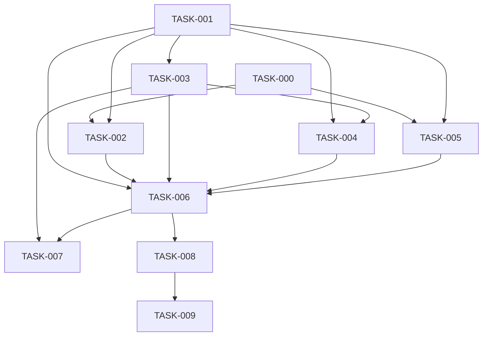

# Notes
## Fix

- Stop calculating chat_type each time - it doesn't change
- Add modify_job tool for manage_jobs skill, otherwise job just gets cancelled
- Request like "wake me up with a weather forecast" triggers schedule_message skill instead of recurrent search_web - probably because search_web frontmatter doesn't tell anything about scheduling
- Job's description repeats message_text, but at least skill name should be present in description, so that list_jobs is aware of task nature. Ideally it should contain distilled_task
- Double check: distilled_task is missing on Phase 2
- Choose skill prompt looks suboptimal:
  - Not to say terribly structured, excessive, confusing and misleading, 
  - Missing ask_user format and example
  - Skills are ordered in a strange way
  - Skill descriptions are incoherent
- Search_web preference not taken into account, should be put into description (probably because of wrong skill applied - verify)

## Add

- Design invariants to the root (?) AGENTS.md: chat isolation, chats nonpersistence, low hardware requirements, low budget, logging, exception handling, etc.
- Retry after 429 where needed
- Scheduling jobs: Daylight saving is unlikely taken into account (and there are countries that do not use it)
- Admin notifications
- _classify_intent returns "chat" but it's never handled. It should be handled explicitly, and last elif in Mind.process_message_batch should log WARNING or something
- Record skill usages in Chat.history:
  - create_picture: iterations
  - manage_jobs: task
  - manage_user_data: task
  - schedule_message: daily/once
  - search_web: tools
- Error handling (logging + retry, where needed + admin notification, where needed):
  - network errors to Telegram
  - Redis failures
  - ChromaDB failures
  - speech/vision/LLM/embeddings/text-to-image errors
  - file operations
- More logging, enforce log formats consistency
- Rate limits for APIs
- Make periodic_job_cleanup sub-routine of general maintenance routine. - Should Memory be its owner?
- Conversation compression sub-routine, open questions:
  - recall_conversation skill: can it retrieve Chroma entries basing on data/distance
  - rebuild system prompt after compression is done - not really needed if it's being updated during restarts already
  - "saved=true/false" for summary entries, if close to edge - notify admin
- Tool: web_scrape_tool with Crawl4AI (https://medium.com/@speaktoharisudhan/crawling-with-crawl4ai-the-open-source-scraping-beast-9d32e6946ad4)
- In group chats use reply rather than send_message
- Introduce conversation modes (doc/design/conversation_modes.md) and apply when delivering agent results
- Internal skill: [local_buddy_]small_talk
  - Gather in advance or lazily-collect facts on potential topics of interest and propose those for discussion with user

## Try

- Skill flavours/hierarchy: search web could have a number of options (sub-specs with specific workflow/sources/hints), depending on the topic. - Actuall, should this be stored in catalog, or in user preferences - like agent updating user_profile with object skill_preferences > web_search > weather > accuweather.com?
- Trafilatura as another extraction option
- _classify_intent could return 'pass' to replace CognitionCore.should_reply. And _classify_intent could have a better name, e.g. "decide_next_action"
- Regulate Еmotional state with system messages, instead of the system prompt (should those be acually saved?). 
- AffectProvider: should return current emotional state as a string, and MemoryCore should pass it to MemoryProvider and it should append it to the conversation as a system message

## See
- No connection pooling for Redis - what's that?
- The winner's approach:
  https://github.com/idzivinskyi/bitgn-trustworthy-agent/tree/main
- ReAct loop doesn't survive tool crashes like exception when using ask_user - still true?
- Misplaced DTOs in `yoda/mind/memory/data/` (don't belong to memory persistence): - still true?
  - `pending_message.py` — perception/embodiment concept
  - `system_prompt.py` — mind-level
  - `emotional_state.py` — affect concept

# Backlog

## Epics

### Chat Context Management

Compression of long conversations, profile extraction, an externalised summary store, and recall via an agent skill. Master design (source of truth): [[chat_context_management]].

**Decomposition principle:** cut by dependency layers, not by "features":
schema → ingest behaviour → pure Core algorithms → Maintenance shell → summariser → full apply pipeline → timeout wiring → vector store → recall skill.

| ID | Title | Size | Deliverable |
|----|-------|------|-------------|
| [[TASK-000-compression-prerequisites/task\|TASK-000]] | compression prerequisites | S | skill names in `task_result`; `skill_preferences` + delta keys |
| [[TASK-001-message-kinds-and-conversation-state-v3/task\|TASK-001]] | message kinds and conversation state v3 | M | `Message.kind`, 5 `Conversation` fields, migration v2→v3, ingest counters, settings |
| [[TASK-002-user-introduction-on-ingest/task\|TASK-002]] | user introduction on ingest | S | lazy `user_introduction` + `introduced_users` + reusable Core helper |
| [[TASK-003-compression-window-algorithms-core/task\|TASK-003]] | compression window algorithms core | M | `CompressionCore`: window selection + trigger firing predicates |
| [[TASK-004-maintenance-integration-shell/task\|TASK-004]] | maintenance integration shell | S | `Maintenance` integration, periodic loop, dry-run stubs |
| [[TASK-005-summarizer-provider-and-profile-extraction/task\|TASK-005]] | summarizer provider and profile extraction | M | `SummarizerProvider`, mechanical participants/skills, profile delta application |
| [[TASK-006-compression-apply-and-size-trigger/task\|TASK-006]] | compression apply and size trigger | L | full apply pipeline + size-trigger |
| [[TASK-007-timeout-trigger-wiring/task\|TASK-007]] | timeout trigger wiring | S | timeout-trigger wired to the existing apply |
| [[TASK-008-summary-store-and-outbox-flush/task\|TASK-008]] | summary store and outbox flush | M | Chroma, embeddings, `flush_summary_outbox` |
| [[TASK-009-recall-conversation-skill/task\|TASK-009]] | recall conversation skill | S | agent skill `recall_conversation` |

**Dependency graph:**



**Milestone:** after TASK-006 long chats are compressed inline (without Chroma) — user value without cold-path recall.

**Parallelisation:** TASK-000 and TASK-001 are independent. After TASK-001, TASK-003 (pure Core) can start immediately; after both TASK-000 and TASK-001, TASK-002 and TASK-005 can run in parallel; TASK-004 follows TASK-001 + TASK-003.

```dataviewjs
const priorityOrder = { critical: 0, high: 1, medium: 2, low: 3 };
const priorityLabel = {
  critical: "🔴 critical",
  high:     "🟠 high",
  medium:   "🟡 medium",
  low:      "🟢 low"
};
const statusLabel = {
  "in-progress": "🔵 in-progress",
  "in-review":   "🟣 in-review",
  "blocked":     "🔴 blocked",
  "todo":        "⬜ todo",
  "done":        "✅ done"
};

const all = dv.pages('"backlog"')
  .where(p => p.id && p.file.name === "task");

const active = all
  .where(p => p.status !== "done")
  .sort(p => priorityOrder[p.priority] ?? 99);

const done = all
  .where(p => p.status === "done")
  .sort(p => p.updated, "desc");

// ── Summary ───────────────────────────────────────────────────────────────
const inProgress = active.where(p => p.status === "in-progress").length;
const blocked    = active.where(p => p.status === "blocked").length;
const todo       = active.where(p => p.status === "todo").length;

dv.paragraph(
  "**Total:** " + all.length + " · " +
  "**in-progress:** " + inProgress + " · " +
  "**todo:** " + todo + " · " +
  "**blocked:** " + blocked + " · " +
  "**done:** " + done.length
);

// ── Active tasks ───────────────────────────────────────────────────────────
dv.header(2, "Active tasks (" + active.length + ")");

if (active.length === 0) {
  dv.paragraph("_No tasks._");
} else {
  dv.table(
    ["ID", "Title", "Tags", "Link", "Status", "Priority", "Size", "Created"],
    active.map(p => [
      p.id,
      p.title,
      p.tags,
      p.file.link,
      statusLabel[p.status]   ?? p.status,
      priorityLabel[p.priority] ?? p.priority,
      p.size,
      p.created
    ])
  );
}

// ── Complete tasks ────────────────────────────────────────────────────────
dv.header(2, "Done (" + done.length + ")");

if (done.length === 0) {
  dv.paragraph("_No tasks._");
} else {
  dv.table(
    ["ID", "Title", "Tags", "Link", "Status", "Size", "Created"],
    done.map(p => [
      p.id,
      p.title,
      p.tags,
      p.file.link,
      statusLabel[p.status]   ?? p.status,
      p.size,
      p.created
    ])
  );
}
```
