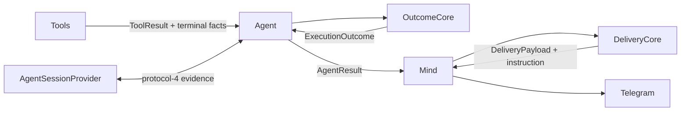

# Agent grounded outcomes

Durable contract for evidence-gated completion, safe failures, and claim-bounded
delivery. Historical source: TASK-018 (EPIC-002 truthful completion, static vs
dynamic, Decision 9).

Related: [[design/agent-two-phase-protocol|two-phase protocol]],
[[design/decisions/ADR-004-evidence-gated-capability-agnostic-completion|ADR-004]].

## Solution overview

`AgentResult` is an exclusive wrapper: exactly one of `ExecutionOutcome` or
`ClarificationResult`. Terminal success requires code-derived `OutcomeEvidence`
(and optional terminal tool facts); a model `finish` may supply a summary but
cannot choose operation, result kind, job kind, or failure category. An
evidence-free finish becomes a safe failure.

`DeliveryCore` turns outcomes/clarifications/static trigger facts into a
`DeliveryPayload` with allowed/prohibited claim tokens, then an authoritative
instruction. `Mind` only moves Data between Agent, Cores, memory, renderer, and
Portal. Language/voice may rephrase inside those boundaries — never strengthen
facts.

## Architecture



`OutcomeCore` and `DeliveryCore` are independent synchronous Cores. Tools report
infrastructure facts; they do not decide user-visible claims.

## Exclusive result shape

```python
@dataclass(frozen=True)
class AgentResult:
    outcome: ExecutionOutcome | None = None
    clarification: ClarificationResult | None = None
    # Exactly one field present — consistency validation only
```

`run`, `resume`, and `run_with_skill` share this contract. Missing resume
session → `ambiguous` failure, not a successful answer.

## Evidence gating

1. `OutcomeCore.evidence_from_results` maps successful tool/active-skill
   identities to capability-neutral `UserOperation` / `ResultKind`.
2. Terminal adapters attach `TerminalResultFacts` only after the side effect
   succeeds (job kind, safe summary, schedule, …).
3. `AgentContext.outcome_evidence` stores **successful** facts only.
4. `terminal_failure_pending` blocks a later `finish` from reusing stale
   evidence after a failed terminal side effect; a successful retry uses new
   facts.
5. Non-terminal `finish` succeeds only with relevant evidence and no pending
   terminal failure; otherwise → `transient`.

Failed tool outputs and exceptions are never treated as completion evidence.

## Execution `fail` mode

Protocol 4 extends `ExecutionDecision.mode` with `fail`:
`failure_reason="unsupported"`, no answer/tools. Use for an activated workflow
that hits a capability boundary. Ambiguous input still uses `ask_user` when
possible.

## Safe failure categories

| Category | Typical causes | Next step |
|----------|----------------|-----------|
| `ambiguous` | Missing session, unclear input | clarify / rephrase |
| `transient` | Tool/runtime/protocol exhaustion, ungrounded finish | try later |
| `unsupported` | `no_skill`, execution `fail` | state capability boundary |

Failures are **capability-agnostic**: no skill, tool, model, schema, phase,
storage, or provider details in user-visible delivery. See ADR-004.

## Static message versus dynamic task (claims)

| Job kind | On creation | On fire |
|----------|-------------|---------|
| `message` | `scheduled_job` + stored-text claims; prohibit live recompute | Deliver stored text only (`delivered_stored_message`) |
| `task` | `scheduled_job` + dynamic operation scheduled; **prohibit future-result claims** | Fresh `run_with_skill` outcome |

Recurrence does not change claim rules. Creation text is not evidence that later
execution succeeded.

## Delivery

`DeliveryCore.build_payload` emits operation/result facts, `AllowedClaim` /
`ProhibitedClaim` tokens, next step, and language policy.

`DeliveryCore.build_instruction`:

- Code-owned rules outside a JSON `<delivery_data trust="untrusted">` block  
- Stable `GROUNDED DELIVERY:` prefix (recognized in memory alongside legacy
  task-result prefixes)  
- Untrusted summary/question JSON-encoded; `&` `<` `>` Unicode-escaped so they
  cannot break the outer delimiter  

Renderer may preserve or rephrase in recent user language / Yoda voice; must not
add facts, change certainty, disclose internals, or imply unproven side effects.

## Protocol 4 sessions

New sessions persist `outcome_evidence` and `terminal_failure_pending`.
v1–v3 load missing evidence as `[]` / `False` and refresh generated control
messages lazily; old tool history is model context, not typed evidence — a new
relevant success is required before `finish`. Existing job JSON and conversation
history are read unchanged (no bulk migration / rerender).

## Code map

| Concern | Location |
|---------|----------|
| Evidence / failure mapping | `yoda/mind/agent/core/outcome_core.py` |
| Claims / instruction | `yoda/mind/agent/core/delivery_core.py` |
| Outcome DTOs | `yoda/mind/agent/data/outcome_data.py` |
| Orchestration | `yoda/mind/agent/agent.py` |
| Delivery path | `yoda/mind/mind.py` |
| Trigger routing | `yoda/mind/job_dispatcher.py` |

## Historical

- [[backlog/archive/TASK-018-grounded-outcomes-and-safe-failures/design|TASK-018 design]]
- [[backlog/archive/EPIC-002-agent-routing-reliability/design|EPIC-002 master design]]
