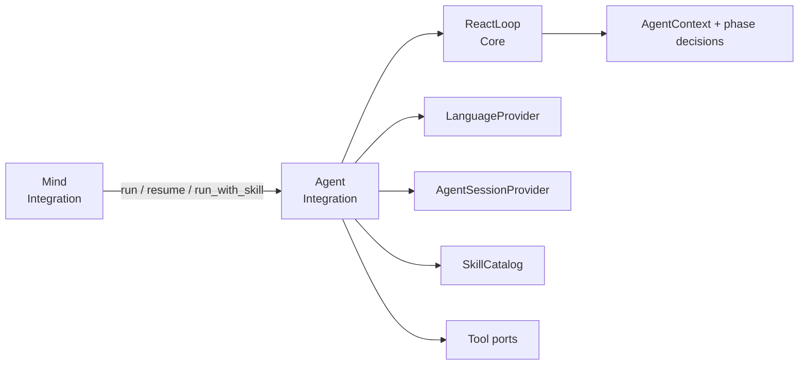

# Agent two-phase protocol

Durable module contract for selection → execution under an IODA `Agent`
Integration. Historical sources: EPIC-002 master design, TASK-014 (roles),
TASK-015 (phase models), with later additive protocol versions from
TASK-016/018.

Related: [[design/agent-skill-selection|skill selection]],
[[design/agent-execution-constraints|execution constraints]],
[[design/agent-grounded-outcomes|grounded outcomes]],
[[design/decisions/ADR-002-agent-orchestration-is-an-integration|ADR-002]],
[[design/decisions/ADR-003-control-plane-uses-system-role|ADR-003]].

## Pipeline stages

Five independently testable decisions — a correct earlier stage does not imply
a correct later one:

1. **Intent routing** — chat, agent task, or resume (owned outside this module).
2. **Skill selection** — which capability owns the outcome.
3. **Tool planning** — which tools and arguments implement the workflow.
4. **Execution** — what tools/jobs actually succeeded.
5. **Delivery** — what can truthfully be claimed (see grounded outcomes).

## Architecture

- `Mind` delegates; it does not own phase state.
- `Agent` coordinates only: Core validation → Providers/tools → typed result.
- `ReactLoop` is synchronous, static, Data-only.
- Independent validated tool calls may run via `asyncio.gather()`.

## Phase contracts

Selection and execution use separate extra-forbidding Pydantic models.
Cross-field and membership policy live in `ReactLoop`, not in the models.

| Phase | Entry | Modes | Tools |
|-------|--------|-------|-------|
| Selection | `Agent.run` | `select_skill`, `no_skill` | None — no executable schema |
| Execution | after activation, `resume`, or `run_with_skill` | `call_tools`, `finish`, `fail` | Active skill tools + infrastructure |

Rules of thumb:

- **Select before clarify.** Clarification (`ask_user`) belongs to execution
  after a skill is chosen. Selection cannot suspend.
- **`select_skill`** requires a catalog member and a non-empty self-contained
  `distilled_task`.
- **`no_skill`** is a typed unsupported terminal, not free-form prose.
- **`run_with_skill`** skips selection (scheduled / forced paths).
- **`fail`** (protocol 4+) is execution-only: `failure_reason="unsupported"`,
  no tools/answer — see [[design/agent-grounded-outcomes|grounded outcomes]].

One corrective retry budget per phase (`selection_retry_used` /
`execution_retry_used`), persisted across suspend/resume. Correction text comes
from closed `ProtocolIssue` categories — never raw model/schema/user text.
A second invalid response yields a typed stage failure and drops any pending
session.

## Suspend / resume

- Valid `ask_user` in execution appends the question, saves context (phase,
  retries, constraints, evidence), and returns a clarification result.
- `resume` continues the persisted `phase`; the user answer is a separate
  `user` message.
- Missing / non-resumable session maps to a safe ambiguous failure (grounded
  outcomes), not a successful answer.

## Protocol versions (additive)

| Version | Introduced by | Notable fields |
|---------|---------------|----------------|
| 1 | pre–TASK-015 | Legacy combined decision transcripts |
| 2 | TASK-015 | `phase`, per-phase retry flags |
| 3 | TASK-016 | `request_constraints` |
| 4 | TASK-018 | `outcome_evidence`, `terminal_failure_pending`, execution `fail` |

Load path: missing keys get safe defaults; recognized generated control
messages refresh lazily on resume. User-authored content, answers, accepted
tool history, and iteration state are preserved. Historical combined-decision
JSON is never re-parsed into new models.

## Control-plane authority

Classifier / selection / workflow / validation / agent control messages use
`system`. User tasks, clarification answers, and quoted conversation use
`user`. User-authored data is never promoted to `system`. See ADR-003.

## Code map

| Concern | Location |
|---------|----------|
| Orchestration | `yoda/mind/agent/agent.py` |
| Phase validation / messages | `yoda/mind/agent/core/react_loop.py` |
| Context + decisions | `yoda/mind/agent/data/agent_data.py` |
| Session persistence | `yoda/mind/agent/session_provider.py` |

## Historical

- [[backlog/archive/EPIC-002-agent-routing-reliability/design|EPIC-002 master design]]
- [[backlog/archive/TASK-015-phase-protocol-and-agent-integration/design|TASK-015 design]]
