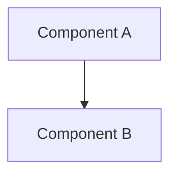

# TASK-01: Design

← [[task|Back to the task]] | [[requirements]]

## Solution overview

In one paragraph: the approach chosen and why it was chosen.

## Architecture



## Key decisions

### Decision 1: Decision name

**Context:** What problem are we solving?
**Options:** Option A / Option B
**Choice:** Option A because...

## Interfaces

### API

```
POST /api/resource
Body: { field: string }
Response: { id: string, status: string }
```

### Data model

```
Entity { id: UUID, field: string }
```

## Impact on the existing system

## Open questions

- [ ] Open questions 1